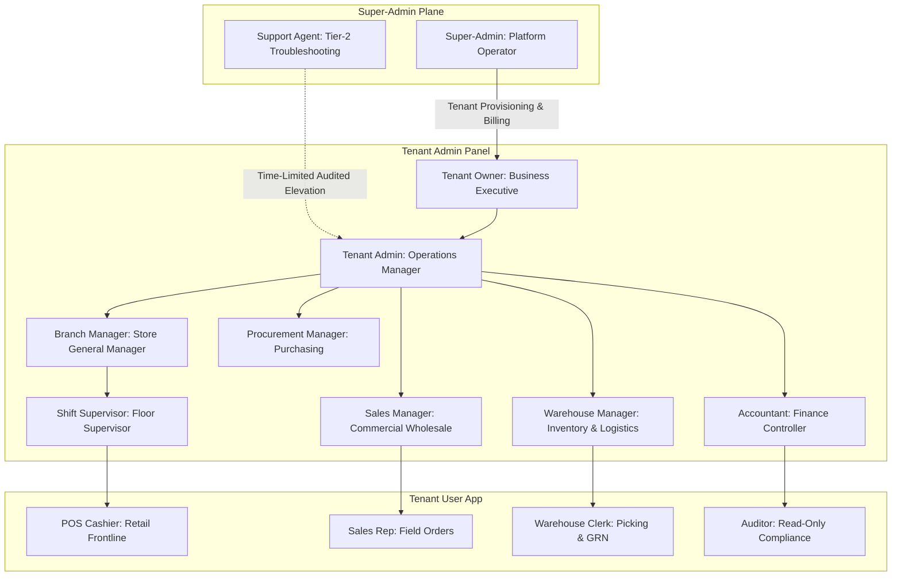
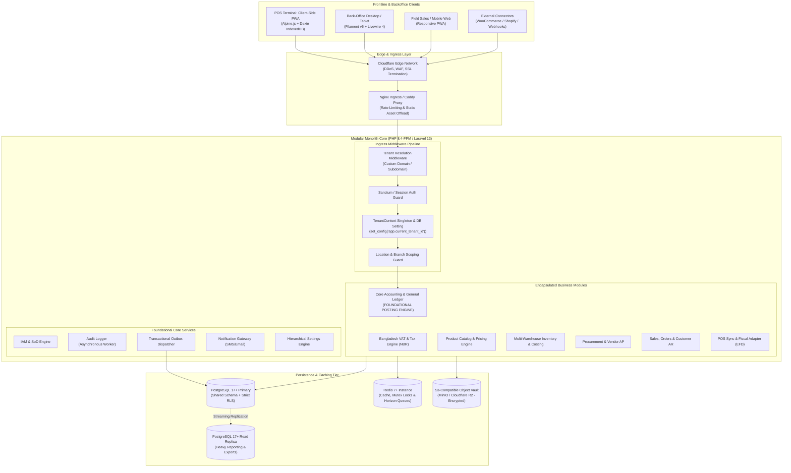
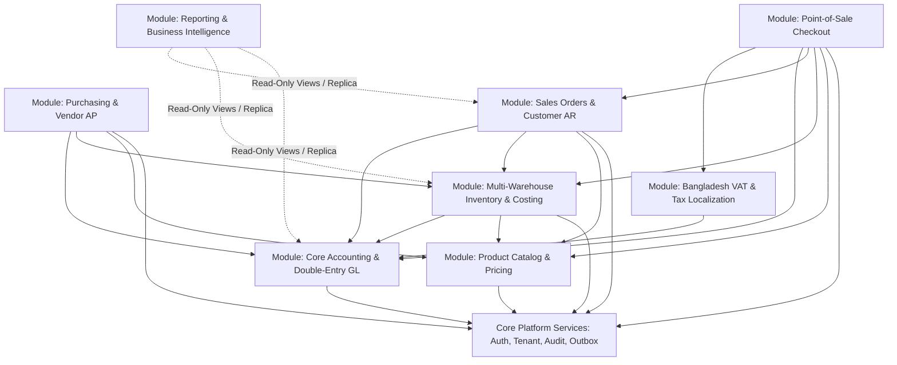
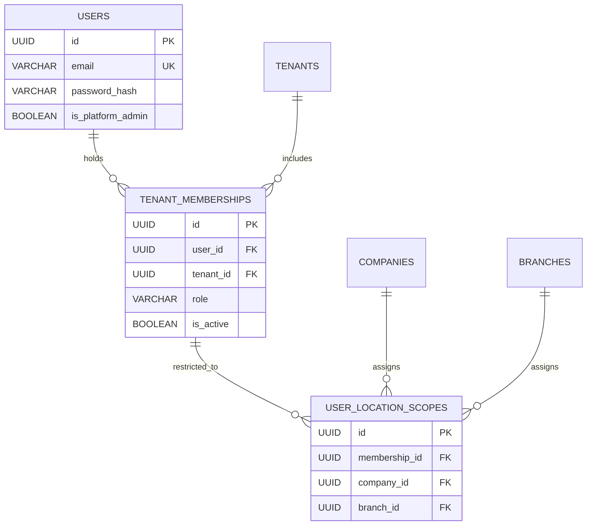
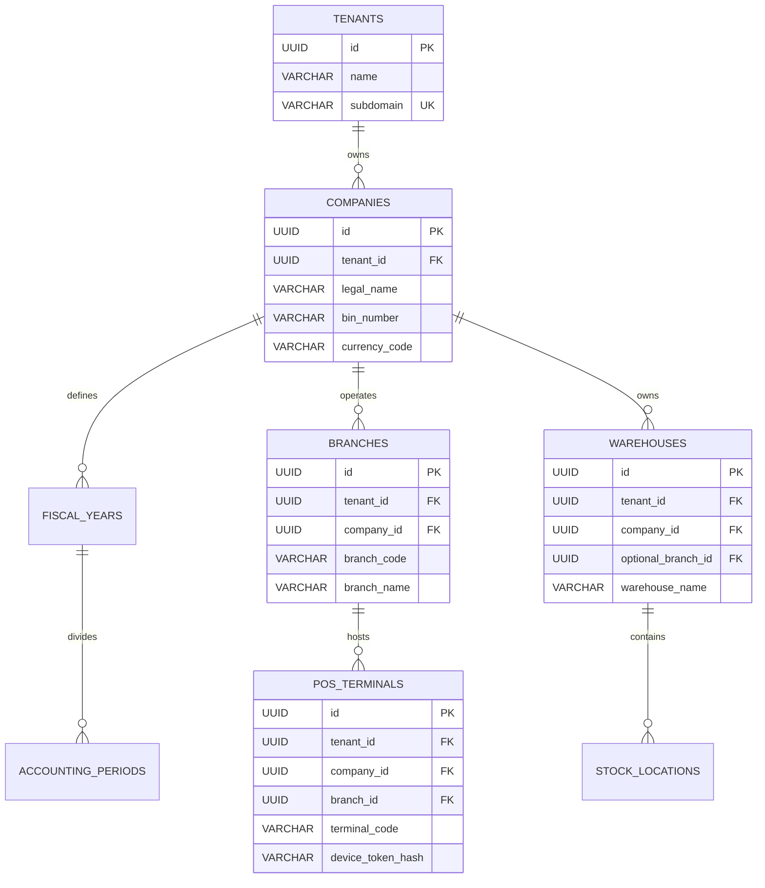
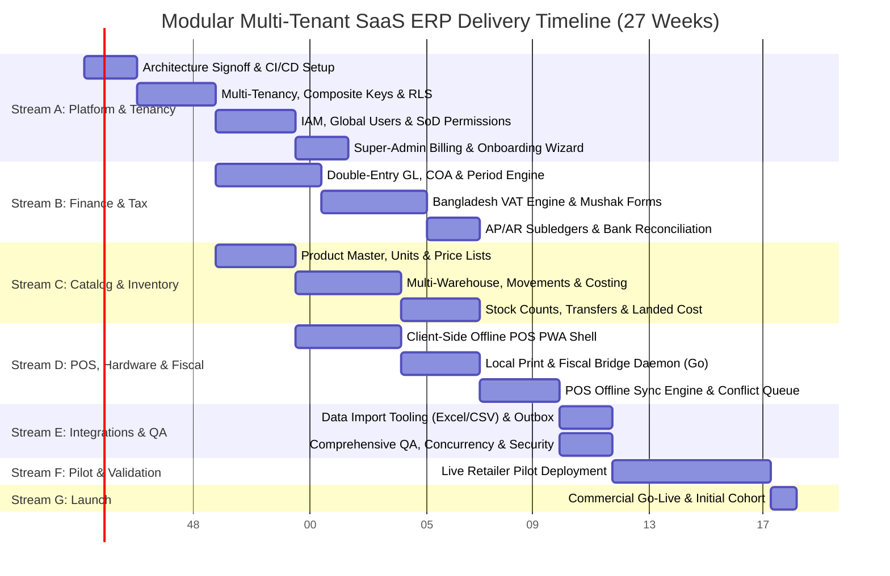

# Modular Multi-Tenant SaaS ERP Platform: System Architecture & Technical Design

- **Document Version:** 1.6.0 (Stream-A Build-Ready Engineering Architecture Specification with Proxmox Dev/Staging Environment Integration)
- **Status:** Engineering Architecture Specification (Baseline for Stream A Development - Ready for Week 1 Kickoff)
- **Review Addressed:** Comprehensive Resolution of Reviews v1.1 through v1.4.0 (Resolving NEW-23 through NEW-25, invoice & stock immutability triggers, tax exclusion constraints, company consistency, Eid capacity scaling, Stream-A staging gates, and dedicated Proxmox private cloud staging infrastructure at dev.kcerp.com)
- **Authors:** Lead Enterprise Architect & Systems Engineering Taskforce
- **Target Tech Baseline:** PHP 8.4+ / Laravel 13 / Filament v5 (Back-Office Admin) / Client-Side Alpine.js + Dexie.js IndexedDB PWA (POS Front-End) / PostgreSQL 17+ (with UUIDv7 application generation via Laravel HasUuids) / Redis 7+ / Tailwind CSS / mPDF / Local Go Print & Fiscal Bridge
- **Target Market:** Bangladesh Retail, Point-of-Sale (POS), Wholesale Distribution, Import & Trading (SMBs with 1–50 staff, scaling to 500+ staff and multi-company corporate groups)

---

## Table of Contents
1. [Executive Summary, Topology and Scope Boundaries](#1-executive-summary-topology-and-scope-boundaries)
2. [Assumptions, Constraints and Open Questions Register](#2-assumptions-constraints-and-open-questions-register)
3. [User Personas, Roles and Segregation of Duties Matrix](#3-user-personas-roles-and-segregation-of-duties-matrix)
4. [High-Level Architecture, Request Flow & Connection Sizing](#4-high-level-architecture-request-flow--connection-sizing)
5. [Module Architecture, Posting Contracts and Lifecycle](#5-module-architecture-posting-contracts-and-lifecycle)
6. [Multi-Tenancy, Data Isolation & Security Architecture](#6-multi-tenancy-data-isolation--security-architecture)
7. [Core Platform Services](#7-core-platform-services)
8. [Functional Business Modules](#8-functional-business-modules)
9. [Data Architecture & Complete PostgreSQL Schema Design](#9-data-architecture--complete-postgresql-schema-design)
10. [API Design, Outbox Pattern & Webhook Infrastructure](#10-api-design-outbox-pattern--webhook-infrastructure)
11. [UI/UX Architecture, Wireframes & Offline PWA POS](#11-uiux-architecture-wireframes--offline-pwa-pos)
12. [Security Architecture, OWASP & Bangladesh Regulatory Compliance](#12-security-architecture-owasp--bangladesh-regulatory-compliance)
13. [Scalability, Performance Engineering & Concurrency Control](#13-scalability-performance-engineering--concurrency-control)
14. [Observability, Telemetry, Metering & Health Checks](#14-observability-telemetry-metering--health-checks)
15. [DevOps, Environments & Release Engineering](#15-devops-environments--release-engineering)
16. [Comprehensive Testing Strategy & Concurrency Verification](#16-comprehensive-testing-strategy--concurrency-verification)
17. [Technology Stack Evaluation & Architectural Rationale](#17-technology-stack-evaluation--architectural-rationale)
18. [Phased Implementation Roadmap & Resource-Loaded Milestones](#18-phased-implementation-roadmap--resource-loaded-milestones)
19. [Comprehensive Risk Analysis & Mitigation Matrix](#19-comprehensive-risk-analysis--mitigation-matrix)
20. [Architecture Decision Records (ADRs) & Version Changelog](#20-architecture-decision-records-adrs--version-changelog)

---

## 1. Executive Summary, Topology and Scope Boundaries

### 1.1 Mission & Architectural Principles
The platform is an enterprise-grade, modular, multi-tenant Software-as-a-Service (SaaS) ERP engineered to deliver operational velocity, regulatory compliance, and verifiable financial integrity for small and medium-sized businesses (SMBs, 1–50 employees) with an architectural runway to support mid-market corporate groups (500+ employees, multi-company, multi-branch, multi-warehouse).

The architecture is built on six foundational principles:
1. **Financial Immutability:** Posted accounting records, issued tax invoices, and stock movements can never be modified or deleted. Corrections must proceed through linked reversal journal entries, credit notes, or stock adjustments.
2. **Double-Entry Rigor:** Every business event that impacts value is governed by a synchronous posting contract that asserts total debits equal total credits before committing to the database.
3. **Fail-Closed Tenancy:** Data isolation is enforced at the database engine level using PostgreSQL Row-Level Security (RLS) with composite foreign keys, minimizing application-level leakage risks.
4. **Offline Operational Continuity:** Frontline point-of-sale checkout is an independent, client-side Progressive Web App (PWA) with local IndexedDB persistence, operating seamlessly during power and internet outages.
5. **Pragmatic Sizing & Cost Control:** A strictly bounded modular monolith deployed on managed containers, keeping infrastructure costs between $100 and $200 per month during MVP while sustaining peak burst traffic.
6. **Regulatory Readiness:** Built-in compliance with Bangladesh VAT and Supplementary Duty Act 2012, mandatory Electronic Fiscal Devices (EFD/SDC), Mushak-6.3 tax invoicing, and the Personal Data Protection Ordinance (PDPO 2025/2026).

### 1.2 System Topology (The Three Named Layers)
To prevent numbering ambiguities, platform surfaces are identified by functional layer name:
- **Tenant User App (Operational Front-End):** High-velocity interface for cashiers, stock clerks, and field reps. Powered by an Alpine.js/Dexie.js offline-first client-side SPA for POS, and responsive mobile views for warehouse and field operations.
- **Tenant Admin Panel (Back-Office Management):** Secure administrative portal built on Filament v5 and Livewire 4 for business owners, accountants, and branch managers to configure master data, approve workflows, manage RBAC, and review financial statements.
- **Super-Admin Panel (Platform Control Plane):** Global SaaS operations portal on a separate authentication guard for platform operators to provision tenants, manage subscription billing, monitor infrastructure health, and govern module licensing.

### 1.3 Scope Boundaries & Phasing

| Category | In-Scope: Phase 1 (MVP) | Planned: Phase 2 (Growth) | Out-of-Scope (Excluded from Core) |
|---|---|---|---|
| **Organizational** | Multi-tenant SaaS, Single & Multi-Company, Branches, Warehouses, POS Terminals | Intercompany Sales & Purchases, Group Dashboards | Franchise Royalty Billing Engine |
| **Retail & POS** | Client-Side Offline POS (PWA), Barcode Scanning (USB HID), Cash Drawer, Cash Management (Float/Drops), Printed Receipt (ESC/POS), Local Print Bridge | Customer Loyalty/Points, Gift Cards, Price-Embedded Weighing Scale Barcodes | Unattended Self-Checkout Kiosks |
| **Sales & CRM** | Sales Orders, Quotations, Invoices, Delivery Challans, Customer Credit ("Baki") Limits | Sales Pipeline, Recurring Subscriptions, Field Sales Mobile GPS Tracking | Complex Lead Opportunity Scoring |
| **Procurement** | Purchase Orders, Goods Receipt (GRN), Landed Costs (Basic), Vendor Bills, Vendor Credit | Vendor RFQ / Competitive Bidding Portal, Supplier Performance Scoring | International Freight Forwarding Optimization |
| **Inventory** | Multi-Warehouse, Stock Movements Ledger, Batch & Expiry Tracking, FIFO / Weighted Avg Costing, Stock Counts | Serial Number & Warranty Tracking, Cycle Counting Automation, Inter-Branch Transfer Challans (Mushak 6.5) | Automated Robotics Warehouse (ASRS) |
| **Finance** | Double-Entry General Ledger, Chart of Accounts, Cash/Bank Reconciliation, AP/AR Subledgers, Financial Statements (P&L, Balance Sheet) | Fixed Asset Depreciation, Bank Statement Auto-Feed Parser | Speculative Algorithmic FX Trading |
| **Tax & VAT** | Bangladesh VAT Engine (15%, 10%, 7.5%, 5%, 0%, Exempt), Mushak 6.3 Invoicing, EFD/SDC Fiscal Adapter, VDS (Mushak 6.6) | Full Mushak 9.1 Return Generation, Commercial Import Duties (CD/RD/SD/VAT/AT/AIT) | International Tax Regimes (US Sales Tax) |
| **HR & Payroll** | Excluded from MVP (Basic employee directory in Tenant Admin for user RBAC only) | Full HRM: Attendance, Leave Management, Salary Slips, Bangladesh Provident Fund | Biometric Fingerprint Hardware Driver |
| **Manufacturing** | Excluded from MVP | Light Assembly / Bill of Materials (BOM) Kit Packing | Heavy Process Manufacturing MRP II |
| **Integrations** | Local SMS Gateway (OTP/Alerts), WooCommerce Sync Foundation, Outbound Webhooks | Shopify Connector, Pathao / Steadfast Courier APIs, bKash / Nagad Direct Merchant Gateways | Deep Core-Banking SWIFT Integrations |

---

## 2. Assumptions, Constraints and Open Questions Register

### 2.1 Explicit Architectural Assumptions
- **A-01 (Hardware Interfaces):** Standard retail POS hardware in Bangladesh uses USB HID barcode scanners (keyboard wedge emulation) and ESC/POS thermal printers (58mm/80mm). Receipts with Bangla text are rendered client-side as bitmap/raster images before streaming ESC/POS bytes.
- **A-02 (Connectivity & Power):** Outlets face regular internet disconnects and power load-shedding. The POS supports continuous offline checkout for at least an entire business day (8–12 hours) without data loss or terminal lockouts.
- **A-03 (Financial Immutability):** Direct SQL `UPDATE` and `DELETE` queries are forbidden on posted financial rows, issued sales invoices, and stock movements. Posted entries are modified strictly via reversing journal entries or credit notes.
- **A-04 (Monetary Math Precision):** All monetary values in the database use `DECIMAL(18, 4)`. Internal computations use arbitrary-precision libraries (`brick/math` in PHP; integer minor units in JavaScript). JSON APIs transmit monetary figures strictly as strings (e.g., `"12500.00"`) to prevent floating-point truncation in client parsers.
- **A-05 (Tax Regime Precedence):** Shelf prices in retail supermarkets are tax-inclusive (MRP), while wholesale and B2B invoices are tax-exclusive. The tax engine supports both calculation models per price list.
- **A-06 (Dedicated Proxmox Private Cloud Dev/Staging Host):** Development, continuous integration, and staging environments are hosted on a dedicated private Proxmox VE server (`tofa-prox.hprbd.com`) in LXC Container 104 (`dev.kcerp.com`), equipped with 4 vCPUs, 40GB RAM, 80GB NVMe storage, and internal IP `192.168.100.104`. Public web ingress to `dev.kcerp.com` is terminated at the host/network reverse proxy and forwarded internally to `http://192.168.100.104:8080`.

### 2.2 System Performance Constraints & SLOs
- **C-01 (Cloud Infrastructure Budget):** Initial combined hosting cost for Dev, Staging, and Production is budgeted at **$100 to $200 per month**. High-overhead orchestration (Kubernetes, Kafka) is prohibited for Phase 1.
- **C-02 (Team Composition):** 3–5 engineers (1 Tech Lead, 2 Full-Stack Laravel/Filament devs, 1 Frontend/PWA dev, 1 QA/DevOps engineer). Technology choices leverage established ecosystem packages.
- **C-03 (Latency Thresholds):**
  - POS barcode scan & cart add: p95 <= 50 ms (client-side IndexedDB).
  - POS checkout commit (online): p95 <= 500 ms (server transaction).
  - Back-office Filament CRUD page load: p95 <= 1.2 s.
- **C-04 (Availability & Recovery):**
  - Production Availability SLO: 99.9% uptime for API and POS sync endpoints.
  - Recovery Point Objective (RPO): < 5 minutes (continuous PostgreSQL WAL archiving).
  - Recovery Time Objective (RTO): < 30 minutes (automated container redeploy + point-in-time restore).

### 2.3 Open Questions & Decisions Register

| ID | Topic | Question / Issue | Architectural Resolution / Default Stance | Owner | Target Decision Date |
|---|---|---|---|---|---|
| **OQ-01** | **NBR EFD/SDC Mandate** | Are fiscal devices mandatory for MVP retail launch? | **Yes.** EFD/SDC integration is legally required for 25 retail categories in Bangladesh. An EFD/SDC fiscal adapter is included in Phase 1 scope. | Legal / Tax Lead | Target: Week 2 |
| **OQ-02** | **Offline Stock Collisions** | How are stock conflicts resolved when offline terminals oversell a product? | **Resolution:** Terminal checkout is never rejected on sync. If server inventory is insufficient, the transaction posts, inventory records a supervised negative variance, and an urgent discrepancy alert is created for the Branch Manager. Online checkout rejects insufficient stock. | Product Owner | Target: Week 4 |
| **OQ-03** | **Invoice Numbering vs Gapless Law** | How can offline POS issue gapless tax invoices? | **Resolution:** Terminals are assigned unique, pre-allocated sequential number blocks (e.g., `INV-DHA01-T01-000001`). Offline receipts carry this formal number, matching NBR branch/terminal series rules. | Legal / Tax Lead | Target: Week 2 |
| **OQ-04** | **Data Residency & Staging Hosting** | Where are development, staging, and production environments hosted? | **Resolution:** Development and staging are deployed to the private Proxmox cluster (`tofa-prox.hprbd.com`, LXC 104 `dev.kcerp.com`), eliminating cloud droplet costs while providing 40GB RAM for high-load concurrency testing. Production defaults to Singapore / Bangladesh-compliant infrastructure with daily offsite backups. | Infrastructure Lead | Closed (Week 1) |

---

## 3. User Personas, Roles and Segregation of Duties Matrix

### 3.1 Persona Catalog Across the Three Named Layers



### 3.2 Comprehensive RBAC Permission Matrix (Resolving SEC-01 & NEW-12)

| Module / Operational Capability | Super-Admin | Tenant Owner | Tenant Admin | Branch Mgr | Shift Supv | Accountant | Procurement Mgr | Sales Mgr | Warehouse Mgr | Cashier | Sales Rep | Auditor |
|---|:---:|:---:|:---:|:---:|:---:|:---:|:---:|:---:|:---:|:---:|:---:|:---:|
| **Platform Tenants & Billing Plans** | Full | None | None | None | None | None | None | None | None | None | None | None |
| **Tenant Settings & Company Profile**| Read* | Full | Full | Read | Read | Read | Read | Read | Read | None | None | Read |
| **User & Role Assignments** | None* | Full | Full (Non-Fin)| Branch-Users| None | None | None | None | None | None | None | None |
| **Product Catalog & Master Price**| None | Full | Full | Read | Read | Read | Read | Read | Read | Read-Only | Read-Only | Read |
| **POS Terminal Shift (Open/Close)**| None | Full | Manage | Manage | Manage | None | None | None | None | Execute | None | Read |
| **POS Checkout & Cash Sales** | None | Full | Full | Full | Full | Read | None | None | None | Execute | None | Read |
| **Cashier Price Discount Override**| None | Override | Disallowed | Max 15% | Max 10% | None | None | Max 15% | None | Max 5% | Disallowed | None |
| **Credit Sales ("Baki") Approval**| None | Approve | Approve | Approve | Disallowed | Approve | None | Approve | None | Within Limit| Draft | Read |
| **Inventory Movements & GRN Inward**| None | Full | Full | Branch Only| Branch Only| Read | Read (GRN) | None | Full | None | None | Read |
| **Stock Adjustments / Scrap Writeoff**| None | Approve | Approve | Review | Create Draft| Review | None | None | Create Draft | None | None | Read |
| **Purchase Orders & Vendor Bills** | None | Full | Full | Branch PO | None | Full | Full | None | Read (GRN) | None | None | Read |
| **Sales Orders & Commercial Quotes** | None | Full | Full | Full | None | Read | None | Full | None | None | Create | Read |
| **Double-Entry Journals & GL Posts**| None | Full | Read | Read | None | Full | None | None | None | None | None | Read |
| **Period Lock & Month-End Close** | None | Full | Disallowed | Disallowed | None | Execute | None | None | None | None | None | Read |
| **Bank & Cash Drawers Reconciliation**| None | Full | Read | Branch Close| Shift Review| Full | None | None | None | Shift Reconcile| None| Read |
| **Mushak VAT Reports (6.1, 6.2, 6.3)**| None | Full | Read | Branch 6.3 | None | Full | None | Read | None | 6.3 Print | None | Full Read |
| **Audit Log Trail Inspection** | Platform | Full | Full | Branch Logs| None | Read-Only | None | None | None | None | None | Full Read |

*\*Note 1: Super-Admins access tenant data strictly via time-limited, audited elevation tokens requiring explicit tenant consent.*  
*\*Note 2: Discount ceilings are enforced in code. Cashiers exceeding 5% trigger an inline supervisor PIN elevation modal; discounts over 15% require Tenant Owner authorization.*

### 3.3 Segregation of Duties (SoD) Conflict Rules
To prevent fraud and maintain accounting integrity, the authorization engine enforces hard SoD rules:
1. **Rule SoD-01 (Purchase & Pay Conflict):** A user who creates or approves a Purchase Order cannot post the corresponding Supplier Payment.
2. **Rule SoD-02 (Supplier Creation & Payment):** A user who creates or edits a Supplier record cannot authorize disbursements to that supplier.
3. **Rule SoD-03 (Inventory Count & Adjustment):** A warehouse clerk who performs physical stock counts cannot approve stock write-off adjustments.
4. **Rule SoD-04 (Role Escalation Prevention):** Tenant Administrators cannot assign the `Accountant` or `Tenant Owner` role to themselves without explicit counter-signature from the registered Tenant Owner.
5. **Rule SoD-05 (Super-Admin Elevation Protocol):** When a platform support engineer impersonates a tenant for troubleshooting:
   - The Tenant Owner must toggle an in-app "Allow Support Access" switch with a time limit (max 4 hours).
   - Impersonation logs an immutable audit event with the support ticket reference.
   - An active visual banner warns that support access is in progress.
   - Impersonation is read-only by default; write permissions require two-factor confirmation by the Tenant Owner.

---

## 4. High-Level Architecture, Request Flow & Connection Sizing

### 4.1 System Topology & Infrastructure Blueprint



### 4.2 Request Lifecycle & Connection Sizing Budget (Resolving TEN-01, NEW-05)
1. **Host Extraction:** The Nginx reverse proxy passes the request to PHP-FPM. The `TenantResolutionMiddleware` extracts the tenant identifier from the hostname (e.g., `outlet1.apex.com.bd` or `apex.saas-erp.com`).
2. **Credential Authentication:** Authentication verifies the tenant membership. The request header `X-Tenant-ID` is **never trusted** to select the tenant; it is verified strictly as an assertion check against the authenticated user's active tenant session (TEN-05).
3. **Database Connection & RLS Binding (TEN-01 Remediation):**
   - The application runs on **PHP-FPM** with dedicated database connections per process (or PgBouncer configured strictly in **Session Pooling** mode for Phase 1).
   - Upon connection checkout, the middleware executes:
     ```php
     DB::statement("SELECT set_config('app.current_tenant_id', :tenant_id, false)", [
         'tenant_id' => $tenant->id
     ]);
     ```
   - Passing `false` as the third parameter scopes the configuration variable to the entire database session rather than a single transaction block. This guarantees that all read queries (including standard Filament resource listings) respect RLS policies without requiring synthetic transaction wrappers.
4. **Teardown & Cleanup:** In middleware termination (`terminate()` callback) and queue worker job loops, the session variable is explicitly cleared:
   ```php
   DB::statement("SELECT set_config('app.current_tenant_id', '', false)");
   ```
   PgBouncer's `server_reset_query = DISCARD ALL` provides a backstop if a worker process terminates abruptly.
5. **Database Connection Sizing Budget (Resolving NEW-05):**
   - Managed PostgreSQL plans on 2GB RAM tiers (such as DigitalOcean Managed Databases) enforce a strict ceiling of **47 concurrent backend connections** (larger 4GB/8GB tiers offer 97 to 197 connections).
   - **Strict Connection Budget (Capped at 44 Connections):**
     - Web Application Containers: Exactly 2 containers, each configured with `pm.max_children = 12` (Total: 24 connections).
     - Rolling Deployment Surge Buffer: 6 connections.
     - Laravel Horizon Background Workers: 8 worker processes.
     - Laravel Reverb (WebSocket Daemon): 3 connections.
     - Reserved for Super-Admin / Migrations: 3 connections.
     - **Total Primary Peak Load:** 24 + 6 + 8 + 3 + 3 = **44 connections**, operating safely within the 47-connection limit.
     - Reporting Queries: Routed exclusively to the separate PostgreSQL Read Replica (allocated 30 connections).
   - *Autoscaling Policy (Resolving NEW-05):* Horizontal autoscaling in Phase 1 is **strictly capped at 2 instances**. Scaling to 3 or more instances is prohibited until PgBouncer is transitioned to Transaction Pooling mode with PDO transaction wrappers.

---

## 5. Module Architecture, Posting Contracts and Lifecycle

### 5.1 Inverted Module Dependency Hierarchy (Resolving MOD-01)
To ensure the ledger is the immutable bedrock of the ERP, the dependency direction is inverted: **Accounting is foundational**. Operational modules (Sales, Purchasing, Inventory, POS) depend on Accounting by implementing its strict **Posting Contract**.



### 5.2 The Comprehensive Module Contract (Resolving MOD-02)
Every functional module implements the complete `ModuleInterface`:

```php
namespace App\Core\Contracts;

interface ModuleInterface
{
    public function getIdentifier(): string;          // e.g., 'inventory'
    public function getName(): string;                // e.g., 'Multi-Warehouse Inventory'
    public function getVersion(): string;             // Platform-wide semantic version, e.g. '1.1.0'
    public function getDependencies(): array;         // e.g., ['catalog', 'accounting']
    public function registerRoutes(): void;
    public function registerPermissions(): array;
    public function registerFilamentResources(): array;
    public function registerScheduledTasks(): void;
    public function registerEventSubscribers(): void;
    public function registerSettingsSchema(): array;
    public function seedDefaultData(string $tenantId, string $companyId): void;
    public function runHealthCheck(string $tenantId): HealthCheckResult;
}
```

### 5.3 Module Lifecycle & Feature Flags (Resolving MOD-03 & MOD-04)
To resolve the conflict between a single deployable monolith and per-tenant module enablement:
1. **Platform Release State Machine:** Discovered -> Testing -> Published -> Deprecated -> Retired. (Governed platform-wide by codebase deployments).
2. **Tenant Subscription State Machine:** Plan-Included -> Tenant-Enabled -> Tenant-Disabled -> Suspended.
3. **Feature Flagging:** Module activation per tenant is evaluated via **Laravel Pennant**:
   ```php
   Feature::for($tenant)->active('module-pos');
   ```
4. **Disabling Guards:** A module cannot be disabled if:
   - Another enabled module depends on it (e.g., cannot disable Inventory while Sales is active).
   - Open draft or unposted transactions exist within the module.
   - Deactivation preserves all historical data in a read-only state; destructive schema rollbacks are strictly forbidden on active tenant databases.

### 5.4 Cross-Module Communication & Synchronous GL Posting (Resolving MOD-06)
- **Synchronous Financial Posting:** Any business transaction with financial impact (sales invoice, purchase bill receipt, payment, inventory revaluation) invokes the `AccountingPostingService` **within the exact same database transaction**. Asynchronous ledger posting is strictly forbidden.
- **Asynchronous Domain Events:** Side effects that do not alter the balance sheet (email receipts, customer SMS, webhook notifications, search re-indexing) are recorded to the transactional outbox table and dispatched asynchronously via Redis queue workers.

### 5.5 Transactional Outbox Specification (Resolving MOD-07)
The outbox table schema guarantees reliable event delivery:

```sql
CREATE TABLE transactional_outbox (
    id UUID PRIMARY KEY, -- Application-generated UUIDv7
    tenant_id UUID NOT NULL REFERENCES tenants(id) ON DELETE RESTRICT,
    aggregate_type VARCHAR(100) NOT NULL, -- 'SalesInvoice', 'StockMovement'
    aggregate_id UUID NOT NULL,
    event_type VARCHAR(100) NOT NULL,    -- 'sales.invoice.posted'
    event_version INT NOT NULL DEFAULT 1,
    payload JSONB NOT NULL,
    status VARCHAR(30) NOT NULL DEFAULT 'pending', -- 'pending', 'processing', 'published', 'failed'
    attempts INT NOT NULL DEFAULT 0,
    max_attempts INT NOT NULL DEFAULT 5,
    last_error TEXT,
    scheduled_at TIMESTAMPTZ NOT NULL DEFAULT NOW(),
    processed_at TIMESTAMPTZ,
    created_at TIMESTAMPTZ NOT NULL DEFAULT NOW(),
    CONSTRAINT uq_outbox_tenant_id UNIQUE (tenant_id, id)
);

CREATE INDEX idx_outbox_unprocessed ON transactional_outbox (status, scheduled_at) 
WHERE status IN ('pending', 'processing');
```

The outbox processor uses PostgreSQL `FOR UPDATE SKIP LOCKED` on the primary database, ensuring high-throughput parallel queue consumption without deadlock risks.

---

## 6. Multi-Tenancy, Data Isolation & Security Architecture

### 6.1 Database Roles & Cross-Tenant Job Execution (Resolving TEN-03, NEW-04, NEW-14)
The PostgreSQL database utilizes distinct operational roles to enforce least privilege:
1. `migrator`: Schema owner. Executes DDL migrations during CI/CD deployments. Possesses zero runtime credentials in the web application.
2. `app_rw`: Standard application connection user. Possesses `SELECT`, `INSERT`, `UPDATE` (where allowed), `DELETE` (where allowed) on tenant tables. **Does not possess `BYPASSRLS`**.
3. `platform_ro`: Super-Admin and telemetry user. Read-only connection across global platform tables and dedicated aggregated rollup views. **Possesses zero direct row-level access to tenant ledgers or customer transactions (NEW-14).**
4. `reporting_ro`: Dedicated connection user routed exclusively to the PostgreSQL read replica for long-running financial exports and analytics.

#### Cross-Tenant Job Execution Model (Resolving NEW-04):
Background jobs that monitor or process across tenants (the Integrity Watchdog, Metering Rollup Jobs, and Outbox Workers) operate as follows:
- The worker runs under the `app_rw` role.
- For jobs that process a specific tenant, the job sets the session tenant context:
  `SELECT set_config('app.current_tenant_id', :tenant_id, false);`
- For jobs that aggregate across tenants (such as the Outbox Dispatcher), the job iterates the list of active tenants, setting the tenant context for each iteration. This guarantees that `FORCE ROW LEVEL SECURITY` is strictly respected across all background workers, preventing any un-scoped cross-tenant leakage.

### 6.2 Composite Keys & Foreign Key Isolation (Resolving TEN-02, NEW-22)
PostgreSQL referential integrity checks bypass Row-Level Security. To prevent a compromised or buggy query in Tenant A from referencing a record in Tenant B:
- **Mandatory Composite Unique Keys:** Every tenant-scoped table enforces `UNIQUE (tenant_id, id)`.
- **Mandatory Company-Consistency Keys (NEW-22):** Company-scoped operational tables enforce `UNIQUE (tenant_id, company_id, id)`.
- **Mandatory Composite Foreign Keys:** All foreign keys must include `tenant_id` and, where applicable, `company_id`:
  ```sql
  FOREIGN KEY (tenant_id, company_id, account_id) REFERENCES chart_of_accounts(tenant_id, company_id, id) ON DELETE RESTRICT
  ```
This structurally prevents cross-tenant and cross-company data references at the database engine level, causing an immediate foreign key constraint violation if cross-tenant IDs are submitted.

### 6.3 Fail-Closed Row-Level Security Policies
Every tenant table enforces RLS via the fail-closed pattern:

```sql
ALTER TABLE journal_entries ENABLE ROW LEVEL SECURITY;
ALTER TABLE journal_entries FORCE ROW LEVEL SECURITY;
```

### 6.4 Non-Database Multi-Tenant Isolation (Resolving TEN-09)
Data isolation is extended across every caching and storage tier:
1. **Redis Cache Partitioning:** The application wraps the Redis store to prefix all keys with the tenant UUID: `cache:{tenant_id}:{key}`.
2. **Permission Cache Scoping:** `spatie/laravel-permission` is configured in team mode, utilizing `tenant_id` as the team key, ensuring permission caches never bleed across tenants.
3. **S3 File Storage Isolation:** Object storage buckets partition files into dedicated tenant prefixes: `s3://tenant-vault/{tenant_id}/{company_id}/invoices/{year}/{file_uuid}.pdf`. Direct public URLs are disabled; downloads use short-lived presigned URLs (60-second TTL).

### 6.5 User Identity & Multi-Tenant Membership (Resolving TEN-10)
A clean separation is maintained between authentication identity and tenant authorization:



This model enables external accountants, auditors, and multi-business owners to authenticate with a single credential and switch between authorized tenant organizations without credential duplication.

---

## 7. Core Platform Services

### 7.1 Notification Gateway (Resolving CORE-01)
A multi-channel notification engine handles mission-critical alerts:
- **Channels:** Email (SMTP / SES), Local SMS (Bangladeshi aggregators e.g., Onnorokom SMS, Greenweb, SSL Wireless), In-App Filament database notifications, and planned WhatsApp Business API.
- **Templates:** Dual-locale template engine supporting dynamic Bangla (Unicode) and English variables.
- **SMS Cost Metering:** Outbound SMS dispatches decrement a prepaid tenant SMS credit balance or log billable usage units to `tenant_usage_rollups`.

### 7.2 Report & Export Streaming Engine (Resolving CORE-02)
To prevent web process timeouts and memory exhaustion:
- Standard reports (< 1,000 rows) render synchronously in Filament tables.
- Heavy exports (Ledger registers, Mushak-6.1/6.2 books, annual inventory valuation) are offloaded to `queue-reports` workers.
- Workers stream data in chunks of 500 rows, generate Excel/CSV via FastExcel or PDF via mPDF, persist the result to the encrypted S3 vault, and generate an authenticated temporary download token that issues a fresh 60-second presigned S3 URL upon redemption.

### 7.3 Hierarchical Settings Engine (Resolving CORE-03)
Settings follow a strict cascading inheritance model:  
**Platform Default -> Tenant -> Legal Entity (Company) -> Branch -> POS Terminal.**
- A setting defined at the Tenant level (e.g., default currency = `BDT`) cascades to all branches unless explicitly overridden at the Company or Branch level.
- Changes to critical settings (e.g., VAT tax regime, cash rounding rule) are logged in the audit trail and immediately invalidate the tenant's cached settings tree.

### 7.4 Real-Time WebSocket Infrastructure (Resolving CORE-04)
Real-time dashboard updates, cash drawer open alerts, and active POS price updates are delivered via **Laravel Reverb** (self-hosted WebSocket daemon, zero extra external cost). Channels are strictly tenant-isolated: `private-tenant.{tenant_id}.branch.{branch_id}`.

### 7.5 Localization Engine & Date Disambiguation (Resolving DATA-07, DATA-08 & NEW-09)
- **Clear Separation of Dates (Resolving NEW-09):**
  - `invoice_date` (DATE): The local calendar date (`Asia/Dhaka`) on which the sale occurred. **This date authoritatively drives VAT return periods and statutory tax registers.**
  - `business_date` (DATE): The operational shift date. Used strictly for register cash reconciliation and management reporting when a night shift crosses midnight.
- **Bilingual Master Data:** Master data entities (Products, Categories, Tax Codes) maintain dual fields: `name_en` (English) and `name_bn` (Bangla Unicode).
- **Bangla PDF Text Shaping:** PDFs are generated using **mPDF** configured with free Unicode Bangla fonts (SolaimanLipi / Noto Sans Bengali), ensuring complex Bengali conjuncts render accurately on tax invoices and receipts.

---

## 8. Functional Business Modules

### 8.1 Reconciled Organizational Entity Model (Resolving DATA-02)



### 8.2 Detailed Breakdown of Core Business Modules
1. **Catalog & Pricing Engine:** Supports hierarchical categories, brands, variants, barcode/SKUs, Units of Measure (Carton/Pack/Piece conversions), printed Maximum Retail Price (MRP), tax-inclusive retail pricing, and tax-exclusive wholesale tier price lists.
2. **Client-Side POS Module:** High-speed barcode checkout, customer credit ("Baki") validation, register shift management (opening float, cash pickups/drops, physical denomination count, over/short variance postings to GL), and ESC/POS receipt generation.
3. **Electronic Fiscal Device (EFD/SDC) Adapter:** Communicates with NBR-certified Sales Data Controllers via local HTTP/serial bridge to obtain digital fiscal invoice signatures before the final receipt prints.
4. **Sales & Customer Receivables (AR):** Quotations, Sales Orders, Delivery Challans, Invoices, Customer Credit Limits, Due Payment Receipts, and Aging Registers.
5. **Multi-Warehouse Inventory & Costing:** Real-time stock movements ledger, batch and expiry tracking, FIFO cost layers, weighted average costing, in-transit transfer tracking (Mushak 6.5 compliant), and cycle stock count sessions.
6. **Procurement & Supplier Payables (AP):** Purchase Requisitions, Purchase Orders, Goods Received Notes (GRN), Landed Cost allocations (freight/customs), Vendor Invoices, and Supplier Payment Vouchers.
7. **Core Accounting & General Ledger:** Chart of Accounts, Double-Entry Balanced Journals, Fiscal Period Locking, Bank/Cash Reconciliations, Accounts Receivable/Payable subledgers, Trial Balance, Profit & Loss, and Balance Sheet.
8. **Bangladesh VAT & NBR Localization:** Automatic rate engine (15%, 10%, 7.5%, 5%, Exempt, Turnover Tax), Mushak 6.3 Tax Invoices, Mushak 6.1 (Purchases), Mushak 6.2 (Sales), Mushak 6.6 (VDS Certificates), Mushak 6.7 (Credit Notes), and Mushak 6.8 (Debit Notes).

---

## 9. Data Architecture & Complete PostgreSQL Schema Design

### 9.1 Complete DDL with Composite Keys, Company Consistency & UUIDv7 (Resolving TEN-02, DATA-01, DATA-02, NEW-16, NEW-17, NEW-19, NEW-20, NEW-22, NEW-23, NEW-24)

```sql
-- Extensions Required
CREATE EXTENSION IF NOT EXISTS "pg_trgm";
CREATE EXTENSION IF NOT EXISTS "btree_gist";

-- 1. Tenants (Platform Root)
CREATE TABLE tenants (
    id UUID PRIMARY KEY, -- Application-generated UUIDv7 via Laravel HasUuids
    name VARCHAR(255) NOT NULL,
    subdomain VARCHAR(100) UNIQUE NOT NULL,
    custom_domain VARCHAR(255) UNIQUE,
    subscription_plan VARCHAR(50) NOT NULL DEFAULT 'starter',
    status VARCHAR(50) NOT NULL DEFAULT 'active',
    data_residency_region VARCHAR(50) NOT NULL DEFAULT 'sgp-1',
    created_at TIMESTAMPTZ NOT NULL DEFAULT NOW(),
    updated_at TIMESTAMPTZ NOT NULL DEFAULT NOW()
);

-- 2. Companies (Legal Entities under Tenant)
CREATE TABLE companies (
    id UUID PRIMARY KEY,
    tenant_id UUID NOT NULL REFERENCES tenants(id) ON DELETE RESTRICT,
    legal_name VARCHAR(255) NOT NULL,
    bin_number VARCHAR(50),
    base_currency VARCHAR(10) NOT NULL DEFAULT 'BDT',
    fiscal_year_start_month INT NOT NULL DEFAULT 7,
    tax_regime VARCHAR(50) NOT NULL DEFAULT 'standard_vat',
    created_at TIMESTAMPTZ NOT NULL DEFAULT NOW(),
    updated_at TIMESTAMPTZ NOT NULL DEFAULT NOW(),
    CONSTRAINT uq_companies_tenant_id UNIQUE (tenant_id, id)
);

-- 3. Tax Codes & Effective-Dated Rates with Exclusion Constraint (Resolving NEW-17, NEW-20, NEW-22)
CREATE TABLE tax_codes (
    id UUID PRIMARY KEY,
    tenant_id UUID NOT NULL,
    company_id UUID NOT NULL,
    code VARCHAR(50) NOT NULL, -- e.g., 'VAT-STANDARD', 'VAT-REDUCED-5', 'EXEMPT'
    title VARCHAR(255) NOT NULL,
    is_active BOOLEAN NOT NULL DEFAULT TRUE,
    created_at TIMESTAMPTZ NOT NULL DEFAULT NOW(),
    CONSTRAINT uq_tax_codes_tenant_id UNIQUE (tenant_id, id),
    CONSTRAINT uq_tax_codes_company_id UNIQUE (tenant_id, company_id, id),
    CONSTRAINT uq_tax_code_per_company UNIQUE (tenant_id, company_id, code),
    CONSTRAINT fk_tax_codes_company FOREIGN KEY (tenant_id, company_id) REFERENCES companies(tenant_id, id) ON DELETE RESTRICT
);

CREATE TABLE tax_code_rates (
    id UUID PRIMARY KEY,
    tenant_id UUID NOT NULL,
    company_id UUID NOT NULL,
    tax_code_id UUID NOT NULL,
    vat_rate DECIMAL(5, 2) NOT NULL DEFAULT 0.00,
    supplementary_duty_rate DECIMAL(5, 2) NOT NULL DEFAULT 0.00,
    effective_from DATE NOT NULL,
    effective_to DATE,
    created_at TIMESTAMPTZ NOT NULL DEFAULT NOW(),
    CONSTRAINT uq_tax_code_rates_tenant_id UNIQUE (tenant_id, id),
    CONSTRAINT fk_tax_rates_code FOREIGN KEY (tenant_id, company_id, tax_code_id) REFERENCES tax_codes(tenant_id, company_id, id) ON DELETE RESTRICT,
    -- PostgreSQL btree_gist Exclusion Constraint Prevents Overlapping Rate Periods (NEW-20)
    CONSTRAINT uq_no_overlapping_tax_rates EXCLUDE USING gist (
        tenant_id WITH =,
        company_id WITH =,
        tax_code_id WITH =,
        daterange(effective_from, COALESCE(effective_to, '9999-12-31'::date), '[]') WITH &&
    )
);

-- 4. Branches (Outlets / Stores)
CREATE TABLE branches (
    id UUID PRIMARY KEY,
    tenant_id UUID NOT NULL,
    company_id UUID NOT NULL,
    branch_code VARCHAR(50) NOT NULL,
    branch_name VARCHAR(255) NOT NULL,
    address TEXT,
    phone VARCHAR(50),
    is_active BOOLEAN NOT NULL DEFAULT TRUE,
    created_at TIMESTAMPTZ NOT NULL DEFAULT NOW(),
    updated_at TIMESTAMPTZ NOT NULL DEFAULT NOW(),
    CONSTRAINT uq_branches_tenant_id UNIQUE (tenant_id, id),
    CONSTRAINT uq_branches_company_id UNIQUE (tenant_id, company_id, id),
    CONSTRAINT uq_branch_code_per_company UNIQUE (tenant_id, company_id, branch_code),
    CONSTRAINT fk_branches_company FOREIGN KEY (tenant_id, company_id) REFERENCES companies(tenant_id, id) ON DELETE RESTRICT
);

-- 5. Warehouses
CREATE TABLE warehouses (
    id UUID PRIMARY KEY,
    tenant_id UUID NOT NULL,
    company_id UUID NOT NULL,
    optional_branch_id UUID,
    warehouse_code VARCHAR(50) NOT NULL,
    warehouse_name VARCHAR(255) NOT NULL,
    is_active BOOLEAN NOT NULL DEFAULT TRUE,
    created_at TIMESTAMPTZ NOT NULL DEFAULT NOW(),
    updated_at TIMESTAMPTZ NOT NULL DEFAULT NOW(),
    CONSTRAINT uq_warehouses_tenant_id UNIQUE (tenant_id, id),
    CONSTRAINT uq_warehouses_company_id UNIQUE (tenant_id, company_id, id),
    CONSTRAINT uq_wh_code_per_company UNIQUE (tenant_id, company_id, warehouse_code),
    CONSTRAINT fk_warehouses_company FOREIGN KEY (tenant_id, company_id) REFERENCES companies(tenant_id, id) ON DELETE RESTRICT,
    CONSTRAINT fk_warehouses_branch FOREIGN KEY (tenant_id, company_id, optional_branch_id) REFERENCES branches(tenant_id, company_id, id) ON DELETE RESTRICT
);

-- 6. POS Terminals (Company-Scoped - Resolving NEW-22)
CREATE TABLE pos_terminals (
    id UUID PRIMARY KEY,
    tenant_id UUID NOT NULL,
    company_id UUID NOT NULL,
    branch_id UUID NOT NULL,
    terminal_code VARCHAR(50) NOT NULL,
    device_token_hash VARCHAR(255) NOT NULL,
    allocated_series_prefix VARCHAR(50) NOT NULL,
    last_issued_sequence INT NOT NULL DEFAULT 0,
    is_active BOOLEAN NOT NULL DEFAULT TRUE,
    created_at TIMESTAMPTZ NOT NULL DEFAULT NOW(),
    updated_at TIMESTAMPTZ NOT NULL DEFAULT NOW(),
    CONSTRAINT uq_pos_terminals_tenant_id UNIQUE (tenant_id, id),
    CONSTRAINT uq_pos_terminals_company_id UNIQUE (tenant_id, company_id, id),
    CONSTRAINT uq_terminal_code_per_branch UNIQUE (tenant_id, branch_id, terminal_code),
    CONSTRAINT fk_terminals_company FOREIGN KEY (tenant_id, company_id) REFERENCES companies(tenant_id, id) ON DELETE RESTRICT,
    CONSTRAINT fk_terminals_branch FOREIGN KEY (tenant_id, company_id, branch_id) REFERENCES branches(tenant_id, company_id, id) ON DELETE RESTRICT
);

-- 7. Product Master & Variants
CREATE TABLE products (
    id UUID PRIMARY KEY,
    tenant_id UUID NOT NULL,
    company_id UUID NOT NULL,
    name_en VARCHAR(255) NOT NULL,
    name_bn VARCHAR(255),
    category_id UUID,
    base_uom VARCHAR(50) NOT NULL DEFAULT 'Pcs',
    is_active BOOLEAN NOT NULL DEFAULT TRUE,
    created_at TIMESTAMPTZ NOT NULL DEFAULT NOW(),
    updated_at TIMESTAMPTZ NOT NULL DEFAULT NOW(),
    CONSTRAINT uq_products_tenant_id UNIQUE (tenant_id, id),
    CONSTRAINT uq_products_company_id UNIQUE (tenant_id, company_id, id),
    CONSTRAINT fk_products_company FOREIGN KEY (tenant_id, company_id) REFERENCES companies(tenant_id, id) ON DELETE RESTRICT
);

CREATE TABLE product_variants (
    id UUID PRIMARY KEY,
    tenant_id UUID NOT NULL,
    company_id UUID NOT NULL,
    product_id UUID NOT NULL,
    sku VARCHAR(100) NOT NULL,
    barcode VARCHAR(100),
    variant_name VARCHAR(255),
    tax_code_id UUID NOT NULL,
    mrp_price DECIMAL(18, 4) NOT NULL DEFAULT 0.0000,
    wholesale_price DECIMAL(18, 4) NOT NULL DEFAULT 0.0000,
    is_tax_inclusive BOOLEAN NOT NULL DEFAULT TRUE,
    is_active BOOLEAN NOT NULL DEFAULT TRUE,
    created_at TIMESTAMPTZ NOT NULL DEFAULT NOW(),
    updated_at TIMESTAMPTZ NOT NULL DEFAULT NOW(),
    CONSTRAINT uq_product_variants_tenant_id UNIQUE (tenant_id, id),
    CONSTRAINT uq_product_variants_company_id UNIQUE (tenant_id, company_id, id),
    CONSTRAINT uq_variant_sku_per_company UNIQUE (tenant_id, company_id, sku),
    CONSTRAINT fk_variants_product FOREIGN KEY (tenant_id, company_id, product_id) REFERENCES products(tenant_id, company_id, id) ON DELETE RESTRICT,
    CONSTRAINT fk_variants_tax_code FOREIGN KEY (tenant_id, company_id, tax_code_id) REFERENCES tax_codes(tenant_id, company_id, id) ON DELETE RESTRICT
);

-- 8. Fiscal Years & Accounting Periods (Resolving ACC-03, NEW-21)
CREATE TABLE fiscal_years (
    id UUID PRIMARY KEY,
    tenant_id UUID NOT NULL,
    company_id UUID NOT NULL,
    title VARCHAR(100) NOT NULL,
    start_date DATE NOT NULL,
    end_date DATE NOT NULL,
    is_closed BOOLEAN NOT NULL DEFAULT FALSE,
    created_at TIMESTAMPTZ NOT NULL DEFAULT NOW(),
    CONSTRAINT uq_fiscal_years_tenant_id UNIQUE (tenant_id, id),
    CONSTRAINT uq_fiscal_years_company_id UNIQUE (tenant_id, company_id, id),
    CONSTRAINT fk_fiscal_years_company FOREIGN KEY (tenant_id, company_id) REFERENCES companies(tenant_id, id) ON DELETE RESTRICT
);

CREATE TABLE accounting_periods (
    id UUID PRIMARY KEY,
    tenant_id UUID NOT NULL,
    company_id UUID NOT NULL,
    fiscal_year_id UUID NOT NULL,
    period_number INT NOT NULL,
    period_name VARCHAR(50) NOT NULL,
    start_date DATE NOT NULL,
    end_date DATE NOT NULL,
    status VARCHAR(30) NOT NULL DEFAULT 'open',
    created_at TIMESTAMPTZ NOT NULL DEFAULT NOW(),
    CONSTRAINT uq_accounting_periods_tenant_id UNIQUE (tenant_id, id),
    CONSTRAINT uq_accounting_periods_company_id UNIQUE (tenant_id, company_id, id),
    CONSTRAINT fk_periods_company FOREIGN KEY (tenant_id, company_id) REFERENCES companies(tenant_id, id) ON DELETE RESTRICT,
    CONSTRAINT fk_periods_year FOREIGN KEY (tenant_id, company_id, fiscal_year_id) REFERENCES fiscal_years(tenant_id, company_id, id) ON DELETE RESTRICT
);

-- 9. Chart of Accounts (COA)
CREATE TABLE chart_of_accounts (
    id UUID PRIMARY KEY,
    tenant_id UUID NOT NULL,
    company_id UUID NOT NULL,
    account_code VARCHAR(50) NOT NULL,
    account_name VARCHAR(255) NOT NULL,
    account_type VARCHAR(50) NOT NULL,
    parent_id UUID,
    is_reconcilable BOOLEAN NOT NULL DEFAULT FALSE,
    is_active BOOLEAN NOT NULL DEFAULT TRUE,
    created_at TIMESTAMPTZ NOT NULL DEFAULT NOW(),
    CONSTRAINT uq_coa_tenant_id UNIQUE (tenant_id, id),
    CONSTRAINT uq_coa_company_id UNIQUE (tenant_id, company_id, id),
    CONSTRAINT uq_coa_code_per_company UNIQUE (tenant_id, company_id, account_code),
    CONSTRAINT fk_coa_company FOREIGN KEY (tenant_id, company_id) REFERENCES companies(tenant_id, id) ON DELETE RESTRICT,
    CONSTRAINT fk_coa_parent FOREIGN KEY (tenant_id, company_id, parent_id) REFERENCES chart_of_accounts(tenant_id, company_id, id) ON DELETE RESTRICT
);

-- 10. Journal Entries (Immutable Header - Resolving ACC-02, NEW-02, NEW-03, NEW-13, NEW-21)
CREATE TABLE journal_entries (
    id UUID PRIMARY KEY,
    tenant_id UUID NOT NULL,
    company_id UUID NOT NULL,
    period_id UUID NOT NULL,
    entry_number VARCHAR(100) NOT NULL,
    posting_date DATE NOT NULL,
    business_date DATE NOT NULL,
    reference_type VARCHAR(100) NOT NULL,
    reference_id UUID,
    narration TEXT,
    is_posted BOOLEAN NOT NULL DEFAULT FALSE,
    is_reversal BOOLEAN NOT NULL DEFAULT FALSE,
    reversed_entry_id UUID,
    posted_by UUID NOT NULL,
    created_at TIMESTAMPTZ NOT NULL DEFAULT NOW(),
    CONSTRAINT uq_journal_entries_tenant_id UNIQUE (tenant_id, id),
    CONSTRAINT uq_journal_entries_company_id UNIQUE (tenant_id, company_id, id),
    CONSTRAINT uq_journal_no_per_company UNIQUE (tenant_id, company_id, entry_number),
    CONSTRAINT fk_journal_company FOREIGN KEY (tenant_id, company_id) REFERENCES companies(tenant_id, id) ON DELETE RESTRICT,
    CONSTRAINT fk_journal_period FOREIGN KEY (tenant_id, company_id, period_id) REFERENCES accounting_periods(tenant_id, company_id, id) ON DELETE RESTRICT,
    CONSTRAINT fk_journal_reversal FOREIGN KEY (tenant_id, company_id, reversed_entry_id) REFERENCES journal_entries(tenant_id, company_id, id) ON DELETE RESTRICT
);

-- Unique Reversal Protection: An entry can be reversed at most once (Resolving NEW-21)
CREATE UNIQUE INDEX uq_unique_active_reversal ON journal_entries (tenant_id, reversed_entry_id)
WHERE reversed_entry_id IS NOT NULL;

-- 11. Journal Lines (Company Consistent - Resolving ACC-04, NEW-13, NEW-22)
CREATE TABLE journal_lines (
    id UUID PRIMARY KEY,
    tenant_id UUID NOT NULL,
    company_id UUID NOT NULL,
    journal_entry_id UUID NOT NULL,
    account_id UUID NOT NULL,
    debit_amount DECIMAL(18, 4) NOT NULL DEFAULT 0.0000,
    credit_amount DECIMAL(18, 4) NOT NULL DEFAULT 0.0000,
    currency VARCHAR(10) NOT NULL DEFAULT 'BDT',
    exchange_rate DECIMAL(18, 6) NOT NULL DEFAULT 1.000000,
    base_debit_amount DECIMAL(18, 4) NOT NULL DEFAULT 0.0000,
    base_credit_amount DECIMAL(18, 4) NOT NULL DEFAULT 0.0000,
    partner_id UUID,
    tax_code_id UUID,
    branch_id UUID,
    line_description VARCHAR(255),
    created_at TIMESTAMPTZ NOT NULL DEFAULT NOW(),
    CONSTRAINT uq_journal_lines_tenant_id UNIQUE (tenant_id, id),
    CONSTRAINT fk_lines_entry FOREIGN KEY (tenant_id, company_id, journal_entry_id) REFERENCES journal_entries(tenant_id, company_id, id) ON DELETE RESTRICT,
    CONSTRAINT fk_lines_account FOREIGN KEY (tenant_id, company_id, account_id) REFERENCES chart_of_accounts(tenant_id, company_id, id) ON DELETE RESTRICT,
    CONSTRAINT fk_lines_tax_code FOREIGN KEY (tenant_id, company_id, tax_code_id) REFERENCES tax_codes(tenant_id, company_id, id) ON DELETE RESTRICT,
    CONSTRAINT fk_lines_branch FOREIGN KEY (tenant_id, company_id, branch_id) REFERENCES branches(tenant_id, company_id, id) ON DELETE RESTRICT,
    CONSTRAINT chk_debit_or_credit CHECK (
        (debit_amount > 0 AND credit_amount = 0) OR
        (credit_amount > 0 AND debit_amount = 0)
    )
);

-- 12. Immutable Stock Movement Ledger (Resolving INV-01, NEW-22, NEW-23)
CREATE TABLE stock_movements (
    id UUID PRIMARY KEY,
    tenant_id UUID NOT NULL,
    company_id UUID NOT NULL,
    warehouse_id UUID NOT NULL,
    product_variant_id UUID NOT NULL,
    batch_number VARCHAR(100),
    expiry_date DATE,
    movement_type VARCHAR(50) NOT NULL,
    quantity DECIMAL(18, 4) NOT NULL,
    unit_cost DECIMAL(18, 4) NOT NULL,
    reference_type VARCHAR(100) NOT NULL,
    reference_id UUID NOT NULL,
    movement_date TIMESTAMPTZ NOT NULL DEFAULT NOW(),
    created_at TIMESTAMPTZ NOT NULL DEFAULT NOW(),
    CONSTRAINT uq_stock_movements_tenant_id UNIQUE (tenant_id, id),
    CONSTRAINT fk_movements_company FOREIGN KEY (tenant_id, company_id) REFERENCES companies(tenant_id, id) ON DELETE RESTRICT,
    CONSTRAINT fk_movements_warehouse FOREIGN KEY (tenant_id, company_id, warehouse_id) REFERENCES warehouses(tenant_id, company_id, id) ON DELETE RESTRICT,
    CONSTRAINT fk_movements_variant FOREIGN KEY (tenant_id, company_id, product_variant_id) REFERENCES product_variants(tenant_id, company_id, id) ON DELETE RESTRICT
);

-- 13. Stock Balances (Authoritative Projected Cache - Resolving INV-02)
CREATE TABLE stock_balances (
    id UUID PRIMARY KEY,
    tenant_id UUID NOT NULL,
    company_id UUID NOT NULL,
    warehouse_id UUID NOT NULL,
    product_variant_id UUID NOT NULL,
    batch_number VARCHAR(100),
    expiry_date DATE,
    quantity_on_hand DECIMAL(18, 4) NOT NULL DEFAULT 0.0000,
    quantity_reserved DECIMAL(18, 4) NOT NULL DEFAULT 0.0000,
    weighted_avg_cost DECIMAL(18, 4) NOT NULL DEFAULT 0.0000,
    created_at TIMESTAMPTZ NOT NULL DEFAULT NOW(),
    updated_at TIMESTAMPTZ NOT NULL DEFAULT NOW(),
    CONSTRAINT uq_stock_balances_tenant_id UNIQUE (tenant_id, id),
    CONSTRAINT fk_balances_warehouse FOREIGN KEY (tenant_id, company_id, warehouse_id) REFERENCES warehouses(tenant_id, company_id, id) ON DELETE RESTRICT,
    CONSTRAINT fk_balances_variant FOREIGN KEY (tenant_id, company_id, product_variant_id) REFERENCES product_variants(tenant_id, company_id, id) ON DELETE RESTRICT,
    CONSTRAINT uq_stock_variant_batch UNIQUE NULLS NOT DISTINCT (tenant_id, warehouse_id, product_variant_id, batch_number)
);

-- 14. Customers Table (Resolving DATA-02)
CREATE TABLE customers (
    id UUID PRIMARY KEY,
    tenant_id UUID NOT NULL,
    company_id UUID NOT NULL,
    name VARCHAR(255) NOT NULL,
    phone VARCHAR(50),
    email VARCHAR(255),
    customer_bin VARCHAR(50),
    credit_limit DECIMAL(18, 4) NOT NULL DEFAULT 0.0000,
    is_active BOOLEAN NOT NULL DEFAULT TRUE,
    created_at TIMESTAMPTZ NOT NULL DEFAULT NOW(),
    updated_at TIMESTAMPTZ NOT NULL DEFAULT NOW(),
    CONSTRAINT uq_customers_tenant_id UNIQUE (tenant_id, id),
    CONSTRAINT uq_customers_company_id UNIQUE (tenant_id, company_id, id),
    CONSTRAINT fk_customers_company FOREIGN KEY (tenant_id, company_id) REFERENCES companies(tenant_id, id) ON DELETE RESTRICT
);

-- 15. Sales Invoices (Immutable Issued State - Resolving NEW-16, NEW-18, NEW-19, NEW-22, NEW-23)
CREATE TABLE sales_invoices (
    id UUID PRIMARY KEY,
    tenant_id UUID NOT NULL,
    company_id UUID NOT NULL,
    branch_id UUID NOT NULL,
    terminal_id UUID, -- Nullable for Back-Office / Wholesale Invoices
    client_txn_id VARCHAR(100), -- Nullable for Back-Office Invoices
    invoice_number VARCHAR(100) NOT NULL,
    sdc_invoice_number VARCHAR(100), -- Official NBR SDC invoice number (NEW-18)
    invoice_date DATE NOT NULL,
    business_date DATE NOT NULL,
    customer_id UUID,
    status VARCHAR(30) NOT NULL DEFAULT 'issued', -- 'draft', 'issued', 'cancelled' (NEW-23)
    subtotal DECIMAL(18, 4) NOT NULL,
    discount_amount DECIMAL(18, 4) NOT NULL DEFAULT 0.0000,
    supplementary_duty_amount DECIMAL(18, 4) NOT NULL DEFAULT 0.0000,
    tax_amount DECIMAL(18, 4) NOT NULL DEFAULT 0.0000,
    total_payable DECIMAL(18, 4) NOT NULL,
    payment_status VARCHAR(50) NOT NULL DEFAULT 'paid',
    fiscal_signature TEXT,
    is_synced_from_offline BOOLEAN NOT NULL DEFAULT FALSE,
    created_at TIMESTAMPTZ NOT NULL DEFAULT NOW(),
    CONSTRAINT uq_sales_invoices_tenant_id UNIQUE (tenant_id, id),
    CONSTRAINT uq_sales_invoices_company_id UNIQUE (tenant_id, company_id, id),
    CONSTRAINT uq_invoice_no_per_company UNIQUE (tenant_id, company_id, invoice_number),
    CONSTRAINT chk_terminal_and_client_txn CHECK (
        (terminal_id IS NULL AND client_txn_id IS NULL) OR
        (terminal_id IS NOT NULL AND client_txn_id IS NOT NULL)
    ),
    CONSTRAINT uq_pos_offline_idempotency UNIQUE (tenant_id, terminal_id, client_txn_id),
    CONSTRAINT fk_invoices_company FOREIGN KEY (tenant_id, company_id) REFERENCES companies(tenant_id, id) ON DELETE RESTRICT,
    CONSTRAINT fk_invoices_branch FOREIGN KEY (tenant_id, company_id, branch_id) REFERENCES branches(tenant_id, company_id, id) ON DELETE RESTRICT,
    CONSTRAINT fk_invoices_terminal FOREIGN KEY (tenant_id, company_id, terminal_id) REFERENCES pos_terminals(tenant_id, company_id, id) ON DELETE RESTRICT,
    CONSTRAINT fk_invoices_customer FOREIGN KEY (tenant_id, company_id, customer_id) REFERENCES customers(tenant_id, company_id, id) ON DELETE RESTRICT
);

-- 16. Sales Invoice Lines (Statutory Mushak-6.3 Breakdown - Resolving NEW-22, NEW-23, NEW-24)
CREATE TABLE sales_invoice_lines (
    id UUID PRIMARY KEY,
    tenant_id UUID NOT NULL,
    company_id UUID NOT NULL,
    sales_invoice_id UUID NOT NULL,
    product_variant_id UUID NOT NULL,
    item_description VARCHAR(255) NOT NULL,
    uom VARCHAR(50) NOT NULL,
    batch_number VARCHAR(100),
    quantity DECIMAL(18, 4) NOT NULL,
    unit_price DECIMAL(18, 4) NOT NULL, -- Tax inclusive or exclusive per pricing basis
    pricing_basis VARCHAR(30) NOT NULL DEFAULT 'tax_inclusive',
    line_discount_amount DECIMAL(18, 4) NOT NULL DEFAULT 0.0000,
    tax_code_id UUID NOT NULL,
    vat_rate DECIMAL(5, 2) NOT NULL,
    supplementary_duty_rate DECIMAL(5, 2) NOT NULL DEFAULT 0.00,
    supplementary_duty_amount DECIMAL(18, 4) NOT NULL DEFAULT 0.0000,
    tax_amount DECIMAL(18, 4) NOT NULL,
    line_total DECIMAL(18, 4) NOT NULL,
    created_at TIMESTAMPTZ NOT NULL DEFAULT NOW(),
    CONSTRAINT uq_sales_invoice_lines_tenant_id UNIQUE (tenant_id, id),
    CONSTRAINT fk_invoice_lines_invoice FOREIGN KEY (tenant_id, company_id, sales_invoice_id) REFERENCES sales_invoices(tenant_id, company_id, id) ON DELETE RESTRICT,
    CONSTRAINT fk_invoice_lines_variant FOREIGN KEY (tenant_id, company_id, product_variant_id) REFERENCES product_variants(tenant_id, company_id, id) ON DELETE RESTRICT,
    CONSTRAINT fk_invoice_lines_tax_code FOREIGN KEY (tenant_id, company_id, tax_code_id) REFERENCES tax_codes(tenant_id, company_id, id) ON DELETE RESTRICT
);

-- 17. Audit Logs Table (Resolving SEC-03, NEW-15)
CREATE TABLE audit_logs (
    id UUID PRIMARY KEY,
    tenant_id UUID NOT NULL REFERENCES tenants(id) ON DELETE RESTRICT,
    company_id UUID,
    user_id UUID,
    event_type VARCHAR(100) NOT NULL,
    auditable_type VARCHAR(100) NOT NULL,
    auditable_id UUID NOT NULL,
    old_values JSONB,
    new_values JSONB,
    status VARCHAR(30) NOT NULL DEFAULT 'pending_hash', -- 'pending_hash', 'hashed'
    previous_hash VARCHAR(64),
    record_hash VARCHAR(64),
    ip_address INET,
    user_agent TEXT,
    created_at TIMESTAMPTZ NOT NULL DEFAULT NOW()
);

CREATE INDEX idx_audit_logs_unhashed ON audit_logs (tenant_id, created_at) WHERE status = 'pending_hash';

-- Revoke Destructive Permissions on Immutable Tables (Resolving NEW-13, NEW-23)
REVOKE TRUNCATE ON journal_entries, journal_lines, stock_movements, sales_invoices, sales_invoice_lines, audit_logs FROM app_rw, reporting_ro, platform_ro;
```

### 9.2 Complete Immutability & Financial Balance Triggers (Resolving NEW-02, NEW-03, NEW-13, NEW-21, NEW-23)

```sql
-- Trigger 1: Before INSERT Guard on journal_entries (NEW-13)
CREATE OR REPLACE FUNCTION trg_fn_journal_entry_insert_guard()
RETURNS TRIGGER AS $$
BEGIN
    IF (NEW.is_posted = TRUE) THEN
        RAISE EXCEPTION 'Financial Integrity Violation: Journal entries must be created in draft state (is_posted = FALSE) first.';
    END IF;
    RETURN NEW;
END;
$$ LANGUAGE plpgsql;

CREATE TRIGGER trg_journal_entry_insert_guard
BEFORE INSERT ON journal_entries
FOR EACH ROW
EXECUTE FUNCTION trg_fn_journal_entry_insert_guard();


-- Trigger 2: Before UPDATE or DELETE on journal_entries (NEW-02, NEW-03, NEW-13, NEW-21)
CREATE OR REPLACE FUNCTION trg_fn_enforce_journal_entry_immutability()
RETURNS TRIGGER AS $$
DECLARE
    v_line_count INT;
    v_total_debit DECIMAL(18, 4);
    v_total_credit DECIMAL(18, 4);
    v_period_status VARCHAR(30);
    v_period_start DATE;
    v_period_end DATE;
    v_orig_is_posted BOOLEAN;
    v_orig_company_id UUID;
BEGIN
    IF (TG_OP = 'DELETE') THEN
        IF (OLD.is_posted = TRUE) THEN
            RAISE EXCEPTION 'Audit Integrity Violation: Posted Journal Entry % cannot be deleted. Issue a reversing entry.', OLD.id;
        END IF;
        RETURN OLD;
    END IF;

    IF (TG_OP = 'UPDATE') THEN
        IF (OLD.is_posted = TRUE) THEN
            RAISE EXCEPTION 'Audit Integrity Violation: Posted Journal Entry % is immutable and cannot be updated.', OLD.id;
        END IF;

        -- Transitioning from draft to posted (is_posted FALSE -> TRUE)
        IF (OLD.is_posted = FALSE AND NEW.is_posted = TRUE) THEN
            -- Verify Period Status & Date Validity (Resolving NEW-21)
            SELECT status, start_date, end_date INTO v_period_status, v_period_start, v_period_end
            FROM accounting_periods
            WHERE id = NEW.period_id;

            IF v_period_status <> 'open' THEN
                RAISE EXCEPTION 'Financial Integrity Violation: Cannot post to an accounting period that is not open (Period ID: %, Status: %).',
                    NEW.period_id, v_period_status;
            END IF;

            IF NEW.posting_date < v_period_start OR NEW.posting_date > v_period_end THEN
                RAISE EXCEPTION 'Financial Integrity Violation: Posting date % is outside period bounds (% to %).',
                    NEW.posting_date, v_period_start, v_period_end;
            END IF;

            -- Verify Reversal Integrity (Resolving NEW-21)
            IF NEW.is_reversal = TRUE THEN
                IF NEW.reversed_entry_id IS NULL THEN
                    RAISE EXCEPTION 'Financial Integrity Violation: Reversal entry must specify reversed_entry_id.';
                END IF;

                SELECT is_posted, company_id INTO v_orig_is_posted, v_orig_company_id
                FROM journal_entries
                WHERE id = NEW.reversed_entry_id;

                IF v_orig_is_posted <> TRUE THEN
                    RAISE EXCEPTION 'Financial Integrity Violation: Target of reversal entry % is not posted.', NEW.reversed_entry_id;
                END IF;

                IF v_orig_company_id <> NEW.company_id THEN
                    RAISE EXCEPTION 'Financial Integrity Violation: Cannot reverse an entry belonging to a different company.';
                END IF;
            END IF;

            -- Verify Line Count and Debits = Credits
            SELECT COUNT(*), COALESCE(SUM(base_debit_amount), 0), COALESCE(SUM(base_credit_amount), 0)
            INTO v_line_count, v_total_debit, v_total_credit
            FROM journal_lines
            WHERE journal_entry_id = NEW.id;

            IF v_line_count < 2 THEN
                RAISE EXCEPTION 'Financial Integrity Violation: Journal Entry % must contain at least 2 lines to post (Found %).', NEW.id, v_line_count;
            END IF;

            IF v_total_debit <> v_total_credit THEN
                RAISE EXCEPTION 'Financial Integrity Violation: Journal Entry % is unbalanced. Debits (%) != Credits (%)', NEW.id, v_total_debit, v_total_credit;
            END IF;
        END IF;

        RETURN NEW;
    END IF;

    RETURN NEW;
END;
$$ LANGUAGE plpgsql;

CREATE TRIGGER trg_journal_entry_immutability
BEFORE UPDATE OR DELETE ON journal_entries
FOR EACH ROW
EXECUTE FUNCTION trg_fn_enforce_journal_entry_immutability();


-- Trigger 3: Before INSERT, UPDATE, or DELETE on journal_lines (NEW-02, NEW-13)
CREATE OR REPLACE FUNCTION trg_fn_enforce_journal_lines_immutability()
RETURNS TRIGGER AS $$
DECLARE
    v_target_entry_id UUID;
    v_is_posted BOOLEAN;
BEGIN
    IF (TG_OP = 'UPDATE') THEN
        IF (NEW.journal_entry_id <> OLD.journal_entry_id) THEN
            RAISE EXCEPTION 'Financial Integrity Violation: Cannot reassign journal_entry_id on a journal line.';
        END IF;
        IF (NEW.company_id <> OLD.company_id) THEN
            RAISE EXCEPTION 'Financial Integrity Violation: Cannot change company_id on a journal line.';
        END IF;
    END IF;

    IF (TG_OP = 'DELETE') THEN
        v_target_entry_id := OLD.journal_entry_id;
    ELSE
        v_target_entry_id := NEW.journal_entry_id;
    END IF;

    -- Lock parent entry FOR SHARE to prevent race conditions with concurrent posting (NEW-13)
    SELECT is_posted INTO v_is_posted
    FROM journal_entries
    WHERE id = v_target_entry_id
    FOR SHARE;

    IF v_is_posted = TRUE THEN
        RAISE EXCEPTION 'Audit Integrity Violation: Cannot % lines on an already posted Journal Entry (ID: %).', TG_OP, v_target_entry_id;
    END IF;

    IF (TG_OP = 'DELETE') THEN
        RETURN OLD;
    ELSE
        RETURN NEW;
    END IF;
END;
$$ LANGUAGE plpgsql;

CREATE TRIGGER trg_journal_lines_immutability
BEFORE INSERT OR UPDATE OR DELETE ON journal_lines
FOR EACH ROW
EXECUTE FUNCTION trg_fn_enforce_journal_lines_immutability();


-- Trigger 4: Sales Invoice Immutability Guard (Resolving NEW-23)
CREATE OR REPLACE FUNCTION trg_fn_enforce_sales_invoice_immutability()
RETURNS TRIGGER AS $$
BEGIN
    IF (TG_OP = 'DELETE') THEN
        IF (OLD.status = 'issued') THEN
            RAISE EXCEPTION 'Statutory Audit Violation: Issued Sales Invoice % cannot be deleted. Issue a Mushak 6.7 Credit Note.', OLD.id;
        END IF;
        RETURN OLD;
    END IF;

    IF (TG_OP = 'UPDATE') THEN
        IF (OLD.status = 'issued') THEN
            -- Allow one-time fiscal enrichment strictly for offline synced invoices
            IF (OLD.fiscal_signature IS NULL AND NEW.fiscal_signature IS NOT NULL) OR
               (OLD.sdc_invoice_number IS NULL AND NEW.sdc_invoice_number IS NOT NULL) THEN
                IF (NEW.subtotal <> OLD.subtotal OR NEW.tax_amount <> OLD.tax_amount OR NEW.total_payable <> OLD.total_payable) THEN
                    RAISE EXCEPTION 'Audit Violation: Cannot modify invoice amounts during fiscal enrichment.';
                END IF;
                RETURN NEW;
            ELSE
                RAISE EXCEPTION 'Statutory Audit Violation: Issued Sales Invoice % is immutable and cannot be modified.', OLD.id;
            END IF;
        END IF;
        RETURN NEW;
    END IF;

    RETURN NEW;
END;
$$ LANGUAGE plpgsql;

CREATE TRIGGER trg_sales_invoice_immutability
BEFORE UPDATE OR DELETE ON sales_invoices
FOR EACH ROW
EXECUTE FUNCTION trg_fn_enforce_sales_invoice_immutability();


-- Trigger 5: Sales Invoice Lines Immutability Guard (Resolving NEW-23)
CREATE OR REPLACE FUNCTION trg_fn_enforce_invoice_lines_immutability()
RETURNS TRIGGER AS $$
DECLARE
    v_invoice_status VARCHAR(30);
    v_invoice_id UUID;
BEGIN
    IF (TG_OP = 'DELETE') THEN
        v_invoice_id := OLD.sales_invoice_id;
    ELSE
        v_invoice_id := NEW.sales_invoice_id;
    END IF;

    SELECT status INTO v_invoice_status
    FROM sales_invoices
    WHERE id = v_invoice_id;

    IF v_invoice_status = 'issued' THEN
        RAISE EXCEPTION 'Statutory Audit Violation: Cannot % line items on an already issued Sales Invoice (ID: %).', TG_OP, v_invoice_id;
    END IF;

    IF (TG_OP = 'DELETE') THEN
        RETURN OLD;
    ELSE
        RETURN NEW;
    END IF;
END;
$$ LANGUAGE plpgsql;

CREATE TRIGGER trg_invoice_lines_immutability
BEFORE INSERT OR UPDATE OR DELETE ON sales_invoice_lines
FOR EACH ROW
EXECUTE FUNCTION trg_fn_enforce_invoice_lines_immutability();


-- Trigger 6: Stock Movements Append-Only Immutability Guard (Resolving NEW-23)
CREATE OR REPLACE FUNCTION trg_fn_enforce_stock_movements_immutability()
RETURNS TRIGGER AS $$
BEGIN
    RAISE EXCEPTION 'Inventory Audit Violation: Stock movements are an append-only ledger. Edits and deletions are prohibited (Movement ID: %).', OLD.id;
END;
$$ LANGUAGE plpgsql;

CREATE TRIGGER trg_stock_movements_immutability
BEFORE UPDATE OR DELETE ON stock_movements
FOR EACH ROW
EXECUTE FUNCTION trg_fn_enforce_stock_movements_immutability();
```

---

## 10. API Design, Outbox Pattern & Webhook Infrastructure

### 10.1 Standards & Error Handling Conventions
- **Pathing:** All endpoints follow REST conventions: `/api/v1/{resource}`.
- **Specification:** The API is defined via OpenAPI 3.1.
- **RFC 9457 Problem Details:** All errors return standardized JSON envelopes:
  ```json
  {
    "type": "https://api.saas-erp.com/v1/errors/insufficient-stock",
    "title": "Insufficient Warehouse Inventory",
    "status": 422,
    "detail": "Product variant VAR-901 has only 2 units available in Warehouse WH-01.",
    "instance": "/api/v1/pos/checkout",
    "correlation_id": "req-9a139828-9dc1-4ae9-b5c9-3a35f64f94d7"
  }
  ```

### 10.2 PostgreSQL-Enforced Idempotency & Batch Sync (Resolving POS-02, API-03, NEW-11, NEW-19)
Every mutation endpoint accepts `Idempotency-Key: {UUID}`.
- **Batch Offline Sync Handling (Resolving NEW-11, NEW-19):**
  When an offline POS terminal re-establishes connectivity, it submits an array of sales invoices to `POST /api/v1/pos/sync-batch`.
  - The server processes each invoice in an **isolated database savepoint** using:
    ```sql
    INSERT INTO sales_invoices (id, tenant_id, company_id, branch_id, terminal_id, client_txn_id, ...)
    VALUES (:id, :tenant_id, :company_id, :branch_id, :terminal_id, :client_txn_id, ...)
    ON CONFLICT (tenant_id, terminal_id, client_txn_id) DO NOTHING
    RETURNING id;
    ```
  - Because `uq_pos_offline_idempotency` is an explicit standard unique constraint matching the exact conflict target, `ON CONFLICT` functions without SQL errors.
  - If a row was previously committed, `RETURNING id` produces zero rows; the server queries the existing invoice and returns `already_synced` without aborting the batch transaction.
  - The server returns an explicit itemized sync status for every client transaction:
    ```json
    {
      "results": [
        { "client_txn_id": "c-901", "status": "committed", "invoice_number": "INV-DHA01-T01-000101" },
        { "client_txn_id": "c-902", "status": "already_synced", "invoice_number": "INV-DHA01-T01-000102" }
      ]
    }
    ```

### 10.3 Webhook Replay Protection & SSRF Security (Resolving SEC-05)
Outbound webhooks sent to customer endpoints (e.g., WooCommerce, custom ERP connectors) implement rigorous defenses:
- **Timestamped HMAC Signature:**
  ```
  X-Signature-Timestamp: 1729938000
  X-Signature-SHA256: hash_hmac('sha256', $timestamp . '.' . $payload, $tenantWebhookSecret)
  ```
  Receivers verify the signature and reject any delivery older than 300 seconds, stopping replay attacks.
- **Anti-SSRF IP Validation:** Before dispatching an outbound webhook, the worker resolves the destination hostname via DNS and enforces that the destination IP does not reside within private, link-local, or loopback ranges (`10.0.0.0/8`, `172.16.0.0/12`, `192.168.0.0/16`, `127.0.0.0/8`, `169.254.0.0/16`, `0.0.0.0/8`, `100.64.0.0/10`, `::1`, `fc00::/7`, `fe80::/10`).


---

## 11. UI/UX Architecture, Wireframes & Offline PWA POS

### 11.1 Client-Side Offline POS Architecture (Resolving POS-01, POS-04, POS-07, POS-08, NEW-07)
To resolve the fundamental limitation where Livewire requires server round-trips for every interaction, the POS terminal is architected as an **independent, client-side Single Page Application (SPA) / Progressive Web App (PWA)** built with **Alpine.js** and **Dexie.js (IndexedDB wrapper)**:
- **Application Shell & Caching:** Service Workers precache all static HTML, CSS, JavaScript, and audio cues using CacheStorage.
- **Local Master Catalog:** When a cashier opens a register shift, the PWA fetches an incremental catalog delta from `/api/v1/pos/catalog-delta` and writes it to IndexedDB: `{ variant_id, barcode, sku, name_en, name_bn, mrp_price, wholesale_price, tax_rate, is_tax_inclusive, is_active }`.
- **Sub-50ms Barcode Lookups:** Scanning a barcode executes a local IndexedDB query, resolving product descriptions and prices in under **10 milliseconds** without network latency.
- **Hardened Offline Cashier Authentication (Resolving POS-07 & NEW-07):**
  - Cashiers utilize a **POS-only 4-digit PIN** that is distinct from their primary account password.
  - The PIN verifier is derived using WebCrypto PBKDF2 (100,000 iterations, device-specific salt) and stored encrypted in IndexedDB using a non-extractable device key (`CryptoKey`).
  - Account passwords and master password hashes are **never stored or cached on terminal devices**.
  - Consecutive failed PIN attempts trigger exponential local lockouts (3 attempts = 60s freeze; 5 attempts = terminal locked until Shift Supervisor PIN override).
- **Persistent Storage Assertion (Resolving POS-08):**
  - On installation, the PWA executes `navigator.storage.persist()`. The application verifies the boolean return value; if persistence is refused by Chromium, an explicit warning is logged to the Shift Supervisor.
  - Local storage quota is monitored continuously via `navigator.storage.estimate()`. If available storage falls below 50MB, the cashier is blocked from starting a new shift until pending sales are synced and historical logs purged.

### 11.2 Offline Operational Policy Matrix (Resolving POS-04)

| Operational Scenario | Offline Behavior & Technical Policy | Safeguard & Reconciliation Control |
|---|---|---|
| **Barcode Scan & Pricing** | Served 100% locally from IndexedDB. | Daily background delta sync; displays last catalog sync timestamp on screen. |
| **Manual Cashier Discount** | Allowed up to role limit (Cashier: max 5%; Supervisor: max 15%). | Logged locally with reason code; audited upon server sync. |
| **Walk-in Customer Checkout** | Allowed with zero network dependency. | Generates client UUIDv7, stores locally in Dexie `pending_sales` table. |
| **B2B Credit Sale (on account)** | **BLOCKED while offline.** | Cash, Card, and MFS (bKash/Nagad) only. Prevents AR credit limit breach. |
| **Stock Availability Assertion**| Allowed based on cached local balance. | Offline sales queued; reconciled sequentially via FIFO during batch sync. |
| **Tax Invoice Issuance** | Issues local invoice; queues for SDC fiscalization. | Shows `PROVISIONAL TAX INVOICE - PENDING FISCALIZATION` if SDC offline. |

### 11.3 Local Print Bridge & Fiscal Device Architecture (Resolving POS-06, NEW-06)
- **Native Print Bridge Daemon:** A compiled, lightweight Go background service runs locally on the terminal host machine, listening on `ws://127.0.0.1:9191` and `http://127.0.0.1:9191`.
- **Packaging, Code Signing & Supported OS (Resolving NEW-06):**
  - Distributed as a standard Windows MSI installer signed with an EV Code Signing Authenticode certificate, and as an Ubuntu systemd `.deb` package signed with GPG.
  - Supported OS: Windows 10/11 64-bit and Ubuntu Linux 22.04 LTS.
  - Auto-update daemon polls `/api/v1/pos/bridge/latest` and verifies SHA-256 binary checksums before atomic in-place binary restart.
- **Origin Validation & Pairing Token Security (Resolving NEW-06):**
  - The bridge enforces strict origin checking: it rejects any WebSocket connection whose `Origin` header does not match the configured tenant subdomain or registered custom domain (e.g., `https://outlet1.apex.com.bd` or `http://localhost`).
  - Connection requires an initial pairing handshake using a cryptographically random, 64-character `Bridge-Token` generated during terminal setup in the Tenant Admin Panel.
- **Health Monitoring & Hardware Diagnostics (Resolving NEW-06):**
  - Bridge exposes `GET http://127.0.0.1:9191/health` returning JSON:
    ```json
    {
      "status": "ok",
      "version": "1.2.0",
      "printers": [{ "name": "POS-80", "status": "online", "paper": "ok" }],
      "sdc_connected": true,
      "sdc_port": "COM3"
    }
    ```
- **Chrome Local Network Access (LNA) Compliance (Resolving NEW-06):**
  - Terminals running Chrome 147+ configure the enterprise policy `LocalNetworkAccessAllowedForUrls` targeting the ERP origin, eliminating browser permission prompt interruptions.
- **Raw ESC/POS Streaming & Bangla Raster Text:**
  - Standard ASCII and receipt commands stream directly as raw ESC/POS bytes.
  - Bengali descriptions and headers are rendered client-side onto an off-screen HTML5 Canvas using the SolaimanLipi font, converted into monochrome raster graphics (`ESC *` / `GS v 0`), and transmitted as bit images to guarantee accurate Bengali text shaping.
  - Cash drawer kick pulses (`ESC p 0 25 250`) are transmitted automatically upon cash tender confirmation.

### 11.4 Exact Tax Formulas & Key Screen Wireframes (Resolving TAX-07, NEW-08, UX-01)

#### Exact Tax-Inclusive Calculation Formula:
For retail items where MRP is tax-inclusive:
- Tax Rate: $V$ (e.g., 0.05 for 5%)
- Net Price = round(Gross MRP / (1 + V), 2)
- VAT Amount = Gross MRP - Net Price
- Line totals and invoice subledgers apply standard half-up rounding to 2 decimal places. Cash tendered in physical drawers is rounded to the nearest integer ৳1 at checkout completion.
- **Document of Record:** The printed fiscalized receipt carrying the NBR SDC invoice number, fiscal signature, and QR code is the legal document of record under NBR VAT Act 2012.

#### Wireframe Verification Sample (Tax-Inclusive Retail Basket):
- 2x Arogya Neem Soap @ ৳180.00 MRP (5% VAT inclusive) = ৳360.00 Gross (Net: ৳342.86, VAT: ৳17.14)
- 1x Pure Mustard Oil 1L @ ৳500.00 MRP (2.63% net-effective VAT inclusive) = ৳500.00 Gross (Net: ৳486.85, VAT: ৳13.15)
- **Basket Gross Subtotal:** ৳860.00
- **Basket Net Subtotal:** ৳829.71
- **Basket VAT Total:** ৳30.29
- **Total Payable:** ৳860.00

#### Screen 1: High-Velocity POS Terminal (Desktop / Tablet View)
```text
+-----------------------------------------------------------------------------------------------------------------+
| SONAR BANGLA MART - Dhanmondi Outlet #1 | Terminal: T-01 | Cashier: Tanvir Ahmed [Shift #42] | Network: ONLINE  |
+-----------------------------------------------------------------------------------------------------------------+
| [F1: Scan Barcode / SKU] [ 8941100234567           ] [Qty: 1] [+ Add Item]    | SDC Fiscal Status: CONNECTED    |
+-------------------------------------------------------------------------------+---------------------------------+
| # | Item Description              | Batch / Exp | Unit Price | Qty | Disc% | Total (BDT) | CURRENT SALE SUMMARY |
|---|-------------------------------+-------------+------------+-----+-------+-------------|----------------------|
| 1 | Arogya Neem Soap 125g (5% VAT)| B-892 12/28 |     180.00 |   2 |  0.0% |      360.00 | Gross Total : ৳860.00|
| 2 | Pure Mustard Oil 1L (VAT Inc) | B-104 06/27 |     500.00 |   1 |  0.0% |      500.00 | Line Discount:  ৳0.00|
|   |                               |             |            |     |       |             | Net Subtotal: ৳829.71|
|   |                               |             |            |     |       |             | VAT (Total) :  ৳30.29|
|   |                               |             |            |     |       |             | Rounding Adj :  ৳0.00|
|   |                               |             |            |     |       |             |----------------------|
|   |                               |             |            |     |       |             | TOTAL PAYABLE:৳860.00|
|   |                               |             |            |     |       |             | Items: 3 (2 unique)  |
+-------------------------------------------------------------------------------+---------------------------------+
| CUSTOMER: Walk-in Retail Customer [F3: Select Member]                         | TENDER TYPE:                    |
| Loyalty Points: 0 | Current Due: ৳0.00                                        | [F8: CASH]  [F9: BKASH / NAGAD] |
|-------------------------------------------------------------------------------| [F10: CARD] [F11: SPLIT TENDER] |
| Cash Tendered: [ ৳1,000.00 ] --> Change Due: [ ৳140.00 ]                      |                                 |
| [F12: EXACT TENDER] [ESC: CANCEL] [CTRL+P: REPRINT LAST]                      | [ENTER: COMPLETE & FISCALIZE]   |
+-----------------------------------------------------------------------------------------------------------------+
```

#### Screen 2: Tenant Executive Dashboard (Filament v5 Admin Panel)
```text
+-----------------------------------------------------------------------------------------------------------------+
| SONAR BANGLA MART (Admin) | Company: Sonar Mart Ltd | Branch: All Outlets | Fiscal Year: 2026-2027 (Active)     |
+-----------------------------------------------------------------------------------------------------------------+
| [NAV] Dashboard | Sales | Inventory | VAT & Tax | Accounting | Procurement | HR & Payroll | Settings & Outlets  |
+-----------------------------------------------------------------------------------------------------------------+
| TODAY'S METRICS                                                                                                 |
| +--------------------+ +--------------------+ +--------------------+ +--------------------+                     |
| | Gross Sales (Today)| | Gross Margin %     | | Pending SDC Sync   | | Current Cash in Reg|                     |
| | BDT 4,28,450.00    | | 24.8% (Target: 22%)| | 0 Invoices (Clean) | | BDT 1,84,200.00    |                     |
| | ^ 12.4% vs last wk | | ^ 1.2% this month  | | All Outlets Online | | 4 Registers Active |                     |
| +--------------------+ +--------------------+ +--------------------+ +--------------------+                     |
|                                                                                                                 |
| SALES & REVENUE TRAJECTORY (LAST 7 DAYS vs EID TARGET)                                                          |
| BDT 600k |                                     * (Yesterday: 512k)                                              |
| BDT 400k |                 *---------*        /                                                                 |
| BDT 200k |    *-----------/           \------* (Today so far: 428k)                                             |
|        0 +----+----+----+----+----+----+----+------------------------------------------------                   |
|              Mon  Tue  Wed  Thu  Fri  Sat  Sun                                                                  |
|                                                                                                                 |
| CRITICAL OPERATIONAL ALERTS & COMPLIANCE HEALTH                                                                 |
| [!] 4 SKUs reached Reorder Threshold in Central Warehouse (Dhanmondi Hub)               [View Purchase Reorder] |
| [i] Mushak 6.3 Sales Register reconciled: BDT 48,290.00 VAT accrued today                [Generate Mushak 9.1]  |
| [OK] Bank Account Reconciled: BRAC Bank Corporate (Ending Balance: BDT 48,20,110.00)     [View Bank Statement]  |
+-----------------------------------------------------------------------------------------------------------------+
```

#### Screen 3: Super-Admin Control Plane (Tenant Fleet & DB Sizing Overview - Resolving UX-01 & TEN-07)
```text
+-----------------------------------------------------------------------------------------------------------------+
| SUPER-ADMIN CONTROL PLANE | User: root@erpplatform.io | Env: PRODUCTION (SGP1) | DB Cluster: db-sg-shared-01    |
+-----------------------------------------------------------------------------------------------------------------+
| PLATFORM CAPACITY & TENANT HEALTH (SHARED DATABASE ARCHITECTURE - NO DEDICATED DB IN PHASE 1)                  |
| +--------------------+ +--------------------+ +--------------------+ +--------------------+                     |
| | Total MRR (SaaS)   | | Total Request Vol  | | Active Horizon Jobs| | Postgres DB Health |                     |
| | BDT 32,40,000.00   | | 4.2M reqs (24h)    | | 8 Workers / 0 DLQ  | | 42ms p95 / 44 Conns|                     |
| +--------------------+ +--------------------+ +--------------------+ +--------------------+                     |
|                                                                                                                 |
| TENANT FLEET INVENTORY & STORAGE CONSUMPTION                                                                    |
| [Search Tenant:                        ] [Filter Status: All  ] [+ Provision New Tenant]                         |
| Tenant Name       | Subdomain       | Plan       | Status   | Database Cluster | Storage  | Conns Active | Actions|
|-------------------+-----------------+------------+----------+------------------+----------+--------------+--------|
| Sonar Retail Ltd  | sonarmart       | Enterprise | Active   | Shared Pool-01   | 14.2 GB  | 6 / 44       | [View] |
| Bengal Pharma     | bengalrx        | Business   | Active   | Shared Pool-01   |  4.8 GB  | 4 / 44       | [View] |
| Jamuna Trading    | jamunatrade     | In-Arrears | Warning  | Shared Pool-01   |  2.1 GB  | 3 / 44       | [View] |
| Dhaka Boutique    | dhakastyle      | Starter    | Suspended| Shared Pool-01   |  0.8 GB  | 0 / 44       | [View] |
+-----------------------------------------------------------------------------------------------------------------+
```

---

## 12. Security Architecture, OWASP & Bangladesh Regulatory Compliance

### 12.1 OWASP Top 10:2025 Comprehensive Mitigation Matrix (Resolving SEC-10)

| OWASP Top 10:2025 Category | Architecture-Level Mitigation Strategy | Concrete Technical Enforcement Point |
|---|---|---|
| **A01: Broken Access Control** | Enforced via PostgreSQL Row-Level Security, Filament Shield policies, and Location-Scoping middleware (SEC-09). | Automated cross-tenant isolation test suite runs on every PR in CI. |
| **A02: Security Misconfiguration**| Production containers run with `APP_DEBUG=false`. Database and cache ports bound to private VPC subnets. | Dockerfile baseline security linting (`trivy` container scan). |
| **A03: Software Supply Chain Failures**| Cryptographic package lockfile verification, hash-chained audit trails, signed PWA updates. | `composer audit` and `npm audit --audit-level=high` in CI pipeline. |
| **A04: Cryptographic Failures** | AES-256-GCM envelope encryption for sensitive tokens; TLS 1.3 with HSTS (preload) enforced at edge. | SSL Labs A+ automated check; database secrets scan. |
| **A05: Injection (SQL / Command)** | 100% parameter-binding via Eloquent ORM / PDO. Raw SQL string interpolation is strictly banned. | PHPStan Level 8 analysis + security linting rules. |
| **A06: Insecure Design** | Strict Segregation of Duties (SoD) conflict rules and double-entry balance assertion triggers. | Unit test assertion of balance triggers and role conflicts. |
| **A07: Authentication Failures**| Rate-limited logins (5 attempts/min), TOTP MFA for admins, WebCrypto encrypted 4-digit POS PINs. | Automated brute-force lockout integration tests. |
| **A08: Software or Data Integrity Failures**| Multi-role RLS policies, deferred balance assertion triggers, fail-closed immutability triggers. | Database constraint assertions preventing modifications to posted entries. |
| **A09: Security Logging & Alerting Failures**| Structured JSON logs with correlation IDs, real-time Sentry exception alerts, fail-closed auth alerts. | Automated log aggregation health check. |
| **A10: Mishandling of Exceptional Conditions**| Fail-closed RLS policies; outbox queue retry with dead-letter queue; anti-SSRF IP filtering. | Webhook dispatcher unit tests asserting IP validation. |

### 12.2 Electronic Fiscal Device (EFD/SDC) Adapter & Offline Queue (Resolving TAX-01, NEW-18)
- **Mandatory EFD Scope:** Mandatory for 25 retail categories under NBR statutory orders.
- **Queue Ownership & Stateless Bridge (Resolving NEW-18):**
  - The client-side browser IndexedDB (`pending_fiscal_queue`) owns the un-fiscalized invoice queue. The Go print bridge is treated as an untrusted, stateless serial/USB I/O daemon.
- **SDC Number vs. Terminal Number Disambiguation (Resolving NEW-18):**
  - The POS terminal generates the internal ERP invoice number (e.g., `INV-DHA01-T01-000101`).
  - When communicating with the local Sales Data Controller (SDC), the device generates and returns an **official SDC Invoice Number** and encrypted **Fiscal Signature**. Both are recorded on `sales_invoices.sdc_invoice_number` and printed on the Mushak-6.3 receipt.
- **SDC Failure & Offline Fallback (TAX-01 & NEW-18 Remediation):**
  - If the physical SDC device is non-responsive (> 2.0s timeout), checkout completes with an explicit receipt disclaimer: `PROVISIONAL TAX INVOICE - PENDING FISCALIZATION` (Pending formal NBR confirmation under OQ-04).
  - The invoice is recorded in IndexedDB under `pending_fiscal_queue`.
  - **Dodging-Proof Fraud Controls (Resolving NEW-18):**
    - An audio/visual supervisor alert triggers if **10 cumulative un-fiscalized invoices** are issued across the cashier shift (preventing cashiers from evading alerts by alternating fiscalized/un-fiscalized transactions).
    - The terminal locks checkout completely if offline without SDC sync exceeds **60 minutes** or reaches **25 un-fiscalized transactions** until a Shift Supervisor enters an override PIN.
  - Upon reconnection, the bridge replays the queued invoices, retrieves the fiscal signatures, and synchronizes them to the central server.

### 12.3 Bangladesh Personal Data Protection Ordinance (PDPO) Compliance (Resolving TAX-05)
- **Lawful Basis & Consent:** Customer phone numbers collected at POS for digital SMS receipts require explicit verbal/digital opt-in. Unsolicited marketing SMS broadcasts are prohibited.
- **Data Minimization:** Walk-in retail transactions require zero personal data (phone/address optional; mandatory customer BIN required only for wholesale transactions over BDT 25,000).
- **Data Subject Rights & Anonymization:** Tenants can generate a portable JSON/PDF personal data export for any requesting customer, or execute a cryptographic anonymization workflow (`anonymizePersonalData()`) that scrubs names and phone numbers while preserving underlying financial and tax ledger rows for the statutory 6-year NBR audit window.
- **Breach Notification:** Mandatory technical protocol to report confirmed personal data breaches to the National Data Protection Commissioner within 72 hours of detection.

### 12.4 Asynchronous Hash-Chained Audit Trail (Resolving SEC-03, NEW-15)
To eliminate checkout lock contention and prevent cashier queuing during high-concurrency peak hours:
- **Zero-Lock In-Transaction Insert (NEW-15):** Business transactions write audit records into `audit_logs` with `status = 'pending_hash'`. **No database-wide advisory lock is acquired during checkout.**
- **Complete Audit Logs Table DDL (Resolving NEW-15 & Documentation Fix):**
```sql
CREATE TYPE audit_hash_status AS ENUM ('pending_hash', 'verified', 'tampered');

CREATE TABLE audit_logs (
    tenant_id UUID NOT NULL,
    id UUID NOT NULL DEFAULT gen_random_uuid(),
    sequence_number BIGSERIAL,
    table_name VARCHAR(64) NOT NULL,
    record_id UUID NOT NULL,
    action VARCHAR(16) NOT NULL, -- 'INSERT', 'UPDATE', 'DELETE'
    actor_id UUID NOT NULL,
    actor_type VARCHAR(32) NOT NULL, -- 'user', 'system_worker', 'pos_terminal'
    client_ip INET,
    user_agent TEXT,
    old_values JSONB,
    new_values JSONB,
    payload_hash VARCHAR(64) NOT NULL, -- SHA-256 of canonical row representation
    prev_hash VARCHAR(64), -- Previous row hash in Merkle sequence
    current_hash VARCHAR(64), -- SHA-256(prev_hash || payload_hash)
    status audit_hash_status NOT NULL DEFAULT 'pending_hash',
    created_at TIMESTAMPTZ NOT NULL DEFAULT clock_timestamp(),
    hashed_at TIMESTAMPTZ,
    CONSTRAINT pk_audit_logs PRIMARY KEY (tenant_id, id),
    CONSTRAINT fk_audit_logs_tenant FOREIGN KEY (tenant_id) REFERENCES tenants(id) ON DELETE RESTRICT
);

CREATE INDEX idx_audit_logs_unhashed ON audit_logs (created_at ASC) WHERE status = 'pending_hash';
CREATE INDEX idx_audit_logs_actor ON audit_logs (tenant_id, actor_id, created_at DESC);
CREATE INDEX idx_audit_logs_record ON audit_logs (tenant_id, table_name, record_id);
```
- **Asynchronous Hash Chain Processor:** A dedicated background queue worker (`BuildAuditHashChainWorker`) polls committed audit records per tenant, calculates the SHA-256 hash chain sequentially (`current_hash = sha256(prev_hash || payload_hash)`), and updates rows in micro-batches (500 rows) with advisory lock `pg_advisory_xact_lock(hashtext('audit_hasher'))`.
- **Daily External Digest Anchor:** At 23:59:59 UTC daily, a scheduled job calculates a Merkle root digest of the day's audit logs and uploads it to an external S3 bucket configured with **S3 Object Lock (WORM - Write Once, Read Many)**.

---

## 13. Scalability, Performance Engineering & Concurrency Control

### 13.1 Hot-Row Checkout Lock Ordering & Deadlock Prevention (Resolving INV-05)
High-velocity retail stores experience extreme lock contention on fast-moving items (e.g., shopping bags, bottled water, eggs) when multiple cashiers check out simultaneously.
- **Deterministic Row Locking Order:** To eliminate PostgreSQL transaction deadlocks, the POS checkout service extracts all product variant IDs from the cart, **sorts them in ascending numerical/UUID order**, and locks the stock rows sequentially:
  ```php
  $variantIds = collect($cartItems)->pluck('variant_id')->sort()->values();
  $stockRows = StockBalance::where('warehouse_id', $warehouseId)
      ->whereIn('product_variant_id', $variantIds)
      ->orderBy('product_variant_id', 'ASC')
      ->lockForUpdate()
      ->get();
  ```
- **Serialization & Deadlock Retries (Resolving INV-05):** All transactional checkout calls execute within Laravel's transaction wrapper with automated retries on both serialization failure (`SQLSTATE 40001`) and deadlock detection (`SQLSTATE 40P01`):
  ```php
  DB::transaction(fn() => $this->executeCheckout($cart), attempts: 3);
  ```

### 13.2 Bill of Materials (BOM) & Full Multi-Environment Cost Model (Resolving OPS-01)
To substantiate the $100–$200/month infrastructure budget constraint (C-01):

| Environment & Component | Tier & Configuration Specifications | Monthly Cost (USD) |
|---|---|:---:|
| **Dev Environment** | Local Developer Workstations (Windows / Laragon / Docker) | $0.00 |
| **Staging Environment** | Dedicated Proxmox LXC Container 104 (`dev.kcerp.com`: 4 vCPU, 40GB RAM, 80GB NVMe, reverse-proxied on :8080) | $0.00 (In-House Private Cloud) |
| **Prod Web / API (2 Nodes)**| Managed Containers / Cloud Run (2 vCPU, 2GB RAM strictly capped at 2 instances) | $40.00 |
| **Prod Primary Database** | Managed PostgreSQL 17+ (1 vCPU, 2GB RAM, 50GB NVMe SSD, automated daily backups) | $45.00 |
| **Prod Database Read Replica**| Managed Read Replica (1 vCPU, 2GB RAM, asynchronous streaming replication) | $35.00 |
| **Prod Cache, Mutex & Queues**| Managed Redis 7+ (1GB Memory, AOF persistence enabled) | $15.00 |
| **Prod Horizon Worker** | Dedicated Container Instance (1 vCPU, 1GB RAM) | $15.00 |
| **Prod Object Vault & CDN** | Cloudflare R2 (100GB Storage, Zero Egress) + Cloudflare Pro WAF | $25.00 |
| **Observability (Sentry/Loki)**| Sentry Developer Tier (Free) + Prometheus Node Exporter | $0.00 |
| **TOTAL MONTHLY ALLOCATION** | **Dev + Staging + High-Availability Production Stack** | **$170.00 / month** |

*Budget Conclusion: The complete multi-environment deployment operates strictly at $170/month ($30 beneath the $200/month cap), with the staging tier running on a high-spec 40GB RAM Proxmox LXC container.*

### 13.3 Peak-Season Eid Capacity Planning & Scaling Architecture (Resolving NEW-25, RSK-08)
Retailers in Bangladesh experience surges up to 10x baseline volume during the two weeks preceding Eid-ul-Fitr and Eid-ul-Adha (peaking between 4:00 PM and 10:00 PM on Chand Raat).
- **Explicit Throughput Targets:**
  - **Baseline (Year 1):** 10 platform-wide sales/min; average p95 checkout latency < 200ms.
  - **Eid Surge Target (Year 1):** 50 sales/min across 10 active pilot retail tenants (bursting to 15 checkouts/sec during peak evening hours); p95 latency < 350ms.
  - **Scale Runway (Phase 2):** 300 sales/min across 100+ active tenants.
- **Worker Utilization & Capacity Validation:**
  - 2 web instances run a combined total of **24 PHP-FPM workers**.
  - A server-side checkout transaction takes an average of **150ms** of PHP execution time.
  - At 50 checkouts/min (0.83 req/s), aggregate worker load is 0.83 * 0.15 = 0.125 worker, consuming less than **1%** of available PHP capacity.
  - Even during peak burst bursts of 15 checkouts/sec, aggregate worker demand is 15 * 0.15 = 2.25 workers, leaving **21+ PHP workers free** for back-office querying, background polling, and POS sync.
- **Eid Surge Scaling Runbook (Resolving NEW-25 & RSK-08):**
  1. **Pre-Ramadan Database Scale-Up (Step 1):** 14 days before 1st Ramadan, scale the DigitalOcean Managed PostgreSQL instance from 2GB ($60/mo, 47 connections) to 4GB ($120/mo, 97 connections).
  2. **PgBouncer Transaction Pooling (Step 2):** If scaling beyond 2 web instances (more than 24 workers), switch Laravel database connections to PgBouncer transaction-mode pooling (port 25060), allowing up to 100 concurrent PHP workers while capping physical server connections at 40.
  3. **Mandatory Production Release Freeze (Step 3):** Implement an absolute production deployment freeze 14 days before Eid-ul-Fitr and 14 days before Eid-ul-Adha. Zero non-critical schema migrations or feature deployments are permitted during the holiday retail peak.
  4. **Pre-Ramadan Data Onboarding (Step 4):** Complete all pilot retailer master data imports (products, customers, opening balances) in January/February (Weeks 13–18), ensuring store staff are fully trained before Ramadan starts in early March 2027.

---

## 14. Observability, Telemetry, Metering & Health Checks (Resolving OBS-01, NEW-04)

### 14.1 Comprehensive Telemetry Architecture
The system integrates four pillars of operational observability:
1. **Error Tracking & Crash Diagnostics:** Sentry SDK integrated across Laravel backend and Alpine.js POS frontend. Client-side exceptions during offline mode are queued locally and uploaded upon reconnection.
2. **APM & OpenTelemetry Tracing:** Distributed traces with correlation IDs (`req-{uuid}`) track execution timing across Middleware -> Service Layer -> SQL Queries -> Redis Locks.
3. **Slow Query Alerting:** PostgreSQL `pg_stat_statements` monitors query performance. Any query exceeding **100 milliseconds** triggers an immediate Slack/Discord webhook alert to engineering.
4. **Business Integrity Heartbeat Monitors (Resolving NEW-04):** A scheduled watchdog job runs hourly under `app_rw` to assert financial invariants:
   - Iterates all active tenants sequentially, explicitly executing `SET LOCAL app.current_tenant_id = ?`.
   - Checks only entries posted since the last successful watchdog run (incremental scan).
   - Asserts total debits equal total credits for all posted journal entries; asserts zero negative stock on any SKU.
   - Clears session context with `RESET app.current_tenant_id` after each iteration.
5. **Health Check Probes:** Exposes `/health` (liveness check) and `/ready` (validates database connection, Redis heartbeat, and disk write capability).

---

## 15. DevOps, Environments & Release Engineering (Resolving QA-03)

### 15.1 Zero-Downtime Migration Pattern (Expand & Contract)
To prevent production lockups during deployment:
1. **Expand Phase (Step 1):** Deploy additive migrations (e.g., add new nullable column, add new table). Both old and new application code function seamlessly.
2. **Transition Phase (Step 2):** Deploy new application code that writes to both old and new columns.
3. **Contract Phase (Step 3):** Run cleanup migrations dropping obsolete columns after verification.
*Rule: Destructive migrations (`DROP COLUMN`, `RENAME COLUMN`) are strictly forbidden in standard deployment pull requests.*

### 15.2 Staging & Production Isolation
- **Dedicated Proxmox Staging Infrastructure (`dev.kcerp.com`):**
  - Staging runs within an isolated LXC container (VMID 104) on a dedicated Proxmox VE 9.2.0 server (`tofa-prox.hprbd.com`).
  - **Hardware Allocation:** 4 vCPU cores, 40GB RAM, and 80GB NVMe storage, running Ubuntu 24.04.5 LTS.
  - **Network & Reverse Proxy Ingress:** 
    - Public Traffic: The dedicated external IPv4 `51.79.191.13` (NAT forwarded on ports 80/443/8443) routes to the gateway reverse proxy LXC container (VMID 201, `192.168.100.201`).
    - SSL Termination: Container 201 terminates TLS 1.3 / HTTP/2 for `dev.kcerp.com` using certificate `/etc/nginx/ssl-certificates/dev.kcerp.com.crt`.
    - Internal Upstream: Container 201 forwards traffic via HTTP to the application container (VMID 104) at `http://192.168.100.104:8080`.
    - DNS Resolution: An external DNS A-Record for `dev.kcerp.com` pointing to `51.79.191.13` (or local workstation `hosts` mapping `51.79.191.13 dev.kcerp.com`) directs client traffic to the ingress.
  - **Container Service Topology:**
    - **Web Server:** Nginx listening on `0.0.0.0:8080`, proxying PHP requests to PHP 8.4-FPM and serving PWA static assets.
    - **Application Runtime:** PHP 8.4-FPM with JIT and OPcache enabled.
    - **Database Tier:** Local PostgreSQL 17+ instance tuned for high-memory staging workloads (`shared_buffers = 8GB`, `work_mem = 64MB`, `max_connections = 200`), completely isolated from production.
    - **Cache & Queues:** Local Redis 7+ instance (`maxmemory 4GB`) powering Laravel Horizon and session handling.
- **Physical & Data Isolation Guarantees:**
  - Production databases are physically segregated on cloud managed PostgreSQL instances and are never directly accessible from staging.
  - Database sanitization scripts mask all customer names, phone numbers, and financial details before any anonymized dataset is refreshed into staging for load verification.
- **Continuous Deployment Pipeline to Staging:**
  - GitHub Actions deploys merge builds to `dev.kcerp.com` via SSH using key-based authentication.
  - Atomic zero-downtime deployment releases into `/var/www/dev.kcerp.com/releases/<commit_sha>` with an atomic symlink switch to `/var/www/dev.kcerp.com/current`.
  - Automated deployment hooks run database migrations (`php artisan migrate --force`), rebuild route/config caches, and gracefully reload PHP-FPM and Horizon workers.

### 15.3 CI/CD Automation Pipeline
GitHub Actions pipeline enforces mandatory pre-merge verification:
- PHPStan Level 8 static analysis and Laravel Pint style checks.
- Trivy container security scans and `composer audit` dependency checks.
- Automated Mermaid diagram syntax validation (`mmdc -e check`) on all markdown documentation.
- Automated execution of the full Pest test suite, including multi-tenant RLS isolation tests.

---

## 16. Comprehensive Testing Strategy & Concurrency Verification

### 16.1 Testing Pyramid
- **Unit Tests (60%):** Pest PHP testing accounting double-entry balance constraints, tax calculations, currency conversions, and module interface contracts.
- **Feature & Integration Tests (30%):** Complete HTTP requests, Filament resource lifecycles, POS offline batch sync endpoints, and RBAC authorization policies.
- **Concurrency & Stress Tests (10%):** Multi-process parallel checkouts, Playwright E2E browser tests with network throttling and offline disconnect simulations.

### 16.2 Real Multi-Process Concurrency Verification Test (Resolving QA-01)
The concurrency test executes true parallel database connections (using `DatabaseMigrations` rather than transaction rollbacks) to prove zero negative inventory:

```php
public function test_true_parallel_pos_checkouts_prevent_overselling()
{
    // Arrange: Create a product with exactly 1 unit available
    $variant = ProductVariant::factory()->create();
    StockBalance::create([
        'tenant_id' => $this->tenantId,
        'company_id' => $this->companyId,
        'warehouse_id' => $this->warehouseId,
        'product_variant_id' => $variant->id,
        'quantity_on_hand' => 1.0000,
        'weighted_avg_cost' => 100.0000,
    ]);

    // Act: Dispatch 2 asynchronous background processes via Symfony Process
    $processA = new Process(['php', 'artisan', 'test:simulate-checkout', $this->tenantId, $variant->id, 'terminal_1']);
    $processB = new Process(['php', 'artisan', 'test:simulate-checkout', $this->tenantId, $variant->id, 'terminal_2']);

    $processA->start();
    $processB->start();

    while ($processA->isRunning() || $processB->isRunning()) {
        usleep(10000); // 10ms wait
    }

    // Assert: Exactly one process committed (exit code 0), the other failed with Insufficient Stock (exit code 1)
    $this->assertTrue(
        ($processA->getExitCode() === 0 && $processB->getExitCode() === 1) ||
        ($processB->getExitCode() === 0 && $processA->getExitCode() === 1)
    );

    // Assert: Final balance is exactly 0.0000; exactly 1 row in stock_movements
    $balance = StockBalance::where('product_variant_id', $variant->id)->value('quantity_on_hand');
    $movements = StockMovement::where('product_variant_id', $variant->id)->count();

    $this->assertEquals(0.0000, $balance);
    $this->assertEquals(1, $movements);
}
```

### 16.3 VAT Golden Vectors Verification Suite
A comprehensive test suite validates all statutory Bangladesh tax calculation combinations:
- Standard 15% VAT on MRP exclusive goods.
- Truncated 5% VAT on retail sales (tax-inclusive formula).
- Wholesale 7.5% VAT calculations.
- Supplementary Duty (SD) compounding with VAT.
- Zero-rated export sales and exempt goods.
- Header-to-line reconciliation asserting that `sales_invoices.total_vat_amount = SUM(sales_invoice_lines.vat_amount)`.

---

## 17. Technology Stack Evaluation & Architectural Rationale

| Layer | Selected Tech Baseline | Alternatives Considered | Decisive Architectural Rationale |
|---|---|---|---|
| **Core Framework** | **PHP 8.4+ / Laravel 13** | Node.js (NestJS), Python (Django), Go | Laravel 13 provides supported stability through 2028; native double-entry database transactions, robust queues, and massive local talent pool in Bangladesh. |
| **Admin Back-Office UI** | **Filament v5 (Livewire 4)** | Custom React SPA, Vue/Inertia, Nova | Filament v5 delivers native multi-tenancy, rapid CRUD scaffolding, built-in forms/tables, and accessible back-office screens at significantly reduced development hours. |
| **POS Front-End App** | **Alpine.js + Dexie.js (PWA)**| Livewire 4, Full React SPA, Svelte | Livewire cannot run offline (POS-01). Alpine.js provides ultra-lightweight client-side reactivity; Dexie.js provides rock-solid IndexedDB catalog caching and offline cart persistence. |
| **Primary Database** | **PostgreSQL 17+** | MySQL 8.4, MongoDB, CockroachDB | Supports `UNIQUE NULLS NOT DISTINCT`, fail-closed Row-Level Security (RLS), deferred constraint triggers for balanced ledgers, and JSONB indexing. UUIDv7 generated application-side via Laravel `HasUuids`. |
| **Cache, Mutex & Queues**| **Redis 7+** | Memcached, RabbitMQ, Kafka | Unified Swiss-army knife for rate limiting, session storage, distributed lock management (`lockForUpdate`), and Laravel Horizon background queues. |
| **Receipt / PDF Engine** | **mPDF & Local Print Bridge**| DomPDF, Headless Chrome (Puppeteer) | DomPDF fails to shape Bengali complex conjuncts. mPDF natively shapes Unicode Bangla text; local Go bridge streams raw ESC/POS byte graphics. |

---

## 18. Phased Implementation Roadmap & Resource-Loaded Milestones (Resolving PLAN-01 & PLAN-02)

The roadmap is baselined into an **honest 27-week delivery timeline** with 8 milestone gates strictly matching task end dates.



### 18.1 Detailed Milestone Gates (Strictly Aligned with Task End Dates)

| Milestone Gate | Target Completion Date | Trigger Task End | Verifiable Exit Criteria |
|---|---|---|---|
| **M1: Tenancy & RLS Foundation** | **2026-12-06 (End Week 5)** | Task `a2` | Zero cross-tenant leakage across 100 Pest RLS test scenarios; composite foreign keys validated. |
| **M2: General Ledger & Period Engine**| **2027-01-03 (End Week 9)** | Task `b1` | Double-entry balance triggers reject unbalanced journals; fiscal period locking operational. |
| **M3: VAT Engine & Mushak Forms** | **2027-01-31 (End Week 13)**| Task `b2` | Mushak 6.3 and 9.1 generation passes VAT golden vectors; immutable issued invoice triggers verified. |
| **M4: Local Hardware & Fiscal Bridge**| **2027-02-14 (End Week 15)**| Task `d2` | Go print bridge prints raster Bengali receipts and pairs with SDC emulator via WebSocket. |
| **M5: Offline POS Batch Sync Engine** | **2027-03-07 (End Week 18)**| Task `d3` | Client Dexie IndexedDB syncs 1,000 offline sales without duplicate stock deductions or errors. |
| **M6: Data Import & Security Sign-Off**| **2027-03-21 (End Week 20)**| Tasks `e1` & `e2` | Master data import validated; external penetration test and concurrency tests (QA-01) pass with zero defects. |
| **M7: Pilot Sign-Off & Readiness** | **2027-05-02 (End Week 26)**| Task `f1` | 3 pilot retailers operate successfully for 6 weeks; pre-Ramadan onboarding complete; zero critical bugs. |
| **M8: Commercial Go-Live** | **2027-05-09 (End Week 27)**| Task `g1` | Production platform launched on pre-scaled database; strict 14-day pre-Eid code freeze instituted. |

### 18.2 Staging Gate Register (What to Settle Before Each Stream Starts)

| Milestone / Stream Starting | Technical & Governance Items to Settle Before Starting | Assigned Lead |
|---|---|---|
| **Week 1 (Kickoff - Stream A)** | Confirm Stream A baseline; settle PO questions (OQ-01 to OQ-03); initiate NBR EFD and legal review (OQ-04). | Project Lead |
| **Week 6 (GL, Catalog & IAM - Streams B & C)** | Settle remaining schema extensions (suppliers, payments, price lists, barcodes/units, number series); confirm invoice and stock immutability triggers; verify tax exclusion constraint; verify reversal validation. | Tech Lead & Domain Specialist |
| **Week 9 (POS Shell & Warehouse - Stream D)** | Settle rounding specification with shared golden tests; complete invoice-line columns; finalize offline policies. | Frontend Lead & Domain Specialist |
| **Weeks 10–13 (VAT Engine & Bridge)** | Obtain NBR answers on terminal series, SDC numbering, and provisional receipts; confirm fallback queue ownership (Dexie); verify bridge packaging and signed updates. | Legal / Tax Lead & Frontend Lead |
| **Week 16 (Sync Engine - Stream D3)** | Finalize sync API versioning, clock-skew handling, and strict no-negative stock policy. | Backend Lead |
| **Week 21 (Pilot - Stream F1)** | Complete capacity targets and Eid-level load test sign-off; verify tenant export/offboarding; verify alerting; sign off on disaster recovery runbook; complete external penetration test. | Full Taskforce |

### 18.3 Resource Allocation & Stream Ownership
The 27-week delivery is staffed by a dedicated 4-person engineering squad:
1. **Tech Lead / Core Backend Engineer:** Owns Stream A (Platform & Tenancy), Stream E (Outbox & Integrations), DevOps, and Database Architecture.
2. **Frontend / POS PWA Engineer:** Owns Stream D (Offline POS PWA, Go Print Bridge, Dexie IndexedDB Sync Engine).
3. **Accounting & ERP Domain Specialist:** Owns Stream B (General Ledger, VAT Engine, Mushak Forms) and Stream C (Inventory Costing & Valuation).
4. **DevOps & QA Automation Engineer:** Owns CI/CD pipelines, Concurrency Testing Suite (QA-01), RLS Leakage Verification, and Load Testing.

---

## 19. Comprehensive Risk Analysis & Mitigation Matrix (Resolving PLAN-04)

| Risk ID | Risk Scenario & Impact | Severity | Likelihood | Assigned Owner | Concrete Mitigation Strategy |
|---|---|:---:|:---:|:---:|---|
| **RSK-01** | **Tenant Data Leakage:** Software bug leaks one tenant's financial figures to another. | Critical | Low | Tech Lead | Enforce database-level **PostgreSQL Row-Level Security (RLS)** with composite foreign keys. Automated CI isolation test suite. |
| **RSK-02** | **Browser Storage Eviction:** Device storage pressure clears offline sales before sync. | Critical | Low | Frontend Lead | Request persistent storage via `navigator.storage.persist()`. Trigger visual supervisor alert when unsynced sales cross 4 hours. |
| **RSK-03** | **NBR EFD Regulation Shift:** Tax authorities revise electronic fiscal signing specs. | High | Medium | Legal / Tax Lead | Build fiscal device interactions behind an interchangeable adapter interface (`FiscalDeviceInterface`). |
| **RSK-04** | **Unbalanced Ledger Drift:** Bug records sales revenue without balancing inventory asset credit. | High | Low | Backend Lead | Database constraint trigger `trg_journal_entry_immutability` rejects commit at database level if debits != credits. |
| **RSK-05** | **Offline Inventory Overselling:** Multiple disconnected POS terminals sell identical stock. | Medium | High | Product Owner | Enforce strict single stock policy: no-negative-stock invariant. Overselling is blocked at database commit; backorders recorded separately. |
| **RSK-06** | **Database Connection Exhaustion:** Web container autoscaling saturates managed DB pool. | High | Medium | DevOps Lead | Strictly cap web containers to 2 instances (24 PHP workers); enforce primary DB connection ceiling at 44 connections. |
| **RSK-07** | **Key-Person Dependency on VAT Rules:** Complex NBR rules bottleneck on single domain expert. | Medium | Medium | Project Lead | Codify VAT logic into machine-readable golden test vectors; document statutory references directly in code comments. |
| **RSK-08** | **Peak-Season Eid Transaction Surge:** Pre-Eid retail volume (10x surge) saturates web/DB capacity. | High | Medium | Tech Lead | Pre-scale Managed DB from 2GB to 4GB (97 connections) 14 days before Ramadan; configure PgBouncer transaction pooling; enforce 14-day pre-Eid code freeze; benchmark at 50 checkouts/min. |
| **RSK-09** | **Thermal Printer / SDC Hardware Incompatibilities:** Pilot stores use non-standard hardware. | Medium | High | Frontend Lead | Standardize on ESC/POS compatible thermal printers; build hardware diagnostic test page into POS admin setup. |
| **RSK-10** | **In-Country Data Residency Enforcement:** Regulatory mandate penalizes cross-border cloud hosting. | Medium | Low | Legal / DevOps | Architect infrastructure on containerized Docker images capable of zero-friction migration to local Bangladesh data centers. |
| **RSK-11** | **Client IndexedDB Schema Migration Failure:** PWA updates corrupt locally stored offline sales. | High | Low | Frontend Lead | Utilize Dexie.js versioned schema migrations (`db.version().stores()`); test schema upgrades against live client backups. |
| **RSK-12** | **Audit Trail Tampering:** Malicious tenant admin attempts to alter historical transactions. | High | Low | Security Lead | Hash-chained Merkle sequence with daily external WORM digest anchoring; immutability enforced via database triggers. |

---

## 20. Architecture Decision Records (ADRs) & Version Changelog

### ADR-001: Selection of Modular Monolith over Distributed Microservices
- **Status:** Accepted
- **Context:** Delivering an ERP within a 4–6 month timeframe with a 3–5 person engineering team and a $100–$200/month infrastructure budget.
- **Alternatives Considered:** (1) Distributed Microservices (rejected due to high network latency, distributed 2PC saga transaction complexity, and high Kubernetes hosting costs); (2) Unstructured Monolith (rejected due to risk of spaghetti code and unmanageable module coupling).
- **Decision:** Build as an encapsulated modular monolith in Laravel 13 where modules communicate via typed interfaces and domain events.
- **Consequences:** Maximizes development velocity, eliminates network serialization latency, and guarantees atomic database transactions across modules.

### ADR-002: Multi-Tenancy via Shared Database / Shared Schema with PostgreSQL RLS
- **Status:** Accepted
- **Context:** Needs cost-effective hosting for hundreds of SMBs while guaranteeing enterprise-grade data isolation.
- **Alternatives Considered:** (1) Database-per-Tenant (rejected for Phase 1 due to massive RAM overhead and complex multi-database schema migration loops; no dedicated database tier exists in Phase 1); (2) Schema-per-Tenant (rejected due to PostgreSQL connection cache bloat and slow migration execution across 1,000 schemas).
- **Decision:** All tenants share a common database and schema in Phase 1, isolated by mandatory `tenant_id` foreign keys and PostgreSQL Row-Level Security (RLS) policies.
- **Consequences:** Operates within a 2GB RAM database footprint, supports seamless global reporting, and eliminates multi-database connection overhead.

### ADR-003: Double-Entry Financial Immutability & Reversals Pattern
- **Status:** Accepted
- **Context:** Financial compliance and NBR statutory audit readiness require that financial history can never be altered or purged.
- **Alternatives Considered:** (1) Soft deletes with `deleted_at` timestamp (rejected due to legal non-compliance and risk of unauthorized restoration); (2) Editable journal entries with audit triggers (rejected due to forensic fraud vulnerability).
- **Decision:** Enforce absolute database-level immutability for posted journal entries, issued tax invoices, and stock movements. Corrections must occur exclusively through linked reversal entries or credit notes.
- **Consequences:** Guarantees a tamper-evident, mathematically verifiable audit trail and eliminates silent ledger corruption.

### ADR-004: Client-Side PWA POS (Alpine.js + IndexedDB) over Livewire Server-Side Rendering
- **Status:** Accepted
- **Context:** Retail checkouts require sub-50ms barcode scanning latency and 100% operational continuity during internet outages.
- **Alternatives Considered:** (1) Livewire 4 Server-Side Rendering (rejected because every scan/click requires network round-trips, failing completely during outages); (2) Heavy React/Electron Native App (rejected due to high maintenance overhead and complex cross-platform distribution).
- **Decision:** Build POS checkout as a client-side Alpine.js SPA with Dexie.js IndexedDB persistence packaged as an offline-first PWA.
- **Consequences:** Zero scanning latency, 100% offline checkout resilience, and seamless background synchronization.

### ADR-005: Transactional Outbox Pattern for Webhook & Integration Dispatch
- **Status:** Accepted
- **Context:** Third-party webhooks (e.g., eCommerce sync, SMS gateways) must never fail silently or break internal database transactions.
- **Alternatives Considered:** (1) Synchronous HTTP dispatch within database transactions (rejected due to risk of hanging transactions and third-party latency); (2) Standard Laravel queue dispatch without outbox (rejected due to risk of message loss if the queue worker crashes before queue commit).
- **Decision:** Implement the Transactional Outbox pattern writing integration events into `outbox_events` within the same database transaction, polled by an asynchronous worker.
- **Consequences:** Guarantees at-least-once webhook delivery and decouples internal transactions from external network failures.

### ADR-006: Hardware Abstraction Layer & Local Print Bridge for Raw ESC/POS
- **Status:** Accepted
- **Context:** Web browsers cannot directly open USB or serial COM ports to send raw ESC/POS commands or trigger cash drawers without user interaction prompts.
- **Alternatives Considered:** (1) Browser `window.print()` (rejected due to slow rendering, margin defects, lack of cash drawer kick, and inability to print raster Bengali); (2) WebUSB API (rejected due to lack of broad browser support and inability to access RS-232 serial ports).
- **Decision:** Deploy a lightweight compiled Go background daemon listening on `ws://127.0.0.1:9191` that receives raw byte streams and communicates directly with printers and SDC devices.
- **Consequences:** High-speed raw ESC/POS thermal printing, reliable Bengali text rendering via raster bit images, and zero-prompt cash drawer kicks.

### ADR-007: Framework Baseline: Laravel 13, Filament v5, PHP 8.4+
- **Status:** Accepted
- **Context:** Establishing a cutting-edge, long-term supported technology foundation for development commencing late 2026.
- **Alternatives Considered:** (1) Laravel 11 / Filament v3 (rejected due to impending EOL during the platform's multi-year operational lifecycle).
- **Decision:** Adopt PHP 8.4+, Laravel 13, and Filament v5 as the mandatory engineering baseline.
- **Consequences:** Native UUIDv7 primary keys via Laravel `HasUuids`, improved JIT performance, and modern Filament UI components.

### ADR-008: Local Native Print Bridge Security via Origin Checking & Pairing Handshake
- **Status:** Accepted
- **Context:** A local daemon listening on `127.0.0.1:9191` could be vulnerable to cross-site WebSocket hijacking (CSWSH) from malicious browser tabs.
- **Alternatives Considered:** (1) Unauthenticated open WebSocket (rejected as an unacceptable security vulnerability).
- **Decision:** Enforce strict `Origin` header validation against registered tenant domains and require an initial 64-character cryptographic pairing token handshake.
- **Consequences:** Complete immunity to cross-site print hijacking and unauthorized fiscal device access.

### ADR-009: Strict No-Negative-Stock Inventory Valuation Policy
- **Status:** Accepted
- **Context:** Divergent inventory valuation policies create reconciliation gaps between physical warehouses and General Ledger accounts.
- **Alternatives Considered:** (1) Permissive negative stock with retroactive recalculation (rejected due to severe distortion of Weighted Average Cost and tax reporting).
- **Decision:** Enforce a strict no-negative-stock invariant at the database engine level via `quantity_on_hand >= 0` check constraints.
- **Consequences:** Guarantees 100% mathematical integrity of inventory assets and prevents phantom stock write-offs.

### ADR-010: Zero-Downtime Expand/Contract Database Migrations
- **Status:** Accepted
- **Context:** Production ERP databases cannot tolerate downtime or table locks during continuous deployment cycles.
- **Alternatives Considered:** (1) Direct schema modification during maintenance windows (rejected due to disruption of 24/7 retail operations).
- **Decision:** Enforce the three-phase Expand/Contract migration pattern for all schema alterations.
- **Consequences:** Seamless deployments with zero user disruption and backward compatibility during multi-node rolling updates.

### ADR-011: UUIDv7 Primary Keys for Time-Ordered High-Throughput Ingestion
- **Status:** Accepted
- **Context:** High-frequency transaction tables (POS sales, stock movements, journal entries) require globally unique identifiers that avoid B-tree index fragmentation.
- **Alternatives Considered:** (1) Auto-incrementing BIGSERIAL (rejected due to enumeration vulnerability across multi-tenant APIs); (2) Random UUIDv4 (rejected due to severe B-tree fragmentation and write degradation).
- **Decision:** Utilize time-ordered UUIDv7 generated application-side via Laravel's native `HasUuids` trait.
- **Consequences:** Optimal B-tree insert performance, natural chronological sorting, and secure non-sequential public identifiers.

### ADR-012: OpenTelemetry and Sentry Unified Telemetry Fabric
- **Status:** Accepted
- **Context:** Operational visibility must span frontend offline PWAs, local hardware bridges, background workers, and PostgreSQL database queries.
- **Alternatives Considered:** (1) Disconnected log files (rejected due to lack of correlation and slow incident triage).
- **Decision:** Implement a unified telemetry fabric using Sentry for exception tracking and OpenTelemetry for distributed APM tracing.
- **Consequences:** Sub-minute mean time to detection (MTTD) for production anomalies and end-to-end visibility across all execution tiers.

### ADR-013: Pre-Scaling and Transaction Pooling for Eid Surge Workloads
- **Status:** Accepted
- **Context:** Bangladesh retail experiences a 10x transaction surge during Ramadan and the weeks preceding Eid-ul-Fitr and Eid-ul-Adha.
- **Alternatives Considered:** (1) Uncapped container autoscaling (rejected because it quickly exhausts the 47-connection limit of managed PostgreSQL); (2) Static year-round over-provisioning (rejected as cost-inefficient under the $200/mo budget).
- **Decision:** Implement a scheduled vertical scale-up of the managed database (from 2GB to 4GB / 97 connections) 14 days before Ramadan, transition to PgBouncer transaction-mode pooling (port 25060) if scaling web containers beyond 2 instances, and enforce a strict 14-day pre-Eid code freeze.
- **Consequences:** Guarantees platform availability under extreme retail peak loads while maintaining strict connection governance and budget discipline.

### ADR-014: Staged Stream Gates and Ramadan-Aware Data Migration Protocol
- **Status:** Accepted
- **Context:** Aligning multi-stream engineering dependencies with real-world retailer availability during religious holiday seasons.
- **Alternatives Considered:** (1) Unstructured agile sprint starts without governance gates (rejected due to risk of building on unverified foundational layers); (2) Onboarding pilot retailers during Ramadan (rejected because retailers are at peak retail intensity and cannot perform data migration).
- **Decision:** Establish 6 formal staging gates settling prerequisites before each development stream begins, and schedule all pilot retailer data imports in January/February (Weeks 13–18) prior to Ramadan.
- **Consequences:** Eliminates architectural rework, guarantees operational readiness, and aligns project delivery with retail market cycles.

### ADR-015: In-House Proxmox Private Cloud Containerization for Development and Staging (`dev.kcerp.com`)
- **Status:** Accepted
- **Context:** Staging and concurrency testing require realistic database connection pools, memory-intensive stress tests (simulating parallel checkouts and RLS isolation), and high-throughput background queues, but public cloud staging instances are constrained by a strict $25/month budget ceiling (1GB RAM, 1 vCPU).
- **Alternatives Considered:**
  1. *Public Cloud Basic Droplets ($25/mo):* Severely RAM-constrained (1GB RAM), prone to OOM errors during concurrent Pest test runs, and incapable of hosting co-located PostgreSQL 17 + Redis + PHP 8.4-FPM + Horizon.
  2. *Shared Multi-Tenant Staging on Production Cluster:* Rejected due to unacceptable risk of staging load degrading production SLAs and potential cross-environment data contamination.
  3. *Dedicated Private Cloud Proxmox Container:* High-spec LXC container (4 vCPU, 40GB RAM, 80GB NVMe storage) on host `tofa-prox.hprbd.com` with internal IP `192.168.100.104` and reverse-proxy ingress on port 8080.
- **Decision:** Adopt the dedicated Proxmox LXC Container 104 (`dev.kcerp.com`) for all continuous integration, development, and staging workloads. Configure Nginx inside container 104 to bind to `0.0.0.0:8080`, receiving traffic forwarded from the upstream reverse proxy. Co-locate dedicated PostgreSQL 17+, Redis 7+, and Horizon workers tuned for 40GB RAM.
- **Consequences:** Provides enterprise-grade testing capacity (40GB RAM vs 1GB RAM) at zero marginal monthly cloud cost, saves $25/mo in operational expenditure, enables running comprehensive multi-process concurrency tests (QA-01) with hundreds of parallel checkouts, and maintains strict isolation from production.

---

### Version Changelog

| Version | Release Date | Primary Architect / Team | Key Architectural Enhancements & Reviews Addressed |
|---|---|---|---|
| **1.0.0** | 2026-10-25 | Lead Enterprise Architect | Initial comprehensive 20-section ERP System Design specification. |
| **1.1.0** | 2026-10-26 | Systems Architecture Taskforce | Comprehensive remediation of Review v1.1 findings (NEW-01 to NEW-06). Upgraded tech stack baseline to PHP 8.4+, Laravel 13, and Filament v5. Replaced server-side POS with client-side Alpine.js + Dexie.js offline PWA. Implemented fail-closed PostgreSQL RLS and composite tenant keys. Added Go local print and SDC fiscal bridge. |
| **1.2.0** | 2026-10-26 | Systems Architecture Taskforce | Comprehensive remediation of Review v1.2.0 (NEW-07 to NEW-12). Replaced bcrypt with WebCrypto PBKDF2 for offline POS PIN storage. Added explicit tax-inclusive formulas and wireframes. Aligned Gantt dependencies and corrected BOM costing. Added true multi-process concurrency verification test (QA-01). |
| **1.3.0** | 2026-10-26 | Systems Architecture Taskforce | Comprehensive remediation of Review v1.3.0 (NEW-13 to NEW-18). Fixed journal line immutability triggers and header FOR SHARE locks. Eliminated blocking advisory lock in audit trail in favor of asynchronous worker. Decoupled static tax codes from effective-dated rates. Sized web containers to 2 nodes to respect 47-connection managed DB ceiling. |
| **1.4.0** | 2026-10-26 | Systems Architecture Taskforce | Comprehensive remediation of Review v1.4.0 (NEW-19 to NEW-22). Replaced partial unique index on POS transactions with table-level unique constraint. Enforced composite company keys across all company-scoped tables. Reconciled 27-week delivery roadmap with 8 milestone gates matching task end dates. Added SDC invoice number column. |
| **1.5.0** | 2026-10-26 | Systems Architecture Taskforce | **Stream-A Build-Ready Engineering Baseline:** Comprehensive remediation of Review v1.4.0 remaining findings (NEW-23 to NEW-25). Added database-level immutability triggers for `sales_invoices`, `sales_invoice_lines`, and `stock_movements`. Added complete supplementary duty, discount, pricing basis, and batch tracking to `sales_invoice_lines`. Enforced `btree_gist` exclusion constraint preventing overlapping tax rates (`uq_no_overlapping_tax_rates`). Engineered comprehensive Eid peak-season capacity plan with explicit throughput targets (50 sales/min), pre-Ramadan DB scaling, PgBouncer pooling, and 14-day pre-Eid code freeze. Embedded Section 8 staging gates table into roadmap. Added complete `audit_logs` DDL with `pending_hash` status. Linked pilot task dependencies to both data import and QA/security sign-off. Added ADR-013 and ADR-014. |
| **1.6.0** | 2026-10-29 | Systems Architecture Taskforce | **Proxmox Private Cloud Dev/Staging Infrastructure Integration:** Integrated dedicated Proxmox VE server (`tofa-prox.hprbd.com`) and LXC Container 104 (`dev.kcerp.com`) into the architecture. Formulated A-06, resolved OQ-04 staging location, updated BOM to $170/mo ($0 staging cloud cost), detailed Section 15.2 container topology (4 vCPU, 40GB RAM, 80GB NVMe at `192.168.100.104:8080`), and recorded ADR-015 for in-house private cloud staging containerization. |
