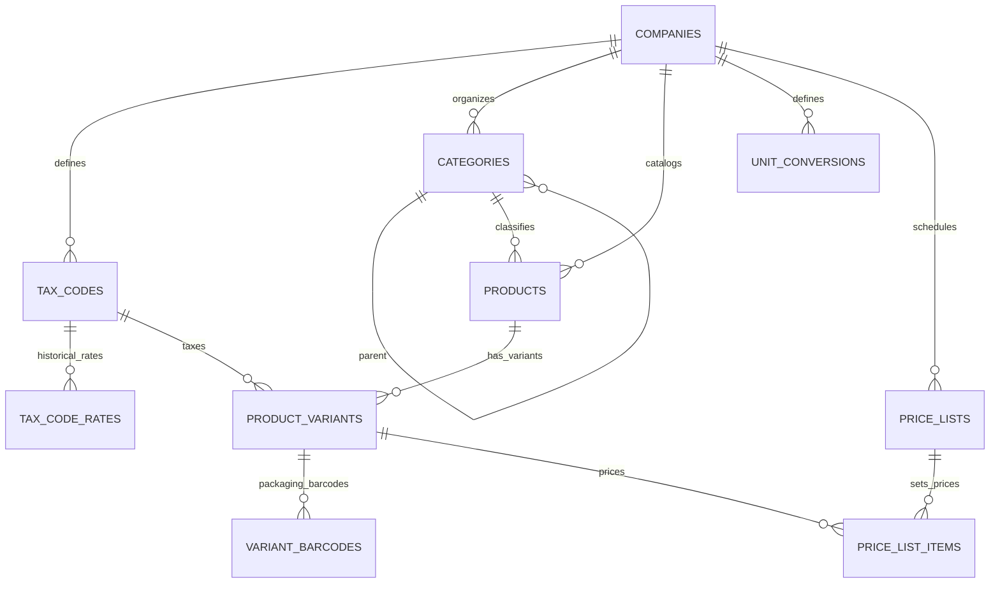

# Step 4: Catalog, Tax Codes, and Price Lists Implementation Plan

## 1. Executive Summary & Review Scope
- **Step Objective:** Implement a robust multi-tenant Catalog, Statutory Bangladesh Tax Engine, and Packaging/Pricing Architecture. This step decouples tax rates and prices from flat columns on variants into data-driven effective-dated tax codes with PostgreSQL `btree_gist` exclusion constraints, tiered tax-inclusive and tax-exclusive price lists, multi-packaging barcode resolution (carton vs piece), unit-of-measure conversions, bilingual master data (`name_en`, `name_bn`), and a statutory Maximum Retail Price (MRP) ceiling enforcement rule.
- **Design Sections:**
  - §7.5: Localization Engine & Bilingual Master Data (`DATA-08`).
  - §8.2 Item 1: Catalog & Pricing Engine (Hierarchical Categories, Variants, UOM Conversions, MRP Ceilings, Price Lists).
  - §9.1 Tables 3 & 7: `tax_codes`, `tax_code_rates` with `btree_gist` exclusion constraint (`NEW-20`), `products`, and `product_variants`.
- **Review Items Closed:**
  - `NEW-17` (Medium): Decouple tax rates and prices from flat columns on product variants. Move tax rates to `tax_codes`/`tax_code_rates`, prices to `price_lists`/`price_list_items`, barcodes to `variant_barcodes` (supporting distinct carton and piece barcodes with multipliers), and units of measure to `unit_conversions`. Retain `mrp` as a statutory ceiling.
  - `NEW-20` (Medium): Split tax codes into stable identity (`tax_codes`) and effective-dated rates (`tax_code_rates`) guarded by a PostgreSQL `btree_gist` exclusion constraint (`uq_no_overlapping_tax_rates`) to physically prevent overlapping rate periods for the same code.
  - `TAX-02` (High): Complete Bangladesh VAT and Supplementary Duty engine. Support statutory rates (15% standard, 10% wholesale, 7.5% services, 5% reduced, 0% zero-rated, Exempt, 4% turnover tax) and supplementary duty (SD). Add `TaxRateResolver` to resolve effective rates across date transitions.
  - `TAX-07` (High): Tax-inclusive retail pricing (`is_tax_inclusive` flag on `price_lists`) and statutory MRP ceiling enforcement (`MrpCeilingRule`) blocking selling prices that exceed printed MRP.
  - `DATA-08` (Medium): Bilingual master data support (`name_en` English and `name_bn` Bangla Unicode) on all customer-facing master data entities (`categories`, `products`, `product_variants`, `tax_codes`, `price_lists`).

---

## 2. Gate Items & Architectural Pre-Conditions
1. **VAT Consultant Rate List Gate:**
   - The statutory rate list for Bangladesh (15%, 10%, 7.5%, 5%, 0%, Exempt, 4% turnover tax) and common Supplementary Duty rates (e.g. 5% to 350% under the 2nd Schedule of the VAT Act 2012) are seeded as standard master data defaults.
   - Because all tax rates are modeled in `tax_code_rates` with `effective_from` and `effective_to` dates rather than hard-coded enums, any future rate change or consultant-mandated adjustment requires only adding a new effective-dated row without code refactoring or schema migrations.
2. **Staffing & Ownership Gate (`NEW-34`):**
   - The Catalog, Tax, and Pricing domains are encapsulated into modular domain boundaries (`app/Modules/Catalog` and `app/Modules/Tax`) with explicit contracts (`TaxRateResolverContract`, `BarcodeResolverContract`), isolating catalog master data from downstream invoice lines (Step 9) and stock layers (Step 7).

---

## 3. Architectural Blueprint & Database Design

### A. Core Schema Entities (All Built with `TenantMigration`)

Every tenant table is constructed using `App\Core\Database\TenantMigration` with:
- UUIDv7 primary key: `id UUID PRIMARY KEY`
- Forced Row-Level Security: `ENABLE ROW LEVEL SECURITY`, `FORCE ROW LEVEL SECURITY`
- Fail-closed tenant isolation policy for `app_rw` and `reporting_ro`
- Composite tenant key: `UNIQUE (tenant_id, id)`
- Company-consistent composite foreign keys: `(tenant_id, company_id, id)`



#### 1. `tax_codes` (Stable Tax Code Identity)
- Columns:
  - `id UUID PRIMARY KEY`
  - `tenant_id UUID NOT NULL REFERENCES tenants(id) ON DELETE RESTRICT`
  - `company_id UUID NOT NULL`
  - `code VARCHAR(50) NOT NULL` (e.g. `'VAT-STD-15'`, `'VAT-RED-10'`, `'VAT-RED-7.5'`, `'VAT-RED-5'`, `'VAT-ZERO-0'`, `'VAT-EXEMPT'`, `'TURNOVER-4'`)
  - `name_en VARCHAR(255) NOT NULL` (`DATA-08`)
  - `name_bn VARCHAR(255) NULL` (`DATA-08`)
  - `is_active BOOLEAN NOT NULL DEFAULT true`
  - `timestampsTz()`
- Constraints:
  - `UNIQUE (tenant_id, id)` (via `TenantMigration`)
  - `UNIQUE (tenant_id, company_id, id)`: `uq_tax_codes_company_id` (enables composite FKs)
  - `UNIQUE (tenant_id, company_id, code)`: `uq_tax_code_per_company`
  - `FOREIGN KEY (tenant_id, company_id) REFERENCES companies(tenant_id, id) ON DELETE RESTRICT`: `fk_tax_codes_company`

#### 2. `tax_code_rates` (Effective-Dated Rates & SD with Exclusion Constraint)
- Columns:
  - `id UUID PRIMARY KEY`
  - `tenant_id UUID NOT NULL REFERENCES tenants(id) ON DELETE RESTRICT`
  - `company_id UUID NOT NULL`
  - `tax_code_id UUID NOT NULL`
  - `rate_percent DECIMAL(5, 2) NOT NULL DEFAULT 0.00`
  - `supplementary_duty_percent DECIMAL(5, 2) NOT NULL DEFAULT 0.00`
  - `effective_from DATE NOT NULL`
  - `effective_to DATE NULL`
  - `timestampsTz()`
- Constraints:
  - `UNIQUE (tenant_id, id)` (via `TenantMigration`)
  - `FOREIGN KEY (tenant_id, company_id, tax_code_id) REFERENCES tax_codes(tenant_id, company_id, id) ON DELETE RESTRICT`: `fk_tax_rates_code`
  - **Exclusion Constraint (`btree_gist` - Resolving `NEW-20`):**
    ```sql
    CONSTRAINT uq_no_overlapping_tax_rates EXCLUDE USING gist (
        tenant_id WITH =,
        company_id WITH =,
        tax_code_id WITH =,
        daterange(effective_from, COALESCE(effective_to, '9999-12-31'::date), '[]') WITH &&
    )
    ```

#### 3. `categories` (Hierarchical Bilingual Categories)
- Columns:
  - `id UUID PRIMARY KEY`
  - `tenant_id UUID NOT NULL REFERENCES tenants(id) ON DELETE RESTRICT`
  - `company_id UUID NOT NULL`
  - `parent_id UUID NULL`
  - `code VARCHAR(50) NOT NULL`
  - `name_en VARCHAR(255) NOT NULL` (`DATA-08`)
  - `name_bn VARCHAR(255) NULL` (`DATA-08`)
  - `description TEXT NULL`
  - `is_active BOOLEAN NOT NULL DEFAULT true`
  - `timestampsTz()`
- Constraints:
  - `UNIQUE (tenant_id, id)`
  - `UNIQUE (tenant_id, company_id, id)`: `uq_categories_company_id`
  - `UNIQUE (tenant_id, company_id, code)`: `uq_category_code_per_company`
  - `FOREIGN KEY (tenant_id, company_id) REFERENCES companies(tenant_id, id) ON DELETE RESTRICT`: `fk_categories_company`
  - `FOREIGN KEY (tenant_id, company_id, parent_id) REFERENCES categories(tenant_id, company_id, id) ON DELETE SET NULL`: `fk_categories_parent`

#### 4. `products` (Product Family / Master)
- Columns:
  - `id UUID PRIMARY KEY`
  - `tenant_id UUID NOT NULL REFERENCES tenants(id) ON DELETE RESTRICT`
  - `company_id UUID NOT NULL`
  - `category_id UUID NULL`
  - `code VARCHAR(50) NOT NULL`
  - `name_en VARCHAR(255) NOT NULL` (`DATA-08`)
  - `name_bn VARCHAR(255) NULL` (`DATA-08`)
  - `base_uom VARCHAR(50) NOT NULL DEFAULT 'Pcs'`
  - `description TEXT NULL`
  - `is_active BOOLEAN NOT NULL DEFAULT true`
  - `timestampsTz()`
- Constraints:
  - `UNIQUE (tenant_id, id)`
  - `UNIQUE (tenant_id, company_id, id)`: `uq_products_company_id`
  - `UNIQUE (tenant_id, company_id, code)`: `uq_product_code_per_company`
  - `FOREIGN KEY (tenant_id, company_id) REFERENCES companies(tenant_id, id) ON DELETE RESTRICT`: `fk_products_company`
  - `FOREIGN KEY (tenant_id, company_id, category_id) REFERENCES categories(tenant_id, company_id, id) ON DELETE SET NULL`: `fk_products_category`

#### 5. `product_variants` (SKU Level with Statutory MRP Ceiling)
- Columns:
  - `id UUID PRIMARY KEY`
  - `tenant_id UUID NOT NULL REFERENCES tenants(id) ON DELETE RESTRICT`
  - `company_id UUID NOT NULL`
  - `product_id UUID NOT NULL`
  - `tax_code_id UUID NOT NULL`
  - `sku VARCHAR(100) NOT NULL`
  - `name_en VARCHAR(255) NOT NULL` (`DATA-08`)
  - `name_bn VARCHAR(255) NULL` (`DATA-08`)
  - `base_uom VARCHAR(50) NOT NULL DEFAULT 'Pcs'`
  - `mrp DECIMAL(18, 4) NOT NULL DEFAULT 0.0000` (printed Maximum Retail Price ceiling, resolving `TAX-07`)
  - `cost_price DECIMAL(18, 4) NOT NULL DEFAULT 0.0000`
  - `is_active BOOLEAN NOT NULL DEFAULT true`
  - `timestampsTz()`
- Constraints:
  - `UNIQUE (tenant_id, id)`
  - `UNIQUE (tenant_id, company_id, id)`: `uq_product_variants_company_id`
  - `UNIQUE (tenant_id, company_id, sku)`: `uq_variant_sku_per_company`
  - `FOREIGN KEY (tenant_id, company_id, product_id) REFERENCES products(tenant_id, company_id, id) ON DELETE RESTRICT`: `fk_variants_product`
  - `FOREIGN KEY (tenant_id, company_id, tax_code_id) REFERENCES tax_codes(tenant_id, company_id, id) ON DELETE RESTRICT`: `fk_variants_tax_code` (company consistency `NEW-22`)

#### 6. `variant_barcodes` (Multi-Packaging Barcode Resolution - `NEW-17`)
- Columns:
  - `id UUID PRIMARY KEY`
  - `tenant_id UUID NOT NULL REFERENCES tenants(id) ON DELETE RESTRICT`
  - `company_id UUID NOT NULL`
  - `variant_id UUID NOT NULL`
  - `barcode VARCHAR(100) NOT NULL`
  - `uom VARCHAR(50) NOT NULL` (e.g. `'Piece'`, `'Carton'`, `'Pack'`)
  - `multiplier DECIMAL(18, 4) NOT NULL DEFAULT 1.0000` (1 for piece, 24 for carton of 24 pieces)
  - `is_primary BOOLEAN NOT NULL DEFAULT false`
  - `timestampsTz()`
- Constraints:
  - `UNIQUE (tenant_id, id)`
  - `UNIQUE (tenant_id, company_id, barcode)`: `uq_variant_barcode_per_company`
  - `FOREIGN KEY (tenant_id, company_id, variant_id) REFERENCES product_variants(tenant_id, company_id, id) ON DELETE CASCADE`: `fk_variant_barcodes_variant`

#### 7. `unit_conversions` (Explicit UOM Conversion Matrix)
- Columns:
  - `id UUID PRIMARY KEY`
  - `tenant_id UUID NOT NULL REFERENCES tenants(id) ON DELETE RESTRICT`
  - `company_id UUID NOT NULL`
  - `from_uom VARCHAR(50) NOT NULL`
  - `to_uom VARCHAR(50) NOT NULL`
  - `multiplier DECIMAL(18, 4) NOT NULL`
  - `timestampsTz()`
- Constraints:
  - `UNIQUE (tenant_id, id)`
  - `UNIQUE (tenant_id, company_id, from_uom, to_uom)`: `uq_unit_conversion_pair`
  - `FOREIGN KEY (tenant_id, company_id) REFERENCES companies(tenant_id, id) ON DELETE RESTRICT`: `fk_unit_conversions_company`

#### 8. `price_lists` (Tiered Price Lists with Tax Treatment - `TAX-07`, `A-05`)
- Columns:
  - `id UUID PRIMARY KEY`
  - `tenant_id UUID NOT NULL REFERENCES tenants(id) ON DELETE RESTRICT`
  - `company_id UUID NOT NULL`
  - `code VARCHAR(50) NOT NULL` (e.g. `'RETAIL-DEFAULT'`, `'WHOLESALE-TIER-1'`)
  - `name_en VARCHAR(255) NOT NULL` (`DATA-08`)
  - `name_bn VARCHAR(255) NULL` (`DATA-08`)
  - `currency VARCHAR(3) NOT NULL DEFAULT 'BDT'`
  - `is_tax_inclusive BOOLEAN NOT NULL DEFAULT false` (`TAX-07`: true for retail POS, false for wholesale)
  - `effective_from DATE NULL`
  - `effective_to DATE NULL`
  - `is_active BOOLEAN NOT NULL DEFAULT true`
  - `timestampsTz()`
- Constraints:
  - `UNIQUE (tenant_id, id)`
  - `UNIQUE (tenant_id, company_id, id)`: `uq_price_lists_company_id`
  - `UNIQUE (tenant_id, company_id, code)`: `uq_price_list_code_per_company`
  - `FOREIGN KEY (tenant_id, company_id) REFERENCES companies(tenant_id, id) ON DELETE RESTRICT`: `fk_price_lists_company`

#### 9. `price_list_items` (Selling Prices per Variant & Quantity Tier)
- Columns:
  - `id UUID PRIMARY KEY`
  - `tenant_id UUID NOT NULL REFERENCES tenants(id) ON DELETE RESTRICT`
  - `company_id UUID NOT NULL`
  - `price_list_id UUID NOT NULL`
  - `variant_id UUID NOT NULL`
  - `unit_price DECIMAL(18, 4) NOT NULL`
  - `min_quantity DECIMAL(18, 4) NOT NULL DEFAULT 1.0000`
  - `timestampsTz()`
- Constraints:
  - `UNIQUE (tenant_id, id)`
  - `UNIQUE (tenant_id, price_list_id, variant_id, min_quantity)`: `uq_price_list_item_tier`
  - `FOREIGN KEY (tenant_id, company_id, price_list_id) REFERENCES price_lists(tenant_id, company_id, id) ON DELETE CASCADE`: `fk_price_items_list`
  - `FOREIGN KEY (tenant_id, company_id, variant_id) REFERENCES product_variants(tenant_id, company_id, id) ON DELETE RESTRICT`: `fk_price_items_variant`

---

### B. Core Services and Invariants

#### 1. `TaxRateResolver` (`App\Modules\Tax\Services\TaxRateResolver`)
- Contract: `App\Modules\Tax\Contracts\TaxRateResolverContract`
- Method: `resolve(string|TaxCode $taxCode, CarbonInterface|string $date): TaxRateResult`
- Logic: Queries `tax_code_rates` where `tax_code_id = :tax_code_id AND effective_from <= :date AND (effective_to IS NULL OR effective_to >= :date)`.
- Returns `TaxRateResult`:
  - `vatRatePercent: string` (e.g. `'15.00'`)
  - `supplementaryDutyPercent: string` (e.g. `'0.00'`)
  - `effectiveFrom: string`
  - `effectiveTo: ?string`
- Error handling: Throws `NoEffectiveTaxRateException` if no period matches.

#### 2. `MrpCeilingRule` (`App\Modules\Catalog\Rules\MrpCeilingRule`)
- Enforces Bangladesh statutory price ceilings: Under the Consumer Rights Protection Act 2009 and VAT Act 2012, goods cannot be sold or priced higher than the printed MRP on the packaging.
- Validation:
  - Evaluates `unit_price <= variant.mrp`.
  - For tax-inclusive price lists (`is_tax_inclusive = true`), `unit_price <= variant.mrp`.
  - For tax-exclusive price lists (`is_tax_inclusive = false`), gross selling price (`unit_price * (1 + (vat_rate + sd_rate)/100)`) or base `unit_price` cannot exceed `mrp`.
  - Throws `MrpCeilingExceededException` or triggers Laravel validation error.

#### 3. `BarcodeResolver` (`App\Modules\Catalog\Services\BarcodeResolver`)
- Contract: `App\Modules\Catalog\Contracts\BarcodeResolverContract`
- Method: `resolve(string $barcode, ?string $companyId = null): BarcodeResolution`
- Logic: Queries `variant_barcodes` with eager-loaded `productVariant.product` and `productVariant.taxCode`.
- Returns `BarcodeResolution`:
  - `variant: ProductVariant`
  - `barcode: string`
  - `uom: string` (`'Piece'`, `'Carton'`, etc.)
  - `multiplier: string` (`'1.0000'`, `'24.0000'`, etc.)
  - `isPrimary: bool`
- Enables POS scanning where scanning a piece barcode registers 1 piece, while scanning a carton barcode registers 24 pieces with a single scan.

---

## 4. Tests to Write First (TDD Plan)

All database tests run on PostgreSQL 17 connecting as `app_rw`, with RLS active and tenant context set via `TenantContext::set($tenant)`.

1. **`tests/Database/TaxRateOverlapTest.php`:**
   - Proves PostgreSQL `btree_gist` exclusion constraint `uq_no_overlapping_tax_rates` rejects overlapping rate periods for the same tax code with `SQLSTATE[23P01]` (`exclusion_violation`).
   - Proves non-overlapping contiguous rate periods succeed.
2. **`tests/Unit/TaxRateResolverTest.php`:**
   - Setup: Tax code with Rate Period 1 (`2026-01-01` to `2026-06-30`, 15% VAT, 0% SD) and Rate Period 2 (`2026-07-01` onwards, 10% VAT, 5% SD).
   - Test date boundary before Rate 1 (`2025-12-31`) -> throws `NoEffectiveTaxRateException`.
   - Test date on last day of Rate 1 (`2026-06-30`) -> resolves to 15.00% VAT, 0.00% SD.
   - Test date on first day of Rate 2 (`2026-07-01`) -> resolves to 10.00% VAT, 5.00% SD.
   - Test future date (`2027-01-01`) -> resolves to 10.00% VAT, 5.00% SD.
3. **`tests/Database/CatalogCompanyConsistencyTest.php`:**
   - Tenant A owns Company 1 and Company 2.
   - Company 1 has Category C1 and Tax Code T1.
   - Company 2 has Product P2.
   - Attempt to assign Category C1 (Company 1) to Product P2 (Company 2) -> rejected by `fk_products_category`.
   - Attempt to assign Tax Code T1 (Company 1) to Variant V2 (Company 2) -> rejected by `fk_variants_tax_code`.
   - Assigning Company 2's own tax code to Variant V2 succeeds.
4. **`tests/Unit/BarcodeResolverTest.php`:**
   - Setup variant with piece barcode (`multiplier = 1.0000`, `uom = 'Piece'`) and carton barcode (`multiplier = 24.0000`, `uom = 'Carton'`).
   - Scanning piece barcode returns `multiplier = '1.0000'` and `uom = 'Piece'`.
   - Scanning carton barcode returns `multiplier = '24.0000'` and `uom = 'Carton'`.
   - Scanning an unknown barcode throws `BarcodeNotFoundException`.
5. **`tests/Unit/MrpCeilingRuleTest.php`:**
   - Variant with `mrp = '850.0000'`.
   - Selling price `'850.0000'` -> valid.
   - Selling price `'840.0000'` -> valid.
   - Selling price `'850.0100'` -> rejected with `MrpCeilingExceededException`.
   - Validation rule integration with FormRequest / validator.
6. **`tests/Database/CatalogTenantIsolationTest.php`:**
   - Tenant A inserts rows into `tax_codes`, `tax_code_rates`, `categories`, `products`, `product_variants`, `variant_barcodes`, `unit_conversions`, `price_lists`, `price_list_items`.
   - Tenant B queries all 9 tables -> receives 0 rows.
   - Tenant B attempts to insert with `tenant_id` of Tenant A -> rejected by RLS `WITH CHECK` policy.
   - Verifies `db:check-rls` passes for all 9 catalog and pricing tables.

---

## 5. Ordered Commits & Implementation Schedule

- [x] **Commit 1: `test(tax): add failing test for btree_gist tax rate overlap exclusion constraint`**
  - Create `tests/Database/TaxRateOverlapTest.php`.
  - Connects as `app_rw` and verifies exclusion constraint behavior.
- [x] **Commit 2: `feat(tax): migrations and models for tax_codes and tax_code_rates with btree_gist exclusion`**
  - Migration `create_tax_codes_table` and `create_tax_code_rates_table` using `TenantMigration`.
  - Models `App\Models\TaxCode` and `App\Models\TaxCodeRate`.
  - Ensure `btree_gist` extension enabled under `pgsql_owner`.
  - Closes `NEW-20`.
- [x] **Commit 3: `test(tax): add unit tests for TaxRateResolver boundary behavior`**
  - Create `tests/Unit/TaxRateResolverTest.php`.
- [x] **Commit 4: `feat(tax): implement TaxRateResolver service and DTOs`**
  - Implement `TaxRateResolverContract`, `TaxRateResolver`, `TaxRateResult`, and `NoEffectiveTaxRateException`.
  - Closes `TAX-02`.
- [x] **Commit 5: `test(catalog): add failing test for company-consistent composite foreign keys`**
  - Create `tests/Database/CatalogCompanyConsistencyTest.php`.
- [x] **Commit 6: `feat(catalog): migrations and models for categories, products, product_variants, unit_conversions`**
  - Migrations for `categories`, `products`, `product_variants`, and `unit_conversions` with composite FKs.
  - Models `App\Models\Category`, `App\Models\Product`, `App\Models\ProductVariant`, `App\Models\UnitConversion`.
  - Closes `DATA-08`, `NEW-17` (partial).
- [x] **Commit 7: `test(catalog): add failing test for variant barcode resolution (carton vs piece)`**
  - Create `tests/Unit/BarcodeResolverTest.php`.
- [x] **Commit 8: `feat(catalog): migration, model and resolver for variant_barcodes`**
  - Migration for `variant_barcodes` with `TenantMigration`.
  - Model `App\Models\VariantBarcode` and service `BarcodeResolver`.
  - Closes `NEW-17` (packaging & barcodes).
- [x] **Commit 9: `test(pricing): add failing test for MRP ceiling rule rejection and tax-inclusive price lists`**
  - Create `tests/Unit/MrpCeilingRuleTest.php`.
- [x] **Commit 10: `feat(pricing): migrations for price_lists and price_list_items, and MrpCeilingRule validator`**
  - Migrations for `price_lists` and `price_list_items`.
  - Models `App\Models\PriceList` and `App\Models\PriceListItem`.
  - Rule `MrpCeilingRule` and exception `MrpCeilingExceededException`.
  - Trigger `trg_price_list_item_mrp` and `trg_product_variant_mrp_reduction`.
  - Closes `TAX-07`, `NEW-17` (pricing decoupling).
- [x] **Commit 11: `test(catalog): verify RLS and isolation across all new catalog and pricing tables`**
  - Create `tests/Database/CatalogTenantIsolationTest.php`.
  - Run `php artisan db:check-rls` and verify 100% coverage.
- [x] **Commit 12: `seed(catalog): add standard Bangladesh tax codes and demo catalog items to DemoTenantSeeder`**
  - Seed statutory VAT rates (15%, 10%, 7.5%, 5%, 0%, Exempt, 4% turnover tax) and SD rates.
  - Seed sample FMCG demo catalog items (e.g. Paracetamol piece/carton, Miniket Rice with MRP, Biscuits) and Retail Price List.
- [x] **Commit 13: `feat(filament): build bilingual resources for categories, products, tax codes, price lists and units`**
  - Filament resources with English and Bengali labels (`DATA-08`).
  - Relation managers for variants, rates, price list items.
- [x] **Commit 14: `test(db): add comprehensive db rule tests for exclusion constraint, company keys and MRP trigger`**
  - Tests in `TaxRateOverlapTest`, `CatalogCompanyConsistencyTest`, and `MrpCeilingDatabaseTest`.
  - Closes `NEW-20`, `NEW-17`, `TAX-07`.

---

## 6. Commands That Must Run on the Server
- `php artisan migrate --database=pgsql_owner`
- `php artisan db:check-rls`
- `php artisan test tests/Database/TaxRateOverlapTest.php`
- `php artisan test tests/Unit/TaxRateResolverTest.php`
- `php artisan test tests/Database/CatalogCompanyConsistencyTest.php`
- `php artisan test tests/Unit/BarcodeResolverTest.php`
- `php artisan test tests/Unit/MrpCeilingRuleTest.php`
- `php artisan test tests/Database/CatalogTenantIsolationTest.php`
- `php artisan test`
- `vendor/bin/pint --test`
- `vendor/bin/phpstan analyse`

---

## 7. Risks & Mitigation
1. **`btree_gist` Extension Dependency:**
   - The PostgreSQL exclusion constraint requires the `btree_gist` extension.
   - *Mitigation:* The migration explicitly issues `DB::connection('pgsql_owner')->statement('CREATE EXTENSION IF NOT EXISTS "btree_gist";')` before defining the table.
2. **Float Precision Loss in Money and Tax Computations:**
   - Monetary values and multipliers must never use native PHP floating point numbers.
   - *Mitigation:* Adhere strictly to rule 6 using `DECIMAL(18, 4)` columns, `brick/math` for arithmetic operations, and string representations in DTOs.
3. **Disagreement Between Review and Design on Variant Columns:**
   - Design §9.1 Table 7 initially included `mrp_price`, `wholesale_price`, `is_tax_inclusive`, and `barcode` on `product_variants`.
   - *Resolution:* Per Review item `NEW-17` ("Where the review and the design disagree, follow the review and say so"), prices are decoupled into `price_lists`/`price_list_items`, barcodes into `variant_barcodes`, and tax rates into `tax_codes`/`tax_code_rates`. Only `mrp` is retained on `product_variants` as the statutory packaging ceiling.
