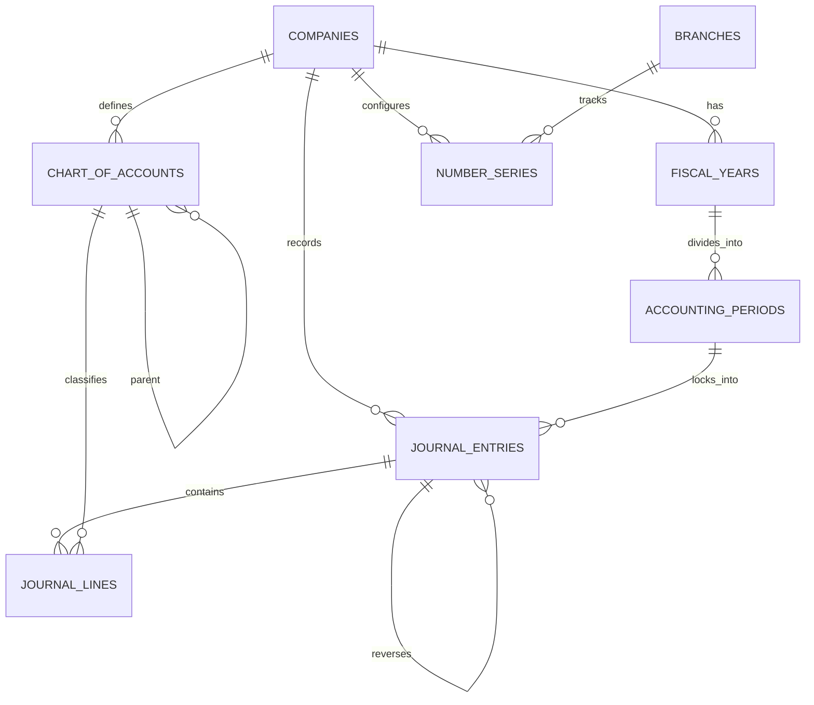

# Step 5: General Ledger, Financial Immutability & Double-Entry Posting Plan

## 1. Executive Summary & Review Scope
- **Step Objective:** Implement a high-integrity, multi-tenant Double-Entry General Ledger, Period Locking Engine, and Document Numbering Architecture. This step delivers physical database-level immutability for posted journals via PostgreSQL triggers, strict fiscal year and period management (July–June Bangladesh fiscal cycle), a gapless `NumberSeries` service with `SELECT … FOR UPDATE` row locking, a strict `Money` value object backed by `brick/math` with half-up rounding to 2 places and string serialization, a transaction-inheriting `AccountingPostingService`, and a standard Bangladesh retail Chart of Accounts template.
- **Design Sections:**
  - §5.4: Cross-Module Communication & Synchronous GL Posting (`MOD-06`).
  - §9.1 Tables 8–11: `fiscal_years`, `accounting_periods`, `chart_of_accounts`, `journal_entries`, `journal_lines`.
  - §9.2: Complete Immutability & Financial Balance Triggers (Triggers 1, 2, 3 as written).
- **Review Items Closed:**
  - `ACC-03` (High): Fiscal years (July–June), accounting periods with status (`open`, `soft-closed`, `closed`), period locking, and posting date boundary validation.
  - `ACC-05` (High): Monetary math standardized on `DECIMAL(18, 4)` in database and an immutable `Money` value object in PHP using `brick/math` with `RoundingMode::HALF_UP` to 2 decimal places and string serialization in JSON/DTOs. No floats anywhere in financial code.
  - `ACC-07` (Medium): Centralized document numbering service (`NumberSeriesService`) per company, branch, and document type with fiscal-year reset and pessimistic `SELECT … FOR UPDATE` locking to guarantee gapless numbers under high concurrency.
  - `NEW-21` (Medium): Strict reversal protection: unique index `(tenant_id, reversed_entry_id)` preventing duplicate reversals, validation that reversals target posted entries in the same company, validation that target periods are open, and verification that posting date falls within the period range.

---

## 2. Gate Items & Architectural Pre-Conditions
1. **Chart of Accounts Template Gate:**
   - The Bangladesh standard retail Chart of Accounts template must include statutory tax accounts:
     - **1050:** VAT Current Account / VAT Receivable (Mushak Input Tax)
     - **1060:** VDS Receivable (VAT Deducted at Source by Customers)
     - **1070:** Advance Income Tax (AIT)
     - **2020:** Output VAT Payable (Mushak Output Tax)
     - **2030:** Supplementary Duty (SD) Payable
     - **2040:** VDS Payable (VAT Deducted at Source from Suppliers to deposit to NBR)
     - **2050:** TDS Payable (Tax Deducted at Source from Suppliers)
2. **Synchronous Posting Invariant (§5.4):**
   - Financial posting must execute **synchronously within the caller's database transaction**. `AccountingPostingService` must never open its own transaction or dispatch asynchronous posting jobs.
3. **§9.2 Triggers Integrity:**
   - The immutability and double-entry balance triggers from §9.2 of the design passed the v1.5.0 review's tests and must be used as written.

---

## 3. Architectural Blueprint & Database Design

### A. Core Schema Entities (All Built with `TenantMigration`)

Every tenant table is constructed using `App\Core\Database\TenantMigration` with:
- UUIDv7 primary key: `id UUID PRIMARY KEY`
- Forced Row-Level Security: `ENABLE ROW LEVEL SECURITY`, `FORCE ROW LEVEL SECURITY`
- Fail-closed tenant isolation policy for `app_rw` and `reporting_ro`
- Composite tenant key: `UNIQUE (tenant_id, id)`
- Company-consistent composite foreign keys: `(tenant_id, company_id, id)`



#### 1. `fiscal_years` (§9.1 Table 8 - Resolving `ACC-03`)
- Columns:
  - `id UUID PRIMARY KEY`
  - `tenant_id UUID NOT NULL REFERENCES tenants(id) ON DELETE RESTRICT`
  - `company_id UUID NOT NULL`
  - `title VARCHAR(100) NOT NULL` (e.g. `'FY 2026-2027'`)
  - `start_date DATE NOT NULL` (e.g. `'2026-07-01'`)
  - `end_date DATE NOT NULL` (e.g. `'2027-06-30'`)
  - `is_closed BOOLEAN NOT NULL DEFAULT FALSE`
  - `timestampsTz()`
- Constraints:
  - `UNIQUE (tenant_id, id)` (via `TenantMigration`)
  - `UNIQUE (tenant_id, company_id, id)`: `uq_fiscal_years_company_id`
  - `UNIQUE (tenant_id, company_id, start_date, end_date)`: `uq_fiscal_year_dates`
  - `FOREIGN KEY (tenant_id, company_id) REFERENCES companies(tenant_id, id) ON DELETE RESTRICT`: `fk_fiscal_years_company`

#### 2. `accounting_periods` (§9.1 Table 8 - Resolving `ACC-03`, `NEW-21`)
- Columns:
  - `id UUID PRIMARY KEY`
  - `tenant_id UUID NOT NULL REFERENCES tenants(id) ON DELETE RESTRICT`
  - `company_id UUID NOT NULL`
  - `fiscal_year_id UUID NOT NULL`
  - `period_number INT NOT NULL` (1 to 12)
  - `period_name VARCHAR(50) NOT NULL` (e.g. `'July 2026'`, `'Agrahayan 1433'`)
  - `start_date DATE NOT NULL`
  - `end_date DATE NOT NULL`
  - `status VARCHAR(30) NOT NULL DEFAULT 'open'` (`'open'`, `'soft-closed'`, `'closed'`)
  - `timestampsTz()`
- Constraints:
  - `UNIQUE (tenant_id, id)` (via `TenantMigration`)
  - `UNIQUE (tenant_id, company_id, id)`: `uq_accounting_periods_company_id`
  - `UNIQUE (tenant_id, company_id, fiscal_year_id, period_number)`: `uq_period_per_year`
  - `FOREIGN KEY (tenant_id, company_id) REFERENCES companies(tenant_id, id) ON DELETE RESTRICT`: `fk_periods_company`
  - `FOREIGN KEY (tenant_id, company_id, fiscal_year_id) REFERENCES fiscal_years(tenant_id, company_id, id) ON DELETE RESTRICT`: `fk_periods_year`
  - `CHECK (status IN ('open', 'soft-closed', 'closed'))`: `chk_accounting_period_status`

#### 3. `chart_of_accounts` (§9.1 Table 9)
- Columns:
  - `id UUID PRIMARY KEY`
  - `tenant_id UUID NOT NULL REFERENCES tenants(id) ON DELETE RESTRICT`
  - `company_id UUID NOT NULL`
  - `account_code VARCHAR(50) NOT NULL` (e.g. `'1010'`, `'2020'`)
  - `account_name VARCHAR(255) NOT NULL`
  - `account_type VARCHAR(50) NOT NULL` (`'asset'`, `'liability'`, `'equity'`, `'revenue'`, `'expense'`)
  - `parent_id UUID NULL`
  - `is_reconcilable BOOLEAN NOT NULL DEFAULT FALSE`
  - `is_active BOOLEAN NOT NULL DEFAULT TRUE`
  - `timestampsTz()`
- Constraints:
  - `UNIQUE (tenant_id, id)` (via `TenantMigration`)
  - `UNIQUE (tenant_id, company_id, id)`: `uq_coa_company_id`
  - `UNIQUE (tenant_id, company_id, account_code)`: `uq_coa_code_per_company`
  - `FOREIGN KEY (tenant_id, company_id) REFERENCES companies(tenant_id, id) ON DELETE RESTRICT`: `fk_coa_company`
  - `FOREIGN KEY (tenant_id, company_id, parent_id) REFERENCES chart_of_accounts(tenant_id, company_id, id) ON DELETE RESTRICT`: `fk_coa_parent`

#### 4. `journal_entries` (§9.1 Table 10 - Resolving `NEW-02`, `NEW-03`, `NEW-13`, `NEW-21`)
- Columns:
  - `id UUID PRIMARY KEY`
  - `tenant_id UUID NOT NULL REFERENCES tenants(id) ON DELETE RESTRICT`
  - `company_id UUID NOT NULL`
  - `period_id UUID NOT NULL`
  - `entry_number VARCHAR(100) NOT NULL`
  - `posting_date DATE NOT NULL`
  - `business_date DATE NOT NULL`
  - `reference_type VARCHAR(100) NOT NULL` (`'manual'`, `'sales_invoice'`, `'purchase_bill'`, `'inventory_movement'`, `'payment'`, `'reversal'`)
  - `reference_id UUID NULL`
  - `narration TEXT NULL`
  - `is_posted BOOLEAN NOT NULL DEFAULT FALSE`
  - `is_reversal BOOLEAN NOT NULL DEFAULT FALSE`
  - `reversed_entry_id UUID NULL`
  - `posted_by UUID NOT NULL`
  - `timestampsTz()`
- Constraints:
  - `UNIQUE (tenant_id, id)` (via `TenantMigration`)
  - `UNIQUE (tenant_id, company_id, id)`: `uq_journal_entries_company_id`
  - `UNIQUE (tenant_id, company_id, entry_number)`: `uq_journal_no_per_company`
  - `FOREIGN KEY (tenant_id, company_id) REFERENCES companies(tenant_id, id) ON DELETE RESTRICT`: `fk_journal_company`
  - `FOREIGN KEY (tenant_id, company_id, period_id) REFERENCES accounting_periods(tenant_id, company_id, id) ON DELETE RESTRICT`: `fk_journal_period`
  - `FOREIGN KEY (tenant_id, company_id, reversed_entry_id) REFERENCES journal_entries(tenant_id, company_id, id) ON DELETE RESTRICT`: `fk_journal_reversal`
  - **Unique Reversal Index (`NEW-21`):**
    ```sql
    CREATE UNIQUE INDEX uq_unique_active_reversal ON journal_entries (tenant_id, reversed_entry_id)
    WHERE reversed_entry_id IS NOT NULL;
    ```

#### 5. `journal_lines` (§9.1 Table 11 - Resolving `ACC-04`, `NEW-13`, `NEW-22`)
- Columns:
  - `id UUID PRIMARY KEY`
  - `tenant_id UUID NOT NULL REFERENCES tenants(id) ON DELETE RESTRICT`
  - `company_id UUID NOT NULL`
  - `journal_entry_id UUID NOT NULL`
  - `account_id UUID NOT NULL`
  - `debit_amount DECIMAL(18, 4) NOT NULL DEFAULT 0.0000`
  - `credit_amount DECIMAL(18, 4) NOT NULL DEFAULT 0.0000`
  - `currency VARCHAR(10) NOT NULL DEFAULT 'BDT'`
  - `exchange_rate DECIMAL(18, 6) NOT NULL DEFAULT 1.000000`
  - `base_debit_amount DECIMAL(18, 4) NOT NULL DEFAULT 0.0000`
  - `base_credit_amount DECIMAL(18, 4) NOT NULL DEFAULT 0.0000`
  - `partner_id UUID NULL`
  - `tax_code_id UUID NULL`
  - `branch_id UUID NULL`
  - `line_description VARCHAR(255) NULL`
  - `timestampsTz()`
- Constraints:
  - `UNIQUE (tenant_id, id)` (via `TenantMigration`)
  - `FOREIGN KEY (tenant_id, company_id, journal_entry_id) REFERENCES journal_entries(tenant_id, company_id, id) ON DELETE RESTRICT`: `fk_lines_entry`
  - `FOREIGN KEY (tenant_id, company_id, account_id) REFERENCES chart_of_accounts(tenant_id, company_id, id) ON DELETE RESTRICT`: `fk_lines_account`
  - `FOREIGN KEY (tenant_id, company_id, tax_code_id) REFERENCES tax_codes(tenant_id, company_id, id) ON DELETE RESTRICT`: `fk_lines_tax_code`
  - `FOREIGN KEY (tenant_id, company_id, branch_id) REFERENCES branches(tenant_id, company_id, id) ON DELETE RESTRICT`: `fk_lines_branch`
  - `CHECK ((debit_amount > 0 AND credit_amount = 0) OR (credit_amount > 0 AND debit_amount = 0))`: `chk_debit_or_credit`

#### 6. `number_series` (Resolving `ACC-07`)
- Columns:
  - `id UUID PRIMARY KEY`
  - `tenant_id UUID NOT NULL REFERENCES tenants(id) ON DELETE RESTRICT`
  - `company_id UUID NOT NULL`
  - `branch_id UUID NULL`
  - `document_type VARCHAR(50) NOT NULL` (e.g. `'journal'`, `'sales_invoice'`, `'purchase_order'`)
  - `prefix VARCHAR(20) NOT NULL` (e.g. `'JV'`, `'SINV'`, `'PO'`)
  - `fiscal_year VARCHAR(20) NOT NULL` (e.g. `'2026-2027'`)
  - `current_number BIGINT NOT NULL DEFAULT 0`
  - `padding INT NOT NULL DEFAULT 6`
  - `timestampsTz()`
- Constraints:
  - `UNIQUE (tenant_id, id)` (via `TenantMigration`)
  - `UNIQUE NULLS NOT DISTINCT (tenant_id, company_id, branch_id, document_type, fiscal_year)`: `uq_series_lookup`
  - `FOREIGN KEY (tenant_id, company_id) REFERENCES companies(tenant_id, id) ON DELETE RESTRICT`: `fk_series_company`
  - `FOREIGN KEY (tenant_id, company_id, branch_id) REFERENCES branches(tenant_id, company_id, id) ON DELETE RESTRICT`: `fk_series_branch`

---

### B. PostgreSQL Financial Immutability Triggers (§9.2 - Used as Written)

```sql
-- Trigger 1: Before INSERT Guard on journal_entries (NEW-13)
CREATE OR REPLACE FUNCTION trg_fn_journal_entry_insert_guard()
RETURNS TRIGGER AS $$
BEGIN
    IF (NEW.is_posted = TRUE) THEN
        RAISE EXCEPTION 'Financial Integrity Violation: Journal entries must be created in draft state (is_posted = FALSE) first.';
    END IF;
    RETURN NEW;
END;
$$ LANGUAGE plpgsql;

CREATE TRIGGER trg_journal_entry_insert_guard
BEFORE INSERT ON journal_entries
FOR EACH ROW
EXECUTE FUNCTION trg_fn_journal_entry_insert_guard();

-- Trigger 2: Before UPDATE or DELETE on journal_entries (NEW-02, NEW-03, NEW-13, NEW-21)
CREATE OR REPLACE FUNCTION trg_fn_enforce_journal_entry_immutability()
RETURNS TRIGGER AS $$
DECLARE
    v_line_count INT;
    v_total_debit DECIMAL(18, 4);
    v_total_credit DECIMAL(18, 4);
    v_period_status VARCHAR(30);
    v_period_start DATE;
    v_period_end DATE;
    v_orig_is_posted BOOLEAN;
    v_orig_company_id UUID;
BEGIN
    IF (TG_OP = 'DELETE') THEN
        IF (OLD.is_posted = TRUE) THEN
            RAISE EXCEPTION 'Audit Integrity Violation: Posted Journal Entry % cannot be deleted. Issue a reversing entry.', OLD.id;
        END IF;
        RETURN OLD;
    END IF;

    IF (TG_OP = 'UPDATE') THEN
        IF (OLD.is_posted = TRUE) THEN
            RAISE EXCEPTION 'Audit Integrity Violation: Posted Journal Entry % is immutable and cannot be updated.', OLD.id;
        END IF;

        -- Transitioning from draft to posted (is_posted FALSE -> TRUE)
        IF (OLD.is_posted = FALSE AND NEW.is_posted = TRUE) THEN
            -- Verify Period Status & Date Validity (Resolving NEW-21)
            SELECT status, start_date, end_date INTO v_period_status, v_period_start, v_period_end
            FROM accounting_periods
            WHERE id = NEW.period_id;

            IF v_period_status <> 'open' THEN
                RAISE EXCEPTION 'Financial Integrity Violation: Cannot post to an accounting period that is not open (Period ID: %, Status: %).',
                    NEW.period_id, v_period_status;
            END IF;

            IF NEW.posting_date < v_period_start OR NEW.posting_date > v_period_end THEN
                RAISE EXCEPTION 'Financial Integrity Violation: Posting date % is outside period bounds (% to %).',
                    NEW.posting_date, v_period_start, v_period_end;
            END IF;

            -- Verify Reversal Integrity (Resolving NEW-21)
            IF NEW.is_reversal = TRUE THEN
                IF NEW.reversed_entry_id IS NULL THEN
                    RAISE EXCEPTION 'Financial Integrity Violation: Reversal entry must specify reversed_entry_id.';
                END IF;

                SELECT is_posted, company_id INTO v_orig_is_posted, v_orig_company_id
                FROM journal_entries
                WHERE id = NEW.reversed_entry_id;

                IF v_orig_is_posted <> TRUE THEN
                    RAISE EXCEPTION 'Financial Integrity Violation: Target of reversal entry % is not posted.', NEW.reversed_entry_id;
                END IF;

                IF v_orig_company_id <> NEW.company_id THEN
                    RAISE EXCEPTION 'Financial Integrity Violation: Cannot reverse an entry belonging to a different company.';
                END IF;
            END IF;

            -- Verify Line Count and Debits = Credits
            SELECT COUNT(*), COALESCE(SUM(base_debit_amount), 0), COALESCE(SUM(base_credit_amount), 0)
            INTO v_line_count, v_total_debit, v_total_credit
            FROM journal_lines
            WHERE journal_entry_id = NEW.id;

            IF v_line_count < 2 THEN
                RAISE EXCEPTION 'Financial Integrity Violation: Journal Entry % must contain at least 2 lines to post (Found %).', NEW.id, v_line_count;
            END IF;

            IF v_total_debit <> v_total_credit THEN
                RAISE EXCEPTION 'Financial Integrity Violation: Journal Entry % is unbalanced. Debits (%) != Credits (%)', NEW.id, v_total_debit, v_total_credit;
            END IF;
        END IF;

        RETURN NEW;
    END IF;

    RETURN NEW;
END;
$$ LANGUAGE plpgsql;

CREATE TRIGGER trg_journal_entry_immutability
BEFORE UPDATE OR DELETE ON journal_entries
FOR EACH ROW
EXECUTE FUNCTION trg_fn_enforce_journal_entry_immutability();

-- Trigger 3: Before INSERT, UPDATE, or DELETE on journal_lines (NEW-02, NEW-13)
CREATE OR REPLACE FUNCTION trg_fn_enforce_journal_lines_immutability()
RETURNS TRIGGER AS $$
DECLARE
    v_target_entry_id UUID;
    v_is_posted BOOLEAN;
BEGIN
    IF (TG_OP = 'UPDATE') THEN
        IF (NEW.journal_entry_id <> OLD.journal_entry_id) THEN
            RAISE EXCEPTION 'Financial Integrity Violation: Cannot reassign journal_entry_id on a journal line.';
        END IF;
        IF (NEW.company_id <> OLD.company_id) THEN
            RAISE EXCEPTION 'Financial Integrity Violation: Cannot change company_id on a journal line.';
        END IF;
    END IF;

    IF (TG_OP = 'DELETE') THEN
        v_target_entry_id := OLD.journal_entry_id;
    ELSE
        v_target_entry_id := NEW.journal_entry_id;
    END IF;

    -- Lock parent entry FOR SHARE to prevent race conditions with concurrent posting (NEW-13)
    SELECT is_posted INTO v_is_posted
    FROM journal_entries
    WHERE id = v_target_entry_id
    FOR SHARE;

    IF v_is_posted = TRUE THEN
        RAISE EXCEPTION 'Audit Integrity Violation: Cannot % lines on an already posted Journal Entry (ID: %).', TG_OP, v_target_entry_id;
    END IF;

    IF (TG_OP = 'DELETE') THEN
        RETURN OLD;
    ELSE
        RETURN NEW;
    END IF;
END;
$$ LANGUAGE plpgsql;

CREATE TRIGGER trg_journal_lines_immutability
BEFORE INSERT OR UPDATE OR DELETE ON journal_lines
FOR EACH ROW
EXECUTE FUNCTION trg_fn_enforce_journal_lines_immutability();
```

---

## 4. Domain Services, Value Objects & Templates

### A. Strict `Money` Value Object (`App\Core\ValueObjects\Money` - Resolving `ACC-05`)
- Built on `brick/math` (`BigDecimal`, `RoundingMode::HALF_UP`).
- Immutable: all operations return a new `Money` instance.
- Methods:
  - `public static function of(string|int|BigDecimal $amount, string $currency = 'BDT'): self`
  - `public static function zero(string $currency = 'BDT'): self`
  - `public function add(Money $other): self`
  - `public function subtract(Money $other): self`
  - `public function multiply(string|int|BigDecimal $multiplier): self`
  - `public function divide(string|int|BigDecimal $divisor): self`
  - `public function round(int $scale = 2): self` (Half-up rounding)
  - `public function isZero(): bool`, `public function isPositive(): bool`, `public function isNegative(): bool`
  - `public function equals(Money $other): bool`, `public function compareTo(Money $other): int`
  - `public function getAmount(): string` (4 decimal places internal string)
  - `public function getFormattedAmount(): string` (2 decimal places formatted string)
- Serialization:
  - Implements `\JsonSerializable`: serializes to string (e.g. `"12500.00"`), never float.
  - Implements `\Stringable`: `__toString()` returns formatted 2-decimal string.

### B. Pessimistic `NumberSeriesService` (`App\Modules\Accounting\Services\NumberSeriesService` - Resolving `ACC-07`)
- Contract: `App\Modules\Accounting\Contracts\NumberSeriesContract`.
- Implements sequential, gapless sequence generation:
  - `public function getNextNumber(string $companyId, ?string $branchId, string $documentType, string $fiscalYear): string`
- Locking mechanism:
  - Executes `SELECT … FOR UPDATE` on the matching `number_series` row within the active transaction.
  - If no series row exists, it safely initializes it with `current_number = 0`.
  - Increments `current_number` by 1, saves, and formats as:
    `{prefix}-{fiscalYear}-{paddedNumber}` (e.g., `JV-26-27-000001`).
  - Guarantees strict gapless progression with zero collisions under multi-process concurrency.

### C. Transaction-Inheriting `AccountingPostingService` (`App\Modules\Accounting\Services\AccountingPostingService` - Resolving §5.4, `MOD-06`)
- Contract: `App\Modules\Accounting\Contracts\AccountingPostingServiceContract`.
- Method:
  - `public function post(JournalEntryDTO $entryData): JournalEntry`
  - `public function reverse(JournalEntry|string $entry, string $postedBy, string $postingDate, ?string $narration = null): JournalEntry`
- Invariants:
  - **Transaction Boundary:** Enforces that a database transaction is already open (`DB::transactionLevel() > 0`) or participates cleanly in the caller's transaction. **Never opens its own transaction.**
  - **Execution Sequence:**
    1. Generates sequential entry number via `NumberSeriesService`.
    2. Inserts draft `journal_entries` header (`is_posted = false`).
    3. Bulk-inserts `journal_lines` with calculated base currency amounts (`base_debit_amount`, `base_credit_amount`).
    4. Updates header `is_posted = true`.
    5. Database trigger executes validation synchronously: period open, posting date in range, reversal checks, debit/credit equality.
    6. Returns the posted `JournalEntry`.

### D. Bangladesh Retail Chart of Accounts Template
- Implemented as a standard seeder / master data template in `App\Modules\Accounting\Database\Seeders\BangladeshRetailCoaTemplate`:
  - **1000 - Assets:**
    - 1010: Cash in Hand / নগদ তহবিল
    - 1020: Bank Current Account / ব্যাংক চলতি হিসাব
    - 1030: Accounts Receivable (Debtors) / দেনাদার হিসাব
    - 1040: Merchandise Inventory / মজুদ পণ্য
    - 1050: VAT Current Account / VAT Receivable (Mushak Input Tax) / মূসক চলতি হিসাব (উপকরণ কর)
    - 1060: VDS Receivable (VAT Deducted at Source by Customers) / উৎসে মূসক কর্তন (গ্রাহক কর্তন)
    - 1070: Advance Income Tax (AIT) / অগ্রিম আয়কর
  - **2000 - Liabilities:**
    - 2010: Accounts Payable (Creditors) / পাওনাদার হিসাব
    - 2020: Output VAT Payable (Mushak Output Tax) / প্রদেয় মূসক (উৎপাদন কর)
    - 2030: Supplementary Duty (SD) Payable / প্রদেয় সম্পূরক শুল্ক
    - 2040: VDS Payable (VAT Deducted at Source from Suppliers) / প্রদেয় উৎসে মূসক (সরবরাহকারী কর্তন)
    - 2050: TDS Payable (Tax Deducted at Source from Suppliers) / প্রদেয় উৎসে আয়কর
  - **3000 - Equity:**
    - 3010: Owner's Capital / মালিকের মূলধন
    - 3020: Retained Earnings / সংরক্ষিত আয়
  - **4000 - Revenue:**
    - 4010: Retail Sales Revenue / খুচরা বিক্রয় আয়
    - 4020: Wholesale Sales Revenue / পাইকারি বিক্রয় আয়
    - 4090: Sales Discounts & Allowances / বিক্রয় বাট্টা
  - **5000 - Cost of Goods Sold:**
    - 5010: Cost of Goods Sold - Retail / বিক্রিত পণ্যের ব্যয়
    - 5020: Inward Freight & Handling / পণ্য পরিবহন খরচ
  - **6000 - Operating Expenses:**
    - 6010: Salaries & Allowances / বেতন ও ভাতাদি
    - 6020: Store Rent / দোকান ভাড়া
    - 6030: Utilities (Electricity & Water) / বিদ্যুৎ ও ইউটিলিটি
    - 6040: Bank Charges / ব্যাংক চার্জ

---

## 5. Tests to Write First (TDD Plan)

### A. Journal Financial Immutability & Database Rule Tests (`tests/Database/JournalImmutabilityTest.php`)
- Connects as `app_rw` on PostgreSQL 17 to prove database triggers physically enforce financial invariants:
  1. **G1 (Balanced Post Succeeds):** Insert draft journal entry with 2 balanced lines (debit = ৳1000, credit = ৳1000). Transitioning `is_posted` to `TRUE` succeeds.
  2. **G2 (Adding a Line After Posting Fails):** Attempting to insert a line into a posted journal entry raises exception `trg_fn_enforce_journal_lines_immutability: Cannot INSERT lines on an already posted Journal Entry`. Attempting update or delete on existing lines also raises exception.
  3. **G3 (Posting into a Closed Period Fails):** Create accounting period with `status = 'closed'` or `status = 'soft-closed'`. Attempting to transition `is_posted` to `TRUE` raises exception `Financial Integrity Violation: Cannot post to an accounting period that is not open`.
  4. **G4 (Reversing a Draft Fails):** Create draft entry A (`is_posted = FALSE`). Attempting to post reversal entry B with `reversed_entry_id = A.id` raises exception `Financial Integrity Violation: Target of reversal entry % is not posted`.
  5. **G5 (Posting an Unbalanced Entry Fails):** Create draft entry with unbalanced lines (debit = ৳1000, credit = ৳800). Transitioning `is_posted` to `TRUE` raises exception `Financial Integrity Violation: Journal Entry % is unbalanced. Debits != Credits`.
  6. **Posting Date Outside Period Bounds Fails:** Accounting period covers `2026-07-01` to `2026-07-31`. Attempting to post journal entry with `posting_date = 2026-08-01` raises exception `Financial Integrity Violation: Posting date % is outside period bounds`.
  7. **Duplicate Reversal Rejected:** Reversing an already-reversed entry raises unique index violation `uq_unique_active_reversal`.

### B. Company Consistency Database Rule Tests (`tests/Database/AccountingCompanyConsistencyTest.php`)
- Connects as `app_rw`:
  1. **Cross-Company Account Rejected (`NEW-22`):** Attempting to insert a journal line referencing a `chart_of_accounts` account belonging to Company B on a journal entry of Company A is rejected by `fk_lines_account`.
  2. **Cross-Company Reversal Rejected (`NEW-21`):** Attempting to post a reversal entry in Company A targeting a posted journal entry of Company B raises exception `Financial Integrity Violation: Cannot reverse an entry belonging to a different company`.
  3. **Cross-Company Period Rejected:** Journal entry of Company A cannot reference an `accounting_periods` row belonging to Company B.

### C. Concurrency & Gapless Number Series Tests (`tests/Database/NumberSeriesConcurrencyTest.php`)
- **Pessimistic Concurrency Test:** Two parallel processes/workers drawing 500 numbers each from the same series row simultaneously:
  - Exactly 1,000 distinct numbers are produced.
  - Zero duplicate sequence numbers.
  - Strict contiguous range from 1 to 1,000 with zero gaps.
- **Fiscal Year Rollover Test:** Drawing from FY `2026-2027` then FY `2027-2028` resets sequence back to 1.

### D. Strict Money Value Object Unit Tests (`tests/Unit/MoneyTest.php`)
- Exact decimal math without floating point errors.
- Half-up rounding to 2 decimal places (`125.005` -> `125.01`, `125.004` -> `125.00`).
- String JSON serialization: `json_encode(['price' => Money::of('280.00')])` outputs `{"price":"280.00"}`.
- Stringable representation.

### E. Synchronous Posting Service Unit Tests (`tests/Unit/AccountingPostingServiceTest.php`)
- Posting executes within caller's transaction and does not start its own.
- Rolling back caller's transaction cleanly rolls back the entire journal and sequence.
- Automatic calculation of base currency debit and credit amounts.

---

## 6. Ordered Commits & Implementation Schedule

- [x] **Commit 1: `test(money): add unit tests for Money value object on brick/math`**
  - Create `tests/Unit/MoneyTest.php`.
  - Verifies exact arithmetic, half-up rounding to 2 places, float rejection, and JSON string serialization (`ACC-05`).
- [x] **Commit 2: `feat(core): implement immutable Money value object using brick/math`**
  - Implement `App\Core\ValueObjects\Money`.
  - Closes `ACC-05`.
- [x] **Commit 3: `test(db): add failing database tests for fiscal years and accounting periods`**
  - Create `tests/Database/FiscalPeriodDatabaseTest.php`.
- [x] **Commit 4: `feat(accounting): migrations and models for fiscal_years and accounting periods`**
  - Create migrations for `fiscal_years` and `accounting_periods` using `TenantMigration`.
  - Create models `App\Models\FiscalYear` and `App\Models\AccountingPeriod`.
  - Closes `ACC-03` (schema).
- [x] **Commit 5: `test(coa): add failing database tests for chart of accounts and Bangladesh template`**
  - Create `tests/Database/ChartOfAccountsDatabaseTest.php`.
- [x] **Commit 6: `feat(accounting): migration and model for chart_of_accounts and Bangladesh retail COA template`**
  - Create migration for `chart_of_accounts` with composite company keys.
  - Create model `App\Models\ChartOfAccount`.
  - Create seeder/template `App\Modules\Accounting\Database\Seeders\BangladeshRetailCoaTemplate`.
- [x] **Commit 7: `test(number-series): add failing concurrency and rollover tests for NumberSeriesService`**
  - Create `tests/Database/NumberSeriesConcurrencyTest.php`.
- [x] **Commit 8: `feat(accounting): migration, model and NumberSeriesService with SELECT FOR UPDATE`**
  - Create migration for `number_series` with `TenantMigration`.
  - Create model `App\Models\NumberSeries`.
  - Create service `App\Modules\Accounting\Services\NumberSeriesService` and contract.
  - Closes `ACC-07`.
- [x] **Commit 9: `test(db): add failing review G1-G5 immutability and period rule tests for journal triggers`**
  - Create `tests/Database/JournalImmutabilityTest.php` and `tests/Database/AccountingCompanyConsistencyTest.php`.
- [x] **Commit 10: `feat(accounting): migrations for journal_entries and journal_lines with section 9.2 triggers`**
  - Create migrations for `journal_entries` and `journal_lines` using `TenantMigration`.
  - Create migration `create_journal_immutability_triggers` implementing §9.2 triggers exactly as written.
  - Models `App\Models\JournalEntry` and `App\Models\JournalLine`.
  - Closes `NEW-21`, `ACC-03` (period validation).
- [x] **Commit 11: `test(posting): add tests for synchronous AccountingPostingService transaction behavior`**
  - Create `tests/Unit/AccountingPostingServiceTest.php`.
- [x] **Commit 12: `feat(accounting): implement AccountingPostingService adhering to caller transaction constraint`**
  - Create `AccountingPostingServiceContract`, `JournalEntryDTO`, `JournalLineDTO`, and `AccountingPostingService`.
  - Enforce zero internal transaction management (participates in caller's active transaction).
  - Closes §5.4 (`MOD-06`).
- [ ] **Commit 13: `test(gl): verify RLS coverage and check-rls across all new accounting tables`**
  - Create `tests/Database/AccountingTenantIsolationTest.php`.
  - Run `php artisan db:check-rls`.

---

## 7. Commands That Must Run on the Server
- `php artisan migrate --database=pgsql_owner`
- `php artisan db:check-rls`
- `php artisan test tests/Unit/MoneyTest.php`
- `php artisan test tests/Database/FiscalPeriodDatabaseTest.php`
- `php artisan test tests/Database/ChartOfAccountsDatabaseTest.php`
- `php artisan test tests/Database/NumberSeriesConcurrencyTest.php`
- `php artisan test tests/Database/JournalImmutabilityTest.php`
- `php artisan test tests/Database/AccountingCompanyConsistencyTest.php`
- `php artisan test tests/Unit/AccountingPostingServiceTest.php`
- `php artisan test`
- `vendor/bin/pint --test`
- `vendor/bin/phpstan analyse`

---

## 8. Risks & Mitigations
1. **Deadlocks in High-Concurrency Number Generation:**
   - Under heavy concurrent load, multiple transactions requesting numbers for the same document type could deadlock if locking order is inconsistent.
   - *Mitigation:* `NumberSeriesService` orders requests by the unique tuple `(company_id, branch_id, document_type, fiscal_year)` and issues `SELECT … FOR UPDATE` on a single row per series, keeping transaction hold time minimal.
2. **Transaction Leakage in Synchronous Posting (§5.4):**
   - If `AccountingPostingService` were to begin its own transaction (`DB::beginTransaction()`), it could commit prematurely or conflict with the outer business document transaction (e.g., sales invoice).
   - *Mitigation:* The service explicitly inspects `DB::transactionLevel()` and throws a `PostingWithoutTransactionException` if the caller did not initialize a database transaction, ensuring atomic consistency.
3. **Floating Point Rounding Divergence in Multi-Currency / VAT:**
   - Using PHP floats for tax or journal lines causes fractional taka discrepancies.
   - *Mitigation:* Strict enforcement of `Money` value object backed by `brick/math` with `RoundingMode::HALF_UP` to 2 decimal places and decimal:4 database persistence.
