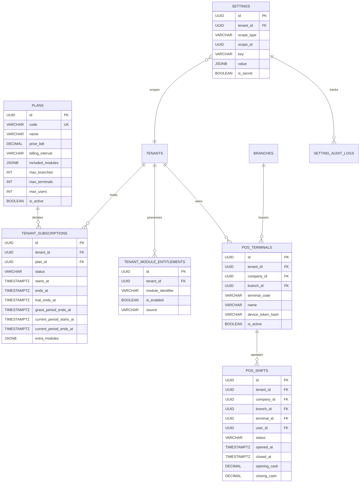

# Step 6: Billing, Module Entitlements, Tenant Lifecycle & Onboarding Plan

## 1. Executive Summary & Review Scope
- **Step Objective:** Implement billing plans, subscription management in the Super-Admin panel, subscription-derived module entitlements mirrored into Laravel Pennant feature flags, module disable guards (active dependents & open documents), tenant lifecycle state enforcement (`active`, `in_arrears`, `suspended`), the 5-level hierarchical settings engine, an automated onboarding wizard executing module `seedDefaultData()`, and rate-limited self-service sign-up with email and phone verification.
- **Design Sections:**
  - §1.2: System Topology (The Three Named Layers: Tenant User App, Tenant Admin Panel, Super-Admin Panel).
  - §5.3: Module Lifecycle & Feature Flags (`MOD-03`, `MOD-04`).
  - §7.3: Hierarchical Settings Engine (`CORE-03`).
- **Review Items Closed:**
  - `TEN-11` (Medium): Tenant lifecycle states have defined behavior (`active`, `in_arrears`, `suspended`): grace period, read-only mode for suspended tenants, legal export rights preserved, POS shift completion permitted while blocking new shifts.
  - `MOD-03` (Medium): Module enable/disable guards: disabling blocked when active dependent modules exist or when unposted open documents/drafts exist; data preserved read-only.
  - `MOD-04` (Medium): Platform-wide code deployments with per-tenant feature flags via Laravel Pennant, strictly derived from subscription records so flags cannot drift from billing.
  - `CORE-03` (Medium): 5-level hierarchical settings engine (Platform $\to$ Tenant $\to$ Company $\to$ Branch $\to$ POS Terminal) with Redis caching, cache invalidation, and audit logging.

---

## 2. Gate Items & Architectural Pre-Conditions
1. **Pilot Payment & Tenant States Gate (`steps.md` Line 13):**
   - Tenant states must explicitly govern access across both the Tenant Admin panel and POS terminals.
   - A suspended tenant cannot perform mutations, but **must retain full access to view and export statutory accounting and tax data** (Mushak 6.3 invoices, journals, audit records).
   - In-flight POS register shifts must be allowed to close gracefully, while new shift openings are rejected.
2. **Pennant-Billing Synchronization Invariant (`MOD-04`):**
   - Feature flags in Laravel Pennant must be authoritative projections of subscription records and plan entitlements. A feature flag cannot be toggled independently of tenant entitlement state, preventing drift between billing and access control.
3. **Module Dependency & Open Document Guard Invariant (`MOD-03`):**
   - Disabling a module must inspect the dependency graph (`getDependencies()`) and open transaction tables. It must fail with explicit domain exceptions if dependents are active or draft/unposted documents exist.

---

## 3. Database Schema Design (All Tenant Tables Built with `TenantMigration`)



### A. Global / Platform Tables (Super-Admin Control Plane)

#### 1. `plans`
- Columns:
  - `id UUID PRIMARY KEY`
  - `code VARCHAR(50) UNIQUE NOT NULL` (e.g. `'starter'`, `'standard'`, `'enterprise'`)
  - `name VARCHAR(100) NOT NULL`
  - `description TEXT NULL`
  - `price_bdt DECIMAL(18, 4) NOT NULL DEFAULT 0.0000`
  - `billing_interval VARCHAR(20) NOT NULL DEFAULT 'monthly'` (`'monthly'`, `'yearly'`)
  - `included_modules JSONB NOT NULL DEFAULT '[]'` (e.g. `['accounting', 'catalog', 'tax', 'sales', 'pos']`)
  - `max_branches INT NOT NULL DEFAULT 1`
  - `max_terminals INT NOT NULL DEFAULT 1`
  - `max_users INT NOT NULL DEFAULT 5`
  - `is_active BOOLEAN NOT NULL DEFAULT TRUE`
  - `timestampsTz()`

#### 2. `tenant_subscriptions`
- Columns:
  - `id UUID PRIMARY KEY`
  - `tenant_id UUID NOT NULL REFERENCES tenants(id) ON DELETE RESTRICT`
  - `plan_id UUID NOT NULL REFERENCES plans(id) ON DELETE RESTRICT`
  - `status VARCHAR(30) NOT NULL DEFAULT 'active'` (`'active'`, `'in_arrears'`, `'suspended'`, `'cancelled'`)
  - `starts_at TIMESTAMPTZ NOT NULL`
  - `ends_at TIMESTAMPTZ NULL`
  - `trial_ends_at TIMESTAMPTZ NULL`
  - `grace_period_ends_at TIMESTAMPTZ NULL`
  - `current_period_starts_at TIMESTAMPTZ NOT NULL`
  - `current_period_ends_at TIMESTAMPTZ NOT NULL`
  - `extra_modules JSONB NOT NULL DEFAULT '[]'` (add-on module licenses)
  - `timestampsTz()`
- Indexes:
  - `CREATE INDEX idx_subscriptions_tenant_status ON tenant_subscriptions(tenant_id, status)`

#### 3. `tenant_module_entitlements`
- Columns:
  - `id UUID PRIMARY KEY`
  - `tenant_id UUID NOT NULL REFERENCES tenants(id) ON DELETE RESTRICT`
  - `module_identifier VARCHAR(50) NOT NULL` (e.g. `'accounting'`, `'catalog'`, `'tax'`, `'pos'`, `'inventory'`, `'sales'`, `'procurement'`, `'reporting'`)
  - `is_enabled BOOLEAN NOT NULL DEFAULT TRUE`
  - `source VARCHAR(30) NOT NULL DEFAULT 'plan'` (`'plan'`, `'addon'`, `'override'`)
  - `timestampsTz()`
- Constraints:
  - `UNIQUE (tenant_id, module_identifier)`

---

### B. Tenant Tables (Created with `TenantMigration`)

#### 4. `pos_terminals` (§8.1 & §9.1 Table 5)
- Columns:
  - `id UUID PRIMARY KEY`
  - `tenant_id UUID NOT NULL REFERENCES tenants(id) ON DELETE RESTRICT`
  - `company_id UUID NOT NULL`
  - `branch_id UUID NOT NULL`
  - `terminal_code VARCHAR(50) NOT NULL` (e.g. `'T-001'`)
  - `name VARCHAR(100) NOT NULL` (e.g. `'Main Terminal'`)
  - `device_token_hash VARCHAR(255) NULL`
  - `is_active BOOLEAN NOT NULL DEFAULT TRUE`
  - `timestampsTz()`
- Constraints:
  - `UNIQUE (tenant_id, id)`
  - `UNIQUE (tenant_id, company_id, id)`: `uq_pos_terminals_company_id`
  - `UNIQUE (tenant_id, company_id, branch_id, terminal_code)`: `uq_terminal_code_per_branch`
  - Composite Foreign Keys:
    - `FOREIGN KEY (tenant_id, company_id, branch_id) REFERENCES branches(tenant_id, company_id, id) ON DELETE RESTRICT`
    - `FOREIGN KEY (tenant_id, company_id) REFERENCES companies(tenant_id, id) ON DELETE RESTRICT`

#### 5. `pos_shifts`
- Columns:
  - `id UUID PRIMARY KEY`
  - `tenant_id UUID NOT NULL REFERENCES tenants(id) ON DELETE RESTRICT`
  - `company_id UUID NOT NULL`
  - `branch_id UUID NOT NULL`
  - `terminal_id UUID NOT NULL`
  - `user_id UUID NOT NULL`
  - `status VARCHAR(30) NOT NULL DEFAULT 'open'` (`'open'`, `'closed'`)
  - `opened_at TIMESTAMPTZ NOT NULL`
  - `closed_at TIMESTAMPTZ NULL`
  - `opening_cash DECIMAL(18, 4) NOT NULL DEFAULT 0.0000`
  - `closing_cash DECIMAL(18, 4) NULL`
  - `expected_cash DECIMAL(18, 4) NULL`
  - `timestampsTz()`
- Constraints:
  - `UNIQUE (tenant_id, id)`
  - `CHECK (status IN ('open', 'closed'))`
  - Composite Foreign Keys:
    - `FOREIGN KEY (tenant_id, company_id, branch_id) REFERENCES branches(tenant_id, company_id, id) ON DELETE RESTRICT`
    - `FOREIGN KEY (tenant_id, company_id, terminal_id) REFERENCES pos_terminals(tenant_id, company_id, id) ON DELETE RESTRICT`

---

### C. Settings & Audit Infrastructure

#### 6. `settings` (§7.3 - Resolving `CORE-03`)
- Columns:
  - `id UUID PRIMARY KEY`
  - `tenant_id UUID NULL REFERENCES tenants(id) ON DELETE CASCADE`
  - `scope_type VARCHAR(50) NOT NULL` (`'platform'`, `'tenant'`, `'company'`, `'branch'`, `'terminal'`)
  - `scope_id UUID NULL` (matches company_id, branch_id, terminal_id)
  - `key VARCHAR(100) NOT NULL`
  - `value JSONB NOT NULL`
  - `is_secret BOOLEAN NOT NULL DEFAULT FALSE`
  - `timestampsTz()`
- Unique Index:
  - Handled via partial indexes for NULL `tenant_id` (platform defaults) and composite unique `(tenant_id, scope_type, scope_id, key)`.

#### 7. `setting_audit_logs`
- Columns:
  - `id UUID PRIMARY KEY`
  - `tenant_id UUID NULL REFERENCES tenants(id) ON DELETE CASCADE`
  - `setting_id UUID NULL REFERENCES settings(id) ON DELETE SET NULL`
  - `key VARCHAR(100) NOT NULL`
  - `scope_type VARCHAR(50) NOT NULL`
  - `scope_id UUID NULL`
  - `old_value JSONB NULL`
  - `new_value JSONB NOT NULL`
  - `changed_by_user_id UUID NULL`
  - `ip_address VARCHAR(45) NULL`
  - `created_at TIMESTAMPTZ NOT NULL DEFAULT NOW()`

#### 8. `registration_verifications`
- Columns:
  - `id UUID PRIMARY KEY`
  - `email VARCHAR(255) NOT NULL`
  - `phone VARCHAR(50) NOT NULL`
  - `email_token VARCHAR(100) NOT NULL`
  - `email_verified_at TIMESTAMPTZ NULL`
  - `phone_otp_hash VARCHAR(255) NOT NULL`
  - `phone_verified_at TIMESTAMPTZ NULL`
  - `expires_at TIMESTAMPTZ NOT NULL`
  - `attempts INT NOT NULL DEFAULT 0`
  - `timestampsTz()`

---

## 4. Software Architecture & Implementation Details

### A. Module Entitlements & Laravel Pennant (`MOD-04`)
- Install `laravel/pennant` via composer.
- Pennant Feature Resolver:
  ```php
  Feature::define($moduleIdentifier, function (Tenant $tenant) use ($moduleIdentifier) {
      return app(ModuleEntitlementServiceContract::class)->isEntitled($tenant, $moduleIdentifier);
  });
  ```
- `ModuleEntitlementService`:
  - `syncFromSubscription(TenantSubscription $subscription): void`: Derives entitlements directly from `Plan::$included_modules` and `$subscription->extra_modules`.
  - `isEntitled(Tenant $tenant, string $moduleIdentifier): bool`: Checks database entitlement table (cached in Redis).
  - `disable(Tenant $tenant, string $moduleIdentifier): void`:
    - **Dependency Guard (`MOD-03`)**: Scans all enabled modules for `$tenant`. If any active module lists `$moduleIdentifier` in `getDependencies()`, throws `ModuleHasActiveDependentsException`.
    - **Open Documents Guard (`MOD-03`)**: Queries document models (unposted journals, open shifts, open orders). If count > 0, throws `ModuleHasOpenDocumentsException`.
    - Disables entitlement record (`is_enabled = false`). Deletes/purges no historical rows.

### B. Tenant Lifecycle States & Behavior Matrix (`TEN-11`)

| Tenant State | Back Office (Tenant Admin) | POS Terminals | Exports & Audit Records | Background Jobs |
|---|---|---|---|---|
| **`active`** | Full read & write access. | Full checkout, shift open/close. | Full access. | Normal execution. |
| **`in_arrears`** | Full read & write access.<br>Warning banner with grace period countdown. | Normal checkout.<br>Cashier banner. | Full access. | Normal execution. |
| **`suspended`** | **Write-blocked**: Mutations (`POST`, `PUT`, `DELETE`) rejected with HTTP 403.<br>Banner: "Account Suspended". | **Current shift finishes**: Cashier can complete sales & close open shift.<br>**New shifts blocked**: Cannot open new shift. | **Full read & export access preserved** (Mushak 6.3 invoices, journals, ledgers). | Critical integrity checks run; non-essential jobs paused. |

- Middleware `EnforceTenantState`:
  - Intercepts non-safe HTTP methods (`POST`, `PUT`, `PATCH`, `DELETE`) and Livewire mutations when `tenant->status === 'suspended'`.
  - White-lists export endpoints (`/export/*`, Filament export actions) and session termination.
- Middleware `TenantResolutionMiddleware`:
  - Updated to resolve tenants with `status IN ('active', 'in_arrears', 'suspended')` instead of only `'active'`, allowing suspended tenants to authenticate, read, and export data.

### C. Hierarchical Settings Engine (`CORE-03`, §7.3)
- Hierarchy Order:
  1. **Terminal** (`scope_type = 'terminal'`, `scope_id = $terminalId`)
  2. **Branch** (`scope_type = 'branch'`, `scope_id = $branchId`)
  3. **Company** (`scope_type = 'company'`, `scope_id = $companyId`)
  4. **Tenant** (`scope_type = 'tenant'`, `scope_id = $tenantId`)
  5. **Platform Default** (`scope_type = 'platform'`, `scope_id = null`)
- `HierarchicalSettingsService`:
  - `get(string $key, ?Terminal $terminal, ?Branch $branch, ?Company $company, ?Tenant $tenant, mixed $default = null): mixed`
  - Evaluates from most specific to least specific.
  - Caches resolution in Redis: `settings:{tenant_id}:{scope_type}:{scope_id}:{key}`.
  - Invalidation: `set()` clears cached keys and logs previous/new values into `setting_audit_logs`.

### D. Onboarding Wizard & `seedDefaultData()`
- `ModuleInterface::seedDefaultData(string $tenantId, string $companyId): void` implemented by modules:
  - **Accounting Module**: Creates July–June Fiscal Year, monthly periods, and calls `BangladeshRetailCoaTemplate::seedForCompany()`.
  - **Tax Module**: Seeds standard Bangladesh VAT codes (Standard 15%, Retail 5%, Zero Rated 0%, Exempt).
  - **Identity / RBAC**: Seeds default roles (`Branch Manager`, `Cashier`, `Accountant`, `Inventory Clerk`).
  - **Organization / Core**: Seeds primary Company, Branch (`'Main Branch'`), Warehouse, and POS Terminal (`'T-001'`).
- `OnboardingWizardService`:
  - Executes registration, provisions company, branch, terminal, and triggers `seedDefaultData()` across active modules in an atomic database transaction.
  - Post-condition: Leaves the tenant immediately ready to post journals, create variants, and open shifts.

### E. Self-Service Registration, Verification & Rate Limits
- Endpoint `/register` with rate limit: 5 attempts per hour per IP.
- Email verification via signed token.
- Phone OTP verification via 6-digit hash with 5-minute expiry.
- Subdomain validation against reserved blacklist (`admin`, `platform`, `api`, `mail`, `dev`).

---

## 5. Test Strategy (Tests First)

### A. Module Entitlements & Disable Guards (`tests/Unit/ModuleEntitlementServiceTest.php`)
- **Active Dependents Guard:**
  - Enable `accounting`, `tax`, `sales`, and `pos`.
  - Attempting to disable `accounting` while `sales` or `pos` is active throws `ModuleHasActiveDependentsException`.
  - Attempting to disable `sales` while `pos` is active throws `ModuleHasActiveDependentsException`.
  - Disabling `pos` first, then disabling `sales` succeeds.
- **Open Documents Guard:**
  - Create a draft unposted journal entry in `accounting`.
  - Attempting to disable `accounting` throws `ModuleHasOpenDocumentsException`.
  - Post or delete the draft journal entry; disabling now succeeds.
- **Pennant Mirroring:**
  - Upgrading subscription to a plan with `inventory` activates Pennant `Feature::for($tenant)->active('inventory')`.
  - Downgrading subscription deactivates Pennant feature flag automatically.

### B. Tenant Lifecycle States (`tests/Database/TenantLifecycleTest.php`)
- **Suspended Tenant Mutation Blocked:**
  - Create tenant with `status = 'suspended'`.
  - Attempting to create a product, update a company, or post a journal throws `TenantSuspendedException` (or returns HTTP 403).
- **Suspended Tenant Can Still Export:**
  - Create seeded journals for tenant. Suspend tenant.
  - Request to `/export/journals` returns HTTP 200 with complete journal CSV/JSON data.
- **POS Shift Completion vs. New Shift Blocked:**
  - Start with an open POS shift on Terminal 1.
  - Suspend the tenant.
  - Terminal can submit sales transactions for current shift and close shift (`CloseShiftAction` succeeds).
  - Attempting to open a new shift on Terminal 1 throws `TenantSuspendedException` and fails.

### C. Hierarchical Settings Resolution (`tests/Database/HierarchicalSettingsTest.php`)
- **Branch Override Beats Tenant Default:**
  - Platform default: `pos.cash_rounding = 'none'`.
  - Tenant level set to: `pos.cash_rounding = 'none'`.
  - Branch B override set to: `pos.cash_rounding = 'nearest_integer'`.
  - Resolving for Branch A (no override) returns `'none'`.
  - Resolving for Branch B returns `'nearest_integer'`.
- **Terminal Override Beats Branch Override:**
  - Terminal 2 under Branch B set to `'half_up'`.
  - Resolving for Terminal 2 returns `'half_up'`.
- **Audit & Invalidation:**
  - Modifying setting logs old and new values into `setting_audit_logs`.
  - Cache invalidated immediately.

### D. Onboarding Wizard End-to-End (`tests/Database/OnboardingWizardTest.php`)
- Execute `OnboardingWizardService::onboard(...)`.
- Verify:
  - Tenant, Company, Branch, POS Terminal created.
  - Bangladesh COA template seeded (`1050`, `2020`, `1010`, etc.).
  - Standard VAT codes seeded (`VAT-15`, `VAT-05`).
  - July–June fiscal year and 12 monthly periods created.
  - `AccountingPostingService::post()` called for the onboarded tenant immediately succeeds and creates a posted, balanced journal entry!

---

## 6. Ordered Commits & Implementation Schedule

- [x] **Commit 1: `feat(deps): require laravel/pennant for billing-derived feature flags (MOD-04)`**
  - Run `composer require laravel/pennant` on dev server, publish pennant configuration.
- [x] **Commit 2: `feat(billing): create plans and tenant_subscriptions schema in Super-Admin platform`**
  - Migrations: `create_plans_table`, `create_tenant_subscriptions_table`.
  - Models: `Plan`, `TenantSubscription`.
- [x] **Commit 3: `feat(pos): migration and model for pos_terminals and pos_shifts`**
  - Migrations: `create_pos_terminals_table`, `create_pos_shifts_table` with `TenantMigration`.
  - Models: `PosTerminal`, `PosShift`.
- [x] **Commit 4: `test(entitlements): add failing tests for module disable guards and Pennant sync (MOD-03, MOD-04)`**
  - Create `tests/Unit/ModuleEntitlementServiceTest.php`.
- [x] **Commit 5: `feat(entitlements): implement ModuleEntitlementService with disable guards and Pennant mirroring (closes MOD-03, MOD-04)`**
  - Migration: `create_tenant_module_entitlements_table`.
  - Model: `TenantModuleEntitlement`.
  - Service: `ModuleEntitlementService`, exceptions, Pennant definitions.
- [x] **Commit 6: `test(lifecycle): add failing tests for tenant states active, in_arrears and suspended (TEN-11)`**
  - Create `tests/Database/TenantLifecycleTest.php`.
- [x] **Commit 7: `feat(lifecycle): implement TenantLifecycleService and EnforceTenantState middleware (closes TEN-11)`**
  - Middleware: `EnforceTenantState`.
  - Update `TenantResolutionMiddleware` to allow suspended tenants for exports.
  - POS shift completion and shift open guard.
- [x] **Commit 8: `test(settings): add failing tests for hierarchical settings engine and cache invalidation (CORE-03)`**
  - Create `tests/Database/HierarchicalSettingsTest.php`.
- [x] **Commit 9: `feat(settings): implement HierarchicalSettingsService with audit logging and cache invalidation (closes CORE-03)`**
  - Migrations: `create_settings_table`, `create_setting_audit_logs_table`.
  - Models: `Setting`, `SettingAuditLog`.
  - Service: `HierarchicalSettingsService`.
- [x] **Commit 10: `test(onboarding): add failing tests for onboarding wizard and default module data seeding`**
  - Create `tests/Database/OnboardingWizardTest.php`.
- [x] **Commit 11: `feat(onboarding): implement OnboardingWizardService and default data seeding across modules`**
  - Implement `seedDefaultData()` on `AccountingServiceProvider` and `TaxServiceProvider`.
  - Service: `OnboardingWizardService`.
- [x] **Commit 12: `test(registration): add failing tests for self-service sign-up, verification and rate limits`**
  - Create `tests/Feature/SelfServiceRegistrationTest.php`.
- [x] **Commit 13: `feat(registration): implement self-service registration with rate limits and verification`**
  - Migration: `create_registration_verifications_table`.
  - Services & Controllers: `RegistrationService`, verification routes.
- [x] **Commit 14: `feat(filament): add PlanResource and SubscriptionResource in Super-Admin, and Onboarding page in Tenant Admin`**
  - Filament resources in Super-Admin (`platform` panel).
  - Onboarding wizard flow in Tenant Admin (`admin` panel).
- [x] **Commit 15: `test(all): run full verification, Pint, PHPStan Level 8, and RLS checks`**
  - Run full test suite, `db:check-rls`, Pint, and PHPStan Level 8 on dev server CT 104.

---

## 7. Commands That Must Run on the Server
- `composer require laravel/pennant`
- `php artisan migrate --database=pgsql_owner`
- `DB_DATABASE=erp_test php artisan migrate --database=pgsql_owner`
- `php artisan db:check-rls`
- `php artisan test tests/Unit/ModuleEntitlementServiceTest.php`
- `php artisan test tests/Database/TenantLifecycleTest.php`
- `php artisan test tests/Database/HierarchicalSettingsTest.php`
- `php artisan test tests/Database/OnboardingWizardTest.php`
- `php artisan test tests/Feature/SelfServiceRegistrationTest.php`
- `php artisan test`
- `vendor/bin/pint --test`
- `vendor/bin/phpstan analyse`

---

## 8. Risks & Mitigations
1. **Pennant State Drift (`MOD-04`):**
   - *Risk:* If a tenant's subscription expires or drops an add-on, cached Pennant flags could allow unauthorized access to unentitled modules.
   - *Mitigation:* Pennant flags resolve dynamically from the database entitlement service with cache tagged to the tenant. Any subscription status or module change purges the tenant's Pennant feature cache immediately.
2. **Suspended Tenant Data Trap (`TEN-11`):**
   - *Risk:* Over-zealous suspension middleware could block all HTTP requests, violating statutory requirements for tenants to export their tax and accounting ledgers.
   - *Mitigation:* `EnforceTenantState` explicitly whitelists `GET` requests on export endpoints and Filament export actions. Only mutations (`POST`, `PUT`, `PATCH`, `DELETE`) are rejected with 403.
3. **Settings Cache Stale Reads (`CORE-03`):**
   - *Risk:* In a multi-server setup, caching hierarchical settings could serve stale values after an administrator changes a critical tax or rounding rule.
   - *Mitigation:* Settings are cached in Redis under tenant-scoped keys. All write operations invalidate the tenant's settings cache and broadcast an invalidation event.
