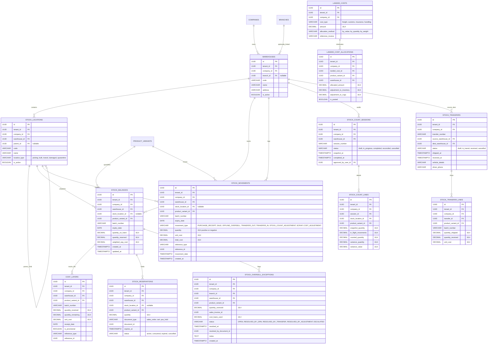

# Step 7: Multi-Warehouse Inventory, Append-Only Stock Ledger & Costing Plan

## 1. Executive Summary & Review Scope
- **Step Objective:** Implement a high-integrity, multi-warehouse inventory engine with bin/shelf stock locations; an append-only `stock_movements` ledger protected by a database immutability trigger; real-time transactional `stock_balances` cache; weighted-average cost (per company) and FIFO `cost_layers`; synchronous document-linked stock reservations with auto-expiry; stock count sessions capable of reconciling in-flight trading movements; inter-branch stock transfers; post-sale landed cost allocation; deterministic sorted-order row locking with SQLSTATE 40001/40P01 retries; and the ADR-016 offline oversell supervisor exception workflow.
- **Design Sections:**
  - §8.2 Item 5: Multi-Warehouse Inventory & Costing.
  - §9.1 Tables 12–13: Schema definitions for `stock_movements` and `stock_balances`.
  - §9.2 Trigger 6: Immutable append-only trigger on `stock_movements` (`trg_stock_movements_immutability`).
  - §13.1: Deterministic sorted row locking (`lockForUpdate()`) and retry on deadlock (`40P01`) and serialization failure (`40001`).
  - §16.2: True multi-process concurrency verification test (`test_true_parallel_pos_checkouts_prevent_overselling`).
  - ADR-016: Offline POS oversell reconciliation and supervised exception handling.
- **Review Items Closed:**
  - `INV-01` (High): Implement append-only stock movement ledger (`stock_movements`), FIFO cost-layer table (`cost_layers`), prevent updates/deletions via trigger, and reconcile stock ledger to GL inventory assets.
  - `INV-03` (Medium): Decouple warehouses from branches. Warehouses belong to companies with an optional branch link; introduce hierarchical `stock_locations` (aisle/rack/shelf/bin/virtual). Balances and movements carry a `stock_location_id` column.
  - `INV-04` (Medium): Introduce synchronous document-linked `stock_reservations` table with expiry timestamps and automated release; resolve negative stock via ADR-016.
  - `INV-06` (Medium): Stock count sessions during active trading that snapshot quantities and adjust for in-flight sales; FEFO/FIFO cost allocation; landed costs arriving after goods have been sold expensed directly to COGS (`5010`).
  - `NEW-26` (Resolved via ADR-016): Synced offline POS transactions never fail for lack of stock; deficits post as `OFFLINE_OVERSELL` movements into a negative balance and open an item in the Supervisor Exception Queue (`stock_oversell_exceptions`).

---

## 2. Gate Items & Architectural Pre-Conditions
1. **ADR-016 Gate Settle First (`steps.md` Line 14):**
   - **Status:** **Closed.** ADR-016 is merged and indexed.
   - Synced offline sales must commit unconditionally. Deficits drive `stock_balances.quantity_on_hand` negative, record `OFFLINE_OVERSELL` movement, freeze moving average cost at last known unit cost, post initial COGS, and open an item in `stock_oversell_exceptions`.
   - When replenishment GRN arrives, automated true-up posts `COST_ADJUSTMENT` movement and balancing GL journal (`5010 COGS` / `1040 Inventory Asset`).
2. **Deterministic Hot-Row Lock Ordering Invariant (§13.1):**
   - POS checkouts touching multiple variants must collect all variant IDs, sort them ascending (`collect($items)->pluck('variant_id')->sort()->values()`), and lock rows in strict ascending order using `lockForUpdate()`.
   - All mutations wrap inside `DB::transaction(..., attempts: 3)` to automatically retry on PostgreSQL deadlock (`SQLSTATE 40P01`) and serialization failure (`SQLSTATE 40001`).
3. **Database-Level Immutability Invariant (§9.2):**
   - `stock_movements` is strictly append-only. PostgreSQL trigger `trg_stock_movements_immutability` rejects any `UPDATE` or `DELETE` at the database engine level.
4. **Relational Tenancy & RLS Invariant (AGENTS.md):**
   - Every inventory table is created via `TenantMigration` with `tenant_id`, composite unique key `(tenant_id, id)`, forced PostgreSQL Row Level Security (RLS), fail-closed policy, and composite foreign keys `(tenant_id, company_id, ...)`.

---

## 3. Database Schema Design (All Tenant Tables Built with `TenantMigration`)



---

## 4. Concurrency & Deadlock Prevention Architecture (§13.1, §16.2)

### A. Deterministic Lock Ordering
When an order or checkout touches $N$ items, random lock acquisition across concurrent checkouts causes circular wait conditions and PostgreSQL deadlocks (`SQLSTATE 40P01`).
1. **Sorted Variant Locking:** The checkout service sorts variant IDs ascending before querying:
   ```php
   $sortedVariantIds = collect($items)
       ->pluck('product_variant_id')
       ->unique()
       ->sort()
       ->values()
       ->all();

   $lockedBalances = StockBalance::where('warehouse_id', $warehouseId)
       ->whereIn('product_variant_id', $sortedVariantIds)
       ->orderBy('product_variant_id', 'ASC')
       ->lockForUpdate()
       ->get()
       ->keyBy('product_variant_id');
   ```
2. **Missing Balance Row Insert Race:** When two transactions attempt to insert the first stock balance for a variant at the same warehouse, the `uq_stock_variant_batch` constraint causes a duplicate key race. The service handles this with PostgreSQL `ON CONFLICT DO UPDATE` or atomic `firstOrCreate()` inside the transaction.

### B. Serialization and Deadlock Retries
All checkout and stock adjustment mutations execute within Laravel's `DB::transaction(..., attempts: 3)`. The retry wrapper automatically catches:
- `SQLSTATE 40001` (Serialization failure)
- `SQLSTATE 40P01` (Deadlock detected)

---

## 5. Inventory Valuation & Landed Cost Mechanics

### A. Weighted Average Cost (WAC) Engine
- Maintained at the company level per warehouse and variant:
  $$\text{New WAC} = \frac{(\text{Current Qty} \times \text{Current WAC}) + (\text{Received Qty} \times \text{Received Unit Cost})}{\text{Current Qty} + \text{Received Qty}}$$
- If $\text{Current Qty} \le 0$ (per ADR-016), moving average calculation is frozen; new receipts reset the WAC to the incoming invoice price for positive remaining units.

### B. FIFO Cost Layers Engine
- Inbound receipts (`PURCHASE_RECEIPT`, `TRANSFER_IN`, positive adjustments) create a record in `cost_layers` with `quantity_remaining = quantity_received`.
- Sales and outbound transfers deplete existing layers ordered by `receipt_date ASC, created_at ASC`.
- Shortfalls during offline POS sync create a provisional negative layer (`is_provisional = true`).

### C. Post-Sale Landed Cost Allocation (`INV-06`)
When landed costs (freight, port handling, customs duties) arrive after an item batch has been partially or fully sold:
1. Total landed cost is allocated across batch units (by value or quantity).
2. For units **still in stock**: Allocated landed cost increases `stock_balances.weighted_avg_cost` and debits GL `1040 (Inventory Asset)`.
3. For units **already sold**: Allocated landed cost bypasses inventory balance and is posted directly as an immutable `COST_ADJUSTMENT` movement, debiting GL `5010 (Cost of Goods Sold)` and crediting GL `2010 (Accounts Payable / Accrued Charges)`.

---

## 6. Stock Count Sessions with In-Flight Reconciliation (`INV-06`)

Retail outlets perform cycle counts during business hours without halting trading.
1. **Session Initialization & Snapshot:**
   - Supervisor starts a count session for a warehouse / location.
   - The system records a frozen `snapshot_quantity` for each variant at $T_0$.
2. **In-Flight Movement Tracking:**
   - Cashiers continue selling and receiving goods.
   - Every movement committed between $T_0$ and session completion ($T_1$) with matching warehouse and variant is automatically linked and summed:
     $$\text{Expected Quantity} = \text{Snapshot Qty} + \sum_{T_0}^{T_1} \text{In-Flight Movements}$$
3. **Variance Reconciliation & Approval:**
   - Counters input `counted_quantity`.
   - $\text{Variance} = \text{Counted Quantity} - \text{Expected Quantity}$.
   - Upon supervisor approval, an automated `STOCK_COUNT_ADJUSTMENT` movement is posted for non-zero variances, updating stock balances and posting inventory gain/loss GL journals.

---

## 7. Step-by-Step Implementation Commits (Tests First for Each)

Each commit follows the non-negotiable rule: **write failing test first on dev server, see it fail, implement, verify pass, run Pint & PHPStan, tick commit.**

### Commit 1: Warehouses & Stock Locations Schema & Scoping [x] (Done - commit `01be3e3`, `81634b7`)
- **Review IDs Closed:** `INV-03`
- **Failing Tests First:**
  - `tests/Database/WarehouseDatabaseTest.php`:
    - Warehouses belong to companies with optional branch links.
    - Creating warehouse with cross-tenant branch fails composite FK.
    - Hierarchical `stock_locations` support self-referencing `parent_id` within the same warehouse.
    - Forced RLS prevents tenant cross-visibility on warehouses and stock locations.
- **Implementation:**
  - Create migration `2026_11_05_000001_create_warehouses_table.php` (via `TenantMigration`).
  - Create migration `2026_11_05_000002_create_stock_locations_table.php` (via `TenantMigration`).
  - Models: `app/Models/Warehouse.php`, `app/Models/StockLocation.php`.
  - Enforce `LocationScope` and composite foreign keys.
- **Verification:** Run `php artisan test tests/Database/WarehouseDatabaseTest.php` and `php artisan db:check-rls`.

### Commit 2: Append-Only Stock Movements Ledger with Immutability Trigger [x] (Done - commit `cbe2486`)
- **Review IDs Closed:** `INV-01`, `NEW-23`
- **Failing Tests First:**
  - `tests/Database/StockMovementImmutabilityTest.php`:
    - Inserting a valid stock movement succeeds.
    - Updating any column on an existing stock movement fails with PostgreSQL trigger error `Inventory Audit Violation: Stock movements are an append-only ledger`.
    - Deleting an existing stock movement fails with the same trigger error.
    - Truncate permission is revoked for `app_rw`.
- **Implementation:**
  - Create migration `2026_11_05_000003_create_stock_movements_table.php` (with `stock_location_id`).
  - Create migration `2026_11_05_000004_create_stock_movements_immutability_trigger.php` implementing §9.2 Trigger 6.
  - Model: `app/Models/StockMovement.php`.
- **Verification:** Run `php artisan test tests/Database/StockMovementImmutabilityTest.php`.

### Commit 3: Stock Balances Projected Cache with ADR-016 Constraint [x] (Done - commit `218543c`, `d0f241a`)
- **Review IDs Closed:** `INV-02`, `INV-03`, `NEW-26`
- **Failing Tests First:**
  - `tests/Database/StockBalanceDatabaseTest.php`:
    - Balance upsert updates `quantity_on_hand` and `weighted_avg_cost` in same transaction.
    - Online checkout attempting to reduce balance below 0 fails with `InsufficientStockException`.
    - Negative balance is permitted *strictly* when movement is `OFFLINE_OVERSELL`.
    - Composite uniqueness on `(tenant_id, warehouse_id, stock_location_id, product_variant_id, batch_number) NULLS NOT DISTINCT`.
- **Implementation:**
  - Create migration `2026_11_05_000005_create_stock_balances_table.php` (with `stock_location_id` and ADR-016 check).
  - Model: `app/Models/StockBalance.php`.
- **Verification:** Run `php artisan test tests/Database/StockBalanceDatabaseTest.php`.

### Commit 4: Mathematical Ledger Property Test (1,000 Movements Invariant) [x] (Done - commit `ac0781e`, `9817fcb`)
- **Review IDs Closed:** `INV-01`, `INV-02`
- **Failing Tests First:**
  - `tests/Database/StockLedgerPropertyTest.php`:
    - Generates 1,000 randomized stock movements (purchases, sales, transfers, count adjustments across 5 variants and 2 warehouses).
    - Asserts that for every single variant and warehouse, `stock_balances.quantity_on_hand` equals `SUM(stock_movements.quantity)` exactly down to 4 decimal places.
    - Prints random seed for replayability.
- **Implementation:**
  - Service: `app/Modules/Inventory/Services/StockMovementService.php` implementing `StockMovementServiceContract`.
  - Transactional movement posting ensuring balances are updated atomically in the same database transaction.
- **Verification:** Run `php artisan test tests/Database/StockLedgerPropertyTest.php`.

### Commit 5: Sorted Row Locking, Deadlock Prevention & Multi-Process Concurrency Test (§13.1, §16.2) [x] (Done - commit `b80c17d`)
- **Review IDs Closed:** `INV-05`, `QA-01`
- **Failing Tests First:**
  - `tests/Concurrency/ParallelPosCheckoutTest.php`:
    - Real multi-process test: Variant starts with exactly 1 unit available.
    - Two asynchronous Symfony `Process` instances execute concurrent checkouts on the dev server.
    - Exactly one process commits (exit code 0); the other fails with `InsufficientStockException` (exit code 1).
    - Final balance is 0.0000; exactly 1 movement recorded.
  - `tests/Concurrency/ForcedDeadlockRetryTest.php`:
    - Two processes lock items in reverse order (Variant 1 then 2 vs Variant 2 then 1) under `DB::transaction(..., attempts: 3)`.
    - Assert deadlock `SQLSTATE 40P01` is caught, retried, and both succeed.
- **Implementation:**
  - Checkout locking engine in `StockMovementService`: sort variant IDs ascending, `lockForUpdate()`, transaction retry wrapper.
  - CLI command for test worker: `app/Console/Commands/SimulatePosCheckoutCommand.php`.
- **Verification:** Run `php artisan test tests/Concurrency/ParallelPosCheckoutTest.php` and `tests/Concurrency/ForcedDeadlockRetryTest.php`.

### Commit 6: FIFO Cost Layers Engine & WAC True-Up
- **Review IDs Closed:** `INV-01`, `INV-06`
- **Failing Tests First:**
  - `tests/Unit/CostingServiceTest.php`:
    - Receipt of 10 units at 50 BDT, then 10 units at 70 BDT.
    - Sale of 15 units consumes layer 1 (10 @ 50) and layer 2 (5 @ 70), total COGS = 850 BDT. Remaining layer has 5 @ 70 = 350 BDT.
    - WAC correctly reflects weighted average per company.
- **Implementation:**
  - Create migration `2026_11_05_000006_create_cost_layers_table.php`.
  - Model: `app/Models/CostLayer.php`.
  - Service: `app/Modules/Inventory/Services/CostingService.php` implementing `CostingServiceContract`.
- **Verification:** Run `php artisan test tests/Unit/CostingServiceTest.php`.

### Commit 7: Document-Linked Stock Reservations with Expiry
- **Review IDs Closed:** `INV-04`
- **Failing Tests First:**
  - `tests/Database/StockReservationTest.php`:
    - Reserving 5 units increments `quantity_reserved` on `stock_balances`.
    - Available stock (`on_hand - reserved`) is decremented.
    - Expired reservations are automatically released via command/service, returning available stock.
    - Committing the sale converts reservation to completed movement.
- **Implementation:**
  - Create migration `2026_11_05_000007_create_stock_reservations_table.php`.
  - Model: `app/Models/StockReservation.php`.
  - Service: `app/Modules/Inventory/Services/StockReservationService.php` implementing `StockReservationServiceContract`.
  - Command: `app/Console/Commands/ReleaseExpiredReservationsCommand.php`.
- **Verification:** Run `php artisan test tests/Database/StockReservationTest.php`.

### Commit 8: Stock Count Sessions with In-Flight Movement Tracking
- **Review IDs Closed:** `INV-06`
- **Failing Tests First:**
  - `tests/Database/StockCountSessionTest.php`:
    - Count session snapshots 100 units.
    - Sale of 10 units occurs during the count (in-flight movement).
    - Counter counts 90 units.
    - System calculates Expected = 100 - 10 = 90, Variance = 0.
    - Non-zero variance generates approved `STOCK_COUNT_ADJUSTMENT` movement and balancing GL entry.
- **Implementation:**
  - Create migration `2026_11_05_000008_create_stock_count_tables.php` (`stock_count_sessions`, `stock_count_lines`).
  - Models: `app/Models/StockCountSession.php`, `app/Models/StockCountLine.php`.
  - Service: `app/Modules/Inventory/Services/StockCountService.php` implementing `StockCountServiceContract`.
- **Verification:** Run `php artisan test tests/Database/StockCountSessionTest.php`.

### Commit 9: Inter-Branch Stock Transfers (Document Now, Mushak 6.5 Later)
- **Review IDs Closed:** `INV-03`
- **Failing Tests First:**
  - `tests/Database/StockTransferTest.php`:
    - Initiating transfer moves stock from source warehouse to in-transit location (`TRANSFER_OUT`).
    - Receiving transfer at destination warehouse moves stock from in-transit to destination warehouse (`TRANSFER_IN`).
    - Discrepancy during receipt (damaged/lost in transit) logs variance adjustment.
- **Implementation:**
  - Create migration `2026_11_05_000009_create_stock_transfers_table.php` (`stock_transfers`, `stock_transfer_lines`).
  - Models: `app/Models/StockTransfer.php`, `app/Models/StockTransferLine.php`.
  - Service: `app/Modules/Inventory/Services/StockTransferService.php` implementing `StockTransferServiceContract`.
- **Verification:** Run `php artisan test tests/Database/StockTransferTest.php`.

### Commit 10: Landed Cost Allocation & Late-Arrival Cost Adjustment
- **Review IDs Closed:** `INV-06`
- **Failing Tests First:**
  - `tests/Database/LandedCostAllocationTest.php`:
    - Freight cost allocated across batch in stock adjusts inventory asset value and WAC.
    - Freight cost allocated to batch already sold out creates direct COGS adjustment journal (`DR 5010 / CR 2010`) and `COST_ADJUSTMENT` stock movement.
- **Implementation:**
  - Create migration `2026_11_05_000010_create_landed_costs_table.php` (`landed_costs`, `landed_cost_allocations`).
  - Models: `app/Models/LandedCost.php`, `app/Models/LandedCostAllocation.php`.
  - Service: `app/Modules/Inventory/Services/LandedCostService.php` implementing `LandedCostServiceContract`.
- **Verification:** Run `php artisan test tests/Database/LandedCostAllocationTest.php`.

### Commit 11: ADR-016 Offline Oversell Sync & Supervisor Exception Queue
- **Review IDs Closed:** `NEW-26`
- **Failing Tests First:**
  - `tests/Database/OfflineOversellSyncTest.php`:
    - Offline sync of 5 units with 2 units on hand commits unconditionally.
    - Final stock balance is `-3.0000`.
    - Movement type is `OFFLINE_OVERSELL`.
    - `stock_oversell_exceptions` record created with status `OPEN`.
    - COGS posted at last known cost.
    - Linking late GRN resolves exception to `RESOLVED_BY_GRN` and triggers cost variance true-up journal.
- **Implementation:**
  - Create migration `2026_11_05_000011_create_stock_oversell_exceptions_table.php`.
  - Model: `app/Models/StockOversellException.php`.
  - Service: `app/Modules/Inventory/Services/OfflineOversellService.php` implementing `OfflineOversellServiceContract`.
- **Verification:** Run `php artisan test tests/Database/OfflineOversellSyncTest.php`.

### Commit 12: Filament Admin Back-Office Resources & GL Inventory Reconciliation
- **Review IDs Closed:** `INV-01`, `INV-03`, `INV-06`, `NEW-26`
- **Failing Tests First:**
  - `tests/Feature/InventoryFilamentResourcesTest.php`:
    - Warehouses, Stock Locations, Stock Balances, Stock Movements, Transfers, Stock Counts, Landed Costs, and Oversell Exceptions accessible in Tenant Admin panel.
    - Inventory valuation report reconciles total stock asset value with GL Account 1040 balance.
- **Implementation:**
  - Filament Resources in `app/Filament/Resources/`:
    - `WarehouseResource`, `StockLocationResource`, `StockBalanceResource`, `StockMovementResource` (read-only), `StockTransferResource`, `StockCountSessionResource`, `LandedCostResource`, `StockOversellExceptionResource`.
  - Inventory GL Reconciliation Report page.
- **Verification:** Run `php artisan test tests/Feature/InventoryFilamentResourcesTest.php`.

---

## 8. Summary of Server Commands & Quality Gate Execution

After each commit, the following command suite runs on the dev server (CT 104):
```bash
# 1. Formatting
vendor/bin/pint --dirty --format agent

# 2. Static Analysis
vendor/bin/phpstan analyse --memory-limit=2G

# 3. Affected Database & Concurrency Tests
php artisan test --filter={TestName}

# 4. Multi-Tenant RLS Security Check
php artisan db:check-rls
```

---

## 9. Risk & Mitigation Matrix

| Risk | Impact | Likelihood | Mitigation |
|---|---|---|---|
| **PostgreSQL Deadlock on Hot Items (INV-05)** | High | High | Enforce deterministic lock ordering: extract all variant IDs in cart, sort ascending, and execute `lockForUpdate()` in sorted order. Wrap in `DB::transaction(..., attempts: 3)` catching `40P01` and `40001`. |
| **Negative Stock Drift Corrupting GL (NEW-26)** | High | Medium | Freeze moving average calculation when balance $\le 0$. Value COGS at last known cost. Open blocking supervisor exception with 24h SLA. True-up variance immediately when late GRN arrives. |
| **Trading Movements Corrupting In-Progress Stock Counts (INV-06)** | Medium | High | Stock count sessions freeze a snapshot at $T_0$ and dynamically aggregate all in-flight sales/receipts between $T_0$ and count submission before computing discrepancy. |
| **Post-Sale Landed Cost Orphaned from Inventory Asset** | Medium | Medium | Automated split: landed costs for units in stock increase inventory valuation; landed costs for units already sold are expensed directly to COGS (`5010`) via automated `COST_ADJUSTMENT`. |
