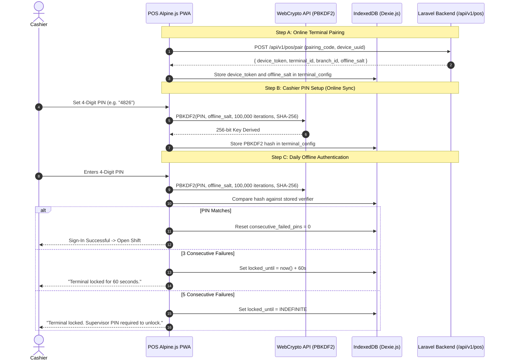

# Step 8: Offline POS Shell & Terminal PWA Plan

## 1. Executive Summary & Review Scope
- **Step Objective:** Build a resilient, high-velocity, client-side offline Point-of-Sale (POS) Single Page Application (SPA) / Progressive Web App (PWA) in `resources/pos` using Alpine.js and Dexie.js (IndexedDB). The application must open instantly, scan barcodes with sub-10ms response times, price tax-inclusive retail items according to Bangladesh VAT 2012 rules, persist every cart change to survive browser reloads and power cuts, enforce offline role-based discount ceilings and PIN lockouts, track register shift cash float and note denominations, and capture offline sales in a local sync queue without server dependency.
- **Design Sections:**
  - §11.1: Client-Side Offline POS Architecture (PWA shell, Dexie tables, WebCrypto PBKDF2 PIN verifiers, storage persistence).
  - §11.2: Offline Operational Policy Matrix (offline sales, B2B credit sale blocks, stock availability caching, SDC provisional receipts).
  - §11.4: Exact Tax Formulas & Key Screen Wireframes (Tax-inclusive calculations, rounding rules, 1366×768 high-velocity POS screen).
  - §3.2: Segregation of Duties Matrix (Role discount ceilings: Cashier 5%, Supervisor 10%, Branch Manager 15%).
- **Review IDs Closed:**
  - `POS-04` (High): Complete offline operational policy and conflict matrix.
  - `POS-07` (High): Hardened offline cashier PIN authentication with device-specific PBKDF2 salts and exponential lockout.
  - `POS-08` (High): Persistent storage assertion (`navigator.storage.persist()`), 50MB quota check, and 4-hour unsynced sales alert.
  - `POS-11` (Medium): Non-colliding keyboard mapping (eliminating browser-reserved `F10`, `F11`, `F12` conflicts), kiosk mode, and autofocus capture.
  - `NEW-32` (High): Restore critical controls dropped in v1.5.0: cart saved on every keystroke, offline supervisor refunds with linked credit notes, manual TrxID for offline bKash/Nagad/card payments, and §3.2 discount matrix.

---

## 2. Gate Items & Architectural Pre-Conditions

1. **Service Worker HTTPS Requirement:**
   - Browsers exclusively register Service Workers and WebCrypto credentials on secure origins (`https://` or `localhost`). Container 104 is served over valid SSL at `https://dev.kcerp.com`, satisfying this gate.
2. **Bangladesh Retail Rounding & Tax Engine (`NEW-08`, §11.4):**
   - For retail items with tax-inclusive MRP: $\text{Net Price} = \text{round}(\text{Gross MRP} / (1 + V), 2)$ and $\text{VAT Amount} = \text{Gross MRP} - \text{Net Price}$.
   - Subtotals, line totals, and VAT retain standard half-up 2-decimal precision. Cash tendered in physical drawers rounds to the nearest integer ৳1 at checkout completion.
3. **Offline Credit Sales Gate (`NEW-32`, §11.2):**
   - **Decision:** As decided in design §11.2, B2B credit sales (on-account receivables) are **strictly blocked while offline** to eliminate catastrophic credit limit breaches and uncollectible debt. Only Cash, Card, and MFS (bKash/Nagad) with manual reference numbers are accepted offline.
4. **Discount Ceilings Discrepancy Resolution:**
   - Where design §11.2 mentions "Supervisor max 15%", the review finding `NEW-32` and §3.2 Segregation of Duties matrix govern:
     - **Cashier:** Maximum 5%
     - **Shift Supervisor:** Maximum 10% (Supervisor PIN required)
     - **Branch Manager:** Maximum 15% (Branch Manager PIN required)
     - Discounts $> 0\%$ require a mandatory reason code.

---

## 3. Database & Local Dexie Schema Design

### Dexie.js Schema (`pos_db`, Version 1)
```javascript
db.version(1).stores({
    // Local catalog cache for sub-10ms barcode lookups
    catalog: 'variant_id, barcode, sku, name_en, name_bn, mrp_price, wholesale_price, cost_price, tax_rate, tax_type, is_tax_inclusive, is_active, updated_at',
    
    // Persistent active cart (saved on every keystroke)
    carts: 'id, customer_id, updated_at',
    
    // Pending offline sales queue
    pending_sales: 'id, invoice_number, shift_id, cashier_id, branch_id, terminal_id, subtotal, discount_amount, tax_amount, grand_total, created_at, status, synced_at',
    
    // SDC fiscal signing queue
    pending_fiscal_queue: 'id, sale_id, invoice_number, status, created_at',
    
    // Register shifts and cash float / note denominations
    shifts: 'id, terminal_id, cashier_id, opened_at, closed_at, status',
    
    // Terminal configuration, persistent device token, and PBKDF2 verifiers
    terminal_config: 'key'
});
```

### Backend Migration (Terminal Pairing & Device Security)
- Create migration `2026_11_08_000001_create_pos_terminal_devices_table.php`:
  - `id` (UUID PK), `tenant_id`, `company_id`, `branch_id`, `pos_terminal_id` (FK to `pos_terminals`).
  - `device_uuid` (string), `device_name` (string).
  - `device_token_hash` (string SHA-256 hash of 64-char high-entropy token).
  - `offline_salt` (string hex-encoded 16 bytes for PBKDF2).
  - `last_sync_at` (timestamptz nullable).
  - `is_active` (boolean).
  - Composite RLS policies and `(tenant_id, id)` unique constraints per AGENTS.md.

---

## 4. Key Map & Kiosk Mode Specification (`POS-11`, `NEW-32`)

To eliminate browser key conflicts on Chrome and Edge kiosk terminals:
- **Forbidden Keys:** `F10` (activates browser menubar in Windows), `F11` (toggles browser window fullscreen), `F12` (opens Developer Tools).
- **POS Action Key Map:**
  - `F1`: Focus Barcode / SKU scanner input.
  - `F2`: Edit quantity of highlighted line item.
  - `F3`: Apply item/basket discount (opens discount modal).
  - `F4`: Select customer / Walk-in toggle.
  - `F6`: Open returns / refund workflow (requires Supervisor PIN).
  - `F7`: Quick Cash Pay (exact amount tendered).
  - `F8`: Payment mode selector (Cash, bKash, Nagad, Card).
  - `F9`: Finalize checkout, kick cash drawer, and print receipt.
  - `Esc`: Clear scanner input, dismiss modal, or cancel active selection.
  - `Ctrl + Shift + S`: Supervisor PIN override prompt.
- **Key Suppression:** When the POS shift is active, `keydown` handler intercepts and prevents browser defaults for `F5`, `Ctrl+R` (page reload), `Ctrl+P` (standard browser print), `Ctrl+U` (view source), and right-click context menu.

---

## 5. Security & Authentication Architecture (`POS-07`, `NEW-07`)



---

## 6. Implementation Commits & Test-First Plan

### Commit 1: Resources Structure, Vite Bundling & PWA Service Worker Shell
- **Review IDs Closed:** `POS-04`, `POS-08`
- **Failing Tests First:**
  - `tests/pos/sw-cache.test.js` (Vitest):
    - Asserts service worker cache manifest contains shell HTML, CSS, JS bundles, and static sound cues (`beep.mp3`, `error.mp3`).
    - Cache-first strategy for precached static assets.
- **Implementation:**
  - Update `vite.config.js` to register `resources/pos/app.js` and `resources/pos/css/pos.css` as independent bundle entries.
  - Create `resources/pos/index.html` (standalone PWA shell mount).
  - Create `resources/pos/sw.js` (Service Worker handling install, precache, activate, and fetch).
  - Blade route & controller: `Route::get('/pos', [PosController::class, 'index'])` returning PWA shell view.
  - Install dependencies on dev server (CT 104): `npm install alpinejs dexie`.
- **Verification:** Run `npx vitest run tests/pos/sw-cache.test.js`.

### Commit 2: Client-Side Tax & Pricing Module with Golden Vectors
- **Review IDs Closed:** `NEW-08`, `TAX-07`
- **Failing Tests First:**
  - `tests/pos/tax-calculator.test.js` (Vitest):
    - Golden Vector 1: 2x Arogya Neem Soap @ ৳180.00 MRP (5% VAT inclusive) = ৳360.00 Gross (Net: ৳342.86, VAT: ৳17.14).
    - Golden Vector 2: 1x Pure Mustard Oil @ ৳500.00 MRP (2.63% net VAT inclusive) = ৳500.00 Gross (Net: ৳486.85, VAT: ৳13.15).
    - Combined Basket Subtotal: Net ৳829.71, VAT ৳30.29, Gross ৳860.00.
    - Cash drawer rounding to nearest integer ৳1 at tender completion.
- **Implementation:**
  - Create `resources/pos/js/services/tax-calculator.js`:
    - Pure, deterministic tax computation functions using integer/scaled decimal arithmetic (no floating point rounding traps).
    - Half-up rounding helper to 2 decimal places.
    - Cash rounding helper to integer ৳1.
- **Verification:** Run `npx vitest run tests/pos/tax-calculator.test.js`.

### Commit 3: Versioned Dexie.js Schema & Storage Persistence Engine
- **Review IDs Closed:** `POS-08`
- **Failing Tests First:**
  - `tests/pos/dexie-db.test.js` (Vitest with `fake-indexeddb`):
    - Initializes `pos_db` v1 and verifies tables: `catalog`, `carts`, `pending_sales`, `pending_fiscal_queue`, `shifts`, `terminal_config`.
    - Storage Persistence: Mocks `navigator.storage.persist()`; asserts persistence requested and handled.
    - Storage Quota: Asserts error thrown and new shifts blocked if quota free space < 50MB.
- **Implementation:**
  - Create `resources/pos/js/db/pos-db.js`:
    - Configures Dexie schema and versioning.
  - Create `resources/pos/js/services/storage-manager.js`:
    - Checks `persist()` and monitors `navigator.storage.estimate()`.
- **Verification:** Run `npx vitest run tests/pos/dexie-db.test.js`.

### Commit 4: Terminal Pairing & Incremental Catalog Delta Backend API
- **Review IDs Closed:** `POS-01`, `POS-04`
- **Failing Tests First:**
  - `tests/Feature/Pos/TerminalPairingAndDeltaTest.php` (Pest):
    - `POST /api/v1/pos/pair` with pairing code issues 64-char device token and offline salt.
    - `GET /api/v1/pos/catalog-delta` without token returns 401 Unauthorized.
    - `GET /api/v1/pos/catalog-delta` with token returns active product variants, barcodes, prices, and tax rates.
    - Querying with `?since={timestamp}` returns only records updated since that timestamp.
- **Implementation:**
  - Migration: `2026_11_08_000001_create_pos_terminal_devices_table.php`.
  - Model: `app/Models/PosTerminalDevice.php`.
  - Controller: `app/Http/Controllers/Api/Pos/PosTerminalApiController.php`.
  - Routes in `routes/api.php` under `/api/v1/pos/`.
  - PWA service: `resources/pos/js/services/catalog-sync.js` to fetch delta and bulk-upsert to Dexie.
- **Verification:** Run `php artisan test tests/Feature/Pos/TerminalPairingAndDeltaTest.php`.

### Commit 5: Hardened Offline Cashier Authentication & Exponential Lockouts
- **Review IDs Closed:** `POS-07`, `NEW-07`
- **Failing Tests First:**
  - `tests/pos/auth-pin.test.js` (Vitest):
    - Verifies PBKDF2 hash generation using WebCrypto with 100,000 iterations and salt.
    - Correct PIN unlocks terminal and returns cashier session.
    - 3 wrong PIN attempts trigger 60-second lock (refuses further attempts until timer expires).
    - 5 wrong PIN attempts trigger permanent lock requiring Supervisor PIN override.
- **Implementation:**
  - Create `resources/pos/js/services/auth-service.js`:
    - Implements WebCrypto PBKDF2 hash verification.
    - Manages lockout counters, expiration timestamps, and supervisor unlock bypass.
- **Verification:** Run `npx vitest run tests/pos/auth-pin.test.js`.

### Commit 6: Cart State Machine, Keystroke Auto-Save & Recovery
- **Review IDs Closed:** `POS-11`, `NEW-32`
- **Failing Tests First:**
  - `tests/pos/cart-store.test.js` (Vitest):
    - Adding, modifying quantity, or removing item saves cart to Dexie `carts` table on every operation.
    - Calling `restoreCart()` recreates identical basket, item lines, and calculations after page reload.
    - Clearing cart removes record from Dexie.
- **Implementation:**
  - Create `resources/pos/js/stores/cart-store.js` (Alpine.js reactive store):
    - Manages active line items, item barcode lookup, quantities, line totals, and tax breakdowns.
    - Debounced/immediate write-through to Dexie `carts` on every mutation.
- **Verification:** Run `npx vitest run tests/pos/cart-store.test.js`.

### Commit 7: Non-Colliding Keyboard Navigation & Scanner Focus Manager
- **Review IDs Closed:** `POS-11`, `NEW-32`
- **Failing Tests First:**
  - `tests/pos/keyboard-manager.test.js` (Vitest):
    - Verifies `F10`, `F11`, `F12` are unbound and suppressed.
    - Pressing `F1` focuses scanner input; `F2` focuses quantity modal; `F7` invokes cash pay; `Esc` dismisses modals.
    - Scanner autofocus: Keystrokes typed while focus is elsewhere are automatically routed to barcode input if rapid scanner timing (<30ms between chars) is detected.
- **Implementation:**
  - Create `resources/pos/js/services/keyboard-manager.js`:
    - Captures `keydown` events, suppresses browser-reserved combinations, routes shortcuts, and detects barcode scanner burst input.
- **Verification:** Run `npx vitest run tests/pos/keyboard-manager.test.js`.

### Commit 8: Role Discount Ceilings & Supervisor Override Engine
- **Review IDs Closed:** `NEW-32`, §3.2
- **Failing Tests First:**
  - `tests/pos/discount-rules.test.js` (Vitest):
    - Cashier applying 5% discount succeeds with reason code.
    - Cashier applying 6% discount is refused with `DiscountCeilingExceededException`.
    - Supervisor PIN authorizes discounts between 5.01% and 10%.
    - Branch Manager PIN authorizes discounts between 10.01% and 15%.
    - Applying any discount $> 15\%$ is rejected unconditionally.
    - Applying discount without reason code is refused.
- **Implementation:**
  - Create `resources/pos/js/services/discount-manager.js`:
    - Implements §3.2 discount matrix validation and supervisor PIN verification modal.
- **Verification:** Run `npx vitest run tests/pos/discount-rules.test.js`.

### Commit 9: Offline Payment Processing, MFS/Card References & 4-Hour Unsynced Alert
- **Review IDs Closed:** `POS-04`, `POS-08`, `NEW-32`
- **Failing Tests First:**
  - `tests/pos/offline-payment.test.js` (Vitest):
    - Cash tender computes change and integer rounding.
    - Offline bKash/Nagad/Card tender requires non-empty manual reference string; records status as `pending_verification`.
    - Completing sale writes record to Dexie `pending_sales` and `pending_fiscal_queue` with status `pending_sync`.
    - Unsynced alert: Sale older than 4 hours triggers `hasCriticalUnsyncedAlert = true`.
- **Implementation:**
  - Create `resources/pos/js/services/payment-service.js`:
    - Validates split/single tenders, captures TrxID for MFS/Card, creates local sales invoices.
  - Create `resources/pos/js/services/sync-monitor.js`:
    - Continuously evaluates oldest pending sale timestamp and emits 4-hour alert.
- **Verification:** Run `npx vitest run tests/pos/offline-payment.test.js`.

### Commit 10: Offline Returns, Refunds & Supervisor Credit Notes
- **Review IDs Closed:** `NEW-32`
- **Failing Tests First:**
  - `tests/pos/refund-service.test.js` (Vitest):
    - Initiating refund without supervisor PIN is refused.
    - Authorizing refund creates linked credit note line items with negative quantities and mandatory reason code.
    - Persists refund sale to Dexie `pending_sales` tagged as `type: 'CREDIT_NOTE'`.
- **Implementation:**
  - Create `resources/pos/js/services/refund-service.js`:
    - Manages return line items, validates original invoice reference, prompts for supervisor PIN, and enforces reason codes.
- **Verification:** Run `npx vitest run tests/pos/refund-service.test.js`.

### Commit 11: Register Shift Lifecycle: Open Float, Drops, Pickups & Denomination Count
- **Review IDs Closed:** `POS-04`
- **Failing Tests First:**
  - `tests/pos/shift-lifecycle.test.js` (Vitest):
    - Opening shift requires opening float (e.g. ৳2,000) and asserts storage quota $\ge$ 50MB.
    - Cash drops and pickups update `expected_cash`.
    - Closing shift takes note denomination counts (৳1000 down to ৳1), computes `actual_cash`, and calculates `over_short`.
    - Stores completed shift in Dexie `shifts` table.
- **Implementation:**
  - Create `resources/pos/js/stores/shift-store.js` (Alpine.js store):
    - Handles shift states, cash drawer reconciliation, drops, pickups, and denomination breakdown.
- **Verification:** Run `npx vitest run tests/pos/shift-lifecycle.test.js`.

### Commit 12: High-Velocity POS UI Screen (§11.4 Wireframe Implementation)
- **Review IDs Closed:** `POS-04`, `UX-01`
- **Failing Tests First:**
  - `tests/pos/pos-ui.test.js` (Vitest with JSDOM):
    - Renders header with Outlet Name, Terminal ID, Cashier Name, Shift Number, Network Status indicator (ONLINE / OFFLINE), and Fiscal SDC status.
    - Renders barcode search bar, line items table (Description, Batch/Exp, Unit Price, Qty, Disc%, Total BDT), and summary sidebar.
    - Renders tender modals (Cash, MFS, Card) and supervisor PIN dialog.
- **Implementation:**
  - Build Alpine.js UI components in `resources/pos/js/components/`:
    - `HeaderBar.js`, `ItemScanner.js`, `CartTable.js`, `SaleSummary.js`, `TenderModal.js`, `SupervisorModal.js`, `ShiftModal.js`.
  - Main Alpine controller in `resources/pos/js/pos-app.js`.
  - Tailwind styling matching §11.4 wireframe optimized for 1366×768 resolution.
- **Verification:** Run `npx vitest run tests/pos/pos-ui.test.js`.

### Commit 13: Playwright E2E Offline Cashier Workflow Suite
- **Review IDs Closed:** `POS-04`, `POS-07`, `POS-08`, `NEW-32`
- **Test Implementation (`tests/e2e/pos-offline.spec.js`):**
  - Scenario 1: Online login and terminal pairing -> Open shift with ৳2,000 float.
  - Scenario 2: Transition browser to offline (`context.setOffline(true)`).
  - Scenario 3: Scan 2 items; modify quantity; reload page mid-sale; verify cart restores completely.
  - Scenario 4: Cashier attempts 8% discount -> rejected. Cashier applies 5% discount -> accepted.
  - Scenario 5: Tender cash; complete transaction; verify receipt rendered and saved to Dexie `pending_sales`.
  - Scenario 6: Wrong PIN entered 3 times -> verify 60s freeze countdown.
  - Scenario 7: Close shift with denomination count; verify over/short calculation.
- **Verification:**
  - Execute Playwright headless on dev server: `npx playwright test tests/e2e/pos-offline.spec.js`.

---

## 7. Quality Gates & Server Command Suite

After each commit, the following command suite runs on the dev server (CT 104):
```bash
# 1. PHP code formatting & static analysis (for backend APIs)
vendor/bin/pint --test
vendor/bin/phpstan analyse --memory-limit=2G

# 2. Frontend unit/component tests
npx vitest run

# 3. Frontend PWA production build
npm run build

# 4. Multi-Tenant database and RLS verification
php artisan test tests/Feature/Pos/
php artisan db:check-rls
```

---

## 8. Risk & Mitigation Matrix

| Risk | Impact | Likelihood | Mitigation |
|---|---|---|---|
| **Storage Eviction on Chromium OS (`POS-08`)** | Critical | Low | PWA prompts `navigator.storage.persist()`. Continuous quota monitoring blocks shift creation if free space < 50MB. |
| **Cashier Disconnect Data Loss on Power Cut (`NEW-32`)** | High | High | Cart state is mirrored to Dexie `carts` table on every keystroke and restored automatically upon reload. |
| **Browser Function Key Hijacking (`POS-11`)** | High | High | Unbind `F10`, `F11`, `F12`. Capture all terminal shortcuts via `keydown` event suppression (`e.preventDefault()`). |
| **Unauthorized Cashier Discount Inflation (`NEW-32`)** | High | Medium | Hard ceiling enforced in client logic: Cashier 5%, Supervisor 10%, Manager 15%. Strict supervisor PIN verification required for overrides. |
| **Floating Point Currency Imprecision** | Critical | Medium | Zero floats in tax/currency calculations. All monetary calculations execute via scaled integer arithmetic matching Bangladesh VAT 2012 rules. |
