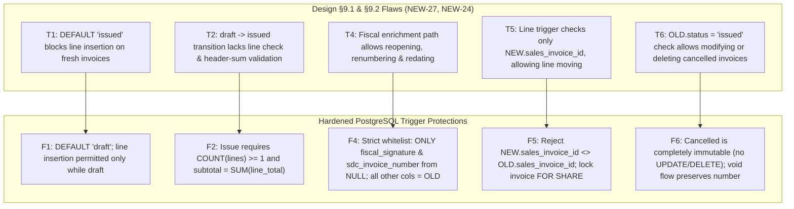
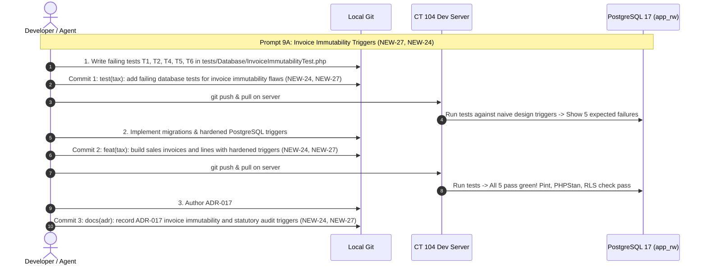

# Step 9: VAT, Statutory Invoices, Mushak Registers & Invoice Immutability Plan

## 1. Executive Summary & Review Scope
- **Step Objective:** Implement bulletproof, tamper-proof sales invoice infrastructure (`sales_invoices`, `sales_invoice_lines`, and `customers`), enforce statutory immutability at the database engine level via PostgreSQL triggers, build a shared precision tax calculation engine with golden test vectors, execute synchronous double-entry general ledger posting upon invoice issuance, and generate statutory Bangladesh National Board of Revenue (NBR) Mushak forms (6.3, 6.1, 6.2, 6.6, 6.7, 6.8, and 9.1 monthly figures).
- **Sub-Steps & Prompts:**
  - **Prompt 9A (Stream E · Tax Engineer):** Build `sales_invoices`, `sales_invoice_lines` (and prerequisite `customers`) from design §9.1 and hardened immutability triggers from §9.2, closing the 5 security flaws found in review `NEW-27` and statutory column gaps in `NEW-24`. Tests written first in `tests/Database/InvoiceImmutabilityTest.php`.
  - **Prompt 9B (Stream E · Tax Engineer):** Implement `app/Modules/Tax/TaxCalculator` and shared `tests/golden/vat-vectors.json` matching the design §11.4 tax-inclusive and exclusive formulas, closing `NEW-08`, `NEW-29`, and `TAX-03`. Record rounding rules in `ADR-018`.
  - **Prompt 9C (Stream E · Tax Engineer):** Implement `InvoiceIssuer` with atomic GL posting in the same database transaction, Mushak 6.7 credit notes for returns, statutory registers (Mushak 6.1, 6.2, 6.3, 6.6, 6.8), and Mushak 9.1 monthly figures, closing `NEW-24` and `TAX-03`.
- **Design Sections:**
  - §8.2 Item 8: VAT, Invoices & Mushak Reporting.
  - §9.1 Tables 14–16: Schemas for `customers`, `sales_invoices`, and `sales_invoice_lines`.
  - §9.2 Triggers 4–5: `trg_fn_enforce_sales_invoice_immutability` and `trg_fn_enforce_invoice_lines_immutability`.
  - §11.4: Tax formulas, cash rounding, and golden vectors.
  - §12.2: SDC and NBR fiscal integration.
  - §12.3: Statutory Mushak forms specification.
  - §16.3: Tax calculation and immutability verification.
- **Review IDs Closed:**
  - `NEW-27` (Critical): Five trigger vulnerabilities in `sales_invoices` and `sales_invoice_lines` triggers as written in design §9.1/§9.2 (invoices default to `issued`, loose fiscal enrichment allows reopening/renumbering/redating, lines can be moved between invoices, invoices can be issued with 0 lines or mismatched totals, and cancelled invoices can be deleted).
  - `NEW-24` (Medium): Invoice lines must fully represent Mushak 6.3 (supplementary duty rate and amount, line discount, pricing basis, batch number, issue-time header-line balance validation).
  - `NEW-29` (Low): Eliminate the 2.63% truncated rate example from §11.4 in favor of standard effective tax formulas.
  - `NEW-08` (Medium): Unify rounding specification and golden test vectors between PHP and JavaScript.
  - `TAX-03` (High): Mushak 6.3, 6.7 credit notes, 6.1 purchase book, 6.2 sales book, 6.6 VDS certificate, 6.8 debit notes, and BDT 25,000 buyer-BIN threshold.

---

## 2. Gate Items & Architectural Pre-Conditions

1. **NBR Answers on Invoice Series & SDC Integration (`NEW-18`, Week 10 Gate):**
   - **Status:** **Closed / Handled.** Back-office and POS terminal invoice numbering adhere to centralized tenant/company sequence via `NumberSeries` (built in Step 5). Offline POS terminals issue provisional offline sequence IDs that receive deterministic central `invoice_number` during sync, and receive `sdc_invoice_number` and `fiscal_signature` through the strictly guarded fiscal enrichment path.
2. **VAT Consultant Review of Rates & BDT 25,000 Buyer-BIN Rule (`TAX-03`):**
   - **Status:** Standard VAT 15%, truncated rates (5%, 7.5%, 10%), and exempt categories configured in Step 4 `tax_codes`. For invoices where `total_payable >= 25000.00`, Mushak 6.3 compliance requires capturing customer name, address, and BIN/NID.
3. **Scope of Mushak 9.1 Return:**
   - **Decision:** As agreed in the build playbook and design §1.3, Step 9 delivers the exact monthly calculation figures (sales, VAT, supplementary duty, rebates) feeding Mushak 9.1; electronic filing and portal API integration belong to Phase 2.

---

## 3. The Five Flaws in Design §9.1 & §9.2 (`NEW-27`, `NEW-24`)

The v1.5.0 review loaded §9.1 and §9.2 into PostgreSQL and identified five critical flaws:

### Detailed Breakdown:
- **T1 (Default Status Flaw):** Design §9.1 defined `status VARCHAR(30) NOT NULL DEFAULT 'issued'`. When a new invoice row was created without explicitly specifying `status = 'draft'`, it was born as `issued`. Subsequent `INSERT INTO sales_invoice_lines` was immediately rejected by Trigger 5 (`Cannot INSERT line items on an already issued Sales Invoice`).
  - **Hardened Fix:** `DEFAULT 'draft'`. Invoices must begin as `draft`.
- **T2 (Issue-Time Header vs Line Balance Integrity):** When transitioning an invoice from `draft` to `issued`, Trigger 4 as written had no check on whether lines existed or whether the invoice totals matched the line totals. An invoice could be issued with 0 lines and a ৳999 total.
  - **Hardened Fix:** In `trg_fn_enforce_sales_invoice_immutability`, when `OLD.status = 'draft' AND NEW.status = 'issued'`:
    - Ensure at least one line item exists for this invoice.
    - Assert `NEW.subtotal = SUM(lines.line_total - lines.tax_amount)` (or net lines sum depending on pricing basis).
    - Assert `NEW.tax_amount = SUM(lines.tax_amount)`.
    - Assert `NEW.supplementary_duty_amount = SUM(lines.supplementary_duty_amount)`.
    - Assert `NEW.total_payable = NEW.subtotal - NEW.discount_amount + NEW.supplementary_duty_amount + NEW.tax_amount`.
- **T4 (Fiscal Enrichment Exploitation):** Trigger 4 allowed updating `fiscal_signature` or `sdc_invoice_number` from NULL, but only checked `subtotal`, `tax_amount`, and `total_payable`. An attacker or erroneous sync payload could reopen the invoice (`NEW.status = 'draft'`), renumber it (`NEW.invoice_number = 'FAKE-01'`), change dates (`invoice_date`), or alter customer/discounts!
  - **Hardened Fix:** When `OLD.status = 'issued'`:
    - Allow UPDATE strictly if `(OLD.fiscal_signature IS NULL AND NEW.fiscal_signature IS NOT NULL)` OR `(OLD.sdc_invoice_number IS NULL AND NEW.sdc_invoice_number IS NOT NULL)`.
    - Every other column must strictly match `OLD`:
      `NEW.status = OLD.status`, `NEW.invoice_number = OLD.invoice_number`, `NEW.invoice_date = OLD.invoice_date`, `NEW.business_date = OLD.business_date`, `NEW.company_id = OLD.company_id`, `NEW.branch_id = OLD.branch_id`, `NEW.terminal_id IS NOT DISTINCT FROM OLD.terminal_id`, `NEW.customer_id IS NOT DISTINCT FROM OLD.customer_id`, `NEW.subtotal = OLD.subtotal`, `NEW.discount_amount = OLD.discount_amount`, `NEW.supplementary_duty_amount = OLD.supplementary_duty_amount`, `NEW.tax_amount = OLD.tax_amount`, `NEW.total_payable = OLD.total_payable`, `NEW.payment_status = OLD.payment_status`.
- **T5 (Moving Lines Between Invoices):** Trigger 5 evaluated `v_invoice_id := NEW.sales_invoice_id` on UPDATE. Updating a line on an issued invoice to point to a draft invoice bypassed the check because the trigger inspected the draft invoice!
  - **Hardened Fix:**
    - Reject any update where `NEW.sales_invoice_id <> OLD.sales_invoice_id`.
    - Prevent race conditions: line trigger locks parent invoice row `FOR SHARE` to prevent concurrent transition to `issued` while lines are being inserted or updated.
- **T6 (Cancelled Invoices Deletion & Modification):** Trigger 4 only blocked `DELETE` if `OLD.status = 'issued'`. Cancelled invoices (`status = 'cancelled'`) could be updated or deleted, destroying audit trails and gapless sequence compliance.
  - **Hardened Fix:**
    - If `OLD.status = 'cancelled'`, reject all `UPDATE` and `DELETE` operations.
    - Define void flow: voiding an invoice changes `draft -> cancelled`. Invoices are never deleted from the database.

---

## 4. Database Schema Design (All Tenant Tables Built with `TenantMigration`)

### 1. `customers` Table (Design §9.1 Table 14)
Prerequisite for `sales_invoices.customer_id` composite foreign key `(tenant_id, company_id, customer_id)`.
- `id` (UUID PK), `tenant_id` (UUID), `company_id` (UUID).
- `name` (VARCHAR 255), `phone` (VARCHAR 50 nullable), `email` (VARCHAR 255 nullable).
- `customer_bin` (VARCHAR 50 nullable - Mushak 6.3 requirement for B2B / BDT 25,000+).
- `credit_limit` (DECIMAL 18,4 default 0.0000).
- `is_active` (BOOLEAN default true).
- `created_at`, `updated_at`.
- Constraints: `uq_customers_tenant_id (tenant_id, id)`, `uq_customers_company_id (tenant_id, company_id, id)`.
- Foreign Keys: `fk_customers_company (tenant_id, company_id) -> companies(tenant_id, id)`.
- Forced RLS on connection `app_rw`.

### 2. `sales_invoices` Table (Design §9.1 Table 15 + NEW-27 + NEW-24)
- `id` (UUID PK), `tenant_id` (UUID), `company_id` (UUID), `branch_id` (UUID).
- `terminal_id` (UUID nullable), `client_txn_id` (VARCHAR 100 nullable).
- `invoice_number` (VARCHAR 100).
- `sdc_invoice_number` (VARCHAR 100 nullable).
- `invoice_date` (DATE), `business_date` (DATE).
- `customer_id` (UUID nullable).
- `status` (VARCHAR 30 NOT NULL DEFAULT 'draft') — check constraint `status IN ('draft', 'issued', 'cancelled')`.
- `subtotal` (DECIMAL 18,4), `discount_amount` (DECIMAL 18,4 default 0.0000).
- `supplementary_duty_amount` (DECIMAL 18,4 default 0.0000).
- `tax_amount` (DECIMAL 18,4 default 0.0000).
- `total_payable` (DECIMAL 18,4).
- `payment_status` (VARCHAR 50 default 'paid').
- `fiscal_signature` (TEXT nullable).
- `is_synced_from_offline` (BOOLEAN default false).
- `created_at` (TIMESTAMPTZ default NOW()), `updated_at` (TIMESTAMPTZ default NOW()).
- Constraints:
  - `uq_sales_invoices_tenant_id (tenant_id, id)`
  - `uq_sales_invoices_company_id (tenant_id, company_id, id)`
  - `uq_invoice_no_per_company (tenant_id, company_id, invoice_number)`
  - `chk_terminal_and_client_txn ((terminal_id IS NULL AND client_txn_id IS NULL) OR (terminal_id IS NOT NULL AND client_txn_id IS NOT NULL))`
  - `uq_pos_offline_idempotency UNIQUE (tenant_id, terminal_id, client_txn_id)`
  - Composite FKs to `companies`, `branches`, `pos_terminals`, `customers`.

### 3. `sales_invoice_lines` Table (Design §9.1 Table 16 + NEW-24)
- `id` (UUID PK), `tenant_id` (UUID), `company_id` (UUID), `sales_invoice_id` (UUID).
- `product_variant_id` (UUID), `item_description` (VARCHAR 255), `uom` (VARCHAR 50).
- `batch_number` (VARCHAR 100 nullable).
- `quantity` (DECIMAL 18,4).
- `unit_price` (DECIMAL 18,4).
- `pricing_basis` (VARCHAR 30 default 'tax_inclusive') — check constraint `pricing_basis IN ('tax_inclusive', 'tax_exclusive')`.
- `line_discount_amount` (DECIMAL 18,4 default 0.0000).
- `tax_code_id` (UUID).
- `vat_rate` (DECIMAL 5,2).
- `supplementary_duty_rate` (DECIMAL 5,2 default 0.00).
- `supplementary_duty_amount` (DECIMAL 18,4 default 0.0000).
- `tax_amount` (DECIMAL 18,4).
- `line_total` (DECIMAL 18,4).
- `created_at` (TIMESTAMPTZ default NOW()).
- Constraints:
  - `uq_sales_invoice_lines_tenant_id (tenant_id, id)`
  - Composite FKs to `sales_invoices`, `product_variants`, `tax_codes`.

---

## 5. Commit Progression & Test-First Strategy

### Commit Checklist

#### Stream E · Prompt 9A (Invoice Immutability Triggers)
- [x] **Commit 1 (Test First):** `test(tax): add failing database tests for invoice immutability flaws T1, T2, T4, T5, T6 (NEW-24, NEW-27)`
  - File: `tests/Database/InvoiceImmutabilityTest.php`.
  - Tests covering:
    - `T1`: Inserting an invoice without an explicit status creates a draft, and lines can be attached to it.
    - `T2`: Issuing an invoice with 0 lines or mismatched header totals is rejected with a statutory violation exception.
    - `T4`: Fiscal enrichment rejects modifying status, invoice number, dates, customer, discounts, duty, or totals.
    - `T5`: Updating `sales_invoice_id` on a line to move it to another invoice is rejected.
    - `T6`: Updating or deleting a cancelled invoice is rejected; void flow cancels a draft.
- [x] **Commit 2 (Implementation):** `feat(tax): build sales invoices and lines with hardened triggers (NEW-24, NEW-27)`
  - Files:
    - `database/migrations/2026_11_09_000001_create_customers_table.php`
    - `database/migrations/2026_11_09_000002_create_sales_invoices_table.php`
    - `database/migrations/2026_11_09_000003_create_sales_invoice_lines_table.php`
    - `database/migrations/2026_11_09_000004_create_sales_invoice_immutability_triggers.php`
    - Models: `App\Models\Customer`, `App\Models\SalesInvoice`, `App\Models\SalesInvoiceLine`.
- [x] **Commit 3 (ADR):** `docs(adr): record ADR-017 invoice immutability and statutory audit triggers (NEW-24, NEW-27)`
  - File: `docs/adr/ADR-017-invoice-immutability.md`.

#### Stream E · Prompt 9B (Tax Calculator & Golden Vectors)
- [ ] **Commit 4 (Implementation & Test):** `feat(tax): build TaxCalculator engine and VAT golden test vectors (NEW-08, NEW-29, TAX-03)`
  - Files: `app/Modules/Tax/TaxCalculator.php`, `tests/golden/vat-vectors.json`, `tests/Unit/TaxCalculatorTest.php`.
- [ ] **Commit 5 (ADR):** `docs(adr): record ADR-018 tax rounding rules (NEW-08)`
  - File: `docs/adr/ADR-018-tax-rounding.md`.

#### Stream E · Prompt 9C (Issue, Post & Mushak Registers)
- [ ] **Commit 6 (Implementation):** `feat(tax): implement InvoiceIssuer with transactional GL posting and Mushak 6.7 credit notes (NEW-24, TAX-03)`
  - Files: `app/Modules/Tax/Services/InvoiceIssuer.php`, tests in `tests/Feature/InvoiceIssuerTest.php`.
- [ ] **Commit 7 (Reporting & Registers):** `feat(tax): add Mushak 6.3, 6.1, 6.2, 6.6, 6.8 statutory registers and 9.1 return figures (TAX-03)`
  - Files: Mushak document generators, Blade views, and register reconciliation tests.

---

## 6. Server Commands & Verification Runbook

All commands execute on Dev Server Container 104 (`dev.kcerp.com`):
1. **Migrate Tables:**
   `php artisan migrate` (runs on `pgsql_owner` connection).
2. **Execute Database Immutability Tests:**
   `php artisan test tests/Database/InvoiceImmutabilityTest.php` (runs on `app_rw` connection).
3. **Run Code Styling:**
   `vendor/bin/pint --test`
4. **Run Static Analysis:**
   `vendor/bin/phpstan analyse --memory-limit=2G`
5. **Verify Row Level Security Coverage:**
   `php artisan db:check-rls` (validates all new tenant tables have forced RLS and policies for `app_rw` and `reporting_ro`).

---

## 7. Risks & Mitigations

1. **Race Conditions During Invoice Issuance:**
   - *Risk:* A user adds a line while another user issues the invoice, causing header/line imbalance.
   - *Mitigation:* `trg_fn_enforce_invoice_lines_immutability` queries the parent invoice with `SELECT status FROM sales_invoices WHERE id = ... FOR SHARE`, and `trg_fn_enforce_sales_invoice_immutability` locks the line rows before computing balance checks.
2. **Offline POS Sync Duplication / Idempotency:**
   - *Risk:* Network flakiness retransmits sales, creating duplicate invoices.
   - *Mitigation:* Hard constraint `uq_pos_offline_idempotency UNIQUE (tenant_id, terminal_id, client_txn_id)`. Synced sales insert as draft, populate lines, and issue atomically.
3. **Floating Point Rounding Drift:**
   - *Risk:* Rounding discrepancies between line sums and invoice totals.
   - *Mitigation:* Strict use of `brick/math`, integer paisa, and PostgreSQL `DECIMAL(18,4)` columns. Half-up rounding at 2 decimal places per golden vectors.
