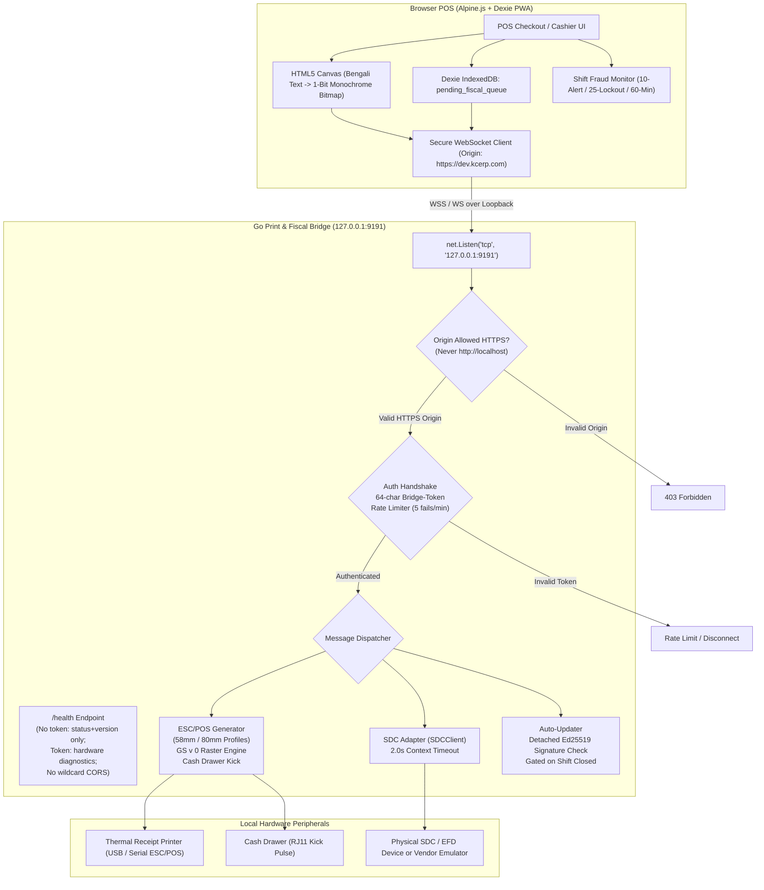

# Step 10: Print & Fiscal Bridge Plan

## 1. Executive Summary & Review Scope
- **Step Objective:** Implement a lightweight, secure, cross-platform background daemon in Go (`bridge/`) running on POS terminal host machines. The bridge binds strictly to loopback (`127.0.0.1:9191`) with zero external network listeners. It provides raw ESC/POS thermal printing (58 mm and 80 mm) with Bengali raster graphics (`GS v 0`), hardware cash drawer kick pulses, and an Electronic Fiscal Device (EFD / SDC) client adapter behind a clean interface enforcing a 2.0-second timeout.
- **Security Hardening:** The bridge accepts WebSocket connections only from configured tenant HTTPS origins (strictly refusing `http://localhost` and plain HTTP); mandates a 64-character `Bridge-Token` pairing handshake with rate-limited brute-force protection; exposes a restricted `/health` endpoint that leaks no hardware or port diagnostics without the token (and emits no wildcard CORS headers); and implements an auto-updater that verifies detached cryptographic signatures (Ed25519) against a public key compiled into the binary (rejecting API-provided checksums) and executes updates only when the POS shift is closed.
- **Queue Ownership & Dodging Controls:** The bridge is completely stateless—it maintains no internal queues. The POS browser owns the `pending_fiscal_queue` in Dexie IndexedDB and orchestrates replays. The POS enforces cumulative shift-level dodging controls: alerting at 10 un-fiscalized invoices and locking checkout at 25 un-fiscalized invoices or after 60 minutes offline until supervisor PIN override.
- **Design Sections Covered:**
  - §11.3: Local Print Bridge & Fiscal Device Architecture.
  - §12.2: Electronic Fiscal Device (EFD/SDC) Adapter & Offline Queue.
- **Review Findings Closed:**
  - `NEW-33` (Critical / Gate): Bridge auto-updater must verify detached cryptographic signature (Ed25519) against an embedded public key (never trust an API checksum), and must install only when the POS reports the shift closed.
  - `NEW-18` (Medium / Gate): Clarify queue ownership (browser Dexie `pending_fiscal_queue` owns the queue; bridge is stateless); dodge-proof fraud controls (alert at 10 cumulative un-fiscalized invoices per shift, lock at 25 or after 60 minutes offline); separate internal ERP invoice sequence from external SDC fiscal signature.
  - `POS-03` (Critical): Disambiguate ERP invoice numbers and SDC numbers; establish legal provisional invoice disclaimer when SDC is unreachable offline.
  - `TAX-01` (Critical): SDC adapter with 2.0-second context timeout, vendor emulator, test fake, and provisional receipt disclaimer `PROVISIONAL TAX INVOICE - PENDING FISCALIZATION`.

---

## 2. Gate Items & Pre-Conditions

1. **SDC Integration Specification & Emulator Availability (`TAX-01`):**
   - **Resolution:** SDC adapter defined behind Go interface `SDCClient`. A vendor emulator (`pkg/sdc/emulator.go`) and deterministic test fake (`pkg/sdc/fake.go`) simulate device responses, delays, and disconnects without requiring physical hardware in CI or dev environments.
2. **Code Signing & Public Key Embedding (`NEW-33`):**
   - **Resolution:** Public key (Ed25519) is compiled directly into the Go binary (`pkg/config/keys.go`). Release artifacts (MSI / `.deb`) are signed during build pipelines, and update payloads carry detached `.sig` files verified against this embedded key.
3. **Go Toolchain on Dev Server (CT 104):**
   - **Resolution:** Dev server CT 104 has Go toolchain installed (`golang-go` / Go 1.22+) to execute `cd bridge && go vet ./... && go test ./...`.

---

## 3. Bridge Architecture & Package Layout



### Bridge Directory Structure (`bridge/`):
```text
bridge/
├── go.mod
├── go.sum
├── cmd/
│   └── bridge/
│       └── main.go                  # Daemon entry point; binds strictly to 127.0.0.1:9191
├── pkg/
│   ├── config/
│   │   ├── config.go                # Tenant origins whitelist, port, token validation, timeout constants
│   │   └── keys.go                  # Compiled-in Ed25519 public key for detached update verification
│   ├── server/
│   │   ├── server.go                # HTTP/WebSocket server initialization & routing
│   │   ├── websocket.go             # WS upgrader, HTTPS origin check, 64-char token pairing
│   │   ├── ratelimit.go             # Failed handshake rate-limiter (sliding window per client)
│   │   └── health.go                # GET /health handler (restricted without token; strict CORS)
│   ├── escpos/
│   │   ├── escpos.go                # Receipt builder, alignment, fonts, cut command
│   │   ├── bitmap.go                # 1-bit monochrome pixel array to GS v 0 raster conversion
│   │   ├── drawer.go                # Cash drawer kick pulse generator (ESC p 0 25 250)
│   │   └── profiles.go              # 58mm (384 dots/32 col) and 80mm (576 dots/48 col) specifications
│   ├── sdc/
│   │   ├── client.go                # SDCClient interface, request/response models
│   │   ├── emulator.go              # NBR vendor emulator implementation
│   │   ├── fake.go                  # Deterministic test fake (simulates timeouts, delays, errors)
│   │   └── serial.go                # RS-232 / USB serial transport with 2.0s context timeout
│   └── updater/
│       ├── updater.go               # Manifest download, shift-status check, atomic in-place restart
│       └── verify.go                # Ed25519 detached signature verification
├── testdata/
│   ├── receipt_80mm_golden.bin      # Exact golden byte sequence for 80mm receipt
│   ├── receipt_58mm_golden.bin      # Exact golden byte sequence for 58mm receipt
│   ├── test_update_binary.bin       # Sample binary payload for updater test
│   ├── test_update_valid.sig        # Valid detached Ed25519 signature
│   └── test_update_forged.sig       # Forged/invalid signature for rejection test
├── security_test.go                 # Prompt 10A security test suite
├── escpos_test.go                   # Golden byte comparison tests
├── sdc_test.go                      # SDC timeout & provisional response tests
└── updater_test.go                  # Signature verification & shift-gated update tests
```

---

## 4. Security Specifications & Attack Mitigations

### 1. Loopback Binding Only:
- The server initializes with `net.Listen("tcp", "127.0.0.1:9191")`.
- It never binds to `0.0.0.0` or any external network interface.

### 2. Origin Validation (`websocket.Upgrader`):
- `CheckOrigin(r *http.Request) bool` inspects `r.Header.Get("Origin")`.
- **Allowed:** Must be an HTTPS origin matching the configured tenant pattern (e.g., `https://dev.kcerp.com` or `https://*.kcerp.com`).
- **Forbidden:**
  - `http://localhost` or `http://127.0.0.1` (strictly rejected).
  - Any non-HTTPS scheme (`http://`).
  - Missing `Origin` header on browser WebSocket requests.
  - Third-party origins (e.g., `https://evil-site.com`).
- Rejected connections fail with HTTP 403 Forbidden.

### 3. Pairing Handshake & 64-Character Bridge-Token:
- WebSocket connection requires an immediate pairing handshake. The client must transmit `{ "action": "auth", "token": "<64_char_token>" }` as its first message, or supply header `X-Bridge-Token: <64_char_token>`.
- Token format: Exactly 64 characters alphanumeric/hex `^[a-zA-Z0-9]{64}$`.
- **Brute-Force Rate Limiter (`pkg/server/ratelimit.go`):**
  - Tracks failed authentication attempts in a sliding 60-second window.
  - Maximum 5 failed attempts per minute per client IP.
  - Upon exceeding 5 failures, the bridge drops the connection with WebSocket close code 4429 (Too Many Requests) and enforces a 60-second cooldown.

### 4. Restricted `/health` Endpoint & Zero Wildcard CORS:
- `GET http://127.0.0.1:9191/health`:
  - **Without Token:** Returns ONLY `{ "status": "ok", "version": "1.0.0" }`. No device names, no COM ports, no serial numbers, and no SDC connection status are revealed.
  - **With Valid `Bridge-Token` Header:** Returns full hardware status:
    ```json
    {
      "status": "ok",
      "version": "1.0.0",
      "printers": [{ "name": "POS-80", "status": "online", "paper": "ok", "width": "80mm" }],
      "sdc": { "connected": true, "port": "COM3", "model": "EFD-NBR-200" }
    }
    ```
  - **CORS Headers:**
    - Never emits `Access-Control-Allow-Origin: *`.
    - If the incoming `Origin` matches the configured tenant HTTPS whitelist, reflects that exact origin and sets `Access-Control-Allow-Headers: X-Bridge-Token, Content-Type`.
    - Otherwise, emits no CORS headers.

### 5. Detached Signature Verification & Shift-Gated Updater (`NEW-33`):
- Auto-updater polls the tenant server for an update manifest (`manifest.json`):
  ```json
  {
    "version": "1.1.0",
    "binary_url": "https://dev.kcerp.com/downloads/bridge-1.1.0-linux-amd64",
    "signature_url": "https://dev.kcerp.com/downloads/bridge-1.1.0-linux-amd64.sig"
  }
  ```
- **Detached Ed25519 Signature Check:**
  - Downloads binary bytes and detached signature bytes (`.sig`).
  - Verifies signature using `ed25519.Verify(embeddedPublicKey, binaryBytes, signatureBytes)`.
  - Checksums supplied in the manifest or API are ignored—only the cryptographic signature against the compiled-in public key is authoritative.
- **Shift-Closed Gating:**
  - Before applying the update binary and restarting, the bridge queries the current POS shift state.
  - If a shift is reported `open`, the update is deferred with log: `Update 1.1.0 downloaded and verified, waiting for shift close`.
  - Installation and restart proceed only when the POS confirms `shift_closed`.

---

## 5. Hardware Specifications & ESC/POS Generation

### 1. Printer Width Profiles:
- **80 mm Profile:**
  - Printable width: 576 dots (72 mm active area).
  - Font A: 48 characters per line (12×24 font).
  - Line pitch: standard 30 dots (approx 3.75 mm).
- **58 mm Profile:**
  - Printable width: 384 dots (48 mm active area).
  - Font A: 32 characters per line (12×24 font).

### 2. Bengali Raster Bit Image Generation (`GS v 0`):
- Thermal printers lack native font ROM for Bengali complex conjunct characters (Yuktakshar).
- **Client Canvas Rendering:** The browser POS renders Bengali store headers, product names (e.g. `খাঁটি সরিষার তেল ১ লিটার`), and footer notices onto an off-screen HTML5 Canvas using SolaimanLipi font.
- **1-Bit Monochrome Array:** The canvas pixel data is converted into an array of 1-bit packed bytes (8 pixels per byte, 1 = black, 0 = white) padded to byte-aligned widths.
- **`GS v 0` Command Formatting:**
  - `GS v 0 m xL xH yL yH d1...dk`
  - `m = 0` (normal density).
  - `xL, xH`: width in bytes (`width_dots / 8`).
  - `yL, yH`: height in dots.
  - `d1...dk`: monochrome pixel payload.

### 3. Cash Drawer Kick Pulse:
- Command: `ESC p m t1 t2` (`\x1b\x70\x00\x19\xfa`).
  - `m = 0` (pin 2).
  - `t1 = 25` (pulse ON time = 25 × 2ms = 50ms).
  - `t2 = 250` (pulse OFF time = 250 × 2ms = 500ms).
- Triggered automatically whenever payment method is `CASH`.

### 4. Paper Cut:
- Partial cut: `GS V 1` (`\x1d\x56\x01`).

---

## 6. Stateless SDC Adapter & Fallback Protocol (`NEW-18`, `POS-03`, `TAX-01`)

### 1. `SDCClient` Go Interface:
```go
package sdc

import "context"

type FiscalRequest struct {
    InvoiceNumber string  `json:"invoice_number"`
    TotalPayable  string  `json:"total_payable"`
    VATAmount     string  `json:"vat_amount"`
    SDAmount      string  `json:"sd_amount"`
    CustomerBIN   string  `json:"customer_bin,omitempty"`
    Timestamp     string  `json:"timestamp"`
}

type FiscalResponse struct {
    SDCInvoiceNumber string `json:"sdc_invoice_number"`
    FiscalSignature  string `json:"fiscal_signature"`
    SDCDeviceSerial  string `json:"sdc_device_serial"`
    FiscalTimestamp  string `json:"fiscal_timestamp"`
    QRCodeData       string `json:"qr_code_data"`
}

type SDCClient interface {
    Fiscalize(ctx context.Context, req FiscalRequest) (*FiscalResponse, error)
    Status(ctx context.Context) (*SDCStatus, error)
}
```

### 2. Strict 2.0-Second Timeout:
- Every call to `Fiscalize` wraps execution in `context.WithTimeout(ctx, 2000*time.Millisecond)`.
- If the physical SDC device does not reply within 2.0 seconds:
  - The bridge returns `{ "status": "timeout", "error": "SDC device unresponsive after 2.0s" }`.
  - The bridge retains zero state, zero pending invoices, and no retry timers.

### 3. Provisional Receipt Fallback:
- When the SDC call times out or fails:
  - The POS completes checkout without blocking the customer.
  - The printed receipt prints the statutory disclaimer in bold:
    `*** PROVISIONAL TAX INVOICE - PENDING FISCALIZATION ***`
  - The invoice is stored in Dexie IndexedDB under table `pending_fiscal_queue`.
  - Upon reconnection to the SDC, the POS browser replays the queue, retrieves the fiscal signature, updates the local record, and synchronizes the fiscal signature to the central server via the fiscal enrichment path.

---

## 7. POS Client Coordination & Fraud Controls (§12.2, `NEW-18`)

In `resources/views/pos/shell.blade.php`:

### 1. Dexie Queue Ownership:
- Dexie schema adds `pending_fiscal_queue`:
  `db.version(2).stores({ pending_fiscal_queue: 'id, invoice_number, shift_id, created_at, status' })`
- Browser manages replaying pending fiscalizations over the bridge WebSocket when SDC status reports online.

### 2. Dodging-Proof Shift-Level Fraud Thresholds:
- Cashiers cannot dodge fraud controls by alternating between fiscalized and un-fiscalized sales. Fraud counters track cumulative counts per cashier shift:
  1. **Supervisor Audio/Visual Alert at 10 Un-fiscalized Invoices:**
     - When `shiftUnfiscalizedCount >= 10`: POS displays an amber warning banner and emits an audio warning sound alert:
       `⚠ ATTENTION: 10 un-fiscalized sales issued during this shift. Ensure SDC device is powered and connected.`
  2. **Terminal Checkout Lockout at 25 Un-fiscalized Invoices or 60 Minutes Offline:**
     - If `shiftUnfiscalizedCount >= 25` OR the terminal has been operating without successful SDC communication for `> 60 minutes`:
     - The POS modal locks checkout completely:
       `🛑 SDC FISCAL LOCKOUT ACTIVE: Checkout suspended due to 25 un-fiscalized sales or 60 minutes without fiscal device sync. Shift Supervisor PIN required to authorize override.`
     - Requires supervisor PIN (`9999` or supervisor role) to log reason and unlock.

---

## 8. Test-First Suite (`go test ./...`)

All tests will be written before implementation and verified on the dev server (`CT 104`):

| Test Function | Location | Verification Target |
|---|---|---|
| `TestOrigin_WrongOriginRejected` | `bridge/security_test.go` | Upgrade request with `Origin: https://malicious-site.com` receives HTTP 403 Forbidden. |
| `TestOrigin_HttpLocalhostRejected` | `bridge/security_test.go` | Upgrade request with `Origin: http://localhost` or `Origin: http://127.0.0.1` receives HTTP 403 Forbidden. |
| `TestAuth_MissingOrWrongTokenRejected` | `bridge/security_test.go` | Connection with missing or invalid token is closed; 5 rapid bad handshakes trigger 60-second rate-limit lockout. |
| `TestHealth_NoLeakageWithoutToken` | `bridge/security_test.go` | `GET /health` without token returns ONLY `{"status":"ok","version":"1.0.0"}`; no hardware details; no `Access-Control-Allow-Origin: *`. |
| `TestUpdater_BadSignatureRefused` | `bridge/updater_test.go` | Binary with invalid/forged detached signature fails Ed25519 verification; update refused while shift is reported open. |
| `TestESCPOS_GoldenReceiptOutput` | `bridge/escpos_test.go` | 80mm and 58mm generated receipt byte slices match exact golden byte fixtures byte-for-byte. |
| `TestSDC_TimeoutYieldsProvisional` | `bridge/sdc_test.go` | SDC fake configured with 2.5s delay triggers timeout error at 2.0s; returns provisional flag. |

---

## 9. Step-by-Step Commit Sequence

- [x] **Commit 1: Setup Go bridge module and dev server toolchain**
  - Initialize `bridge/go.mod`.
  - Install Go toolchain on dev server CT 104.
  - Setup basic project skeleton with listener on `127.0.0.1:9191`.
  - Run `go vet ./...` and `go test ./...` on CT 104.

- [x] **Commit 2: Test First: Security, Origin validation, Token pairing & Health leakage (`NEW-18`, `NEW-33`)**
  - Write failing tests in `bridge/security_test.go`:
    - `TestOrigin_WrongOriginRejected`
    - `TestOrigin_HttpLocalhostRejected`
    - `TestAuth_MissingOrWrongTokenRejected`
    - `TestHealth_NoLeakageWithoutToken`
  - Push and run on CT 104; verify failures.

- [x] **Commit 3: Implement Origin checking, 64-char token handshake, Rate limiter & Restricted /health**
  - Implement `pkg/config`, `pkg/server/websocket.go`, `pkg/server/ratelimit.go`, and `pkg/server/health.go`.
  - Enforce tenant HTTPS whitelist, reject `http://localhost`, require 64-character token, rate-limit bad attempts to 5/min, restrict `/health` and eliminate wildcard CORS.
  - Run `go test ./...` on CT 104; verify tests pass.

- [x] **Commit 4: Test First: Detached Ed25519 updater & Shift-gated installation (`NEW-33`)**
  - Write failing tests in `bridge/updater_test.go`:
    - `TestUpdater_BadSignatureRefused`
    - `TestUpdater_ShiftOpenDefersInstall`
    - `TestUpdater_ShiftClosedInstalls`
  - Push and run on CT 104; verify failures.

- [x] **Commit 5: Implement Detached Ed25519 updater with compiled public key & Shift gating**
  - Implement `pkg/updater/verify.go` and `pkg/updater/updater.go`.
  - Embed Ed25519 public key; verify detached `.sig`; gate installation on shift-closed status.
  - Run `go test ./...` on CT 104; verify tests pass.

- [x] **Commit 6: Test First: ESC/POS generation, GS v 0 Bangla raster & Cash drawer kick**
  - Create golden test files `testdata/receipt_80mm_golden.bin` and `testdata/receipt_58mm_golden.bin`.
  - Write failing tests in `bridge/escpos_test.go`:
    - `TestESCPOS_GoldenReceiptOutput_80mm`
    - `TestESCPOS_GoldenReceiptOutput_58mm`
    - `TestESCPOS_DrawerKickPulse`
    - `TestESCPOS_RasterBitmap_GSv0`
  - Push and run on CT 104; verify failures.

- [x] **Commit 7: Implement ESC/POS profiles, GS v 0 raster engine & Cash drawer command**
  - Implement `pkg/escpos/escpos.go`, `pkg/escpos/bitmap.go`, `pkg/escpos/drawer.go`, and `pkg/escpos/profiles.go`.
  - Format 58mm/80mm commands, raster bit image conversion, drawer kick pulse.
  - Run `go test ./...` on CT 104; verify tests pass.

- [x] **Commit 8: Test First: SDC client interface, 2.0s timeout & Provisional receipt fallback (`TAX-01`, `NEW-18`)**
  - Write failing tests in `bridge/sdc_test.go`:
    - `TestSDC_SuccessfulFiscalization`
    - `TestSDC_TimeoutYieldsProvisional`
    - `TestSDC_VendorEmulatorRoundTrip`
  - Push and run on CT 104; verify failures.

- [x] **Commit 9: Implement SDC client, Vendor emulator, Test fake & 2.0s context timeout**
  - Implement `pkg/sdc/client.go`, `pkg/sdc/emulator.go`, `pkg/sdc/fake.go`, and `pkg/sdc/serial.go`.
  - Wrap fiscalization with 2.0s context timeout; bridge remains completely stateless.
  - Run `go test ./...` on CT 104; verify tests pass.

- [x] **Commit 10: POS Shell Integration: Dexie pending_fiscal_queue & Dodging fraud controls (§12.2, `NEW-18`)**
  - Update `resources/views/pos/shell.blade.php`:
    - Add `pending_fiscal_queue` table in Dexie.
    - Connect to bridge WebSocket at `ws://127.0.0.1:9191` using 64-character token.
    - Canvas Bengali rendering -> 1-bit monochrome bitmap -> send to bridge.
    - Shift-level cumulative un-fiscalized counter: 10 alert, 25 or 60-min lockout modal with supervisor PIN override.
    - Replay queue when SDC reconnects.
  - Run POS vitest and Playwright tests on CT 104.

- [x] **Commit 11: CI & Dependabot Integration**
  - Add bridge test job (`go vet ./...`, `go test -v ./...`) to `.github/workflows/ci.yml`.
  - Add `gomod` ecosystem entry to `.github/dependabot.yml`.
  - Run full test suite (`php artisan test`, `npm run build`, `cd bridge && go test ./...`).

---

## 10. Definition of Done & Milestone M4 Verification
- All 7 required `go test` scenarios pass in `bridge/` on dev server CT 104.
- `go vet ./...` reports zero warnings.
- Wrong origin and `http://localhost` are strictly rejected with 403 Forbidden.
- Bridge refuses connections without 64-char token; rate-limits after 5 failures.
- `/health` leaks nothing sensitive without token and emits no wildcard CORS.
- Updater rejects updates with invalid detached signatures; installs only when shift is closed.
- ESC/POS raster generation produces exact golden byte receipts with Bangla text and cash drawer pulse.
- SDC 2.0s timeout cleanly triggers provisional disclaimer while Dexie owns the pending queue.
- POS alerts at 10 un-fiscalized sales and locks checkout at 25 or 60 minutes offline.
