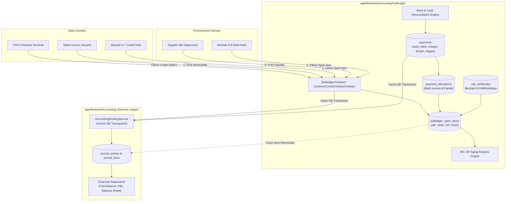

# Step 11: Receivables & Payables Subledger Plan

## 1. Executive Summary & Review Scope
- **Step Objective:** Build a unified Accounts Receivable (AR) and Accounts Payable (AP) subledger module within `app/Modules/Accounting/Subledger` that serves as the single source of truth for all customer and supplier open items, payments, multi-invoice allocations, partial payments, credit limit ("baki") validations, Mushak 6.6 VDS withholdings, and aging analysis.
- **Architectural Boundary (ADR-019):** Neither Sales nor Procurement tracks customer or supplier balances. Sales and Procurement post debtor/creditor transactions exclusively through the `SubledgerContract`. Every subledger transaction synchronizes with General Ledger control accounts (1030 Trade Debtors, 2010 Trade Creditors) in the *exact same database transaction*.
- **Design Sections Covered:**
  - §8.2 #4: Sales & Customer Receivables (AR) — Customer credit limits, due payment receipts, aging registers.
  - §8.2 #6: Procurement & Supplier Payables (AP) — Supplier bills, payment vouchers, SoD disbursement approvals.
  - §8.2 #7: Core Accounting & General Ledger — AR/AP subledgers, bank & cash reconciliation, Trial Balance, Profit & Loss, Balance Sheet.
  - §3.3: Segregation of Duties (SoD) — Hard rules SoD-01 (Purchase & Pay) and SoD-02 (Supplier Creation & Payment).
- **Review Findings Closed:**
  - `ACC-06` (Medium / Gate): Receivables and payables were previously owned in four places (Sales, Purchasing, Customer & Supplier Ledgers, Accounting). Resolved by establishing `app/Modules/Accounting/Subledger` as the single owner of open items, allocations, and aging, reconciling to GL control accounts 1030 and 2010.
  - `NEW-16` (Medium / Gate): Schema completeness for customer credit, supplier entities, payments table supporting multiple methods (`cash`, `bank`, `cheque`, `bkash`, `nagad`), multi-invoice allocations, and removing stored running balances (`customers.current_due`) in favor of dynamic open item evaluation.
  - `NEW-34` (Gate): Clear domain boundary and ownership between Catalog, Sales, Procurement, and Accounting Subledger.

---

## 2. Gate Items & Pre-Conditions

1. **Subledger Module Location (ADR-019):**
   - **Decision:** Placed in `app/Modules/Accounting/Subledger`.
   - **Rationale:** AR and AP share identical double-entry mechanics (open items, allocation logic, aging buckets, statement reconciliation). Consolidating under Accounting guarantees atomic GL posting in the same transaction as subledger movements.
2. **Dynamic Balance Evaluation (No Running `current_due` Columns):**
   - In accordance with `ACC-06` and `NEW-16`, customer credit ("Baki") and supplier dues are computed dynamically by summing remaining balances from `subledger_open_items`. No denormalized `current_due` column is stored or cached on `customers` or `suppliers`.
3. **Immutability of Financial Transactions (ADR-003, ADR-017):**
   - Posted payments and allocations are strictly immutable. Corrections must take place via reversal entries, refund payments, or debit/credit notes.

---

## 3. Architecture & Data Flow



---

## 4. Database Schema Specifications

All tenant tables will be created using `App\Core\Database\TenantMigration` with forced Row-Level Security, composite primary/foreign keys (`UNIQUE (tenant_id, id)` and `UNIQUE (tenant_id, company_id, id)`), and fail-closed RLS policies for `app_rw` and `reporting_ro`.

### 1. `suppliers` (Table 16)
- `id UUID PRIMARY KEY` (UUIDv7)
- `tenant_id UUID NOT NULL`
- `company_id UUID NOT NULL`
- `name VARCHAR(255) NOT NULL`
- `code VARCHAR(50) NULL`
- `phone VARCHAR(50) NULL`
- `email VARCHAR(255) NULL`
- `supplier_bin VARCHAR(50) NULL`
- `credit_period_days INT NOT NULL DEFAULT 30`
- `is_active BOOLEAN NOT NULL DEFAULT true`
- `created_at / updated_at TIMESTAMPTZ`
- **Keys:** `UNIQUE (tenant_id, id)`, `UNIQUE (tenant_id, company_id, id)`
- **FK:** `(tenant_id, company_id) REFERENCES companies(tenant_id, id)`

### 2. `supplier_bills` (Table 17)
- `id UUID PRIMARY KEY` (UUIDv7)
- `tenant_id UUID NOT NULL`
- `company_id UUID NOT NULL`
- `branch_id UUID NOT NULL`
- `supplier_id UUID NOT NULL`
- `bill_number VARCHAR(100) NOT NULL`
- `bill_date DATE NOT NULL`
- `due_date DATE NOT NULL`
- `subtotal NUMERIC(18, 4) NOT NULL`
- `tax_amount NUMERIC(18, 4) NOT NULL DEFAULT 0.0000`
- `total_amount NUMERIC(18, 4) NOT NULL`
- `status VARCHAR(30) NOT NULL DEFAULT 'draft'` (`draft`, `approved`, `posted`, `cancelled`)
- `created_by UUID NOT NULL`
- `approved_by UUID NULL`
- `approved_at TIMESTAMPTZ NULL`
- `gl_journal_entry_id UUID NULL`
- `created_at / updated_at TIMESTAMPTZ`
- **Keys:** `UNIQUE (tenant_id, id)`, `UNIQUE (tenant_id, company_id, id)`, `UNIQUE (tenant_id, company_id, bill_number)`
- **FKs:**
  - `(tenant_id, company_id, supplier_id) REFERENCES suppliers(tenant_id, company_id, id)`
  - `(tenant_id, company_id, branch_id) REFERENCES branches(tenant_id, company_id, id)`
  - `(tenant_id, created_by) REFERENCES users(tenant_id, id)`

### 3. `payments` (Table 18)
- `id UUID PRIMARY KEY` (UUIDv7)
- `tenant_id UUID NOT NULL`
- `company_id UUID NOT NULL`
- `branch_id UUID NOT NULL`
- `payment_number VARCHAR(100) NOT NULL`
- `payment_type VARCHAR(20) NOT NULL` (`inbound`, `outbound`)
- `payment_method VARCHAR(30) NOT NULL` (`cash`, `bank`, `cheque`, `bkash`, `nagad`)
- `party_type VARCHAR(20) NOT NULL` (`customer`, `supplier`)
- `party_id UUID NOT NULL`
- `payment_date DATE NOT NULL`
- `amount NUMERIC(18, 4) NOT NULL`
- `reference VARCHAR(255) NULL` (Cheque number, Bank slip, bKash TrxID)
- `status VARCHAR(30) NOT NULL DEFAULT 'draft'` (`draft`, `pending_approval`, `posted`, `cancelled`, `reconciled`)
- `created_by UUID NOT NULL`
- `approved_by UUID NULL`
- `approved_at TIMESTAMPTZ NULL`
- `gl_journal_entry_id UUID NULL`
- `created_at / updated_at TIMESTAMPTZ`
- **Constraints:**
  - `CHECK (amount > 0)`
  - `CHECK (payment_type IN ('inbound', 'outbound'))`
  - `CHECK (payment_method IN ('cash', 'bank', 'cheque', 'bkash', 'nagad'))`
  - `CHECK (party_type IN ('customer', 'supplier'))`
  - `CHECK (status IN ('draft', 'pending_approval', 'posted', 'cancelled', 'reconciled'))`
- **Keys:** `UNIQUE (tenant_id, id)`, `UNIQUE (tenant_id, company_id, id)`, `UNIQUE (tenant_id, company_id, payment_number)`

### 4. `subledger_open_items` (Table 19)
- `id UUID PRIMARY KEY` (UUIDv7)
- `tenant_id UUID NOT NULL`
- `company_id UUID NOT NULL`
- `party_type VARCHAR(20) NOT NULL` (`customer`, `supplier`)
- `party_id UUID NOT NULL`
- `source_type VARCHAR(50) NOT NULL` (`sales_invoice`, `supplier_bill`, `credit_note`, `debit_note`, `payment`)
- `source_id UUID NOT NULL`
- `document_number VARCHAR(100) NOT NULL`
- `document_date DATE NOT NULL`
- `due_date DATE NOT NULL`
- `direction VARCHAR(10) NOT NULL` (`debit`, `credit`)
- `gl_control_account_code VARCHAR(20) NOT NULL` (`1030` for AR, `2010` for AP)
- `original_amount NUMERIC(18, 4) NOT NULL`
- `allocated_amount NUMERIC(18, 4) NOT NULL DEFAULT 0.0000`
- `remaining_amount NUMERIC(18, 4) NOT NULL`
- `status VARCHAR(30) NOT NULL DEFAULT 'open'` (`open`, `partially_allocated`, `fully_allocated`, `reversed`)
- `created_at / updated_at TIMESTAMPTZ`
- **Constraints:**
  - `CHECK (original_amount > 0)`
  - `CHECK (allocated_amount >= 0)`
  - `CHECK (remaining_amount >= 0)`
  - `CHECK (allocated_amount <= original_amount)`
  - `CHECK (remaining_amount = original_amount - allocated_amount)`
  - `CHECK (direction IN ('debit', 'credit'))`
  - `CHECK (status IN ('open', 'partially_allocated', 'fully_allocated', 'reversed'))`
- **Keys:** `UNIQUE (tenant_id, id)`, `UNIQUE (tenant_id, company_id, id)`

### 5. `payment_allocations` (Table 20)
- `id UUID PRIMARY KEY` (UUIDv7)
- `tenant_id UUID NOT NULL`
- `company_id UUID NOT NULL`
- `payment_id UUID NULL`
- `credit_note_id UUID NULL`
- `open_item_id UUID NOT NULL`
- `allocated_amount NUMERIC(18, 4) NOT NULL`
- `allocation_date DATE NOT NULL`
- `notes TEXT NULL`
- `created_at / updated_at TIMESTAMPTZ`
- **Constraints:**
  - `CHECK (allocated_amount > 0)`
  - `CHECK ((payment_id IS NOT NULL AND credit_note_id IS NULL) OR (payment_id IS NULL AND credit_note_id IS NOT NULL))`
- **Trigger:** `trg_payment_allocations_sync` verifies `allocated_amount <= open_item.remaining_amount` and atomically recalculates `subledger_open_items.allocated_amount`, `remaining_amount`, and `status`.

### 6. `vds_certificates` (Mushak 6.6 - Table 21)
- `id UUID PRIMARY KEY` (UUIDv7)
- `tenant_id UUID NOT NULL`
- `company_id UUID NOT NULL`
- `branch_id UUID NOT NULL`
- `certificate_number VARCHAR(100) NOT NULL`
- `direction VARCHAR(30) NOT NULL` (`received_from_customer`, `issued_to_supplier`)
- `customer_id UUID NULL`
- `supplier_id UUID NULL`
- `withholding_entity_name VARCHAR(255) NOT NULL`
- `withholding_entity_bin VARCHAR(50) NOT NULL`
- `issue_date DATE NOT NULL`
- `tax_period VARCHAR(20) NOT NULL`
- `total_invoice_amount NUMERIC(18, 4) NOT NULL`
- `total_vat_amount NUMERIC(18, 4) NOT NULL`
- `vds_amount NUMERIC(18, 4) NOT NULL`
- `sales_invoice_id UUID NULL`
- `supplier_bill_id UUID NULL`
- `payment_id UUID NULL`
- `status VARCHAR(20) NOT NULL DEFAULT 'valid'`
- `created_at / updated_at TIMESTAMPTZ`
- **Keys:** `UNIQUE (tenant_id, id)`, `UNIQUE (tenant_id, company_id, id)`

### 7. Bank & Cash Reconciliation Tables (Tables 22–24)
- `bank_statements`: Statement header (`id`, `chart_of_account_id` referencing Bank 1020, `statement_date`, `opening_balance`, `closing_balance`, `status`).
- `bank_statement_lines`: Individual statement lines (`line_date`, `value_date`, `description`, `reference_number`, `deposit_amount`, `withdrawal_amount`, `balance`, `is_reconciled`, `matched_payment_id`).
- `bank_reconciliations`: Monthly reconciliation snapshot (`reconciliation_date`, `gl_balance`, `statement_balance`, `unreconciled_difference`, `reconciled_by`).

---

## 5. Implementation Steps & Commit Schedule (Test First)

### Commit 1: Schema Migrations & RLS Policies (Suppliers, Bills, Payments, Open Items, Allocations, VDS, Bank) [COMPLETED]
- **Test Written First:** `tests/Database/SubledgerSchemaTenantIsolationTest.php` (PASS - 2 tests, 17 assertions)
  - Asserts that all 8 subledger tables enforce PostgreSQL Row-Level Security.
  - Verifies cross-tenant data is completely invisible under `app_rw`.
  - Verifies composite foreign keys `(tenant_id, company_id, id)` prevent cross-company references.
- **Implementation:**
  - Created migrations in `database/migrations/`:
    1. `2026_11_11_000001_create_suppliers_table.php`
    2. `2026_11_11_000002_create_supplier_bills_table.php`
    3. `2026_11_11_000003_create_payments_table.php`
    4. `2026_11_11_000004_create_subledger_open_items_table.php`
    5. `2026_11_11_000005_create_payment_allocations_table.php`
    6. `2026_11_11_000006_create_vds_certificates_table.php`
    7. `2026_11_11_000007_create_bank_statements_table.php`
    8. `2026_11_11_000008_create_subledger_triggers.php` (for allocation and payment immutability)
  - Created Eloquent models in `app/Models/`: `Supplier`, `SupplierBill`, `Payment`, `SubledgerOpenItem`, `PaymentAllocation`, `VdsCertificate`, `BankStatement`, `BankStatementLine`.
  - Verified RLS (`php artisan db:check-rls` -> 55/55 tables passed).
  - Verified Pint (392 files) and PHPStan (0 errors).

### Commit 2: Customer Credit Limits ("Baki") Validation at Sale & POS [COMPLETED]
- **Test Written First:** `tests/Database/CustomerCreditLimitTest.php` (PASS - 4 tests, 13 assertions)
  - Sets customer credit limit to ৳10,000.
  - Posts open invoice of ৳8,000. Asserts dynamically calculated `current_due` is ৳8,000.
  - Attempts sale of ৳2,500 on credit -> Assert refused with `CreditLimitExceededException` (৳8,000 + ৳2,500 > ৳10,000).
  - Asserts sale is allowed if tender is Cash/bKash (credit limit only applies to un-tendered or credit portion).
- **Implementation:**
  - Created `app/Modules/Accounting/Subledger/Contracts/CustomerCreditCheckerContract.php`.
  - Created `app/Modules/Accounting/Subledger/Services/CustomerCreditChecker.php`.
  - Created `CustomerCreditCheckResult` DTO and `CreditLimitExceededException`.
  - Registered singleton in `AccountingServiceProvider`.
  - Integrated dynamic credit limit check and subledger open item creation into `InvoiceIssuer`.
  - Verified Pint (397 files) and PHPStan (0 errors).

### Commit 3: Payments Recording & Multi-Invoice Allocation Engine [COMPLETED]
- **Test Written First:** `tests/Database/PaymentAllocationDatabaseTest.php` (PASS - 3 tests, 21 assertions)
  - Creates 3 open sales invoices (৳10,000, ৳15,000, ৳25,000).
  - Records single payment of ৳30,000 via bKash.
  - Allocates ৳10,000 to Inv 1 (fully paid), ৳15,000 to Inv 2 (fully paid), ৳5,000 to Inv 3 (partially paid, ৳20,000 remaining).
  - Asserts attempting to allocate ৳25,000 to Inv 3 (exceeding open amount) throws `AllocationExceedsOpenItemException`.
  - Asserts allocating more than payment total throws `AllocationExceedsPaymentException`.
- **Implementation:**
  - Created `app/Modules/Accounting/Subledger/Contracts/PaymentServiceContract.php`.
  - Created `app/Modules/Accounting/Subledger/Services/PaymentService.php`.
  - Created `RecordPaymentDTO`, `AllocationItemDTO`, `AllocationExceedsOpenItemException`, `AllocationExceedsPaymentException`.
  - Registered `PaymentServiceContract` singleton in `AccountingServiceProvider`.
  - Verified Pint (404 files) and PHPStan (0 errors).

### Commit 4: Segregation of Duties (SoD §3.3) for Supplier Payment Vouchers [COMPLETED]
- **Test Written First:** `tests/Database/SupplierPaymentSodTest.php` (PASS - 3 tests, 21 assertions)
  - User A (Purchasing Clerk) creates a Supplier Payment Voucher.
  - User A attempts to approve or post voucher -> Assert fails with `SegregationOfDutiesException` (Rule SoD-01 / SoD-02: Creator cannot approve their own payment).
  - User B (Tenant Owner / Finance Manager) approves voucher -> Assert succeeds, status becomes `posted`, and double-entry GL journal is posted.
  - User C who created the Supplier record attempts to approve -> Assert fails with `SegregationOfDutiesException`.
- **Implementation:**
  - Added `created_by` column and relation to `suppliers` table (migration `2026_11_11_000009_add_created_by_to_suppliers_table.php`).
  - Created `app/Modules/Accounting/Subledger/Contracts/SupplierPaymentVoucherContract.php`.
  - Created `app/Modules/Accounting/Subledger/Services/SupplierPaymentVoucherService.php`.
  - Created `CreateSupplierVoucherDTO`, `AllocationItemDTO`, and `SegregationOfDutiesException`.
  - Registered `SupplierPaymentVoucherContract` singleton in `AccountingServiceProvider`.
  - Verified Pint (410 files) and PHPStan (0 errors).

### Commit 5: Mushak 6.6 VDS Withholding & Statutory Accounting [COMPLETED]
- **Test Written First:** `tests/Database/VdsWithholdingCertificateTest.php` (PASS - 3 tests, 52 assertions)
  - Issues invoice of ৳860 (Net ৳829.71, VAT ৳30.29).
  - Corporate buyer pays ৳829.71 in bank, withholding ৳30.29 as VDS with Mushak 6.6 certificate # `VDS-2026-0042`.
  - Records receipt with VDS deduction.
  - Asserts GL Journal:
    - Debit: Bank Current Account (1020) ৳829.71
    - Debit: VDS Receivable (1060) ৳30.29
    - Credit: Accounts Receivable (1030) ৳860.00
  - Asserts invoice open item is fully cleared (`remaining_amount = 0.0000`).
  - Asserts supplier payment with VDS withholding:
    - Bill of ৳100,000 (Subtotal ৳85,000, VAT ৳15,000).
    - Pays ৳85,000 via bank, withholds ৳15,000 VDS, issues Mushak 6.6 # `VDS-OUT-2026-0001`.
    - GL: Debit AP (2010) ৳100,000, Credit Bank (1020) ৳85,000, Credit VDS Payable (2040) ৳15,000.
    - Supplier bill open item is fully cleared.
  - Asserts settlement exceeding remaining balance is refused.
- **Implementation:**
  - Created `app/Modules/Accounting/Subledger/Contracts/VdsCertificateContract.php`.
  - Created `app/Modules/Accounting/Subledger/Services/VdsCertificateService.php`.
  - Created `CustomerVdsDeductionDTO` and `SupplierVdsWithholdingDTO`.
  - Registered `VdsCertificateContract` singleton in `AccountingServiceProvider`.
  - Verified Pint (415 files) and PHPStan (0 errors).

### Commit 6: 500-Transaction Randomized Subledger GL Reconciliation Property Test [COMPLETED]
- **Test Written First:** `tests/Database/SubledgerGlReconciliationTest.php` (PASS - 1 test, 12 assertions, 7.0s duration)
  - Seeds 10 customers and 10 suppliers.
  - Uses fixed pseudorandom seed (`mt_srand(424242)`).
  - Executes 500 randomized lifecycle events:
    - Invoices (adding AR debit open items, GL 1030)
    - Customer payments (cash, bank, bKash) with multi-invoice allocations
    - Mushak 6.7 credit notes (reducing AR)
    - Supplier bills (adding AP credit open items, GL 2010)
    - Supplier payment vouchers with SoD approval
  - Strictly asserts at the end:
    $$\sum \text{AR Open Items remaining\_amount} \equiv \text{GL Control Account 1030 Balance}$$
    $$\sum \text{AP Open Items remaining\_amount} \equiv \text{GL Control Account 2010 Balance}$$
  - Asserts all open items have mathematically consistent allocation statuses (`open`, `partially_allocated`, `fully_allocated`).
  - Asserts all double-entry GL journal entries balance.
- **Implementation:**
  - Created `app/Modules/Accounting/Subledger/Contracts/SubledgerReconciliationContract.php`.
  - Created `app/Modules/Accounting/Subledger/Services/SubledgerReconciliationService.php`.
  - Created `SubledgerReconciliationResult` DTO.
  - Registered `SubledgerReconciliationContract` singleton in `AccountingServiceProvider`.
  - Verified Pint (419 files) and PHPStan Level 8 (0 errors).

### Commit 7: Bank & Cash Statement Reconciliation Engine [COMPLETED]
- **Test Written First:** `tests/Database/BankReconciliationTest.php` (PASS - 2 tests, 26 assertions)
  - Imports sample bank statement lines.
  - Matches 5 statement lines against posted payments (by date, reference, and exact amount).
  - Leaves 1 unmatched line (unrecorded bank charge).
  - Asserts reconciliation summary generates accurate cleared balance and outstanding variance.
  - Tests manual matching and unmatching workflows with automatic payment status synchronization (`posted` <-> `reconciled`).
- **Implementation:**
  - Created `app/Modules/Accounting/Subledger/Contracts/BankReconciliationContract.php`.
  - Created `app/Modules/Accounting/Subledger/Services/BankReconciliationService.php`.
  - Created `ImportBankStatementDTO`, `ImportStatementLineDTO`, `BankReconciliationSummaryDTO`.
  - Registered `BankReconciliationContract` singleton in `AccountingServiceProvider`.
  - Verified Pint (425 files) and PHPStan Level 8 (0 errors).

### Commit 8: Aging Registers & Financial Statements (Trial Balance, P&L, Balance Sheet) [COMPLETED]
- **Test Written First:** `tests/Database/FinancialStatementsTest.php` (PASS - 3 tests, 24 assertions)
  - Tests AR & AP Aging buckets (`0-30`, `31-60`, `61-90`, `91-120`, `120+` days) and asserts total aging equals GL accounts 1030 and 2010.
  - Tests Trial Balance: verifies $\sum \text{Debits} == \sum \text{Credits}$ across all active COA accounts.
  - Tests Profit & Loss: Net Revenue (4000s) - COGS (5000s) - Expenses (6000s) == Net Operating Income.
  - Tests Balance Sheet: Total Assets (1000s) == Total Liabilities (2000s) + Total Equity (3000s) + Net Income.
- **Implementation:**
  - Created `app/Modules/Accounting/Subledger/Contracts/SubledgerAgingContract.php`.
  - Created `app/Modules/Accounting/Subledger/Services/SubledgerAgingService.php`.
  - Created `app/Modules/Accounting/Contracts/FinancialReportContract.php`.
  - Created `app/Modules/Accounting/Services/FinancialReportService.php`.
  - Created `AgingBucketDTO`, `PartyAgingItemDTO`, `AgingReportDTO`, `TrialBalanceAccountDTO`, `TrialBalanceReportDTO`, `ProfitAndLossReportDTO`, `BalanceSheetReportDTO`.
  - Registered `SubledgerAgingContract` and `FinancialReportContract` in `AccountingServiceProvider`.
  - Verified Pint (437 files) and PHPStan Level 8 (0 errors).

---

## 6. Commands to Run on Dev Server (CT 104)

```bash
# 1. Run migrations as pgsql_owner
php artisan migrate --database=pgsql_owner --force

# 2. Check Row-Level Security
php artisan db:check-rls

# 3. Format code with Pint
vendor/bin/pint --test

# 4. Static analysis at Level 8
vendor/bin/phpstan analyse --no-progress

# 5. Run tests as app_rw
php artisan test tests/Database/SubledgerSchemaTenantIsolationTest.php
php artisan test tests/Database/CustomerCreditLimitTest.php
php artisan test tests/Database/PaymentAllocationDatabaseTest.php
php artisan test tests/Database/SupplierPaymentSodTest.php
php artisan test tests/Database/VdsWithholdingCertificateTest.php
php artisan test tests/Database/SubledgerGlReconciliationTest.php
php artisan test tests/Database/BankReconciliationTest.php
php artisan test tests/Database/FinancialStatementsTest.php
```

---

## 7. Risks & Mitigations

| Risk | Impact | Mitigation Strategy |
|---|---|---|
| Concurrent checkout attempts on customer credit ("Baki") leading to limit race condition | High | Credit checks acquire a `FOR UPDATE` lock on the customer row within the transaction or lock customer open items to compute true projected balance. |
| Partial payment rounding drift across multiple invoices | High | All calculations use `Brick\Math\BigDecimal` and `Money` value object with Banker's Rounding (Half-Up, 2 places). Remainder is assigned to the final allocation. |
| Memory exhaustion during 500-transaction property test | Medium | Process transactions in batches, clean model memory (`unset`), and disable query logging in tests. |
| Segregation of Duties bypass via CLI or API impersonation | Critical | SoD rules are validated directly inside `SupplierPaymentVoucherService` and enforced at database trigger level where feasible. |
