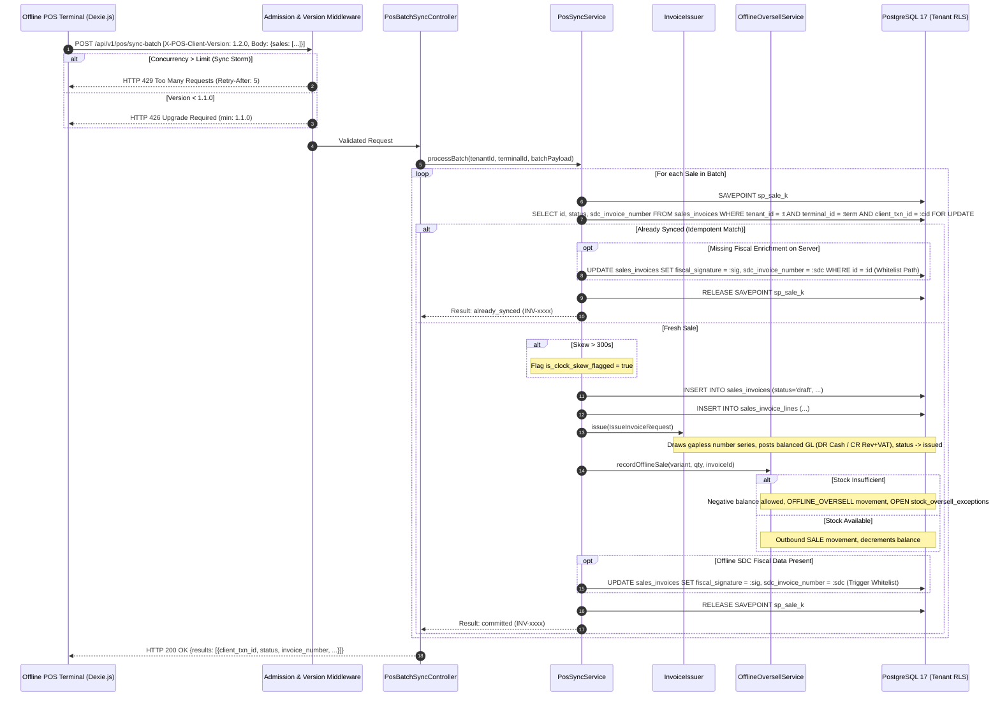

# Step 12: Offline POS Sync Engine & Outage Recovery Plan

## 1. Context, Review Goals & Architecture Directives
- **Step Objective:** Implement a resilient, high-throughput offline synchronization engine for POS terminals (`POST /api/v1/pos/sync-batch`) ensuring that terminals disconnected for hours—or running a previous client version—sync every completed sale exactly once, never lose a transaction or cash record, and do not overwhelm the database during mass reconnect surges.
- **Milestone:** M5 (Weeks 16–18, Target: 7 Mar 2027).
- **Design Sections Covered:**
  - §10.2: PostgreSQL-Enforced Idempotency & Batch Sync (`ON CONFLICT`, savepoints, itemized results).
  - §11.2: Offline Operational Policy Matrix (unconditional offline sync, offline credit blocked).
  - §5.4 & §8.2: General Ledger and Stock Movements posted synchronously with invoice issuance.
  - §9.1 & §9.2: Bangladesh Statutory Invoicing, gapless number series, and immutable fiscal enrichment.
- **Review Findings Closed:**
  - `POS-09` (High / Gate): Sync API versioning and client update policy. Header `X-POS-Client-Version` enforced; current and previous schema versions supported; HTTP 426 Upgrade Required below minimum; updates applied exclusively at shift close.
  - `POS-10` (Medium / Gate): Device clocks and sync storms. Dual timestamps (`device_time` vs `server_received_time`); clock skew flagged beyond $\pm 300\text{s}$ threshold; client-side exponential backoff with random jitter; server-side admission control with HTTP 429 (`Retry-After`).
  - `API-03` (Medium): Scoped idempotency semantics. Idempotent batch processing with per-sale database savepoints; `ON CONFLICT (tenant_id, terminal_id, client_txn_id) DO NOTHING`; request body validation.
  - `NEW-26` / `ADR-016`: Never reject a completed sale for lack of stock. Deficits drive warehouse balance negative, record `OFFLINE_OVERSELL` stock movements, freeze moving average costing, and open blocking supervisor exceptions in `stock_oversell_exceptions` with a 24-hour SLA.
  - `NEW-27`: Never insert sales invoices directly with `status = 'issued'`. Insert as `draft`, add line items, then issue atomically via `InvoiceIssuer` to enforce double-entry GL posting and immutability triggers.
  - Fiscal Enrichment Whitelist: Use the statutory fiscal-enrichment update path *only* to populate `fiscal_signature` and `sdc_invoice_number` from `NULL` on already issued sales invoices.

---

## 2. Gate Items & Architectural Pre-Conditions

1. **Sync API Versioning & Minimum Version Contract (`POS-09`):**
   - **Current Version:** `1.2.0` (Schema v2).
   - **Previous Version:** `1.1.0` (Schema v1).
   - **Minimum Supported Version:** `1.1.0`.
   - Any client sending `X-POS-Client-Version < 1.1.0` (or omitting the header) is refused immediately with `426 Upgrade Required`.
   - Client PWA receives update bundles in the background but defers application until `shift_close` to prevent mid-shift session disruption.
2. **Clock-Skew Threshold & Telemetry (`POS-10`):**
   - Maximum tolerable drift: 300 seconds (5 minutes).
   - Server records both `device_time` (from terminal) and `server_received_time` (`now()`).
   - If $|\text{server\_received\_time} - \text{device\_time}| > 300\text{s}$, the sale is flagged with `is_clock_skew_flagged = TRUE` and `clock_skew_seconds`, logging a telemetry alert without rejecting the physical sale.
3. **ADR-016 Stock Invariant Exception (`NEW-26`):**
   - Offline transactions represent physical transactions that already took place. Stock checks must **never** roll back an offline sale.
   - Deficits create `OFFLINE_OVERSELL` movements and open `stock_oversell_exceptions` records for supervisor resolution.
4. **Immutability & Savepoint Isolation (`API-03`, `NEW-27`, Design §10.2):**
   - Each sale in a batch is isolated in its own nested database savepoint (`SAVEPOINT sale_{idx}`).
   - Failure of one sale (e.g. malformed SKU) rolls back *only* that savepoint and returns itemized `status: "failed"`, while all valid sales commit cleanly.

---

## 3. Data Flow & Sequence Diagram



---

## 4. PostgreSQL Schema Enhancements

### 1. `sales_invoices` Migration Update
Add audit timestamp columns and clock-skew metrics to `sales_invoices`:
```sql
ALTER TABLE sales_invoices
    ADD COLUMN IF NOT EXISTS device_time TIMESTAMPTZ NULL,
    ADD COLUMN IF NOT EXISTS server_received_time TIMESTAMPTZ NULL,
    ADD COLUMN IF NOT EXISTS clock_skew_seconds INTEGER NULL,
    ADD COLUMN IF NOT EXISTS is_clock_skew_flagged BOOLEAN NOT NULL DEFAULT FALSE;

CREATE INDEX IF NOT EXISTS idx_sales_invoices_clock_skew 
    ON sales_invoices (tenant_id, is_clock_skew_flagged) 
    WHERE is_clock_skew_flagged = TRUE;
```

### 2. Update Immutability Trigger (Trigger 4 Whitelist Extension)
Extend `trg_fn_enforce_sales_invoice_immutability()` in `database/migrations/` so that the fiscal-enrichment whitelist also asserts that `device_time`, `server_received_time`, `clock_skew_seconds`, and `is_clock_skew_flagged` cannot be altered once issued.

---

## 5. Module Architecture & Detailed Component Design

### 1. Versioning & Payload Normalization (`POS-09`)
- **`app/Http/Middleware/PosClientVersionMiddleware.php`:**
  - Reads `X-POS-Client-Version`.
  - Rejects versions below `config('pos.min_client_version', '1.1.0')` with HTTP 426 and JSON error payload.
- **`app/Modules/POS/Adapters/PosSyncPayloadAdapter.php`:**
  - Standardizes differences between Schema v1 (`tests/Fixtures/pos-sync/v1.json`) and Schema v2 (`tests/Fixtures/pos-sync/v2.json`):
    - v1 uses flat `tax_rate` and `price`; v2 uses `tax_code_id`, `pricing_basis`, `sdc_invoice_number`.
    - Normalizes into unified `SyncSaleItemDTO` and `SyncBatchRequestDTO`.

### 2. Admission Control & Anti-Storm Limiter (`POS-10`)
- **`app/Http/Middleware/PosSyncAdmissionControl.php`:**
  - Implements concurrency and rate admission via Redis:
    - Max concurrent sync batches per tenant: `10`.
    - Rate limit: `60 batches / minute` per terminal.
  - When limits are exceeded during mass reconnect storms, returns `HTTP 429 Too Many Requests` with header `Retry-After: {jittered_seconds}`.
  - Prevents database connection exhaustion (47-connection managed DB ceiling).

### 3. POS Batch Sync Service (`API-03`, `NEW-26`, `NEW-27`, Design §10.2)
- **`App\Modules\POS\Contracts\PosSyncServiceContract.php`**
- **`App\Modules\POS\Services\PosSyncService.php`:**
  - **`syncBatch(SyncBatchRequestDTO $batch): SyncBatchResultDTO`**
    - Validates terminal pairing against active tenant and branch.
    - Captures `server_received_time = now()`.
    - Iterates over each sale in an isolated database transaction / savepoint:
      1. **Idempotency Guard:** Queries `sales_invoices` for existing `(tenant_id, terminal_id, client_txn_id)`.
         - If found:
           - If incoming sale contains `fiscal_signature` / `sdc_invoice_number` and existing invoice has `NULL`, execute statutory fiscal enrichment.
           - Return `status = 'already_synced'`, with existing `invoice_number` and `id`.
      2. **Clock Skew Calculation:**
         - `$skew = abs($serverReceivedTime->diffInSeconds($sale->deviceTime));`
         - `$flagged = $skew > 300;`
      3. **Draft Invoice Creation (NEW-27):**
         - Inserts `sales_invoices` with `status = 'draft'`, `is_synced_from_offline = true`, `device_time`, `server_received_time`, `clock_skew_seconds`, `is_clock_skew_flagged`.
         - Inserts `sales_invoice_lines`.
      4. **Atomic Issuance (`InvoiceIssuer::issue()`):**
         - Draws next gapless invoice number (`INV-...`).
         - Validates statutory line mathematics.
         - Enforces credit limits if payment is `credit`.
         - Posts double-entry GL journal atomically (Debit Cash `1010` / Credit Revenue `4010` + VAT `2020`).
         - Updates invoice `status -> 'issued'`.
      5. **Stock Deduction & Oversell Handling (ADR-016, NEW-26):**
         - Dispatches to `OfflineOversellServiceContract::recordOfflineSale()`.
         - If inventory has sufficient stock: records `movement_type = 'SALE'`, decrements `quantity_on_hand`.
         - If inventory is insufficient: allows negative stock, records `movement_type = 'OFFLINE_OVERSELL'`, freezes moving average cost, and opens `stock_oversell_exceptions` record with `status = 'OPEN'`.
      6. **Fiscal Enrichment Path:**
         - If the offline sale includes pre-generated SDC fiscal data (`fiscal_signature`, `sdc_invoice_number`), performs one-time statutory update on issued row.
      7. **Commit Savepoint:**
         - Records sale as `committed`.

### 4. Client PWA Exponential Backoff & Jitter (`POS-10`)
- **`resources/pos/src/sync-engine.js`:**
  - Reconnect triggers exponential backoff with full jitter:
    $$T = \text{random}(0, \min(M, B \times 2^{\text{attempt}}))$$
    Where $B = 2\text{s}$, $M = 60\text{s}$.
  - Intercepts HTTP 429: reads `Retry-After` header and pauses sync queue.
  - Intercepts HTTP 426: displays user-facing notification "Terminal update pending shift close. Offline sales safe in local storage."

---

## 6. Implementation Commits & Test-First Order

### Commit 1: Schema Migrations & Clock-Skew Metrics
- **Tests First:** `tests/Database/PosSyncSchemaTest.php`
  - Asserts `device_time`, `server_received_time`, `clock_skew_seconds`, `is_clock_skew_flagged` exist on `sales_invoices`.
  - Asserts PostgreSQL Trigger 4 prevents modifying clock-skew metrics after invoice issuance.
  - Asserts `uq_pos_offline_idempotency` unique constraint enforces `(tenant_id, terminal_id, client_txn_id)`.
- **Implementation:**
  - Migration `add_offline_sync_metrics_to_sales_invoices_table.php`.
  - Update `SalesInvoice` model casts and fillables.
  - Fixtures `tests/Fixtures/pos-sync/v1.json` and `tests/Fixtures/pos-sync/v2.json`.

### Commit 2: Client Versioning & Admission Middleware (`POS-09`, `POS-10`)
- **Tests First:** `tests/Feature/PosSyncVersioningAndAdmissionTest.php`
  - Request with missing or older `X-POS-Client-Version: 1.0.0` receives `426 Upgrade Required`.
  - Request with `X-POS-Client-Version: 1.1.0` (previous) or `1.2.0` (current) is accepted.
  - Contract test: `tests/Fixtures/pos-sync/v1.json` payload successfully adapts and parses into unified DTO.
  - Simulated burst exceeding admission threshold receives `429 Too Many Requests` with `Retry-After` header.
- **Implementation:**
  - `App\Http\Middleware\PosClientVersionMiddleware`.
  - `App\Http\Middleware\PosSyncAdmissionControl`.
  - `App\Modules\POS\Adapters\PosSyncPayloadAdapter`.

### Commit 3: Batch Sync Engine with Isolated Savepoints (`API-03`, `NEW-27`)
- **Tests First:** `tests/Feature/PosBatchSyncTest.php`
  - **Idempotency Test:** Sending the exact same batch twice records each sale once; second response marks each item as `already_synced` with identical invoice IDs and numbers; no duplicate stock deductions or GL journals.
  - **Isolated Savepoints Test:** In a batch of 3 sales where sale #2 has an invalid payload or non-existent product, sales #1 and #3 commit successfully with `status: "committed"` while sale #2 returns `status: "failed"` with reason.
  - **NEW-27 Invariant Test:** Verifies that no invoice is ever inserted directly with `status = 'issued'`; draft $\to$ lines $\to$ `InvoiceIssuer::issue()` lifecycle is verified.
- **Implementation:**
  - `App\Modules\POS\Contracts\PosSyncServiceContract` & `PosSyncService`.
  - `App\Http\Controllers\Api\Pos\PosBatchSyncController`.
  - Route registration `POST /api/v1/pos/sync-batch`.

### Commit 4: ADR-016 Offline Oversells & Clock-Skew Flagging (`NEW-26`, `POS-10`)
- **Tests First:** `tests/Database/PosSyncOversellAndClockSkewTest.php`
  - **Oversell Test:** Terminal sells 10 units when only 3 are on hand. Sync commits without error:
    - Stock balance drops to `-7.0000`.
    - Stock movement is created with `movement_type = 'OFFLINE_OVERSELL'`.
    - Open exception is created in `stock_oversell_exceptions` with `quantity_oversold = 7.0000` and `status = 'OPEN'`.
    - Trial balance remains strictly balanced (COGS recognized at last known cost).
  - **Clock-Skew Test:** Terminal submits sale with `device_time` 15 minutes in the past ($900\text{s}$ skew).
    - Invoice commits successfully.
    - `is_clock_skew_flagged` is `TRUE`, `clock_skew_seconds` is recorded around $900$.
  - **Fiscal Enrichment Test:** Terminal syncs sale with pre-populated SDC invoice number and signature; invoice reflects fiscal data without triggering immutability exceptions.
- **Implementation:**
  - Connect `PosSyncService` with `OfflineOversellServiceContract`.
  - Clock skew evaluation logic and telemetry dispatch.
  - Fiscal-enrichment path in `PosSyncService`.

### Commit 5: Client PWA Sync Daemon & Exponential Backoff (`POS-10`)
- **Tests First:** `resources/pos/tests/sync-retry.test.js` (Vitest)
  - Unit tests verifying jittered exponential backoff calculation.
  - Tests verifying handling of 429 (`Retry-After`) and 426 (`Upgrade Required`).
- **Implementation:**
  - Update `resources/pos/src/sync-engine.js` and `resources/views/pos/shell.blade.php`.
  - Add offline sync queue worker and status badge to POS interface.

---

## 7. Verification Checklist & Gate Exit Criteria

1. **Idempotency:** Re-sending 100 sales returns `already_synced` for all 100 with zero duplicate database rows.
2. **Failure Isolation:** Any bad record in a batch fails safely without aborting sibling sales.
3. **Backward Compatibility:** Previous version fixture (`v1.json`) syncs cleanly without schema errors.
4. **Upgrade Enforcement:** Unsupported versions receive HTTP 426.
5. **Physical Truth (ADR-016):** An oversold product never blocks sync; negative balance and supervisor exception are logged.
6. **Clock Skew:** Skew $> 300\text{s}$ is captured and flagged.
7. **Statutory Immutability:** Invoices are issued through `InvoiceIssuer`; fiscal signatures use the statutory whitelist update.
8. **Admission Control:** Throttles burst requests with 429 and `Retry-After`.
9. **Code Quality:** `vendor/bin/pint --test`, `vendor/bin/phpstan analyse` (Level 8), and `php artisan db:check-rls` pass with zero warnings.
