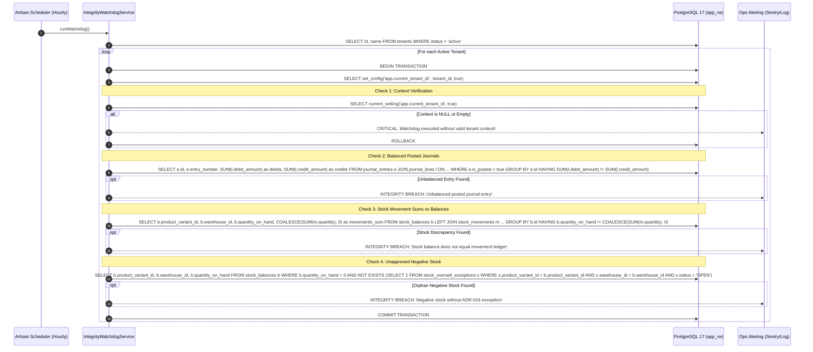
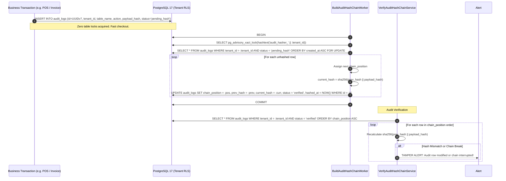
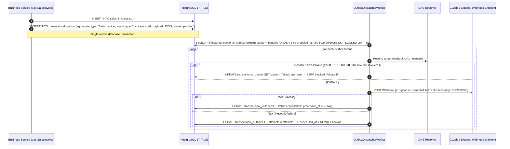

# Step 13: Outbox, Audit, Watchdog, Import & Pilot QA Plan

## 1. Context, Review Goals & Architecture Directives
- **Step Objective:** Implement reliable asynchronous event delivery via the transactional outbox pattern, a tamper-evident hash-chained audit trail with zero checkout lock contention, a business integrity watchdog that automatically audits financial and inventory invariants, master data import/export with single-tenant restore, and the pilot load/security gate suite.
- **Milestone:** M6 (Weeks 19–20, Target: 21 Mar 2027).
- **Design Sections Covered:**
  - §5.5: Transactional Outbox Specification (Resolving MOD-07; `transactional_outbox` schema, `SKIP LOCKED` polling, at-least-once delivery).
  - §6.1 & §6.2: Multi-Tenancy, database roles, per-tenant transaction context, and composite key referential integrity.
  - §7.1 & §7.2: Audit trail data architecture and master data migration.
  - §10.3: Webhooks & External API Integrations (HMAC-SHA256 signatures, 300s replay window, post-DNS SSRF validation).
  - §12.4: Asynchronous Hash-Chained Audit Trail (Resolving SEC-03, NEW-15, NEW-31; `audit_logs` DDL, `pending_hash`, per-tenant advisory lock, database immutability triggers).
  - §14: Observability, Telemetry & Business Integrity Heartbeat Monitors (Resolving OBS-01, NEW-04, NEW-30; cross-tenant watchdog with transaction isolation, ledger balance assertion, orphan negative stock detection).
  - §16: Comprehensive Testing, Concurrency & Pilot Gate Validation (Eid peak load tests, OWASP security audit, nightly CI workflow).
- **Review Findings Closed:**
  - `NEW-30` (Gate / Critical): Business integrity watchdog cross-tenant context handling. Iterates active tenants in isolated transactions using `SELECT set_config('app.current_tenant_id', :id, true)`. Never uses `SET` with bind parameters (Rule 4). Fails loudly if tenant context is missing. Asserts posted journals balance ($\sum \text{debits} = \sum \text{credits}$) and stock balances match ledger movements ($\text{quantity\_on\_hand} = \sum \text{movements}$). Reports negative stock *only* when no valid ADR-016 exception exists.
  - `NEW-31` (Gate / High): Tamper-evident hash-chained audit trail. Single `audit_logs` table with `(tenant_id, id)` key, UUIDv7 IDs, forced RLS. `chain_position` column assigned by background worker per tenant under `pg_advisory_xact_lock(hashtext('audit_hasher_' || tenant_id))`. In-transaction insert writes `status = 'pending_hash'` without table locks. Database trigger `trg_audit_logs_immutable` allows only one-time hash transition and forbids any subsequent update or delete. Verifier handles out-of-order commits without false alerts.
  - `MOD-07` (Medium): Transactional outbox pattern. Single table `transactional_outbox` (ADR-005 name corrected), written in the business transaction, processed with `FOR UPDATE SKIP LOCKED`. Webhooks enforce timestamped HMAC-SHA256 signatures, a 300-second replay window, and post-DNS resolution SSRF checks against private/loopback/link-local IPv4/IPv6 ranges.
  - `TEN-06` (High): Tenant data portability, master data import, single-tenant export, restore, and offboarding. Excel/CSV imports with dry-run error reporting; opening balance journal posting; complete tenant JSON archive export and restore with identical trial balance and inventory valuation; controlled offboarding purge.
  - `OBS-01` (High): Observability & Pilot Gate. Health endpoints `/health` and `/ready`; k6 load test suites (`loadtests/eid-peak.js` at 15 checkouts/sec and `loadtests/sync-storm.js`); OWASP dependency audits; `.github/workflows/nightly.yml`.

---

## 2. Gate Items & Architectural Pre-Conditions

1. **Eid-ul-Fitr Scheduling Gate (Week 19, ~10 Mar 2027):**
   - The team accounts for reduced working days during the Eid holiday. Master data import tools and integrity watchdogs land first (13A), followed by outbox and tenant export (13B), gating the pilot data imports in weeks 20–21 (NEW-28).
2. **Watchdog Session Context Invariant (NEW-30, Rule 4):**
   - The watchdog runs under `app_rw`.
   - For every active tenant, it opens an explicit database transaction and executes `SELECT set_config('app.current_tenant_id', :id, true)`.
   - Never use `SET` or `SET LOCAL` with bind parameters.
   - If `app.current_tenant_id` is empty or null, the check must fail loudly with an exception—it must **never** report "all clear" on an empty context.
   - Checks posted journals balance and stock balances equal their movement sums; negative stock is permitted **only** when accompanied by an `OPEN` record in `stock_oversell_exceptions`.
3. **Audit Immutability & Advisory Lock Isolation (NEW-31):**
   - Zero-lock insertion: During transactions, application code inserts audit records with `status = 'pending_hash'`. No global advisory lock is held during cashier checkouts.
   - The hashing worker assigns `chain_position` sequentially per tenant using `pg_advisory_xact_lock(hashtext('audit_hasher_' || tenant_id))`.
   - Database trigger `trg_audit_logs_immutable` allows only one-time transition from `pending_hash` to `verified` and rejects any other update or delete.
4. **Transactional Outbox & SSRF Protection (MOD-07):**
   - Outbox table is named `transactional_outbox` with composite key `(tenant_id, id)`.
   - Webhook dispatcher resolves destination host to IP first, validating that the IP is not in private/reserved ranges (`127.0.0.0/8`, `10.0.0.0/8`, `172.16.0.0/12`, `192.168.0.0/16`, `169.254.0.0/16`, `::1`, `fc00::/7`), and then executes HTTP request using the validated IP with the original `Host` header.
5. **Tenant Portability Total Matching (TEN-06):**
   - Export and restore must be deterministic: importing an exported tenant into a clean database yields identical GL trial balances ($\sum \text{Debit} = \sum \text{Credit}$ per account) and identical warehouse stock values.

---

## 3. Data Flow & Architecture Diagrams

### 3.1 Business Integrity Watchdog Cross-Tenant Execution (NEW-30)

### 3.2 Asynchronous Hash-Chained Audit Trail (NEW-31)

### 3.3 Transactional Outbox & Webhooks with Post-DNS SSRF Checks (MOD-07)

---

## 4. Ordered Commits & Implementation Steps

### Commit 1: Business Integrity Watchdog (Tests First, NEW-30)
- **Failing Tests Written First:** `tests/Feature/Watchdog/IntegrityWatchdogTest.php`
  1. `test_watchdog_fails_loudly_when_tenant_context_is_empty_never_reports_clean`:
     - Run check with uninitialized or empty tenant context $\to$ Expect `RuntimeException` ("Tenant context must be set before executing integrity watchdog"), never returns "all clear".
  2. `test_watchdog_catches_unbalanced_posted_journal_entry`:
     - Create balanced tenant state.
     - As `pgsql_owner` (temporarily disabling triggers), insert an unbalanced posted journal entry ($\text{Debit} = 1000, \text{Credit} = 900$).
     - Run watchdog $\to$ Assert watchdog reports failure naming the unbalanced entry number and variance.
  3. `test_watchdog_catches_stock_balance_ledger_discrepancy`:
     - Variant with balance on hand = 50.
     - Modify `stock_balances.quantity_on_hand` to 45 without matching movement.
     - Run watchdog $\to$ Assert watchdog flags discrepancy ($\text{balance} \ne \sum \text{movements}$).
  4. `test_watchdog_allows_negative_stock_with_adr016_exception_but_flags_orphan_negative_stock`:
     - Variant A: balance = -5 with `stock_oversell_exceptions` status 'OPEN' $\to$ Watchdog passes Variant A.
     - Variant B: balance = -2 with NO exception record $\to$ Watchdog fails and flags Variant B as unapproved negative stock.
  5. `test_watchdog_runs_per_tenant_transaction_with_set_config`:
     - Verify watchdog iterates tenants and executes `SELECT set_config('app.current_tenant_id', id, true)` within a transaction block.
- **Implementation:**
  - Create `App\Modules\Accounting\Watchdog\Services\IntegrityWatchdogService`.
  - Create Artisan command `php artisan integrity:check-books {--tenant=}`.
  - Register hourly scheduled task in `routes/console.php`.

---

### Commit 2: Tamper-Evident Hash-Chained Audit Trail (Tests First, NEW-31)
- **Failing Tests Written First:** `tests/Database/AuditTrailHashChainTest.php`
  1. `test_audit_log_inserts_as_pending_hash_with_uuidv7_and_tenant_composite_key`:
     - Insert audit record during business transaction $\to$ Verifies `(tenant_id, id)` uniqueness, `status = 'pending_hash'`, no advisory locks held.
  2. `test_audit_hasher_assigns_chain_position_and_hashes_sequentially_per_tenant`:
     - Insert 5 unhashed rows.
     - Run `BuildAuditHashChainWorker` $\to$ Verifies `chain_position` (1, 2, 3, 4, 5), `prev_hash` links to prior row, `current_hash = sha256(prev_hash || payload_hash)`, `status = 'verified'`.
     - Verifies per-tenant advisory lock `pg_advisory_xact_lock(hashtext('audit_hasher_' || tenant_id))` is used.
  3. `test_slow_concurrent_transactions_commit_out_of_order_without_false_tamper_alert`:
     - Simulate Transaction A starting at $T_1$, Transaction B committing at $T_2$, and Transaction A committing later at $T_3$.
     - Run hasher $\to$ Assigned `chain_position` in commit sequence.
     - Run verifier in `chain_position` order $\to$ Validates cleanly without false tamper alarms.
  4. `test_immutability_trigger_prohibits_updates_and_deletions_on_audit_logs`:
     - Attempt to update `action` or `payload_hash` on an audit row $\to$ Expect `QueryException` ("Audit Log Immutability Violation").
     - Attempt to delete an audit row $\to$ Expect `QueryException`.
     - Only allow transitioning from `pending_hash` to `verified` once.
  5. `test_verifier_detects_out_of_band_tampering`:
     - Bypass trigger as `pgsql_owner` to modify a verified row's `new_values`.
     - Run `VerifyAuditHashChainService` $\to$ Detects mismatch, marks row `tampered`, and raises critical alert.
- **Implementation:**
  - Create migration `2026_11_14_000001_create_audit_logs_table.php` (composite key `(tenant_id, id)`, RLS, `chain_position`, immutability trigger `trg_audit_logs_immutable`).
  - Create Model `App\Models\AuditLog`.
  - Create `App\Core\Audit\Services\AuditLogger`, `App\Core\Audit\Workers\BuildAuditHashChainWorker`, `App\Core\Audit\Services\VerifyAuditHashChainService`.
  - Create Artisan command `php artisan audit:verify-chain {tenant_id?}`.

---

### Commit 3: Transactional Outbox, Webhooks & Post-DNS SSRF Protection (Tests First, MOD-07)
- **Failing Tests Written First:** `tests/Feature/Outbox/TransactionalOutboxTest.php`
  1. `test_outbox_event_emitted_inside_business_transaction`:
     - Issue invoice $\to$ Assert `transactional_outbox` row created with `status = 'pending'`, matching `tenant_id` and payload.
  2. `test_outbox_dispatcher_delivers_with_skip_locked_and_tenant_context`:
     - Dispatcher runs $\to$ Claims event via `SELECT ... FOR UPDATE SKIP LOCKED`, sets tenant context, marks `published`.
  3. `test_outbox_dispatcher_retries_with_exponential_backoff_and_dead_letter`:
     - Mock failing destination $\to$ Increments `attempts`, updates `scheduled_at` with exponential backoff; after 5 attempts transitions to `status = 'failed'`.
  4. `test_webhook_dispatcher_attaches_hmac_signature_and_timestamp`:
     - Assert headers include `X-Signature: sha256={hash}` and `X-Timestamp: {timestamp}`.
     - Replay test: payload with timestamp older than 300s is rejected.
  5. `test_ssrf_protection_blocks_private_and_loopback_destinations_after_dns_resolution`:
     - Webhook URL `https://internal.test/webhook` resolving to `127.0.0.1`, `10.0.0.5`, `169.254.169.254`, or `::1` is refused before connection.
     - Valid public URL (e.g. `https://hooks.slack.com/...`) is permitted.
- **Implementation:**
  - Update `docs/adr/ADR-005-transactional-outbox.md` to reference `transactional_outbox`.
  - Create migration `2026_11_14_000002_create_transactional_outbox_table.php` (composite key, RLS, status index).
  - Create Model `App\Models\TransactionalOutbox`.
  - Create `App\Core\Outbox\Services\OutboxEmitter`, `App\Core\Outbox\Services\OutboxDispatcherService`.
  - Create `App\Core\Webhooks\Services\WebhookDispatcher`, `App\Core\Webhooks\Services\SsrfProtectionService`.
  - Create Artisan command `php artisan outbox:dispatch`.

---

### Commit 4: Master Data Import & Single-Tenant Export/Restore (Tests First, TEN-06)
- **Failing Tests Written First:** `tests/Feature/DataPortability/TenantImportExportTest.php`
  1. `test_master_data_import_dry_run_reports_all_row_errors_without_inserting`:
     - Provide XLSX / CSV with deliberate row errors (missing SKU, invalid VAT code, negative price).
     - Run `import(dryRun: true)` $\to$ Returns detailed error list naming exact row numbers and field errors; database count remains 0.
  2. `test_master_data_import_executes_idempotently`:
     - Run valid import twice $\to$ Second run creates 0 duplicate products, customers, or suppliers.
  3. `test_opening_balances_import_posts_single_balanced_journal_entry`:
     - Opening inventory and receivables balance sheet import $\to$ Automatically posts one balanced journal entry per company to the GL.
  4. `test_tenant_export_and_restore_produces_identical_trial_balance_and_stock_value`:
     - Seed active tenant with sales, stock, and posted ledgers.
     - Run `TenantExportService::export(tenantId)` $\to$ Generates structured JSON archive.
     - Run `TenantRestoreService::restore(archiveFile, targetTenantId)` into empty staging tenant.
     - Assert: Opening and closing trial balance debits and credits match source tenant to the penny (`0.00`).
     - Assert: Warehouse stock quantities and inventory valuation match source tenant exactly.
  5. `test_tenant_offboarding_workflow_with_export_and_controlled_purge`:
     - Initiate offboarding $\to$ Archives tenant data, enters retention lock, and purges tenant rows adhering to `ON DELETE RESTRICT`.
- **Implementation:**
  - Create `App\Modules\DataMigration\Services\MasterDataImportService`.
  - Create `App\Modules\DataMigration\Services\TenantExportService`, `TenantRestoreService`, `TenantOffboardingService`.
  - Create Artisan commands `php artisan tenant:export {tenant_id} {--output=}`, `php artisan tenant:restore {archive_file} {--target-tenant=}`, `php artisan tenant:import-master {file} {--type=} {--dry-run}`.

---

### Commit 5: Pilot Gate: Health Checks, Load Test Harness & Security Audits (Tests First, OBS-01)
- **Failing Tests Written First:** `tests/Feature/PilotGateTest.php`
  1. `test_health_and_ready_endpoints_return_system_status`:
     - `/health` returns HTTP 200 `{"status": "ok"}`.
     - `/ready` verifies PostgreSQL connection, Redis heartbeat, and disk write capability.
  2. `test_owasp_security_headers_and_controls`:
     - Enforces Content-Security-Policy, X-Frame-Options: DENY, X-Content-Type-Options: nosniff.
- **Harness & CI Scripts:**
  - Create k6 load testing scripts in `loadtests/`:
    - `loadtests/eid-peak.js`: 15 sales/second sustained checkout load against POS sync API.
    - `loadtests/sync-storm.js`: Burst sync storm simulating 50 reconnecting terminals.
  - Create `.github/workflows/nightly.yml` for nightly automated runs of Concurrency, Playwright, and RLS test suites.
  - Run `composer audit`, `npm audit`, `govulncheck` in `bridge/`.
  - Generate pilot readiness report in `docs/build/m6-gate.md`.

---

## 5. Database Migrations & Rule Tests

| Migration File | Tables / Triggers Affected | Security & Immutability Rules | Rule Test File |
|---|---|---|---|
| `2026_11_14_000001_create_audit_logs_table.php` | `audit_logs`, `trg_audit_logs_immutable` | Forced RLS (`tenant_id, id`), `chain_position`, one-time transition trigger from `pending_hash` to `verified`, blocks any edit/delete. | `tests/Database/AuditTrailHashChainTest.php` |
| `2026_11_14_000002_create_transactional_outbox_table.php` | `transactional_outbox` | Forced RLS (`tenant_id, id`), `ON DELETE RESTRICT` to `tenants`, status indexes for `SKIP LOCKED` processing. | `tests/Feature/Outbox/TransactionalOutboxTest.php` |

---

## 6. Commands to Execute on Dev Server (CT 104)

All commands execute exclusively on the dev server container 104 over SSH / local runner:
1. `php artisan migrate --force` (runs as `pgsql_owner` via migration runner)
2. `php artisan db:check-rls` (asserts forced RLS on all tenant tables including `audit_logs` and `transactional_outbox`)
3. `php artisan test tests/Feature/Watchdog/IntegrityWatchdogTest.php`
4. `php artisan test tests/Database/AuditTrailHashChainTest.php`
5. `php artisan test tests/Feature/Outbox/TransactionalOutboxTest.php`
6. `php artisan test tests/Feature/DataPortability/TenantImportExportTest.php`
7. `php artisan test tests/Feature/PilotGateTest.php`
8. `vendor/bin/pint --test`
9. `vendor/bin/phpstan analyse --no-progress`
10. `php artisan test --compact`

---

## 7. Risks & Mitigations

| Risk | Impact | Mitigation Strategy |
|---|---|---|
| **Lock contention on audit log hashing** | Queue backlog during high cashier throughput | Transactions insert unhashed rows (`pending_hash`) with zero table locks. Hashing worker batches 500 rows and uses per-tenant advisory lock `pg_advisory_xact_lock(hashtext('audit_hasher_' || tenant_id))`. |
| **False tamper alert on out-of-order commits** | False security alarm during concurrent transactions | Worker assigns `chain_position` only upon reading committed rows. Verification traverses in `chain_position` order, avoiding commit-timestamp race conditions. |
| **Cross-tenant data leak during background jobs** | RLS bypass or data contamination | Watchdog and outbox workers execute under `app_rw`, wrapping each tenant's batch in a transaction with `SELECT set_config('app.current_tenant_id', id, true)` and failing loudly if context is empty. |
| **SSRF vulnerability in webhooks** | Attacker probes cloud metadata or local Redis/PostgreSQL | Post-DNS IP validation inspects resolved socket address and blocks private, loopback, link-local, and multicast ranges before dispatch. |
| **Tenant export data inconsistency** | Corrupted or unbalanced restore | Export executes within a repeatable read (`ISOLATION LEVEL REPEATABLE READ`) transaction to capture an exact point-in-time snapshot. Restore verifies opening and closing trial balance debits equal credits before activating tenant. |
