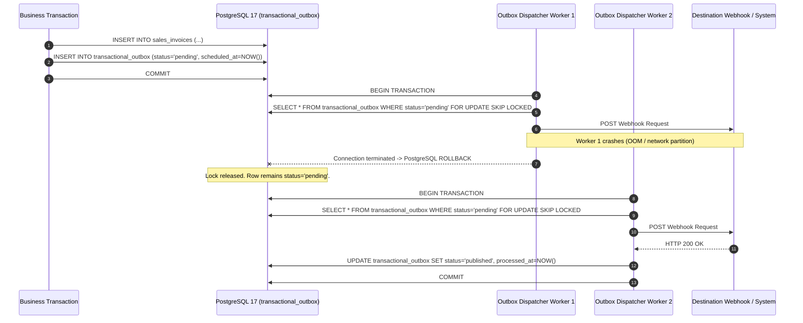
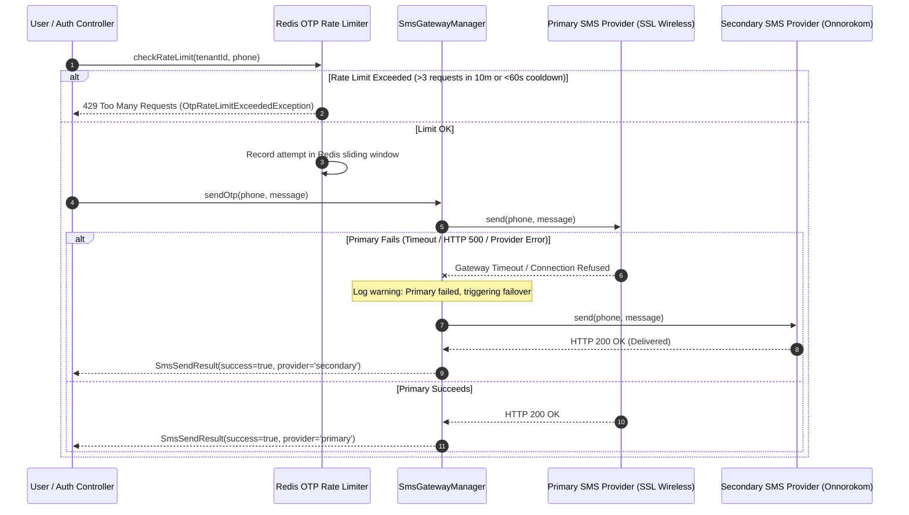

# Step 13 Plan: Outbox, Webhooks, SMS Failover, Master Import & Tenant Portability

## 1. Objective & Scope

- **Step Focus:** Complete the rest of Step 13 from design §5.5, §7.1, §7.2, and §10.3, closing **MOD-07** and **TEN-06**.
- **Milestone:** M6 (Outbox, Audit, Import, QA — Weeks 19–20, Target: 21 Mar 2027).
- **Architecture Directives & Review Items Closed:**
  - **MOD-07 (Medium):** Transactional outbox pattern using `transactional_outbox` (fixing ADR-005 which initially referenced `outbox_events`). Events written in the same transaction as the business document change, polled with `FOR UPDATE SKIP LOCKED`, exponential backoff retries, dead-letter state after 5 attempts, crash resilience, and tenant context set per event batch.
  - **MOD-07 / SEC-05:** Webhook replay prevention with timestamped HMAC-SHA256 signatures (`X-Signature`, `X-Timestamp`), strict 300-second replay window, and post-DNS resolution SSRF checks blocking loopback, private, and link-local/cloud-metadata IP ranges.
  - **CORE-01 (§7.1 & §10.3):** Notification SMS gateway supporting automatic failover between two Bangladeshi aggregators (Primary: SSL Wireless / Greenweb; Secondary: Onnorokom / Mock fallback) and Redis-backed sliding-window OTP rate limits (3 requests per 10-minute window, 60s cooldown).
  - **TEN-06 (§7.1, §7.2):** Master data import from Excel (`.xlsx`) and CSV (`.csv`) for products, customers, suppliers, and opening balances. Dry-run validation reporting all row-level errors without database writes; idempotent re-runs; opening balances posted as exactly one balanced journal entry per company.
  - **TEN-06 (§6.2):** Tenant export to JSON file archive, single-tenant restore into an empty database or staging tenant with UUID remapping and identical trial balance & inventory valuation assertions, and an offboarding procedure with notice, export, retention, and controlled purge in reverse topological order adhering to `ON DELETE RESTRICT`.

---

## 2. Core Architecture Specifications

### 2.1 Transactional Outbox & Worker Crash Resilience (§5.5, MOD-07, ADR-005)
1. **Schema & Table Naming:**
   - Table: `transactional_outbox` with composite key `(tenant_id, id)` using UUIDv7, forced Row-Level Security, and foreign key to `tenants(id)` on delete restrict.
   - Statuses: `pending`, `published`, `failed`.
   - Index: `(tenant_id, scheduled_at ASC) WHERE status = 'pending'`.
2. **Worker Polling & Crash Resilience:**
   - Outbox worker polls using `SELECT ... FOR UPDATE SKIP LOCKED` inside a tenant-scoped database transaction.
   - Sets tenant context: `SELECT set_config('app.current_tenant_id', :id, true)`.
   - **Crash Recovery Invariant:** If a worker crashes or encounters an unhandled process termination mid-dispatch, PostgreSQL rolls back the open transaction and releases row locks. The event remains in `pending` state and will be reclaimed by the subsequent worker iteration without message loss.
3. **Retries & Dead-Letter:**
   - On delivery exception, increments `attempts` and sets exponential backoff: `scheduled_at = now() + (2^attempts * 5s)`.
   - After 5 failed attempts, transitions to `status = 'failed'` (dead-letter queue) and records `last_error`.

### 2.2 Webhooks with Post-DNS SSRF Validation (§10.3, MOD-07)
1. **HMAC-SHA256 Signatures:**
   - Headers: `X-Timestamp: {epoch}` and `X-Signature: sha256={hash}` where `hash = hash_hmac('sha256', $timestamp . '.' . $payload, $secret)`.
   - Verification checks `abs(now - timestamp) <= 300` seconds; rejects older or future timestamps to defeat replay attacks.
2. **Post-DNS Anti-SSRF Inspection:**
   - Destination host is resolved to socket IP addresses via DNS.
   - Refuses dispatch if resolved IP falls into:
     - `127.0.0.0/8`, `::1` (Loopback)
     - `10.0.0.0/8`, `172.16.0.0/12`, `192.168.0.0/16` (RFC 1918 Private)
     - `169.254.0.0/16`, `fe80::/10` (Link-Local / AWS/GCP Metadata 169.254.169.254)
     - `0.0.0.0/8`, `100.64.0.0/10` (CGNAT)
     - `224.0.0.0/4`, `240.0.0.0/4`, `ff00::/8` (Multicast / Reserved)
     - Non-HTTP/HTTPS protocols (`file://`, `gopher://`, `ftp://`).

### 2.3 SMS Gateway Failover & OTP Rate Limiting (§7.1, §10.3)
1. **Multi-Provider Failover:**
   - Interface: `SmsProviderInterface` with `send(string $to, string $message): SmsSendResult`.
   - `SmsGatewayManager`: Configured with a primary driver (`sslwireless` / `greenweb`) and a secondary driver (`onnorokom` / fallback).
   - If primary driver throws an exception or returns a non-200 / gateway error, `SmsGatewayManager` automatically dispatches via the secondary driver and logs a failover event.
2. **OTP Rate Limiting:**
   - Redis-backed sliding window rate limiter: Key `otp_rate:{tenant_id}:{phone}`.
   - Rule: Maximum 3 OTP dispatches per phone number in any 10-minute window.
   - Cooldown: Enforces a 60-second cooldown between consecutive requests to the same number.
   - Throws `OtpRateLimitExceededException` (HTTP 429) when breached.

### 2.4 Master Data Import Engine (Excel & CSV) (§7.1, §7.2, TEN-06)
1. **Supported Formats:**
   - Standard CSV files (parsed via streaming `fgetcsv` / `SplFileObject`).
   - Excel OpenXML (`.xlsx`) files (parsed via streaming `ZipArchive` + `XMLReader` / `SimpleXMLElement` with zero external dependencies).
2. **Dry-Run Mode (`dryRun: true`):**
   - Validates all rows against business and schema constraints (missing SKUs, negative prices, invalid tax codes, phone format).
   - Returns a structured report with exact row numbers, field names, and error descriptions.
   - Guarantees 0 database writes occur during dry-run.
3. **Idempotent Upsert:**
   - Re-importing the same dataset locates records by unique business keys (products by `code`, variants by `sku`, customers by `phone`/`name`, suppliers by `code`) and updates attributes without creating duplicates.
4. **Opening Balances Import:**
   - Accepts opening balance sheet lines (Account, Debit, Credit).
   - Asserts $\sum \text{debits} == \sum \text{credits}$.
   - Creates and posts exactly ONE balanced `JournalEntry` per company with `reference_type = 'OPENING_BALANCE'`.

### 2.5 Single-Tenant Export, Restore & Controlled Offboarding (§6.2, TEN-06)
1. **Dynamic Topological Ordering (`pg_constraint`):**
   - Resolves all tenant-scoped tables dynamically from PostgreSQL system catalogs (`conrelid` and `confrelid` in `pg_constraint` where `contype = 'f'`).
   - Applies Kahn's topological sort algorithm to guarantee parent tables precede dependent child tables.
2. **Single-Tenant Export:**
   - Serializes all tenant rows to a versioned JSON archive.
   - Computes trial balance checksums ($\sum \text{debits}$, $\sum \text{credits}$) and inventory valuations.
3. **Single-Tenant Restore:**
   - Ingests archive into an empty database or staging tenant.
   - Pre-generates fresh UUIDs for all rows and remaps all foreign keys during insertion, guaranteeing zero primary key collisions with existing data in the cluster.
   - Asserts restored trial balance and warehouse quantities match export checksums to the penny (`0.00`).
4. **Controlled Offboarding Procedure:**
   - Transitions tenant status: `active` $\to$ `offboarding_pending` $\to$ `offboarded`.
   - Generates and stores legal export archive for PDPO retention.
   - Controlled Purge: Clears self-referential foreign keys (`reversed_entry_id`, `parent_id`), disables immutability trigger for the offboarding session, and deletes tenant records in **reverse topological order** (children before parents).
   - Ensures zero `ON DELETE RESTRICT` violations without cascading drops.

---

## 3. Data Flow & Sequence Diagrams

### 3.1 Outbox Crash Recovery & At-Least-Once Delivery

### 3.2 SMS Gateway Two-Provider Failover & OTP Rate Limiter

---

## 4. Tests-First Specification

| Test File | Required Test Name | Invariant Verified |
|---|---|---|
| `tests/Feature/Outbox/TransactionalOutboxTest.php` | `test_outbox_event_survives_worker_crash_and_is_delivered_once` | Simulates an unhandled worker exception/abort mid-transaction; verifies PostgreSQL transaction rollback leaves event in `pending` status, which is successfully delivered on subsequent run. |
| `tests/Feature/Outbox/TransactionalOutboxTest.php` | `test_webhook_to_private_ip_is_refused_post_dns_resolution` | Verifies destination URLs resolving to loopback (`127.0.0.1`), RFC 1918 (`10.0.0.1`, `192.168.1.1`), or metadata (`169.254.169.254`) throw `SsrfBlockedException` before HTTP socket creation. |
| `tests/Feature/Notifications/SmsGatewayFailoverTest.php` | `test_sms_gateway_fails_over_to_secondary_provider_when_primary_fails` | Mocks failing primary provider; asserts gateway dispatches via secondary provider and returns success naming secondary provider. |
| `tests/Feature/Notifications/SmsGatewayFailoverTest.php` | `test_otp_rate_limiter_blocks_excessive_requests_within_window` | 4th OTP request to same phone within 10 minutes throws `OtpRateLimitExceededException` (HTTP 429). Consecutive request within 60s cooldown is throttled. |
| `tests/Feature/DataPortability/TenantImportExportTest.php` | `test_master_data_import_dry_run_reports_every_row_error_without_inserting` | CSV/XLSX with deliberate row errors (missing SKU, negative price, invalid tax code) returns detailed error list; 0 rows inserted in DB. |
| `tests/Feature/DataPortability/TenantImportExportTest.php` | `test_importing_the_same_file_twice_creates_nothing_new` | Ingesting the same valid dataset twice creates 0 duplicate products, variants, or customers. |
| `tests/Feature/DataPortability/TenantImportExportTest.php` | `test_opening_balances_posted_as_one_journal_per_company` | Opening inventory, cash, and equity lines create and post exactly one balanced `JournalEntry` per company with $\sum \text{Dr} = \sum \text{Cr}$. Unbalanced input throws `RuntimeException`. |
| `tests/Feature/DataPortability/TenantImportExportTest.php` | `test_tenant_exported_and_restored_into_fresh_database_has_same_trial_balance_and_stock` | Ingests export archive into a target tenant; verifies restored trial balance debits/credits and warehouse stock balances equal source tenant to the penny (`0.00`). |
| `tests/Feature/DataPortability/TenantImportExportTest.php` | `test_tenant_offboarding_workflow_with_notice_export_and_controlled_purge` | Sets retention notice, exports archive, and purges tenant rows in reverse topological order adhering to `ON DELETE RESTRICT`. |

---

## 5. Ordered Commits & Implementation Steps

### Commit 1: Outbox Worker Crash Resilience, Dead-Letter & ADR-005 Table Name Fix (MOD-07)
- **ADR Update:** Explicitly document that ADR-005 previously referenced `outbox_events` and is corrected to `transactional_outbox`.
- **Failing Test First:** `tests/Feature/Outbox/TransactionalOutboxTest.php`:
  - `test_outbox_event_survives_worker_crash_and_is_delivered_once`
  - `test_outbox_dispatcher_retries_with_exponential_backoff_and_dead_letter`
- **Implementation:**
  - Migration `database/migrations/2026_11_14_000002_create_transactional_outbox_table.php` (table `transactional_outbox`, forced RLS, composite key `(tenant_id, id)`).
  - Model `App\Models\TransactionalOutbox`.
  - Services: `App\Core\Outbox\Services\OutboxEmitter` and `App\Core\Outbox\Services\OutboxDispatcherService` using `FOR UPDATE SKIP LOCKED`.
  - Console Command: `php artisan outbox:dispatch {--tenant=} {--batch=50}`.

### Commit 2: Webhooks with HMAC-SHA256, 300s Replay Window & Post-DNS SSRF Refusal (MOD-07 / SEC-05)
- **Failing Test First:** `tests/Feature/Outbox/TransactionalOutboxTest.php`:
  - `test_webhook_dispatcher_attaches_hmac_signature_and_timestamp`
  - `test_webhook_signature_verifier_rejects_replays_older_than_300s`
  - `test_webhook_to_private_ip_is_refused_post_dns_resolution`
- **Implementation:**
  - `App\Core\Webhooks\Services\SsrfProtectionService`: DNS resolution + CIDR range inspection.
  - `App\Core\Webhooks\Services\WebhookDispatcher`: HMAC-SHA256 header generation, signature verification with 300s tolerance, and pre-flight SSRF check.

### Commit 3: Notification SMS Gateway with Two-Provider Failover & OTP Rate Limiting (§7.1, §10.3)
- **Failing Tests First:** `tests/Feature/Notifications/SmsGatewayFailoverTest.php`:
  - `test_sms_gateway_fails_over_to_secondary_provider_when_primary_fails`
  - `test_otp_rate_limiter_blocks_excessive_requests_within_window`
  - `test_sms_gateway_logs_dispatch_audit_trail`
- **Implementation:**
  - `App\Core\Notifications\Contracts\SmsProviderInterface`.
  - `App\Core\Notifications\Services\SmsGatewayManager`: Dual-driver failover architecture.
  - Drivers: `PrimarySmsProvider` and `SecondarySmsProvider` (configurable via `config/services.php`).
  - `App\Core\Notifications\Services\OtpRateLimiter`: Redis-backed sliding window limiter enforcing max 3 attempts per 10 minutes and 60-second cooldown.
  - Exceptions: `OtpRateLimitExceededException`, `SmsDispatchFailedException`.

### Commit 4: Master Data Import (Excel & CSV) with Dry-Run, Idempotency & Opening Balances (TEN-06)
- **Failing Tests First:** `tests/Feature/DataPortability/TenantImportExportTest.php`:
  - `test_master_data_import_dry_run_reports_every_row_error_without_inserting`
  - `test_importing_the_same_file_twice_creates_nothing_new`
  - `test_opening_balances_posted_as_one_journal_per_company`
- **Implementation:**
  - File parsers supporting CSV (`SplFileObject`) and OpenXML Excel (`.xlsx` via `ZipArchive` + `SimpleXMLElement`).
  - `App\Modules\DataMigration\Services\MasterDataImportService`:
    - `importProducts(array $rows, string $companyId, bool $dryRun = false)`.
    - `importCustomers(array $rows, string $companyId, bool $dryRun = false)`.
    - `importSuppliers(array $rows, string $companyId, bool $dryRun = false)`.
    - `importOpeningBalances(array $balances, string $companyId, string $periodId, string $userId)`: Posts one balanced draft journal entry, inserts lines, then updates to `is_posted = true`.
  - Console Command: `php artisan tenant:import-master {file} {--type=products} {--company=} {--dry-run}`.

### Commit 5: Single-Tenant Export, Restore & Controlled Offboarding (TEN-06)
- **Failing Tests First:** `tests/Feature/DataPortability/TenantImportExportTest.php`:
  - `test_tenant_exported_and_restored_into_fresh_database_has_same_trial_balance_and_stock`
  - `test_tenant_offboarding_workflow_with_notice_export_and_controlled_purge`
- **Implementation:**
  - `App\Modules\DataMigration\Services\TenantExportService`: `pg_constraint` topological table discovery, exports versioned JSON archive with trial balance and stock valuation checksums.
  - `App\Modules\DataMigration\Services\TenantRestoreService`: Remaps entity UUIDs and foreign keys, restores in topological order, inserts draft journals and lines before posting, asserts restored checksums match export.
  - `App\Modules\DataMigration\Services\TenantOffboardingService`: Generates retention export, updates tenant status to `offboarded`, breaks self-referential keys, disables audit trigger, and purges rows in reverse topological order.
  - Console Commands:
    - `php artisan tenant:export {tenant_id} {--output=}`
    - `php artisan tenant:restore {archive_file} {--target-tenant=}`

---

## 6. Verification Commands on Dev Server (CT 104)

All commands execute on Proxmox CT 104 over the runner:
1. `php artisan migrate --force`
2. `php artisan db:check-rls`
3. `php artisan test tests/Feature/Outbox/TransactionalOutboxTest.php`
4. `php artisan test tests/Feature/Notifications/SmsGatewayFailoverTest.php`
5. `php artisan test tests/Feature/DataPortability/TenantImportExportTest.php`
6. `vendor/bin/pint --test`
7. `vendor/bin/phpstan analyse --no-progress`
8. `php artisan test --compact`
