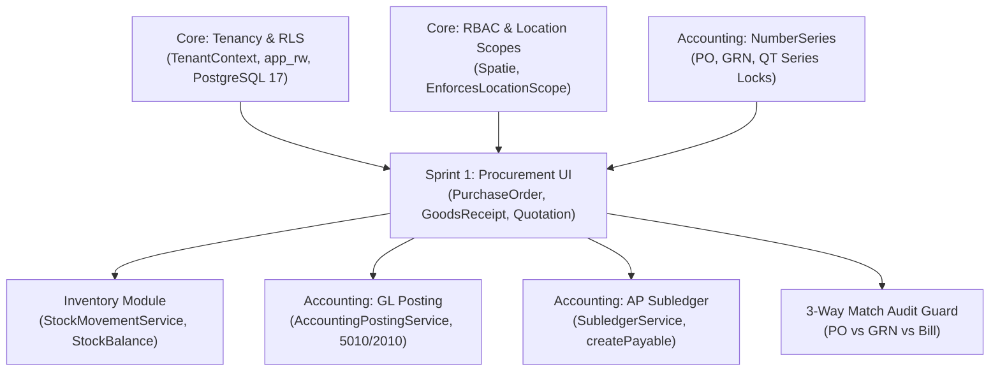

# SPRINT 1 DEPENDENCY AND RISK REGISTER
## KC Retail ERP | Architecture Governance & Threat Mitigation

- **Sprint:** Wave 1 / Sprint 1: Procurement & Document UI Parity
- **Target Baseline:** Git commit `17d0264` (`step-13a-watchdog-audit`)
- **Document Status:** IMPLEMENTATION PLANNING ONLY (Awaiting Human Approval)

---

## 1. Upstream & Downstream Dependencies

The Procurement and Document UI components interface with several foundational core modules. Any change must strictly preserve contract boundaries.

### Dependency Inventory

| Module / Service | Contract / Interface | Inbound / Outbound | Criticality |
| :--- | :--- | :--- | :--- |
| **Tenancy** | `TenantContext::id()`, `FilamentTenantContextMiddleware` | Inbound | Critical: Sets PostgreSQL `app.current_tenant_id` session config. |
| **Number Series** | `NumberSeriesContract::getNextNumber()` | Outbound | High: Pessimistic row locking on prefix sequence (`PO`, `GRN`, `QT`). |
| **Inventory Movement** | `StockMovementServiceContract::recordMovement()` | Outbound | Critical: Atomic insertion of stock movements and weighted average cost updates. |
| **General Ledger** | `AccountingPostingServiceContract::post()` | Outbound | Critical: Double-entry journal posting (`purchase_bill`: Dr Expense/Inventory, Cr AP). |
| **AP Subledger** | `SubledgerContract::createPayable()` | Outbound | Critical: Open-item creation in AP subledger for vendor aging and payment allocation. |
| **Customer Credit** | `CustomerCreditCheckerContract` | Outbound | Medium: Credit limit check prior to converting Quotation to Sales Order. |
| **Filament Framework** | `Filament\Resources\Resource`, Livewire 4, Tailwind v3 | Infrastructure | High: Admin panel UI components, reactive repeater calculations. |

---

## 2. Risk Matrix & Failure Mode Effects Analysis (FMEA)

| Risk ID | Failure Mode / Threat | Severity | Likelihood | Impact | Mitigation Strategy & Architectural Guard |
| :--- | :--- | :--- | :--- | :--- | :--- |
| **RSK-01** | **Direct Eloquent Mutation in UI**: Filament form saves record directly, bypassing domain service and skipping stock movements or audit logs. | **Critical** | Medium | High | **Strict Architectural Decoupling**: Override `handleRecordCreation` and `handleRecordUpdate` on all Filament pages. Assemble DTOs and call domain contracts (`ProcurementDocumentChainContract`). |
| **RSK-02** | **Concurrent Receipt Race Condition**: Two operators simultaneously receive against the same PO, exceeding ordered quantity. | **High** | Low | High | **Pessimistic Row Locking**: `confirmGoodsReceipt` executes `PurchaseOrderLine::lockForUpdate()` within an active database transaction before updating quantities. |
| **RSK-03** | **Silent Approval of Billed Overages**: Supplier bill approved with higher unit price or quantity than warehouse accepted. | **Critical** | Medium | High | **Three-Way Match Hard Block**: `approve_bill` action checks `ThreeWayMatchingWidget::getReconciliationData()['has_exceptions']`. If exceptions exist, approval is impossible without managerial override. |
| **RSK-04** | **Cross-Tenant Select Leakage**: Filament select dropdowns display suppliers, branches, or products belonging to another tenant. | **Critical** | Low | Catastrophic | **Double Defense**: 1. PostgreSQL 17 forced RLS denies cross-tenant reads at DB level. 2. All `Select::options()` closures explicitly filter by `Filament::getTenant()->id`. |
| **RSK-05** | **Floating Point Currency Error**: Money calculations in 3-way matching introduce rounding inaccuracies ($0.01$ discrepancies). | **High** | Medium | Medium | **Brick/Math Standard**: Strict enforcement of `Brick\Math\BigDecimal` with `RoundingMode::HalfUp` to 4 decimal places. Floats are banned. |
| **RSK-06** | **Damaged Stock Leakage**: Damaged goods arriving at warehouse accidentally enter active sellable inventory on POS. | **High** | Low | High | **Quarantine Logic**: Only `received_quantity` (accepted) triggers positive `StockMovement`. Damaged/rejected quantities are recorded in quarantine logs and excluded from `StockBalance`. |

---

## 3. Segregation of Duties (SoD) Conflict Matrix

To prevent internal fraud, embezzlement, or accidental misstatements, the following role conflicts are enforced:

| Role 1 | Role 2 | Conflict Level | Enforced Separation Rule |
| :--- | :--- | :--- | :--- |
| **Procurement Manager** (Creates PO) | **Warehouse Manager** (Receives Goods) | **High Conflict** | A single user should not order goods and certify their physical receipt. |
| **Warehouse Manager** (Receives Goods) | **Accountant** (Approves Vendor Bill) | **Toxic Conflict** | Warehouse receiving personnel must never approve supplier payments or create AP liabilities. |
| **Procurement Manager** (Creates PO) | **Accountant** (Approves Vendor Bill) | **High Conflict** | The officer committing commercial terms should not authorize the payment disbursement. |
| **Any Initiator** | **Self-Approval** | **Strict Block** | The user who created a PO or Bill cannot execute the Three-Way Match override for that same document. |

---

## 4. Rollback & Fail-Safe Strategy

1. **Pre-Implementation Checkpoint**:
   - The verified baseline commit `17d0264` is preserved untouched.
   - Sprint 1 implementation occurs in an isolated feature branch (`feat/procurement-ui-parity`).
2. **Database Non-Destructiveness**:
   - Zero existing migrations or tables are altered.
   - Any new inspection columns (`rejected_quantity`, `damaged_quantity`) are additive only with default values (`0.0000`).
3. **Emergency Circuit Breaker**:
   - If an issue occurs in production or staging, disabling the navigation group in `AdminPanelProvider` instantly hides the UI without corrupting existing database data or backend services.
