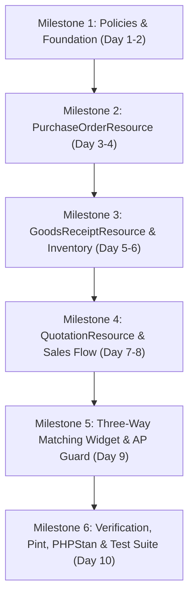

# SPRINT 1 IMPLEMENTATION PLAN: PROCUREMENT & DOCUMENT UI PARITY
## KC Retail ERP | Wave 1: Core Operational Parity

- **Project:** KC Retail ERP (`POS_ERP_Multi_Tenant`)
- **Baseline Git Branch:** `step-13a-watchdog-audit`
- **Baseline Commit:** `17d0264`
- **Target Environment:** Proxmox CT 104 (`dev.kcerp.com`), PostgreSQL 17.4, PHP 8.4, Laravel 13, Filament v5
- **Document Status:** IMPLEMENTATION PLANNING ONLY (Awaiting Human Approval)
- **Author:** Principal Software Architect & QA Lead
- **Date:** November 2026

---

## 1. Executive Summary & Objective

The objective of Wave 1 / Sprint 1 is to eliminate operational reliance on backend walkthrough scripts and APIs by delivering **enterprise-grade, multi-tenant Filament v5 back-office user interfaces** for the core procurement and commercial sales document workflows.

### Target Scope
1. **`PurchaseOrderResource`**: Full lifecycle management of purchase orders (Draft $\to$ Confirmed $\to$ Partially Received $\to$ Received $\to$ Closed / Cancelled) with supplier bindings, pricing, and branch allocation.
2. **`GoodsReceiptResource`**: Warehouse intake management (Draft $\to$ Received / Stock Posted), supporting partial delivery, batch tracking, expiry dates, and separate tracking for damaged/rejected quantities.
3. **`QuotationResource`**: Commercial sales quotation management (Draft $\to$ Converted to Sales Order / Cancelled) with customer group pricing and validity tracking.
4. **Automated Three-Way Matching Validation Widget**: Financial and audit control widget matching Purchase Order, Goods Receipt Note (GRN), and Supplier Bill lines to detect quantity, price, and amount variances before liability posting.

---

## 2. Repository Baseline Assessment: What Exists vs. What Is Missing

An exhaustive inspection of commit `17d0264` reveals that backend domain services and database tables are already thoroughly built and tested. The primary gap is the **presentation and interaction layer in Filament**.

### 2.1 Backend Domain & Database Matrix

| Domain Component | Existing Repository Baseline | Status | Reusability / Gap |
| :--- | :--- | :--- | :--- |
| **Purchase Order Model** | `app/Models/PurchaseOrder.php`, `PurchaseOrderLine.php` | Implemented | 100% Reusable. Has UUIDs, tenant & company FKs, status fields, and number series. |
| **Goods Receipt Model** | `app/Models/GoodsReceipt.php`, `GoodsReceiptLine.php` | Implemented | 100% Reusable. Linked to PO, warehouse, supplier, challan number. |
| **Quotation Model** | `app/Models/Quotation.php`, `QuotationLine.php` | Implemented | 100% Reusable. Customer binding, quotation dates, validity. |
| **Supplier & Bill Models** | `app/Models/Supplier.php`, `SupplierBill.php`, `SupplierBillLine.php` | Implemented | 100% Reusable. Linked to PO and GRN via migration `2026_11_12_000008`. |
| **Procurement Service** | `app/Modules/Procurement/Services/ProcurementDocumentChainService.php` | Implemented | 100% Reusable. Enforces immutability, number series, stock posting, GL posting, and AP open items. |
| **Sales Chain Service** | `app/Modules/Sales/Services/SalesDocumentChainService.php` | Implemented | 100% Reusable. Handles quotation creation, conversion to SO, challan, invoice, and AR subledger. |
| **Inventory Movement** | `app/Modules/Inventory/Services/StockMovementService.php` | Implemented | 100% Reusable. Updates `stock_balances` and `stock_movements` atomically. |
| **Accounting & AP** | `app/Modules/Accounting/Services/AccountingPostingService.php`, `SubledgerService.php` | Implemented | 100% Reusable. Creates double-entry journals (`5010` Dr, `2010` Cr) and AP open items. |
| **Filament UI Layer** | `app/Filament/Resources/` | **MISSING** | **Zero procurement/quotation resources exist.** Need `PurchaseOrderResource`, `GoodsReceiptResource`, `QuotationResource`. |
| **3-Way Match Widget** | `app/Filament/Widgets/` | **MISSING** | **No widget exists.** Needs comparison logic between PO lines, GRN lines, and Bill lines. |

---

## 3. Strict Architectural Non-Negotiables

All implementation in Sprint 1 must adhere to these foundational principles:

1. **Zero Direct Eloquent Mutation in Filament Pages**:
   - Filament pages and components must **never** perform direct database writes that alter stock, post financial journals, or bypass status guards.
   - Form submission and action buttons must assemble strongly typed DTOs (e.g. `CreatePurchaseOrderDTO`, `CreateGoodsReceiptDTO`) and invoke the respective domain contract (`ProcurementDocumentChainContract`, `SalesDocumentChainContract`).
2. **PostgreSQL 17 Forced RLS & Multi-Tenancy**:
   - The application connects as `app_rw`.
   - Every database query executed by Filament tables, forms, and relation managers operates under `set_config('app.current_tenant_id', ...)` enforced by `FilamentTenantContextMiddleware`.
   - Composite keys `(tenant_id, company_id, ...)` must be strictly populated on all child records.
3. **Inventory & Costing Integrity**:
   - Purchase Orders must **NEVER** increment stock or alter inventory valuation.
   - Physical stock movements occur **exclusively** upon explicit confirmation of a `GoodsReceipt` via `StockMovementService`.
   - Damaged and rejected quantities must never enter active sellable inventory (`quantity_on_hand`).
4. **General Ledger & Subledger Immutability**:
   - Financial journals are generated **only** when a `SupplierBill` is confirmed.
   - Posted journals and AP open items are strictly append-only. Corrections require debit notes or reversal vouchers.
5. **Segregation of Duties (SoD)**:
   - Role-based authorization must prevent a single user from creating a PO, receiving the goods, and approving the vendor bill.

---

## 4. File-Level Implementation Map

The following files will be created or updated during Sprint 1 execution:

```
app/
├── Filament/
│   ├── Resources/
│   │   ├── PurchaseOrders/
│   │   │   ├── PurchaseOrderResource.php              [NEW] Main Resource definition
│   │   │   ├── Pages/
│   │   │   │   ├── ListPurchaseOrders.php             [NEW] Tabular list with status filters
│   │   │   │   ├── CreatePurchaseOrder.php            [NEW] Form delegating to ProcurementService
│   │   │   │   ├── ViewPurchaseOrder.php              [NEW] Read-only view with document chain links
│   │   │   │   └── EditPurchaseOrder.php              [NEW] Draft-only edit screen
│   │   │   └── RelationManagers/
│   │   │       ├── LinesRelationManager.php           [NEW] Order item management
│   │   │       └── GoodsReceiptsRelationManager.php   [NEW] Inbound receipts linked to PO
│   │   ├── GoodsReceipts/
│   │   │   ├── GoodsReceiptResource.php               [NEW] Main Resource definition
│   │   │   ├── Pages/
│   │   │   │   ├── ListGoodsReceipts.php              [NEW] Intake history & filters
│   │   │   │   ├── CreateGoodsReceipt.php             [NEW] Receiving form with PO line pull
│   │   │   │   └── ViewGoodsReceipt.php               [NEW] Confirmed GRN details & stock impact
│   │   │   └── RelationManagers/
│   │   │       └── ReceiptLinesRelationManager.php    [NEW] Quantity received/rejected/batch
│   │   ├── Quotations/
│   │   │   ├── QuotationResource.php                  [NEW] Main Resource definition
│   │   │   ├── Pages/
│   │   │   │   ├── ListQuotations.php                 [NEW] Sales quotation register
│   │   │   │   ├── CreateQuotation.php                [NEW] Quote builder
│   │   │   │   ├── ViewQuotation.php                  [NEW] View with "Convert to SO" action
│   │   │   │   └── EditQuotation.php                  [NEW] Draft quote editor
│   │   │   └── RelationManagers/
│   │   │       └── QuotationLinesRelationManager.php  [NEW] Quote items and pricing
│   │   └── SupplierBills/                             [NEW or Extension for 3-Way Match]
│   │       └── Widgets/
│   │           └── ThreeWayMatchingWidget.php         [NEW] PO vs GRN vs Bill reconciliation widget
│   └── Widgets/
│       └── ProcurementOverviewWidget.php              [NEW] Executive KPI stats for Procurement
├── Policies/
│   ├── PurchaseOrderPolicy.php                        [NEW] RBAC & Location scope enforcement
│   ├── GoodsReceiptPolicy.php                         [NEW] RBAC & Warehouse scope enforcement
│   └── QuotationPolicy.php                            [NEW] RBAC & Branch scope enforcement
tests/
├── Feature/
│   └── Filament/
│       ├── PurchaseOrderResourceTest.php              [NEW] Form submission, permissions, RLS
│       ├── GoodsReceiptResourceTest.php               [NEW] Stock movement triggers, partial receipts
│       ├── QuotationResourceTest.php                  [NEW] Quote creation, conversion to SO
│       ├── ThreeWayMatchingWidgetTest.php             [NEW] Quantity/price variance detection
│       └── ProcurementLocationScopingTest.php         [NEW] Cross-branch isolation
```

---

## 5. Implementation Sequence & Milestones (10-Day Plan)



### Milestone Details
- **Days 1–2 (Foundation & Policies)**:
  - Author `PurchaseOrderPolicy`, `GoodsReceiptPolicy`, `QuotationPolicy` using `EnforcesLocationScope`.
  - Register policies in `AuthServiceProvider` / Laravel auto-discovery.
  - Setup test fixtures and factories for Filament test cases.
- **Days 3–4 (PurchaseOrderResource)**:
  - Build `PurchaseOrderResource` with form schemas, repeater for lines, tax calculation, and number series.
  - Connect actions: `Confirm`, `Cancel`, `Print PDF`.
  - Verify PO creation and immutability via `PurchaseOrderResourceTest`.
- **Days 5–6 (GoodsReceiptResource)**:
  - Build `GoodsReceiptResource` with PO-pull mechanism (`select purchase_order_id` auto-populates lines with remaining unreceived quantities).
  - Add batch number, manufacturing date, expiry date, and rejected quantity fields.
  - Implement action: `Confirm & Post to Stock` delegating to `ProcurementDocumentChainService::confirmGoodsReceipt`.
  - Verify stock ledger updates and partial receipts via `GoodsReceiptResourceTest`.
- **Days 7–8 (QuotationResource)**:
  - Build `QuotationResource` with customer search, price list lookup, and validity date picker.
  - Implement action: `Convert to Sales Order` delegating to `SalesDocumentChainService::convertQuotationToSalesOrder`.
  - Verify quotation workflow via `QuotationResourceTest`.
- **Day 9 (Three-Way Matching Widget)**:
  - Build `ThreeWayMatchingWidget` calculating variances:
    $$\Delta Q_{\text{receipt}} = Q_{\text{received}} - Q_{\text{ordered}}$$
    $$\Delta Q_{\text{bill}} = Q_{\text{billed}} - Q_{\text{received}}$$
    $$\text{PPV} = (P_{\text{billed}} - P_{\text{PO}}) \times Q_{\text{billed}}$$
  - Integrate widget into `SupplierBillResource` and `GoodsReceiptResource`.
  - Enforce financial block: bill cannot be approved if $\text{PPV} > \text{Threshold}$ or $Q_{\text{billed}} > Q_{\text{received}}$ without explicit manager override.
- **Day 10 (Hardening, Verification & CI/CD Gate)**:
  - Run `vendor/bin/pint --test` (format clean).
  - Run `vendor/bin/phpstan analyse` (Larastan Level 8 zero errors).
  - Execute full test suite: `php artisan test --filter=Filament`.
  - Verify zero database schema or RLS regression: `php artisan db:check-rls`.

---

## 6. Approval Gate Criteria

Before any code is merged or deployed:
1. **Pest / PHPUnit Test Pass Rate**: 100% pass across all new feature tests.
2. **Zero RLS Violations**: Confirmed fail-closed operation across all 68 tenant tables.
3. **Larastan Level 8**: Zero static analysis errors across all newly created files.
4. **Human Verification**: Review of UI walkthrough on CT 104 (`dev.kcerp.com/admin/trustbond`).
