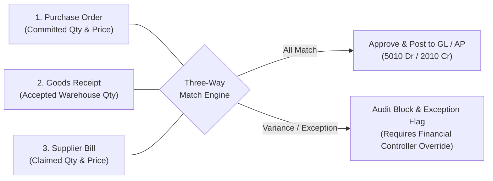

# THREE-WAY MATCHING VALIDATION SPECIFICATION
## KC Retail ERP | Accounts Payable & Audit Guard Module

- **Component:** `App\Filament\Widgets\ThreeWayMatchingWidget`
- **Related Resource:** `App\Filament\Resources\SupplierBills\SupplierBillResource`
- **Document Family:** P2P (Procure-to-Pay) Financial Integrity
- **Document Status:** IMPLEMENTATION PLANNING ONLY (Awaiting Human Approval)

---

## 1. Overview & Business Objectives

Three-Way Matching is the primary financial integrity control in the Procure-to-Pay (P2P) lifecycle. It reconciles three independent commercial records before liability is recognized in the General Ledger:
1. **The Purchase Order (PO)**: Authorized commercial agreement specifying ordered items, quantities, and agreed purchase rates.
2. **The Goods Receipt Note (GRN)**: Certified warehouse document recording physical quantities received, batch details, and inspection results.
3. **The Supplier Bill (Vendor Invoice)**: Commercial invoice demanding payment from the company.



### Critical Business Rules
1. **Anti-Leakage Guarantee**: A supplier bill must **never** be approved or posted if billed quantity exceeds physically received quantity ($Q_{\text{bill}} > Q_{\text{received}}$).
2. **Visible Exceptions**: Matching variances must be immediately visible to accounts payable officers and auditors. They **must never silently approve invoices**.
3. **Purchase Price Variance (PPV) Accounting**: Any discrepancy between PO unit price and billed unit price is isolated as Purchase Price Variance (PPV) and tracked for supplier rating and margin analysis:
   $$\text{PPV} = (P_{\text{bill}} - P_{\text{PO}}) \times Q_{\text{bill}}$$
4. **Audit Immutability**: Any approved override of a matching exception must record the approving manager's user ID, timestamp, justification, and payload hash in the immutable `audit_logs` hash chain.

---

## 2. Mathematical Reconciliation & Tolerance Rules

### 2.1 Line-by-Line Reconciliation Formulae

For each product variant line item $i$:

| Dimension | Formula | Acceptance Condition | Exception Flag |
| :--- | :--- | :--- | :--- |
| **Quantity Match** | $\Delta Q_i = Q_{\text{bill}, i} - Q_{\text{grn}, i}$ | $\Delta Q_i \le 0$ | `QUANTITY_OVERBILLING_EXCEPTION` |
| **Order Ceiling** | $\Delta Q_{\text{order}, i} = Q_{\text{bill}, i} - Q_{\text{po}, i}$ | $\Delta Q_{\text{order}, i} \le 0$ | `ORDER_EXCEEDED_EXCEPTION` |
| **Price Variance** | $\Delta P_i = P_{\text{bill}, i} - P_{\text{po}, i}$ | $|\Delta P_i| \le \text{Tolerance}$ | `PURCHASE_PRICE_VARIANCE_EXCEPTION` |
| **Amount Variance** | $\Delta A_i = A_{\text{bill}, i} - (Q_{\text{bill}, i} \times P_{\text{po}, i} + \text{Tax}_i)$ | $|\Delta A_i| \le \text{Tolerance}$ | `TOTAL_AMOUNT_MISMATCH_EXCEPTION` |

### 2.2 Configurable Tolerance Levels
In retail grocery and FMCG trade:
- **Quantity Tolerance**: **0.00%** (Strict zero-tolerance. You only pay for what warehouse accepted).
- **Price Tolerance (Standard)**: **0.00%** (Strict adherence to contract/PO rate).
- **Price Tolerance (Commodities / Agri)**: **1.00%** or max **৳ 100 per line**, configurable in tenant company settings.

---

## 3. UI Schema & Widget Architecture

### 3.1 Widget Placement & Structure
`ThreeWayMatchingWidget` is rendered as an embedded relationship widget at the top of the `SupplierBillResource` View/Edit page, and can also be queried standalone from the Audit / Compliance panel.

#### Component Layout
```
+------------------------------------------------------------------------------------------------+
|  THREE-WAY MATCHING AUDIT ENGINE                                           [ STATUS: EXCEPTION ]|
+------------------------------------+-----------------------------------+-----------------------+
|  Total Invoiced: ৳ 120,000.00      |  Expected PO Amount: ৳ 115,000.00 |  PPV Variance: +৳ 5,000|
|  Status: MATCH FAILED              |  GRN Received: 100% Verified       |  Exceptions: 1 Item   |
+------------------------------------+-----------------------------------+-----------------------+
|  Line Comparison Table                                                                         |
|  +--------------------+----------+----------+----------+----------+----------+----------+----+
|  | Item / SKU         | PO Qty   | GRN Qty  | Bill Qty | PO Price | Bill Pr. | Variance |St. |
|  +--------------------+----------+----------+----------+----------+----------+----------+----+
|  | Fresh Mustard Oil  | 200      | 120      | 120      | ৳ 150.00 | ৳ 150.00 | ৳ 0.00   |OK  |
|  | Radhuni Turmeric   | 500      | 500      | 500      | ৳ 60.00  | ৳ 70.00  |+৳ 5,000  |FAIL|
|  +--------------------+----------+----------+----------+----------+----------+----------+----+
|  [!] EXCEPTION DETECTED: Unit price on line #2 exceeds PO purchase rate by ৳ 10.00 / unit.       |
|  [ Action Blocked: Cannot approve or post this bill until price variance is resolved ]          |
|                                                                                                |
|  [ Request Credit Note from Vendor ]       [ Managerial Override (Financial Controller Only) ] |
+------------------------------------------------------------------------------------------------+
```

### 3.2 Livewire / Filament Implementation Outline

```php
namespace App\Filament\Widgets;

use App\Models\SupplierBill;
use Brick\Math\BigDecimal;
use Filament\Widgets\Widget;

class ThreeWayMatchingWidget extends Widget
{
    protected static string $view = 'filament.widgets.three-way-matching-widget';

    public ?SupplierBill $record = null;

    /**
     * Reconcile line items across PO, GRN, and Supplier Bill.
     *
     * @return array{
     *   status: 'MATCHED'|'EXCEPTION'|'UNLINKED',
     *   total_po_expected: string,
     *   total_billed: string,
     *   net_ppv: string,
     *   has_exceptions: bool,
     *   lines: array<int, array<string, mixed>>
     * }
     */
    public function getReconciliationData(): array
    {
        if (! $this->record || ! $this->record->goods_receipt_id) {
            return [
                'status' => 'UNLINKED',
                'total_po_expected' => '0.00',
                'total_billed' => $this->record?->total_amount ?? '0.00',
                'net_ppv' => '0.00',
                'has_exceptions' => true,
                'lines' => [],
            ];
        }

        $bill = $this->record->load(['lines', 'goodsReceipt.lines', 'purchaseOrder.lines']);
        $grnLines = $bill->goodsReceipt->lines->keyBy('id');
        $poLines = $bill->purchaseOrder?->lines->keyBy('id') ?? collect();

        $lines = [];
        $netPpv = BigDecimal::zero();
        $expectedTotal = BigDecimal::zero();
        $hasExceptions = false;

        foreach ($bill->lines as $bLine) {
            $grnLine = $bLine->goods_receipt_line_id ? $grnLines->get($bLine->goods_receipt_line_id) : null;
            $poLine = $bLine->purchase_order_line_id ? $poLines->get($bLine->purchase_order_line_id) : null;

            $billQty = BigDecimal::of($bLine->quantity);
            $billPrice = BigDecimal::of($bLine->unit_price);
            $grnQty = $grnLine ? BigDecimal::of($grnLine->received_quantity) : BigDecimal::zero();
            $poQty = $poLine ? BigDecimal::of($poLine->ordered_quantity) : BigDecimal::zero();
            $poPrice = $poLine ? BigDecimal::of($poLine->unit_price) : $billPrice;

            $lineExpected = $billQty->multipliedBy($poPrice);
            $expectedTotal = $expectedTotal->plus($lineExpected);

            $linePpv = $billPrice->minus($poPrice)->multipliedBy($billQty);
            $netPpv = $netPpv->plus($linePpv);

            $lineExceptions = [];
            if ($billQty->isGreaterThan($grnQty)) {
                $lineExceptions[] = "Billed qty ({$billQty}) exceeds GRN received qty ({$grnQty}).";
            }
            if ($billPrice->isGreaterThan($poPrice)) {
                $lineExceptions[] = "Billed unit price ({$billPrice}) exceeds PO rate ({$poPrice}).";
            }

            if (! empty($lineExceptions)) {
                $hasExceptions = true;
            }

            $lines[] = [
                'product_name' => $bLine->product->name_en,
                'sku' => $bLine->variant->sku,
                'po_qty' => (string) $poQty,
                'grn_qty' => (string) $grnQty,
                'bill_qty' => (string) $billQty,
                'po_price' => (string) $poPrice,
                'bill_price' => (string) $billPrice,
                'ppv' => (string) $linePpv,
                'status' => empty($lineExceptions) ? 'MATCHED' : 'EXCEPTION',
                'exceptions' => $lineExceptions,
            ];
        }

        return [
            'status' => $hasExceptions ? 'EXCEPTION' : 'MATCHED',
            'total_po_expected' => (string) $expectedTotal,
            'total_billed' => (string) $bill->total_amount,
            'net_ppv' => (string) $netPpv,
            'has_exceptions' => $hasExceptions,
            'lines' => $lines,
        ];
    }
}
```

---

## 4. Exception Handling & Segregation of Duties (SoD)

### 4.1 Bill Posting Block
In `SupplierBillResource`, the `Approve & Post to GL` action checks matching status:

```php
Action::make('approve_bill')
    ->label('Approve & Post Bill / বিল অনুমোদন ও পোস্টিং')
    ->icon('heroicon-o-lock-closed')
    ->color('success')
    ->requiresConfirmation()
    ->visible(fn (SupplierBill $record): bool => $record->status === 'draft')
    ->action(function (SupplierBill $record) {
        $widget = new ThreeWayMatchingWidget();
        $widget->record = $record;
        $match = $widget->getReconciliationData();

        if ($match['has_exceptions']) {
            Notification::make()
                ->title('Three-Way Match Failed')
                ->body('Cannot post bill with unresolved quantity or price exceptions. Financial Controller override required.')
                ->danger()
                ->send();
            return;
        }

        // Proceed to GL posting & AP Open item creation
    })
```

### 4.2 Managerial Override Workflow
1. Only users with role `Tenant Owner`, `Tenant Admin`, or `Financial Controller` can invoke the override modal.
2. The user must provide a formal text explanation (e.g. *"Price increase accepted due to revised customs duty tariff notification"*).
3. The approval logs an entry in `audit_logs` with event `supplier_bill.matching_override` and recalculates the hash chain via `BuildAuditHashChainWorker`.

---

## 5. Automated Test Strategy

1. **Exact Match Test**: PO 100 units @ ৳50, GRN 100 units, Bill 100 units @ ৳50 $\to$ Status `MATCHED`, approval permitted.
2. **Quantity Overbilling Test**: PO 100 units, GRN 80 units, Bill 100 units $\to$ Status `EXCEPTION`, approval blocked.
3. **Price Variance Test**: PO rate ৳100, Bill rate ৳110 $\to$ Status `EXCEPTION`, PPV calculated as +৳10/unit, approval blocked.
4. **Managerial Override Audit Test**: Override executed by authorized role $\to$ bill transitions to `posted`, GL journal created, audit record written.
5. **Pest Feature Test Class**:
   - `tests/Feature/Filament/ThreeWayMatchingWidgetTest.php`
