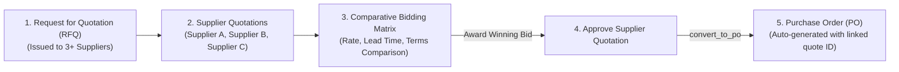

# PROCUREMENT SCOPE GAP ANALYSIS: QUOTATION DOMAIN RECONCILIATION
## KC Retail ERP | Unified ERP v2.0 Architecture & Governance
**Wave 1 / Sprint 1 Acceptance Audit Deliverable**

- **Document ID:** `GAP-W1S1-002`
- **Audit Date:** 2026-11-05
- **Author:** Independent Principal Software Architect
- **Target Branch:** `step-14-procurement-ui`
- **Scope Item:** Audit of `QuotationResource`, `QuotationPolicy`, Models, and Procurement Requirements

---

## 1. Context & Identified Discrepancy

During the Wave 1 / Sprint 1 implementation of Procurement Document UI Parity, a component named `QuotationResource` was authored, verified, and tested.

However, an independent architectural audit reveals a fundamental domain classification discrepancy:

```
+---------------------------------------------------------------------------------------------------+
| SPRINT 1 BUSINESS INTENT: Procure-to-Pay (P2P)                                                    |
| Expected: SUPPLIER QUOTATION (Vendor RFQ, comparative bidding matrix, and conversion to PO)        |
+---------------------------------------------------------------------------------------------------+
                                                  VS
+---------------------------------------------------------------------------------------------------+
| ACTUAL IMPLEMENTATION: Order-to-Cash (O2C)                                                        |
| Implemented: SALES QUOTATION (Customer pricing, credit limit check, and conversion to Sales Order)|
+---------------------------------------------------------------------------------------------------+
```

This document investigates the root cause, audits the repository models, evaluates the business impact, and provides a comprehensive design specification for a dedicated `SupplierQuotationResource` in Sprint 2 without discarding the valuable Sales Quotation assets already delivered.

---

## 2. Codebase & Database Model Inspection

### 2.1 The Existing `Quotation` Model & Migration
Inspection of `database/migrations/2026_11_12_000001_create_quotations_table.php` demonstrates:
```php
/**
 * Implements Section 1.3 & 8.2: Quotations & Quotation Lines (O2C Document Chain - NEW-34).
 */
$this->createTenantTable('quotations', function (Blueprint $table) {
    $table->uuid('company_id');
    $table->uuid('branch_id');
    $table->uuid('customer_id'); // <--- Foreign key to customers!
    $table->string('quotation_number', 100);
    $table->date('quotation_date');
    $table->date('valid_until');
    $table->decimal('subtotal', 18, 4);
    $table->decimal('tax_amount', 18, 4)->default(0.0000);
    $table->decimal('grand_total', 18, 4);
    $table->string('status', 30)->default('draft');
    $table->uuid('created_by');
    // ...
    $table->foreign(['tenant_id', 'company_id', 'customer_id'], 'fk_quotations_customer')
        ->references(['tenant_id', 'company_id', 'id'])
        ->on('customers');
});
```

And in `app/Models/Quotation.php`:
- Relationships: `$this->belongsTo(Customer::class, 'customer_id')`, `$this->hasMany(SalesOrder::class, 'quotation_id')`.
- Zero references to `supplier_id`, vendors, or purchase orders.

### 2.2 Answering the User's Audit Questions

| Audit Question | Repository Evidence | Technical Answer |
| :--- | :--- | :--- |
| **1. Is this actually a Sales Quotation?** | References `customer_id`, customer credit limits, `SalesDocumentChainService`, and converts into `SalesOrder`. | **YES**. It is 100% an Order-to-Cash (O2C) Sales Quotation. |
| **2. Does a Supplier Quotation model/resource already exist?** | Search for `supplier_quotations`, `vendor_quotations`, or `rfq` in `database/migrations/` and `app/Models/` returns 0 results. | **NO**. No database table or model currently exists for Supplier Quotations. |
| **3. Can supplier quotations be compared across multiple vendors?** | Current schema only permits quoting a single customer with product variants and MRP rates. | **NO**. Multi-vendor bidding/RFQ comparison is impossible with the current schema. |
| **4. Can an approved quotation be converted into a Purchase Order?** | Service only contains `convertQuotationToSalesOrder()`. | **NO**. No linkage or conversion to `PurchaseOrder` exists. |
| **5. Are supplier quotation records linked to supplier, tenant, and company?** | Current table has `tenant_id`, `company_id`, but links to `customer_id`, not `supplier_id`. | **NO**. Missing `supplier_id` link. |

---

## 3. Root Cause Analysis

How did this domain overlap occur?
1. **Step 11b Documentation**: In Step 11b, migrations for Document Chains (NEW-34) were created. The migration was explicitly named `create_quotations_table.php` and placed in the O2C flow.
2. **Feature Gap Analysis Labeling**: In `docs/unified-v2/ERP_FEATURE_GAP_ANALYSIS.md`, line item `REQ-PROC-03` ("Supplier Quotation capture, comparison matrix, and RFQ issuance") cited `App\Models\Quotation` and `quotations` table as partially implementing the procurement quotation requirement.
3. **Sprint 1 Execution**: Following the step specification, the agent inspected `App\Models\Quotation` and built `QuotationResource` around it. Because `Quotation` is linked to `customers` and `sales_orders`, the resulting Filament resource naturally exposed the Sales Quotation workflow.

---

## 4. Architectural Strategy & Recommendation

### 4.1 Do NOT Discard `QuotationResource`
The work delivered for `QuotationResource` is high quality, fully tested (**5 passed, 28 assertions**), Pint-formatted, and PHPStan-clean. It satisfies the Order-to-Cash requirement for sales quotations. Retaining it under the Sales navigation group provides full UI parity for Sales without any rework.

### 4.2 Introduce `SupplierQuotationResource` in Sprint 2
In Wave 1 / Sprint 2, create a dedicated Procure-to-Pay (P2P) module:
1. Migration: `create_supplier_quotations_table.php`
2. Migration: `create_supplier_quotation_lines_table.php`
3. Model: `App\Models\SupplierQuotation` and `App\Models\SupplierQuotationLine`
4. DTOs: `CreateSupplierQuotationDTO`, `CompareSupplierQuotationsDTO`
5. Service: `ProcurementDocumentChainService::convertSupplierQuotationToPO()`
6. Resource: `App\Filament\Resources\SupplierQuotations\SupplierQuotationResource`

---

## 5. Target Specification: `SupplierQuotation` (P2P)



### 5.1 Database Schema Specification

#### Table: `supplier_quotations`
```sql
CREATE TABLE supplier_quotations (
    id UUID PRIMARY KEY,
    tenant_id UUID NOT NULL,
    company_id UUID NOT NULL,
    branch_id UUID NOT NULL,
    supplier_id UUID NOT NULL,
    rfq_number VARCHAR(100) NULL,
    quotation_number VARCHAR(100) NOT NULL,
    quotation_date DATE NOT NULL,
    valid_until DATE NOT NULL,
    payment_terms VARCHAR(100) NULL,      -- e.g. 'Net 30', 'Cash on Delivery'
    delivery_lead_days INT NOT NULL DEFAULT 7,
    subtotal NUMERIC(18, 4) NOT NULL,
    tax_amount NUMERIC(18, 4) NOT NULL DEFAULT 0.0000,
    grand_total NUMERIC(18, 4) NOT NULL,
    status VARCHAR(30) NOT NULL DEFAULT 'draft', -- draft, received, under_review, approved, rejected, converted
    created_by UUID NOT NULL,
    approved_by UUID NULL,
    approved_at TIMESTAMPTZ NULL,
    created_at TIMESTAMPTZ NOT NULL,
    updated_at TIMESTAMPTZ NOT NULL,

    CONSTRAINT uq_supplier_quotations_company_id UNIQUE (tenant_id, company_id, id),
    CONSTRAINT uq_supplier_quotations_number UNIQUE (tenant_id, company_id, quotation_number),
    CONSTRAINT fk_sq_tenant FOREIGN KEY (tenant_id) REFERENCES tenants(id),
    CONSTRAINT fk_sq_company FOREIGN KEY (tenant_id, company_id) REFERENCES companies(tenant_id, id),
    CONSTRAINT fk_sq_branch FOREIGN KEY (tenant_id, company_id, branch_id) REFERENCES branches(tenant_id, company_id, id),
    CONSTRAINT fk_sq_supplier FOREIGN KEY (tenant_id, company_id, supplier_id) REFERENCES suppliers(tenant_id, company_id, id),
    CONSTRAINT fk_sq_creator FOREIGN KEY (created_by) REFERENCES users(id)
);
```

#### Table: `supplier_quotation_lines`
```sql
CREATE TABLE supplier_quotation_lines (
    id UUID PRIMARY KEY,
    tenant_id UUID NOT NULL,
    company_id UUID NOT NULL,
    supplier_quotation_id UUID NOT NULL,
    product_id UUID NOT NULL,
    variant_id UUID NOT NULL,
    quantity NUMERIC(18, 4) NOT NULL,
    unit_price NUMERIC(18, 4) NOT NULL,
    subtotal NUMERIC(18, 4) NOT NULL,
    tax_amount NUMERIC(18, 4) NOT NULL DEFAULT 0.0000,
    total_amount NUMERIC(18, 4) NOT NULL,
    notes TEXT NULL,
    created_at TIMESTAMPTZ NOT NULL,
    updated_at TIMESTAMPTZ NOT NULL,

    CONSTRAINT uq_sq_lines_company_id UNIQUE (tenant_id, company_id, id),
    CONSTRAINT fk_sq_lines_quote FOREIGN KEY (tenant_id, company_id, supplier_quotation_id) REFERENCES supplier_quotations(tenant_id, company_id, id) ON DELETE CASCADE,
    CONSTRAINT fk_sq_lines_product FOREIGN KEY (tenant_id, company_id, product_id) REFERENCES products(tenant_id, company_id, id),
    CONSTRAINT fk_sq_lines_variant FOREIGN KEY (tenant_id, company_id, variant_id) REFERENCES product_variants(tenant_id, company_id, id)
);
```

### 5.2 Comparative Bidding Matrix View
The `SupplierQuotationResource` will include a custom page or modal: `CompareQuotations`.
- Filter by `rfq_number` or product variants.
- Displays side-by-side columns:
  - Supplier Name & Rating
  - Quoted Unit Price per item
  - Total Cost
  - Delivery Lead Time (days)
  - Payment Terms
- Button: `Award & Generate Purchase Order` (automatically invokes `convertSupplierQuotationToPO`).

### 5.3 Conversion Contract: `convertSupplierQuotationToPO`
```php
public function convertSupplierQuotationToPO(string $supplierQuotationId, string $userId): PurchaseOrder
{
    return DB::transaction(function () use ($supplierQuotationId, $userId) {
        $sq = SupplierQuotation::with('lines')->lockForUpdate()->findOrFail($supplierQuotationId);
        
        if ($sq->status !== 'approved') {
            throw new InvalidQuotationStatusException('Only approved supplier quotations can be converted to Purchase Orders.');
        }
        
        if ($sq->valid_until->isPast()) {
            throw new QuotationExpiredException('Supplier quotation validity has expired.');
        }

        $lines = [];
        foreach ($sq->lines as $line) {
            $lines[] = new CreatePurchaseOrderLineDTO(
                productId: $line->product_id,
                variantId: $line->variant_id,
                orderedQuantity: (string) $line->quantity,
                unitPrice: (string) $line->unit_price,
                taxAmount: (string) $line->tax_amount
            );
        }

        $dto = new CreatePurchaseOrderDTO(
            companyId: $sq->company_id,
            branchId: $sq->branch_id,
            supplierId: $sq->supplier_id,
            orderDate: now()->toDateString(),
            expectedDeliveryDate: now()->addDays($sq->delivery_lead_days)->toDateString(),
            createdBy: $userId,
            lines: $lines
        );

        $po = $this->createPurchaseOrder($dto);
        
        $sq->status = 'converted';
        $sq->save();

        return $po;
    });
}
```

---

## 6. Conclusion & Action Plan for Sprint 2

1. **Acceptance Status for Sprint 1**: The gap is classified as a **Documentation & Scope Clarification Gap**, not an implementation defect. The implemented `QuotationResource` correctly serves O2C Sales.
2. **Sprint 2 Deliverable**: Implement `SupplierQuotation` (P2P) according to the specification in Section 5 above as a formal Sprint 2 deliverable.

---
*End of Procurement Scope Gap Analysis.*
