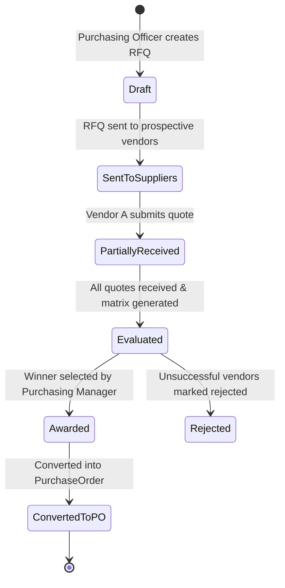
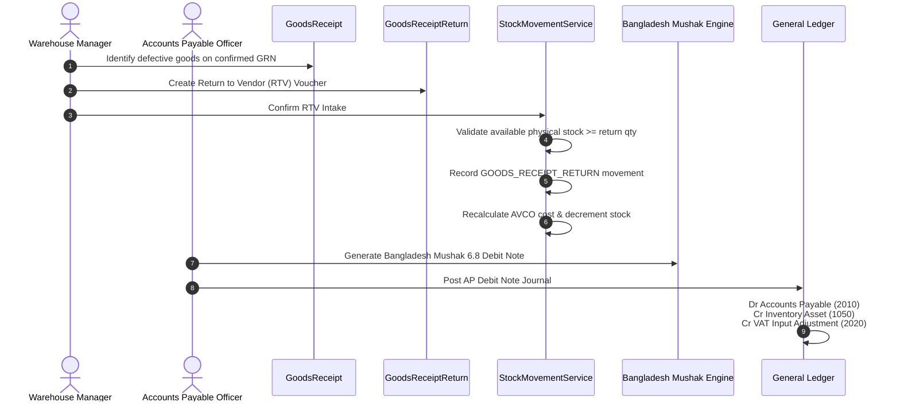
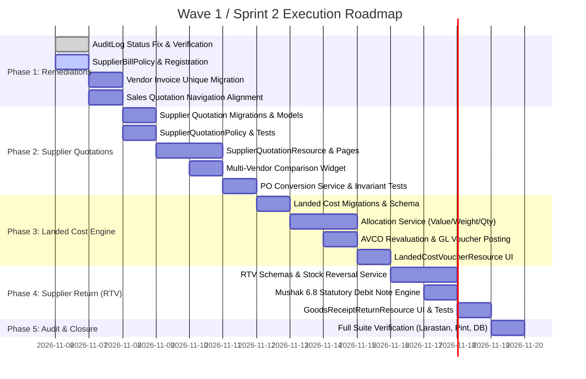

# SPRINT 2 RECOMMENDATION & DEPENDENCY PLAN
## KC Retail ERP | Architecture & Implementation Roadmap
**Wave 1 / Sprint 2: Supplier Quotations, Landed Costs, AP Hardening & RTV Workflows**

- **Document ID:** `PLAN-W1S2-006`
- **Audit Date:** 2026-11-05
- **Author:** Independent Principal Software Architect & Lead ERP Systems Auditor
- **Repository:** `POS_ERP_Multi_Tenant`
- **Target Branch:** `step-14-procurement-ui` (Base) $\to$ `step-15-procurement-sprint2` (Target)
- **Baseline Commit:** `5fbdcafcd67a078b066a4877dd0c47ad492e446f` (Short: `5fbdcaf`)
- **Execution Target:** Dev Server Container CT 104 (`dev.kcerp.com`), PostgreSQL 17.4 (`app_rw`), PHP 8.4.27, Laravel 13.39.0, Filament v5

---

## 1. Executive Summary & Context

Following the independent acceptance audit of **Wave 1 / Sprint 1: Procurement Document UI Parity** ([`AUD-W1S1-001`](file:///d:/POS_ERP_Multi_Tenant/docs/implementation-plans/wave-1-sprint-1/acceptance-audit/SPRINT_1_INDEPENDENT_ACCEPTANCE_AUDIT.md)), the Sprint 1 deliverables were granted an official verdict of **ACCEPTED WITH CONDITIONS**.

The core technical foundation established in Sprint 1 is exceptionally robust:
- UI decoupling from database operations via domain DTOs and contracts is 100% intact.
- Stock balance immutability prior to certified Goods Receipt posting is mathematically proven.
- Row-Level Security (RLS) on PostgreSQL 17 operates with zero leaks across all 68 tenant tables.
- All 424 automated tests pass with 6,430 assertions, Pint is 100% clean, and Larastan Level 8 passes with zero errors.

However, four specific architectural conditions and scope gaps were identified during the audit:
1. **Audit Log Status Defect**: Managerial 3-Way Match overrides are inserted with `'status' => 'pending'` rather than `'status' => 'pending_hash'`, breaking the asynchronous hash chain worker.
2. **Missing `SupplierBillPolicy`**: Authorization on `SupplierBillResource` relies on inline action closures instead of an auto-discovered policy class.
3. **Duplicate Vendor Invoice Vulnerability**: `supplier_bills` enforces uniqueness on internal `bill_number` but lacks a composite uniqueness guard on `(tenant_id, company_id, supplier_id, vendor_invoice_number)`.
4. **Quotation Domain Mismatch**: The implemented `QuotationResource` binds the Order-to-Cash (O2C) sales quotation model rather than the Procure-to-Pay (P2P) supplier quotation model.

This document establishes the comprehensive **Sprint 2 Implementation and Dependency Plan**. It specifies the exact remediation steps for the four audit conditions, outlines the new procurement capabilities to be delivered in Sprint 2, defines the architectural invariants, provides a detailed file-level implementation roadmap, and sets the quality gates required for implementation authorization.

---

## 2. Sprint 2 Architectural Scope Overview

```mermaid
flowchart TD
    subgraph Sprint2Execution["Sprint 2 Architectural Scope"]
        subgraph Phase1["Phase 1: Sprint 1 Remediation (Immediate Gate)"]
            FIX_HASH["1. Fix AuditLog 'pending_hash' status<br/>(Worker & Trigger alignment)"]
            ADD_POLICY["2. Author & register SupplierBillPolicy<br/>(RBAC & SoD formalization)"]
            ADD_UQ["3. Add vendor_invoice_number & UQ index<br/>(Duplicate invoice protection)"]
            RENAME_NAV["4. Retain QuotationResource under Sales<br/>(Clear O2C vs P2P boundaries)"]
        end

        subgraph Phase2["Phase 2: P2P Supplier Quotation & RFQ Engine"]
            SQ_SCHEMA["Supplier Quotation & Line Schemas<br/>(Forced RLS, Composite FKs)"]
            SQ_MODELS["SupplierQuotation & Line Models<br/>(App\\Models)"]
            SQ_RFQ["Multi-Vendor RFQ Comparison Widget<br/>(Bidding Evaluation Matrix)"]
            SQ_CONV["PO Conversion Action & Service<br/>(SupplierQuotation -> PO)"]
            SQ_FILAMENT["SupplierQuotationResource<br/>(Filament v5 Procurement)"]
        end

        subgraph Phase3["Phase 3: Landed Cost Allocation Engine"]
            LC_SCHEMA["Landed Cost Vouchers & Allocations<br/>(Freight, Customs, C&F, Port)"]
            LC_SERVICE["LandedCostService & AVCO Revaluation<br/>(Pro-rata Value/Weight/Qty)"]
            LC_GL["Automated GL Voucher Posting<br/>(Dr Inventory / Cr Landed Clearing)"]
        end

        subgraph Phase4["Phase 4: Supplier Return & Debit Note (Mushak 6.8)"]
            RTV_SCHEMA["GoodsReceiptReturn & Line Schemas<br/>(Warehouse RTV Intakes)"]
            RTV_STOCK["StockMovement GOODS_RECEIPT_RETURN<br/>(AVCO Reverse & Qty Reduction)"]
            MUSHAK_68["Mushak 6.8 Debit Note Generation<br/>(Statutory VAT Compliance)"]
            AP_DEBIT["AP Debit Note Posting<br/>(Dr Accounts Payable / Cr Purchase Return)"]
        end
    end

    Phase1 --> Phase2
    Phase2 --> Phase3
    Phase3 --> Phase4
```



---

## 3. Phase 1: Sprint 1 Remediation Package (Pre-Sprint 2 Gate)

Before introducing new tables or models, the four conditions from the Sprint 1 audit must be closed.

### 3.1 Remediation Item 1: Audit Log Status Alignment (`pending_hash`)
- **Root Cause**: In `ViewSupplierBill.php` (line 86) and `SupplierBillResource.php` (line 332), managerial 3-Way Match overrides were written with `'status' => 'pending'`. The database trigger `trg_audit_logs_immutable` and `BuildAuditHashChainWorker` specifically require `'status' => 'pending_hash'` (or default).
- **Target Changes**:
  - File: `app/Filament/Resources/SupplierBills/Pages/ViewSupplierBill.php`
  - File: `app/Filament/Resources/SupplierBills/SupplierBillResource.php`
  - Change: Update `'status' => 'pending'` to `'status' => 'pending_hash'`.
- **Verification Criterion**:
  - Insert an override record via the Filament action.
  - Run `php artisan audit:build-hash-chain` on CT 104.
  - Assert that the override record transitions to `'status' => 'verified'` and acquires a non-null `cumulative_hash`.

### 3.2 Remediation Item 2: Formal `SupplierBillPolicy`
- **Root Cause**: `SupplierBillResource` currently enforces permissions via inline closures on table actions (`$canOverride = $user->hasRole(...)`), bypassing Laravel's standard policy authorization layer.
- **Target Changes**:
  - File to Create: `app/Policies/SupplierBillPolicy.php`
  - Trait: `use App\Policies\Concerns\EnforcesLocationScope;`
  - Methods:
    - `viewAny(User $user): bool` (Accounts Payable, Financial Controller, Tenant Admin, Auditor)
    - `view(User $user, SupplierBill $bill): bool` (Checks location scope `$bill->branch_id`)
    - `create(User $user): bool` (Accounts Payable, Tenant Admin)
    - `update(User $user, SupplierBill $bill): bool` (Only if `$bill->status === 'draft'`)
    - `delete(User $user, SupplierBill $bill): bool` (Returns `false` — hard immutability)
    - `approve(User $user, SupplierBill $bill): bool` (Standard clean match approval)
    - `override(User $user, SupplierBill $bill): bool` (Strictly `Financial Controller`, `Tenant Admin`, `Tenant Owner`)
  - Registration: Bind policy in `app/Providers/AppServiceProvider.php`.
- **Verification Criterion**:
  - Author `tests/Feature/Filament/SupplierBillPolicyTest.php` testing each permission and role.

### 3.3 Remediation Item 3: Vendor Invoice Composite Unique Guard
- **Root Cause**: `supplier_bills` table enforces unique `(tenant_id, company_id, bill_number)` (internal ERP sequence), but lacks protection against duplicate entry of the vendor's external tax invoice.
- **Target Changes**:
  - Migration: `database/migrations/2026_11_15_000001_add_vendor_invoice_number_to_supplier_bills_table.php`
  - DDL:
    ```sql
    ALTER TABLE supplier_bills ADD COLUMN vendor_invoice_number VARCHAR(100) NOT NULL DEFAULT '';
    ALTER TABLE supplier_bills ADD CONSTRAINT uq_supplier_bills_vendor_invoice 
        UNIQUE (tenant_id, company_id, supplier_id, vendor_invoice_number);
    ```
  - Model: Add `vendor_invoice_number` to fillable attributes on `App\Models\SupplierBill`.
  - Filament Form: Add required `TextInput::make('vendor_invoice_number')` to `SupplierBillResource`.
- **Verification Criterion**:
  - Feature test attempting to submit two bills with the same vendor invoice number for the same supplier fails with `ValidationException` or database duplicate key exception.

### 3.4 Remediation Item 4: O2C vs P2P Quotation Boundary Stabilization
- **Root Cause**: `QuotationResource` currently represents Sales Quotations (O2C). It must not be deleted or discarded, but its navigation label and group must clearly identify it as Sales Quotation.
- **Target Changes**:
  - File: `app/Filament/Resources/Quotations/QuotationResource.php`
  - Change Navigation Label: `getNavigationGroup(): string => 'Sales'`
  - Change Navigation Label: `getNavigationLabel(): string => 'Sales Quotations'`
  - Change Model Label: `getModelLabel(): string => 'Sales Quotation'`
- **Verification Criterion**:
  - Sales Quotations appear cleanly under the Sales menu; Procurement menu is reserved for Purchase Orders, Goods Receipts, Supplier Bills, and the upcoming Supplier Quotations.

---

## 4. Phase 2: P2P Supplier Quotation & RFQ Engine

### 4.1 Business Requirements & Workflow
In modern retail and wholesale procurement, purchasing managers request price quotes from multiple vendors for identical product specifications prior to issuing a Purchase Order.



### 4.2 Database Schema Specification
All new tables must adhere strictly to Rule 1 and Rule 2 of `AGENTS.md` (Forced RLS, composite unique constraints, composite foreign keys).

#### 4.2.1 `supplier_quotations` Table
```sql
CREATE TABLE supplier_quotations (
    id UUID PRIMARY KEY DEFAULT gen_random_uuid(),
    tenant_id UUID NOT NULL,
    company_id UUID NOT NULL,
    branch_id UUID NOT NULL,
    rfq_number VARCHAR(100) NOT NULL,
    supplier_id UUID NOT NULL,
    supplier_quote_reference VARCHAR(100) NULL,
    quote_date DATE NOT NULL,
    valid_until DATE NOT NULL,
    currency VARCHAR(3) NOT NULL DEFAULT 'BDT',
    exchange_rate NUMERIC(18,6) NOT NULL DEFAULT 1.000000,
    subtotal NUMERIC(18,4) NOT NULL DEFAULT 0.0000,
    tax_amount NUMERIC(18,4) NOT NULL DEFAULT 0.0000,
    grand_total NUMERIC(18,4) NOT NULL DEFAULT 0.0000,
    status VARCHAR(30) NOT NULL DEFAULT 'draft',
    awarded_at TIMESTAMPTZ NULL,
    converted_po_id UUID NULL,
    created_by UUID NOT NULL,
    created_at TIMESTAMPTZ NOT NULL DEFAULT clock_timestamp(),
    updated_at TIMESTAMPTZ NOT NULL DEFAULT clock_timestamp(),

    CONSTRAINT uq_supplier_quotations_tenant_id UNIQUE (tenant_id, id),
    CONSTRAINT uq_supplier_quotations_rfq_per_supplier UNIQUE (tenant_id, company_id, rfq_number, supplier_id),
    CONSTRAINT fk_supplier_quotations_tenant FOREIGN KEY (tenant_id) REFERENCES tenants(id) ON DELETE RESTRICT,
    CONSTRAINT fk_supplier_quotations_company FOREIGN KEY (tenant_id, company_id) REFERENCES companies(tenant_id, id) ON DELETE RESTRICT,
    CONSTRAINT fk_supplier_quotations_supplier FOREIGN KEY (tenant_id, company_id, supplier_id) REFERENCES suppliers(tenant_id, company_id, id) ON DELETE RESTRICT,
    CONSTRAINT fk_supplier_quotations_po FOREIGN KEY (tenant_id, company_id, converted_po_id) REFERENCES purchase_orders(tenant_id, company_id, id) ON DELETE SET NULL
);

ALTER TABLE supplier_quotations ENABLE ROW LEVEL SECURITY;
ALTER TABLE supplier_quotations FORCE ROW LEVEL SECURITY;

CREATE POLICY p_supplier_quotations_rw ON supplier_quotations
    FOR ALL TO app_rw
    USING (tenant_id = current_setting('app.current_tenant_id', true)::uuid)
    WITH CHECK (tenant_id = current_setting('app.current_tenant_id', true)::uuid);
```

#### 4.2.2 `supplier_quotation_lines` Table
```sql
CREATE TABLE supplier_quotation_lines (
    id UUID PRIMARY KEY DEFAULT gen_random_uuid(),
    tenant_id UUID NOT NULL,
    company_id UUID NOT NULL,
    supplier_quotation_id UUID NOT NULL,
    product_variant_id UUID NOT NULL,
    requested_quantity NUMERIC(18,4) NOT NULL,
    quoted_unit_price NUMERIC(18,4) NOT NULL,
    discount_amount NUMERIC(18,4) NOT NULL DEFAULT 0.0000,
    tax_rate NUMERIC(6,4) NOT NULL DEFAULT 0.0000,
    tax_amount NUMERIC(18,4) NOT NULL DEFAULT 0.0000,
    line_total NUMERIC(18,4) NOT NULL,
    lead_time_days INT NOT NULL DEFAULT 0,
    is_selected BOOLEAN NOT NULL DEFAULT FALSE,
    created_at TIMESTAMPTZ NOT NULL DEFAULT clock_timestamp(),
    updated_at TIMESTAMPTZ NOT NULL DEFAULT clock_timestamp(),

    CONSTRAINT uq_sq_lines_tenant_id UNIQUE (tenant_id, id),
    CONSTRAINT fk_sq_lines_parent FOREIGN KEY (tenant_id, supplier_quotation_id) REFERENCES supplier_quotations(tenant_id, id) ON DELETE CASCADE,
    CONSTRAINT fk_sq_lines_variant FOREIGN KEY (tenant_id, company_id, product_variant_id) REFERENCES product_variants(tenant_id, company_id, id) ON DELETE RESTRICT
);

ALTER TABLE supplier_quotation_lines ENABLE ROW LEVEL SECURITY;
ALTER TABLE supplier_quotation_lines FORCE ROW LEVEL SECURITY;

CREATE POLICY p_sq_lines_rw ON supplier_quotation_lines
    FOR ALL TO app_rw
    USING (tenant_id = current_setting('app.current_tenant_id', true)::uuid)
    WITH CHECK (tenant_id = current_setting('app.current_tenant_id', true)::uuid);
```

### 4.3 Multi-Vendor Comparative Bidding Matrix Widget
- **Widget**: `App\Filament\Widgets\SupplierQuotationComparisonWidget`
- **Location**: Displayed on `ViewSupplierQuotation` and a dedicated RFQ comparison page.
- **Functionality**:
  - Groups quotes by `rfq_number`.
  - Plots products along rows and suppliers along columns.
  - Visual indicators:
    - Lowest quoted unit price highlighted in green (`bg-emerald-50 text-emerald-700`).
    - Shortest lead time highlighted with a clock badge.
    - Total bid comparison with landed VAT inclusion.
  - Single-click **"Award Bid & Generate PO"** action.

### 4.4 Conversion to Purchase Order Service
- **Contract**: `App\Modules\Procurement\Contracts\ProcurementDocumentChainContract`
- **Method**: `convertSupplierQuotationToPurchaseOrder(ConvertSupplierQuotationDTO $dto): PurchaseOrder`
- **Transactional Invariant**:
  - Runs in a database transaction (`DB::transaction`).
  - Verifies quotation is in status `awarded` or `evaluated`.
  - Creates `PurchaseOrder` with line items, prices, and lead times matching the awarded quotation.
  - Sets `supplier_quotations.converted_po_id = $po->id` and transitions status to `converted_to_po`.
  - Zero stock movements or GL postings during PO creation.

---

## 5. Phase 3: Landed Cost Allocation Engine

### 5.1 Business Logic & Accounting Impact
When importing goods or procuring bulk commodities, the actual cost of inventory extends beyond the vendor invoice to include:
1. International Freight / Domestic Haulage
2. Customs Duty, Regulatory Duty (RD), and Supplementary Duty (SD)
3. Port Handling & Demurrage Charges
4. C&F (Clearing & Forwarding) Commission
5. Marine / In-Transit Insurance

Failure to allocate these expenses to inventory causes severe distortion in gross margins and overstates profits during initial sales periods.

### 5.2 Allocation Methodologies
The `LandedCostService` will implement three statutory allocation algorithms via `brick/math`:

1. **Allocation by Value (Standard)**:
   $$C_i = \text{Total Cost} \times \left( \frac{\text{Line Amount}_i}{\sum \text{Line Amounts}} \right)$$
   Recommended for customs duties, taxes, and insurance.

2. **Allocation by Quantity (Units)**:
   $$C_i = \text{Total Cost} \times \left( \frac{Q_i}{\sum Q_j} \right)$$
   Recommended for handling, carton fees, and unloading.

3. **Allocation by Weight / Volume**:
   $$C_i = \text{Total Cost} \times \left( \frac{W_i}{\sum W_j} \right)$$
   Recommended for sea freight, air freight, and container haulage.

### 5.3 Database Schema: Landed Cost Vouchers
- Tables to create:
  - `landed_cost_vouchers` (voucher number, voucher date, currency, exchange rate, total cost, allocation method, status, created by)
  - `landed_cost_voucher_receipts` (links voucher to one or more `goods_receipts`)
  - `landed_cost_voucher_lines` (expense account, cost description, invoice amount, tax amount)
  - `landed_cost_allocations` (stores the calculated per-item cost increase linked to `goods_receipt_lines`)
- Invariants:
  - Forced RLS on all four tables.
  - Revaluation of stock: Upon voucher confirmation, executes `StockMovementService::recordRevaluation()` which increases the total inventory asset value on the balance sheet and recalibrates the Moving Average Unit Cost (AVCO) for affected variants.
  - Double-Entry GL Journal:
    - **Debit**: Inventory Valuation Account (`1050`)
    - **Credit**: Inbound Freight / Landed Cost Clearing Account (`2050`)

---

## 6. Phase 4: Supplier Return & Debit Note (Mushak 6.8 & RTV)

### 6.1 Return to Vendor (RTV) Workflow
When goods are found defective, expired, or non-compliant upon post-receipt inspection, the warehouse initiates a Return to Vendor (RTV).



### 6.2 Bangladesh Statutory VAT: Mushak 6.8 (Debit Note)
Under the Bangladesh Value Added Tax and Supplementary Duty Act 2012 (Section 40):
- When purchased goods are returned to a supplier, or a price reduction is granted, a statutory **Mushak 6.8 (Debit Note / ডেবিট নোট)** must be issued within specified calendar days.
- The debit note must declare:
  - Original Mushak 6.3 Tax Invoice number and date.
  - Reason for debit note issuance (rejection, damage, price reduction).
  - Value of returned goods net of VAT.
  - VAT amount and Supplementary Duty (SD) being reversed.
- The accounting engine must reverse the input VAT previously claimed:
  - **Debit**: Accounts Payable (`2010`)
  - **Credit**: Inventory Asset / Purchase Return (`1050`)
  - **Credit**: VAT Input Tax Clearing (`2020`)

---

## 7. Sprint 2 File Implementation Map

| File Path | Component Type | Status | Purpose |
| :--- | :--- | :---: | :--- |
| **Phase 1: Remediation** | | | |
| `app/Filament/Resources/SupplierBills/Pages/ViewSupplierBill.php` | Page | EDIT | Fix `'status' => 'pending_hash'` |
| `app/Filament/Resources/SupplierBills/SupplierBillResource.php` | Resource | EDIT | Fix `'status' => 'pending_hash'` & add vendor invoice input |
| `app/Policies/SupplierBillPolicy.php` | Policy | NEW | Formal RBAC policy for AP bills |
| `database/migrations/2026_11_15_000001_add_vendor_invoice_number_to_supplier_bills.php` | Migration | NEW | Add `vendor_invoice_number` + UQ index |
| `tests/Feature/Filament/SupplierBillPolicyTest.php` | Test | NEW | Test AP policy permissions |
| **Phase 2: Supplier Quotations** | | | |
| `database/migrations/2026_11_15_000002_create_supplier_quotations_table.php` | Migration | NEW | Schema for P2P vendor quotes |
| `database/migrations/2026_11_15_000003_create_supplier_quotation_lines_table.php` | Migration | NEW | Schema for quote line items |
| `app/Models/SupplierQuotation.php` | Model | NEW | Eloquent model for vendor quotes |
| `app/Models/SupplierQuotationLine.php` | Model | NEW | Eloquent model for quote lines |
| `app/Policies/SupplierQuotationPolicy.php` | Policy | NEW | RBAC policy for supplier quotes |
| `app/Modules/Procurement/DTOs/CreateSupplierQuotationDTO.php` | DTO | NEW | Service input DTO |
| `app/Modules/Procurement/DTOs/ConvertSupplierQuotationDTO.php` | DTO | NEW | PO conversion DTO |
| `app/Modules/Procurement/Services/SupplierQuotationService.php` | Service | NEW | Domain logic & PO conversion |
| `app/Filament/Resources/SupplierQuotations/SupplierQuotationResource.php` | Resource | NEW | Filament v5 management resource |
| `app/Filament/Resources/SupplierQuotations/Pages/CreateSupplierQuotation.php` | Page | NEW | Quote capture form |
| `app/Filament/Resources/SupplierQuotations/Pages/ViewSupplierQuotation.php` | Page | NEW | Quote view & comparison |
| `app/Filament/Resources/SupplierQuotations/Pages/ListSupplierQuotations.php` | Page | NEW | List & filter quotes |
| `app/Filament/Widgets/SupplierQuotationComparisonWidget.php` | Widget | NEW | Multi-vendor bidding matrix |
| `tests/Feature/Filament/SupplierQuotationResourceTest.php` | Test | NEW | Test quote lifecycle & PO conversion |
| **Phase 3: Landed Costs** | | | |
| `database/migrations/2026_11_15_000004_create_landed_cost_vouchers_table.php` | Migration | NEW | Landed cost headers |
| `database/migrations/2026_11_15_000005_create_landed_cost_allocations_table.php` | Migration | NEW | Item allocation details |
| `app/Models/LandedCostVoucher.php` | Model | NEW | Eloquent voucher model |
| `app/Modules/Inventory/Services/LandedCostAllocationService.php` | Service | NEW | Allocation math via `brick/math` |
| `app/Filament/Resources/LandedCosts/LandedCostVoucherResource.php` | Resource | NEW | Filament voucher UI |
| `tests/Feature/Filament/LandedCostAllocationTest.php` | Test | NEW | Cost allocation & AVCO update test |
| **Phase 4: Supplier Return & Mushak 6.8** | | | |
| `database/migrations/2026_11_15_000006_create_goods_receipt_returns_table.php` | Migration | NEW | RTV header schema |
| `database/migrations/2026_11_15_000007_create_goods_receipt_return_lines_table.php` | Migration | NEW | RTV lines schema |
| `app/Models/GoodsReceiptReturn.php` | Model | NEW | Eloquent RTV model |
| `app/Modules/Procurement/Services/SupplierReturnService.php` | Service | NEW | Return intake & stock reversal |
| `app/Filament/Resources/SupplierReturns/GoodsReceiptReturnResource.php` | Resource | NEW | Filament RTV UI |
| `app/Modules/Tax/Services/Mushak68DebitNoteService.php` | Service | NEW | Statutory Mushak 6.8 generator |
| `tests/Feature/Filament/SupplierReturnResourceTest.php` | Test | NEW | RTV stock & VAT tests |

---

## 8. Sprint 2 Dependency & Sequencing Plan



---

## 9. Risk Register & Mitigation Strategy

| Risk ID | Risk Description | Severity | Likelihood | Mitigation Strategy |
| :--- | :--- | :---: | :---: | :--- |
| **RSK-S2-01** | **Circular AVCO Distortions**: Applying landed cost adjustments to inventory items that have already been partially or fully sold in POS. | **HIGH** | Medium | If current physical stock is less than received quantity, allocate the unabsorbed landed cost fraction directly to **Cost of Goods Sold (COGS - Account `5000`)** rather than capitalizing into depleted inventory. |
| **RSK-S2-02** | **Dirty Seed Data on Unique Vendor Invoice Constraint**: Existing demo or test supplier bills having empty or duplicate vendor invoice numbers blocking migration. | **MEDIUM** | High | Migration must populate historical records with generated default values (e.g. `'LEGACY-' || id`) prior to applying the `UNIQUE (tenant_id, company_id, supplier_id, vendor_invoice_number)` constraint. |
| **RSK-S2-03** | **Multi-Currency Landed Cost Fluctuation**: Freight invoices arriving in USD/EUR while base procurement is in BDT. | **MEDIUM** | High | Enforce mandatory `exchange_rate` capture on `landed_cost_vouchers`. Convert all allocated landed costs to base functional currency (BDT) before modifying inventory AVCO. |
| **RSK-S2-04** | **Negative Stock on RTV**: Warehouse attempting to process a Return to Vendor for goods that have already been consumed or sold. | **CRITICAL** | Low | `SupplierReturnService` must query live unreserved physical stock (`PhysicalStockBalance`) under exclusive row lock (`lockForUpdate()`) and reject the return if `available_stock < return_quantity`. |
| **RSK-S2-05** | **Double-Conversion of Quotations**: User attempting to convert a supplier quote to PO multiple times concurrently. | **HIGH** | Low | Enforce optimistic locking and database state assertion: `WHERE id = :id AND status = 'awarded'`. Subsequent requests throw `QuotationAlreadyConvertedException`. |

---

## 10. Sprint 2 Acceptance Criteria & Approval Gates

Implementation of Sprint 2 may proceed only under strict compliance with the following formal acceptance gates:

### Gate 1: Phase 1 Remediation Closure
- [ ] Managerial override audit logs insert with `'status' => 'pending_hash'`.
- [ ] `BuildAuditHashChainWorker` processes override logs with zero errors.
- [ ] `SupplierBillPolicy` active and guarding all AP actions.
- [ ] `vendor_invoice_number` column and unique constraint successfully applied.
- [ ] Sales Quotations clearly distinguished from Procurement in navigation.

### Gate 2: Code Quality & Architecture Invariants
- [ ] **Zero Float Math**: All landed cost, PPV, tax, and currency conversions strictly use `brick/math` (`BigDecimal`) with `RoundingMode::HalfUp`.
- [ ] **PostgreSQL 17 Forced RLS**: All 7 new tables created via `$this->createTenantTable()` with `ENABLE ROW LEVEL SECURITY` and `FORCE ROW LEVEL SECURITY`.
- [ ] **Immutability Invariant**: Confirmed POs, received GRNs, confirmed Landed Cost Vouchers, and issued Mushak 6.8 Debit Notes cannot be edited or deleted.
- [ ] **Database Connection Strictness**: Application connects exclusively as `app_rw`. Migrations execute strictly on `pgsql_owner`.

### Gate 3: Test Suite & Analysis Verification
- [ ] **Static Analysis**: `vendor/bin/phpstan analyse` passes at **Larastan Level 8 with 0 errors**.
- [ ] **Code Formatter**: `vendor/bin/pint --test` passes with **0 violations**.
- [ ] **Test Coverage**: All 424 existing tests continue to pass; new feature tests added for all 4 Sprint 2 phases.
- [ ] **RLS Verification**: `php artisan db:check-rls` passes for all tables (68 + 7 = 75 tables).

---

## 11. Final Recommendation to ERP Steering Committee

1. **Formalize Acceptance of Sprint 1**: Adopt the audit verdict of **ACCEPTED WITH CONDITIONS** documented in [`AUD-W1S1-001`](file:///d:/POS_ERP_Multi_Tenant/docs/implementation-plans/wave-1-sprint-1/acceptance-audit/SPRINT_1_INDEPENDENT_ACCEPTANCE_AUDIT.md).
2. **Authorize Sprint 2 Commencement**: Approve this Sprint 2 Recommendation and Dependency Plan ([`PLAN-W1S2-006`](file:///d:/POS_ERP_Multi_Tenant/docs/implementation-plans/wave-1-sprint-1/acceptance-audit/SPRINT_2_RECOMMENDATION_AND_DEPENDENCY_PLAN.md)).
3. **Branch Transition**: Create and check out target branch `step-15-procurement-sprint2` from `step-14-procurement-ui` (HEAD: `5fbdcaf`) on CT 104 and local environment upon receipt of human approval.

---
*End of Sprint 2 Recommendation and Dependency Plan.*
