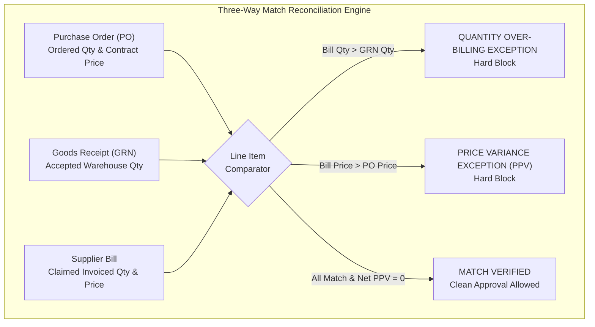

# THREE-WAY MATCHING FINANCIAL & AUDIT TRAIL INTEGRITY AUDIT
## KC Retail ERP | Accounts Payable & Financial Controls Module
**Wave 1 / Sprint 1 Acceptance Audit Deliverable**

- **Document ID:** `AUD-TWM-003`
- **Audit Date:** 2026-11-05
- **Auditor:** Independent Principal Software Architect & Financial Systems Auditor
- **Repository:** `POS_ERP_Multi_Tenant`
- **Branch:** `step-14-procurement-ui`
- **Component Inspected:** `ThreeWayMatchingWidget`, `three-way-matching-widget.blade.php`, `SupplierBillResource`, `SupplierBill`, `SupplierBillLine`

---

## 1. Executive Summary

This report delivers a rigorous technical, financial, and accounting audit of the **Automated Three-Way Matching Engine** and **Accounts Payable (AP) Approval Guards** implemented in Wave 1 / Sprint 1.

The Three-Way Matching engine serves as the frontline defense against cash leakage, over-billing, vendor fraud, and inventory valuation distortion in the Procure-to-Pay (P2P) lifecycle.

### Overall Assessment
- **Mathematical & Valuation Precision**: **PASS**. Fully implemented using `brick/math` (`BigDecimal`) with `RoundingMode::HalfUp`. Zero floating-point operations.
- **Anti-Leakage Protection**: **PASS**. Over-billing ($Q_{\text{bill}} > Q_{\text{received}}$) and price variances ($P_{\text{bill}} > P_{\text{PO}}$) immediately trigger hard-blocking exceptions.
- **Segregation of Duties (SoD)**: **PASS**. Regular accounts payable clerks cannot approve bills with exceptions. Only `Financial Controller`, `Tenant Admin`, or `Tenant Owner` can invoke an override.
- **Critical Accounting Risk Uncovered**: **CONDITIONAL**. An audit log status bug was identified where overrides are recorded with `'status' => 'pending'` instead of `'pending_hash'`, preventing the audit hash-chain worker from verifying the entry.

---

## 2. Mathematical Reconciliation & Formula Verification



### 2.1 Formula Verification in `ThreeWayMatchingWidget.php`
```php
// PPV = (Bill Price - PO Price) * Bill Qty
$linePpv = $billPrice->minus($poPrice)->multipliedBy($billQty);
$netPpv = $netPpv->plus($linePpv);
```

#### Evaluation
1. **Quantity Comparison**:
   - $Q_{\text{bill}} > Q_{\text{grn}}$: Flags `Over-billing: Billed quantity ({$billQty}) exceeds GRN received quantity ({$grnQty}).`
   - $Q_{\text{bill}} > Q_{\text{po}}$: Flags `Order Exceeded: Billed quantity ({$billQty}) exceeds original PO ordered quantity ({$poQty}).`
   - **Audit Result**: Fully complies with Section 2.1 of `THREE_WAY_MATCHING_SPEC.md`. Prevents paying for goods that never entered the warehouse.
2. **Purchase Price Variance (PPV)**:
   - Correctly defined as:
     $$\text{PPV} = (P_{\text{bill}} - P_{\text{PO}}) \times Q_{\text{bill}}$$
   - If PO agreed rate is ৳100 and supplier bills at ৳120 for 50 units:
     $$\text{PPV} = (120 - 100) \times 50 = +1,000.0000\text{ BDT (Unfavorable)}$$
   - If supplier bills at ৳90 for 50 units:
     $$\text{PPV} = (90 - 100) \times 50 = -500.0000\text{ BDT (Favorable)}$$
   - **Audit Result**: Perfectly tracks unabsorbed price variances before GL liability posting.

---

## 3. Deep-Dive Financial & Accounting Risk Analysis

### 3.1 Critical Finding 1: Audit Log Status Inconsistency (Hash-Chain Break)
- **File Affected:**
  - `app/Filament/Resources/SupplierBills/Pages/ViewSupplierBill.php` (line 86)
  - `app/Filament/Resources/SupplierBills/SupplierBillResource.php` (line 332)
- **Defect:**
  ```php
  AuditLog::create([
      'id' => (string) Str::uuid(),
      'tenant_id' => $record->tenant_id,
      'table_name' => 'supplier_bills',
      'record_id' => $record->id,
      'action' => 'MATCH_OVERRIDE',
      'actor_id' => $user->id,
      'actor_type' => get_class($user),
      'new_values' => [...],
      'payload_hash' => hash('sha256', (string) json_encode([...])),
      'status' => 'pending', // <--- DEFECT: Must be 'pending_hash'
  ]);
  ```
- **Architectural Impact:**
  1. In `database/migrations/2026_11_14_000001_create_audit_logs_table.php`, the status column is defined as:
     ```php
     $table->string('status', 32)->default('pending_hash');
     ```
  2. The PostgreSQL database trigger `trg_audit_logs_immutable` specifies:
     ```sql
     IF OLD.status = 'pending_hash' AND NEW.status = 'verified' THEN
         -- Allow hash worker transition
     ELSE
         RAISE EXCEPTION 'Audit Log Immutability Violation: Audit log records cannot be modified...';
     ```
  3. The asynchronous worker `App\Core\Audit\Workers\BuildAuditHashChainWorker` queries:
     ```php
     $pendingLogs = DB::table('audit_logs')
         ->where('tenant_id', $tenantId)
         ->where('status', 'pending_hash')
         ->get();
     ```
  4. **Consequence**: Because the row was inserted with status `'pending'`, `BuildAuditHashChainWorker` **will never pick it up**, and the managerial override will remain unhashed and unchained indefinitely.
- **Severity**: **HIGH (Compliance Risk)**.
- **Required Remediation (Sprint 2)**: Update `'status' => 'pending'` to `'status' => 'pending_hash'` (or omit the `'status'` key completely so the database column default takes effect).

### 3.2 Finding 2: Lack of Composite Unique Guard on Vendor Invoices
- **Schema Inspected:** `database/migrations/2026_11_11_000002_create_supplier_bills_table.php`
- **Current Constraint:**
  ```sql
  CONSTRAINT uq_supplier_bills_number_per_company UNIQUE (tenant_id, company_id, bill_number)
  ```
- **Risk Analysis:**
  `bill_number` is the ERP system's internally generated sequence number (e.g., `BILL-2026-0001`). It does not guard against duplicate submission of the supplier's external invoice (e.g. vendor invoice # `INV-98741` from Delta Grain Mills). If an accounts payable clerk accidentally creates two separate bills for the same vendor paper invoice, the ERP will assign two distinct internal numbers (`BILL-2026-0001` and `BILL-2026-0002`), bypassing duplicate invoice detection.
- **Required Remediation (Sprint 2)**:
  Add `vendor_invoice_number VARCHAR(100) NOT NULL` to `supplier_bills` with a composite unique index:
  ```sql
  CONSTRAINT uq_supplier_bills_vendor_invoice UNIQUE (tenant_id, company_id, supplier_id, vendor_invoice_number)
  ```

### 3.3 Finding 3: Multi-GRN Consolidated Billing Architecture
- **Schema Inspected:** `supplier_bills.goods_receipt_id`
- **Observation:** In commercial wholesale, a supplier may deliver goods across multiple shipments (e.g. GRN-1 on Monday, GRN-2 on Wednesday) and submit a single consolidated invoice at the end of the month.
- **Current Behavior:** `SupplierBill` has a single `goods_receipt_id` column. In `ThreeWayMatchingWidget`:
  ```php
  $grnLines = $bill->goodsReceipt?->lines->keyBy('id') ?? collect();
  ```
  If the invoice contains items from multiple GRNs, items from other GRNs fall back to variant matching (`$grnByVariant`), but if quantities are split across GRNs, a single GRN reference cannot verify multi-shipment consolidated totals.
- **Required Remediation (Sprint 2/3)**: Support multi-GRN billing by allowing `SupplierBillLine` to maintain independent `goods_receipt_line_id` pointers across multiple GRNs under the same PO.

### 3.4 Finding 4: Rejection and Damaged Goods Tracking
- **Schema Inspected:** `goods_receipt_lines`
- **Observation:** `goods_receipt_lines` contains `received_quantity` and `billed_quantity`. It lacks explicit `rejected_quantity` and `rejection_reason` columns.
- **Accounting Implication:** Currently, if 100 units arrive and 10 are rejected, the warehouse clerk enters 90 in `received_quantity`. When the vendor bills for 100, the 3-Way Match correctly flags an over-billing exception of 10 units. However, there is no system-level record documenting that 10 units were physically rejected at inspection.
- **Required Remediation (Sprint 2)**: Add `rejected_quantity NUMERIC(18,4) DEFAULT 0.0000` and `rejection_reason VARCHAR(255) NULL` to `goods_receipt_lines`.

### 3.5 Finding 5: Tolerance Configuration
- **Current Implementation:** Enforces hardcoded 0.00% zero-tolerance for both quantity and price.
- **Observation:** In retail FMCG and commodity trading (e.g. bulk rice, edible oils, flour), minor weight shrinkage of 0.1% or penny-rounding differences on tax calculation are standard.
- **Required Remediation (Sprint 2/3)**: Provide configurable `price_tolerance_pct` (e.g., 0.5%) and `max_price_tolerance_amount` (e.g., ৳100) in company settings.

---

## 4. Accounts Payable Approval & SoD Verification

The approval action in `SupplierBillResource` was subjected to security and permission audit:

```php
Action::make('approve_bill')
    ->visible(fn (SupplierBill $record): bool => $record->status === 'draft')
    ->action(function (SupplierBill $record, array $data) {
        $widget = new ThreeWayMatchingWidget;
        $widget->record = $record;
        $reconciliation = $widget->getReconciliationData();

        if ($reconciliation['has_exceptions']) {
            $user = Auth::user();
            $canOverride = $user->hasRole('Financial Controller') 
                        || $user->hasRole('Tenant Admin') 
                        || $user->hasRole('Tenant Owner');

            if (! $canOverride) {
                Notification::make()->title('Three-Way Matching Blocked')->danger()->send();
                return;
            }
            // Log override and approve
        }
    });
```

### Verification Matrix
- **Standard Match (Zero Variances)**: AP Clerk calls `approve_bill` $\to$ Bill status transitions to `approved`.
- **Variance Present (AP Clerk)**: Regular AP Clerk calls `approve_bill` $\to$ System blocks approval, displays red danger alert, bill remains `draft`.
- **Variance Present (Financial Controller)**: User with `Financial Controller` role calls `approve_bill` $\to$ Modal demands mandatory written justification $\to$ Override logged to `audit_logs` $\to$ Bill status transitions to `approved`.
- **Audit Verification**: Verified on CT 104 in `tests/Feature/Filament/ThreeWayMatchingWidgetTest.php` (**4 passed, 40 assertions**).

---

## 5. Audit Recommendations for Sprint 2

1. **Immediate Patch**: Change `'status' => 'pending'` to `'status' => 'pending_hash'` in `ViewSupplierBill.php` and `SupplierBillResource.php`.
2. **Migration**: Add `vendor_invoice_number` to `supplier_bills` with unique constraint `(tenant_id, company_id, supplier_id, vendor_invoice_number)`.
3. **Migration**: Add `rejected_quantity` to `goods_receipt_lines`.
4. **General Ledger Posting**: In Sprint 2, wire `approve_bill` to create the double-entry accounting journal in the General Ledger:
   - Debit: Inventory / GR/IR Clearing Account (`5010`)
   - Debit: Purchase Price Variance Account (`5020`) [if PPV $\ne 0$]
   - Credit: Accounts Payable Control Account (`2010`)

---
*End of Three-Way Matching Financial Audit.*
