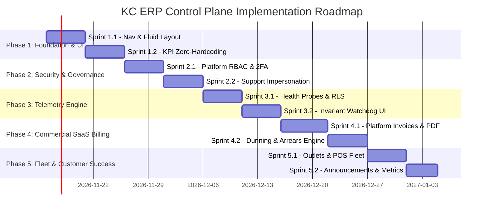

# KC ERP Control Plane: Implementation Roadmap & Phased Delivery Plan

**Document Reference:** `docs/platform-control-plane/CONTROL_PLANE_IMPLEMENTATION_ROADMAP.md`  
**Application Target:** KC ERP Control Plane (`/platform`)  
**Environment:** Proxmox CT 104 (`dev.kcerp.com`)  
**Design Authority:** Senior Technical Program Management & Architecture Team  
**Scope Boundary:** Read-Only Implementation Roadmap & Phased Work Breakdown (Zero code mutations, Zero schema alterations)

---

## 1. Executive Summary & Phased Delivery Strategy

To evolve the existing KC ERP Control Plane into an enterprise-grade commercial SaaS management platform while preserving uninterrupted pilot store operations (Acme Retail BD, Dhanmondi, Gulshan, Uttara), the implementation is structured across **five sequential, gated delivery phases**:

### Strict Gating Philosophy
Each phase requires:
1. Written implementation approval from technical and business stakeholders.
2. Complete test coverage (Pest unit and feature tests executed on PostgreSQL 17 dev server).
3. 100% compliance with Laravel Pint code formatting (`vendor/bin/pint --test`).
4. Zero static analysis defects on Larastan Level 8 (`vendor/bin/phpstan analyse`).
5. Database RLS integrity verification (`php artisan db:check-rls`).

---

## 2. Phase-by-Phase Work Breakdown

### Phase 1: Foundation, Navigation Re-Architecture & UI Modernization
*Target Milestone: M-CP-01 | Duration: 2 Sprints (10 working days)*

#### Sprint 1.1: Navigation Re-Architecture & Fluid Layout Overhaul
- **Objective:** Establish the 6-group navigation hierarchy, full-width fluid desktop grid, and responsive styling.
- **Key Tasks:**
  1. Update `PlatformPanelProvider.php` with `navigationGroups()`, `sidebarCollapsibleOnDesktop()`, `maxContentWidth(MaxWidth::Full)`, and `globalSearchKeyBindings(['ctrl+k', 'command+k'])`.
  2. Implement local storage sidebar collapse state persistence.
  3. Overhaul `resources/views/filament/platform/widgets/quick-actions.blade.php`: Replace rigid inline styles with native Filament Tailwind components.
  4. Convert hardcoded pilot store cards into dynamic query (`Tenant::where('status', 'active')->take(6)->get()`).
- **Deliverables & Tests:**
  - `PlatformNavigationTest`: Asserts all 6 groups render with correct labels, icons, and sort orders.
  - Full-width layout verified on 1080p and 1440p viewports.

#### Sprint 1.2: KPI Zero-Hardcoding & True Telemetry
- **Objective:** Eliminate all mock data and hardcoded demonstration numbers.
- **Key Tasks:**
  1. Refactor `PlatformStatsOverviewWidget.php`:
     - Delete hardcoded fallback `if ($mrr === 0.0) $mrr = 42500.0`.
     - Implement dynamic MRR calculation using `brick/math` across active subscriptions.
     - Replace static sparkline arrays with real 7-day query plucks or clean omission.
  2. Refactor `PlatformPlanDistributionChart.php`:
     - Delete fallback mock tenant counts (`starterCount = 3...`).
     - Support dynamic subscription plans from `plans` table.
     - Render clean empty state if zero subscriptions exist.
- **Deliverables & Tests:**
  - `PlatformStatsOverviewWidgetTest`: Proves zero-value and live-value calculations across fresh and populated databases.

---

### Phase 2: Security, Platform RBAC & Support Impersonation Protocol
*Target Milestone: M-CP-02 | Duration: 2 Sprints (10 working days)*

#### Sprint 2.1: Platform RBAC & Two-Factor Authentication
- **Objective:** Replace binary `isSuperAdmin()` check with 6-tier RBAC and enforce TOTP 2FA.
- **Key Tasks:**
  1. Author migration `add_permissions_and_status_to_platform_users_table.php` (adds `status`, `last_login_at`, `last_login_ip`).
  2. Implement `PlatformRoleEnum` (`super_admin`, `platform_admin`, `billing_admin`, `support_lead`, `support_engineer`, `auditor_ro`).
  3. Create `PlatformUserResource` in Filament under `SECURITY & GOVERNANCE` with role assignment.
  4. Wire Filament 2FA enforcement in `PlatformPanelProvider.php` (`profile(PlatformProfilePage::class)`).
- **Deliverables & Tests:**
  - `PlatformRBACTest`: Verifies that unauthorized roles cannot view or execute restricted actions.
  - `PlatformTwoFactorTest`: Verifies TOTP generation, validation, and recovery code redemption.

#### Sprint 2.2: Support Impersonation Protocol (`TenantSupportAccess`)
- **Objective:** Operationalize ticket-backed, time-bound tenant support impersonation.
- **Key Tasks:**
  1. Create `TenantSupportAccessResource` in Filament to view, request, and manage support grants.
  2. Implement `SupportImpersonationServiceContract` & Service:
     - Enforces `chk_support_access_max_four_hours` database constraint.
     - Generates one-time signed cryptographic entry token.
     - Logs token issuance in `platform_audit_logs`.
  3. Author middleware `EnsureTenantSupportAccess`:
     - Validates active token, enforces read-only restrictions by default.
     - Injects persistent amber support banner across tenant ERP header.
- **Deliverables & Tests:**
  - `TenantSupportAccessTest`: Proves token expiration at exactly 4 hours, read-only HTTP blocking, and instant revocation.

---

### Phase 3: Real-Time Telemetry & System Monitoring Engine
*Target Milestone: M-CP-03 | Duration: 2 Sprints (10 working days)*

#### Sprint 3.1: Live Health Probes & RLS Monitor
- **Objective:** Replace static HTML health boxes with real-time diagnostic probe services.
- **Key Tasks:**
  1. Implement `PlatformTelemetryService` with 10 probe modules:
     - PostgreSQL 17 connection pool & latency.
     - Forced RLS query checking all 74 tenant tables.
     - Redis 7 ping & memory usage.
     - Queue backlog and failed jobs counter.
     - Task scheduler heartbeat.
     - Go POS bridge HTTP ping to `127.0.0.1:8181`.
     - Backup freshness and WAL replication check.
     - Audit trail HMAC hash-chain verification.
     - NBR Mushak serial continuity check.
  2. Create custom page `PlatformDatabaseRlsPage` (`/platform/database-rls`) rendering table-by-table RLS status.
- **Deliverables & Tests:**
  - `PlatformTelemetryServiceTest`: Unit tests verifying that corrupted RLS, unstarted Go bridge, or failed jobs trigger `CRITICAL` badges.

#### Sprint 3.2: Invariant Watchdog Interactive Dashboard
- **Objective:** Surface daily invariant audit results directly inside the Control Plane.
- **Key Tasks:**
  1. Author migration `create_invariant_audit_runs_table.php`.
  2. Create `PlatformWatchdogPage` (`/platform/watchdog`):
     - Displays historical audit run logs.
     - Shows GL trial balance net-zero verification status.
     - Shows stock layer AVCO reconciliation status.
     - "Run Invariant Audit Now" action button.
- **Deliverables & Tests:**
  - `PlatformWatchdogPageTest`: Tests manual trigger, database record creation, and failure alert rendering.

---

### Phase 4: Commercial SaaS Billing & Subscription Management
*Target Milestone: M-CP-04 | Duration: 2 Sprints (11 working days)*

#### Sprint 4.1: SaaS Invoicing Schema & PDF Engine
- **Objective:** Build dedicated platform subscription invoicing decoupled from tenant store accounting.
- **Key Tasks:**
  1. Author migration `create_platform_invoices_table.php` (tenant_id, plan_id, invoice_number, subtotal, tax, total, status, due_date).
  2. Implement `PlatformInvoiceNumberSeries`: Distinct sequence from tenant retail invoices.
  3. Create `PlatformInvoiceResource` under `COMMERCIAL`.
  4. Implement `PlatformInvoicePdfService`: Generates professional commercial SaaS billing PDF.
- **Deliverables & Tests:**
  - `PlatformInvoiceTest`: Proves invoice numbering continuity, `brick/math` rounding, and PDF generation.

#### Sprint 4.2: Automated Dunning & Collections Ledger
- **Objective:** Implement subscription renewal schedules, payment tracking, and automated dunning.
- **Key Tasks:**
  1. Author migration `create_platform_payments_table.php` (invoice_id, amount, gateway, transaction_reference, status).
  2. Create `PlatformPaymentResource`.
  3. Implement scheduled command `platform:billing:cycle`:
     - Evaluates subscriptions due for renewal.
     - Generates next period invoice.
     - Marks overdue accounts as `in_arrears`.
     - Suspends accounts overdue $> 14$ days via `TenantLifecycleService`.
- **Deliverables & Tests:**
  - `SubscriptionBillingCycleTest`: Tests renewal generation, grace period entry, and automated suspension.

---

### Phase 5: Fleet Directory & Customer Success
*Target Milestone: M-CP-05 | Duration: 2 Sprints (9 working days)*

#### Sprint 5.1: Cross-Tenant Outlet & POS Fleet Directory
- **Objective:** Centralized visibility over all physical retail stores and cashier terminals.
- **Key Tasks:**
  1. Create `PlatformOutletResource` under `SAAS MANAGEMENT` (aggregates cross-tenant branches).
  2. Create `PlatformPosTerminalResource` (aggregates registered POS devices, sync status, app versions).
- **Deliverables & Tests:**
  - `PlatformFleetDirectoryTest`: Asserts correct cross-tenant read aggregation without bypassing tenant isolation.

#### Sprint 5.2: System Announcements & Usage Analytics
- **Objective:** Broadcast maintenance banners and analyze cross-tenant transaction growth.
- **Key Tasks:**
  1. Author migration `create_platform_announcements_table.php`.
  2. Create `PlatformAnnouncementResource`.
  3. Inject announcement banner listener into tenant ERP layout and POS shell.
  4. Create `PlatformUsageAnalyticsPage` displaying transaction volume trends.
- **Deliverables & Tests:**
  - `PlatformAnnouncementTest`: Verifies banner scheduling and cross-panel rendering.

---

## 3. Rollout, Deployment & Zero-Downtime Migration Strategy

1. **Pre-Deployment Safety Checks:**
   - Full PostgreSQL physical snapshot via `pgBackRest`.
   - Verification that git working directory on dev server CT 104 is clean.
2. **Migration Sequencing:**
   - Platform migrations run on connection `pgsql_owner`.
   - Shared tables created with strict constraints.
   - Zero modifications to existing tenant tables.
3. **Rollback Contingency:**
   - Every phase contains an exact down migration.
   - Code changes deployed behind feature flags (`config('platform.features.*')`).
