# KC ERP Control Plane: Navigation Architecture Specification

**Document Reference:** `docs/platform-control-plane/CONTROL_PLANE_NAVIGATION_SPEC.md`  
**Application Target:** KC ERP Control Plane (`/platform`)  
**Environment:** Proxmox CT 104 (`dev.kcerp.com`)  
**Design Authority:** Senior UI/UX & Platform Architecture Team  
**Scope Boundary:** Read-Only Specification & Architecture (Zero code mutations, Zero schema alterations)

---

## 1. Executive Summary & Design Principles

The existing KC ERP Control Plane presents an unstructured, flat navigation sidebar comprising only four links:
1. `Dashboard` (`/platform`)
2. `Plans` (`/platform/plans`)
3. `Subscriptions` (`/platform/subscriptions`)
4. `Tenants` (`/platform/tenants`)

As the platform scales to hundreds of retail chains, dozens of POS terminal fleets, enterprise billing cycles, and mission-critical compliance audits, this flat navigation fails to provide clear operational boundaries.

This specification redesigns the Control Plane navigation into **six logical, enterprise-grade navigation groups**. Each group aligns directly with organizational responsibilities (SaaS Administration, Commercial Finance, NOC Operations, Security & Compliance, Customer Success, and Global Configuration).

### Core Navigation Principles
1. **Separation of Operational Domains:** Distinct boundaries between tenant operational fleet management, commercial revenue collection, and platform infrastructure telemetry.
2. **Dynamic Status Badging:** Surface real-time counts (e.g. In-Arrears tenants, Active RLS tables, Failed Jobs, Pending Support Grants) directly in the sidebar badges.
3. **Role-Based Visibility (RBAC):** Navigation items automatically hide based on the authenticated operator's role (`super_admin`, `platform_admin`, `billing_admin`, `support_lead`, `support_engineer`, `auditor_ro`).
4. **Desktop Ergonomics:** Collapsible sidebar groups with local storage state persistence, quick search filtering, and global command palette (`Ctrl+K` / `Cmd+K`).

---

## 2. Six-Group Navigation Architecture

```mermaid
graph TD
    CP["KC ERP Control Plane (/platform)"]
    
    CP --> G1["1. SAAS MANAGEMENT"]
    CP --> G2["2. COMMERCIAL"]
    CP --> G3["3. PLATFORM OPERATIONS"]
    CP --> G4["4. SECURITY & GOVERNANCE"]
    CP --> G5["5. CUSTOMER SUCCESS"]
    CP --> G6["6. SYSTEM SETTINGS"]
    
    G1 --> G1_1["Tenants & Organizations (/platform/tenants)"]
    G1 --> G1_2["Companies & Outlets (/platform/outlets)"]
    G1 --> G1_3["Tenant Users (/platform/tenant-users)"]
    G1 --> G1_4["POS Terminals & Devices (/platform/pos-terminals)"]
    
    G2 --> G2_1["Plans & Features (/platform/plans)"]
    G2 --> G2_2["Subscriptions (/platform/subscriptions)"]
    G2 --> G2_3["Billing & Invoices (/platform/invoices)"]
    G2 --> G2_4["Payments & Collections (/platform/payments)"]
    
    G3 --> G3_1["System Health Dashboard (/platform/health)"]
    G3 --> G3_2["Database & RLS Monitor (/platform/database-rls)"]
    G3 --> G3_3["Daily Invariant Watchdog (/platform/watchdog)"]
    G3 --> G3_4["Backup & PITR Recovery (/platform/backups)"]
    G3 --> G3_5["Releases & Deployments (/platform/deployments)"]
    
    G4 --> G4_1["Platform Roles & Operators (/platform/security/operators)"]
    G4 --> G4_2["Platform Audit Logs (/platform/security/audit-logs)"]
    G4 --> G4_3["Support Access Grants (/platform/security/support-access)"]
    G4 --> G4_4["Security & Login Events (/platform/security/events)"]
    
    G5 --> G5_1["Support Tickets (/platform/support/tickets)"]
    G5 --> G5_2["Announcements & Banners (/platform/announcements)"]
    G5 --> G5_3["Usage Analytics & Metrics (/platform/analytics)"]
    
    G6 --> G6_1["Platform Global Settings (/platform/settings)"]
    G6 --> G6_2["Notification Webhooks (/platform/notifications)"]
    G6 --> G6_3["Operator Profile & 2FA (/platform/profile)"]
```



---

## 3. Comprehensive Navigation Item Specification

### 3.1 Primary Standalone Item
- **Label:** `Dashboard`
- **Route:** `/platform`
- **Icon:** `heroicon-o-home`
- **Sort:** `0`
- **Access Policy:** All authenticated platform operators.

---

### 3.2 Group 1: SAAS MANAGEMENT
*Target Audience: Platform Operations, Account Managers, Support Engineers*

| Item Label | Route Path | Target Resource / Page | Heroicon (Outline) | Dynamic Badge Logic | Min Required Role |
| :--- | :--- | :--- | :--- | :--- | :--- |
| **Tenants & Organizations** | `/platform/tenants` | `TenantResource` | `heroicon-o-building-office-2` | Total active / total count (`Active: N`) | `support_engineer` |
| **Companies & Outlets** | `/platform/outlets` | `PlatformOutletResource` | `heroicon-o-building-storefront` | Total physical stores registered | `support_engineer` |
| **Tenant Users** | `/platform/tenant-users` | `PlatformTenantUserResource` | `heroicon-o-user-group` | None | `support_engineer` |
| **POS Terminals & Devices** | `/platform/pos-terminals` | `PlatformPosTerminalResource` | `heroicon-o-computer-desktop` | Count of edge terminals synced in last 24h | `support_engineer` |

#### Architectural Highlights:
- **Tenants & Organizations:** Manages tenant provisioning, legal company name, custom subdomain, data residency region (`dhaka-1`), suspension, and reinstatement.
- **Companies & Outlets:** Cross-tenant aggregation of all `branches` across Bangladesh, allowing support engineers to look up store locations and telephone contacts.
- **POS Terminals & Devices:** Fleet inventory of registered offline Dexie PWA registers, hardware bridge links, and sync timestamps.

---

### 3.3 Group 2: COMMERCIAL
*Target Audience: Billing Administrators, Finance Executives, Commercial Leadership*

| Item Label | Route Path | Target Resource / Page | Heroicon (Outline) | Dynamic Badge Logic | Min Required Role |
| :--- | :--- | :--- | :--- | :--- | :--- |
| **Plans & Features** | `/platform/plans` | `PlanResource` | `heroicon-o-credit-card` | Count of active commercial tiers | `billing_admin` |
| **Subscriptions** | `/platform/subscriptions` | `TenantSubscriptionResource` | `heroicon-o-arrow-path` | Count of subscriptions in grace period | `billing_admin` |
| **Billing & Invoices** | `/platform/invoices` | `PlatformInvoiceResource` | `heroicon-o-document-text` | Overdue unpaid invoices (`warning` color) | `billing_admin` |
| **Payments & Collections** | `/platform/payments` | `PlatformPaymentResource` | `heroicon-o-banknotes` | Total collected this month (BDT) | `billing_admin` |

#### Architectural Highlights:
- **Strict Financial Separation:** Commercial SaaS invoicing and payment records reside in `platform_invoices` and `platform_payments`. They are 100% separate from tenant VAT invoices (`sales_invoices`) or tenant general ledgers.
- **Automated Dunning Visibility:** The `Subscriptions` badge turns amber if any tenant enters `in_arrears` status, notifying billing staff immediately.

---

### 3.4 Group 3: PLATFORM OPERATIONS
*Target Audience: Site Reliability Engineers, Database Administrators, NOC Operators*

| Item Label | Route Path | Target Resource / Page | Heroicon (Outline) | Dynamic Badge Logic | Min Required Role |
| :--- | :--- | :--- | :--- | :--- | :--- |
| **System Health** | `/platform/health` | `PlatformSystemHealthPage` | `heroicon-o-heart` | Global status: `100% OK` or `DEGRADED` | `support_engineer` |
| **Database & RLS Monitor** | `/platform/database-rls` | `PlatformDatabaseRlsPage` | `heroicon-o-circle-stack` | Table RLS compliance: `74/74 Forced` | `platform_admin` |
| **Invariant Watchdog** | `/platform/watchdog` | `PlatformWatchdogPage` | `heroicon-o-shield-check` | Last audit result: `Passed` or `Failed` | `support_engineer` |
| **Backup & Recovery** | `/platform/backups` | `PlatformBackupPage` | `heroicon-o-arrow-down-tray` | Snapshot age: `< 4h` or `STALE` | `platform_admin` |
| **Releases & Deployments** | `/platform/deployments` | `PlatformDeploymentsPage` | `heroicon-o-rocket-launch` | Current Git commit hash (`d4560e5`) | `platform_admin` |

#### Architectural Highlights:
- **Database & RLS Monitor:** Live query against PostgreSQL `pg_tables` and `pg_class` proving that all 74 tenant tables have `rowsecurity = true` and `forcerowsecurity = true`.
- **Invariant Watchdog:** Surfaces execution evidence from `pilot:daily-check` (GL trial balance zero-balance checks, stock layer integrity, audit chain unbroken).

---

### 3.5 Group 4: SECURITY & GOVERNANCE
*Target Audience: Chief Information Security Officer (CISO), Platform Super Admins, Compliance Auditors*

| Item Label | Route Path | Target Resource / Page | Heroicon (Outline) | Dynamic Badge Logic | Min Required Role |
| :--- | :--- | :--- | :--- | :--- | :--- |
| **Platform Operators** | `/platform/security/operators` | `PlatformUserResource` | `heroicon-o-identification` | Total active operators | `super_admin` |
| **Platform Audit Logs** | `/platform/security/audit-logs` | `PlatformAuditLogResource` | `heroicon-o-clipboard-document-list` | Total platform events in last 24h | `auditor_ro` |
| **Support Access Grants** | `/platform/security/support-access` | `TenantSupportAccessResource` | `heroicon-o-key` | Active impersonation sessions (`danger` color) | `support_lead` |
| **Login & Security Events** | `/platform/security/events` | `PlatformSecurityEventsPage` | `heroicon-o-lock-closed` | Failed login attempts (last 1h) | `platform_admin` |

#### Architectural Highlights:
- **Support Access Grants:** Centralized governance for the `tenant_support_accesses` table. Shows all active, time-bound operator impersonation tokens with countdown timers and instant revoke buttons.
- **Platform Audit Logs:** Cryptographically hashed, tamper-evident log of all mutations executed inside `/platform` (e.g., plan changes, tenant suspensions, support grants).

---

### 3.6 Group 5: CUSTOMER SUCCESS
*Target Audience: Customer Success Managers, Support Leads, Account Executives*

| Item Label | Route Path | Target Resource / Page | Heroicon (Outline) | Dynamic Badge Logic | Min Required Role |
| :--- | :--- | :--- | :--- | :--- | :--- |
| **Support Tickets** | `/platform/support/tickets` | `PlatformSupportTicketResource` | `heroicon-o-ticket` | Open tickets awaiting support response | `support_engineer` |
| **Announcements & Banners**| `/platform/announcements` | `PlatformAnnouncementResource` | `heroicon-o-megaphone` | Currently active broadcasts | `platform_admin` |
| **Usage Analytics** | `/platform/analytics` | `PlatformUsageAnalyticsPage` | `heroicon-o-chart-bar` | Daily active tenant chains | `billing_admin` |

#### Architectural Highlights:
- **Announcements & Banners:** Enables operators to push maintenance notifications or critical alerts into tenant ERP panels and POS cashier screens with start/end schedules.
- **Usage Analytics:** Cross-tenant aggregation of daily transaction counts, POS shifts, and invoice volume to identify rapidly expanding or inactive retail accounts.

---

### 3.7 Group 6: SYSTEM SETTINGS
*Target Audience: Platform Super Admins, System Administrators*

| Item Label | Route Path | Target Resource / Page | Heroicon (Outline) | Dynamic Badge Logic | Min Required Role |
| :--- | :--- | :--- | :--- | :--- | :--- |
| **Platform Settings** | `/platform/settings` | `PlatformSettingsPage` | `heroicon-o-cog-6-tooth` | None | `super_admin` |
| **Notification Webhooks**| `/platform/notifications`| `PlatformNotificationSettingsPage`| `heroicon-o-bell` | Active alert webhooks (Slack/Email) | `platform_admin` |
| **Operator Profile & 2FA**| `/platform/profile` | `PlatformProfilePage` | `heroicon-o-user-circle` | 2FA status: `Enforced` / `Pending` | All operators |

---

## 4. Filament 5 Panel Navigation Configuration

To register these groups cleanly in `app/Providers/Filament/PlatformPanelProvider.php`, the following configuration specification is defined:

```php
// app/Providers/Filament/PlatformPanelProvider.php (Specification)

public function panel(Panel $panel): Panel
{
    return $panel
        ->id('platform')
        ->path('platform')
        ->authGuard('platform')
        ->login()
        ->brandName('KC ERP Control Plane')
        ->colors([
            'primary' => Color::Amber,
            'gray' => Color::Slate,
        ])
        ->sidebarCollapsibleOnDesktop()
        ->sidebarWidth('17rem')
        ->navigationGroups([
            NavigationGroup::make('SAAS MANAGEMENT')
                ->icon('heroicon-o-building-office-2')
                ->collapsed(false),
            NavigationGroup::make('COMMERCIAL')
                ->icon('heroicon-o-credit-card')
                ->collapsed(false),
            NavigationGroup::make('PLATFORM OPERATIONS')
                ->icon('heroicon-o-cpu-chip')
                ->collapsed(false),
            NavigationGroup::make('SECURITY & GOVERNANCE')
                ->icon('heroicon-o-shield-check')
                ->collapsed(false),
            NavigationGroup::make('CUSTOMER SUCCESS')
                ->icon('heroicon-o-user-group')
                ->collapsed(true),
            NavigationGroup::make('SYSTEM SETTINGS')
                ->icon('heroicon-o-cog-6-tooth')
                ->collapsed(true),
        ])
        ->globalSearchKeyBindings(['command+k', 'ctrl+k'])
        ->databaseNotifications()
        ->databaseNotificationsPolling('30s');
}
```

---

## 5. Role-Based Access Control (RBAC) Navigation Matrix

Every navigation item implements `canViewAny(): bool` within its respective Filament Resource or Custom Page class, evaluating the current operator's role:

| Navigation Item | Super Admin | Platform Admin | Billing Admin | Support Lead | Support Engineer | Auditor (RO) |
| :--- | :---: | :---: | :---: | :---: | :---: | :---: |
| **Dashboard** | Read/Write | Read/Write | Read/Write | Read/Write | Read/Write | Read Only |
| **Tenants & Organizations** | Full CRUD | Full CRUD | Read Only | Edit / View | View Only | Read Only |
| **Companies & Outlets** | Full CRUD | Full CRUD | Read Only | Edit / View | View Only | Read Only |
| **POS Terminals & Devices** | Full CRUD | Full CRUD | Hidden | View / Reset | View Only | Read Only |
| **Plans & Features** | Full CRUD | Full CRUD | Full CRUD | Read Only | Hidden | Read Only |
| **Subscriptions** | Full CRUD | Full CRUD | Full CRUD | Read Only | Hidden | Read Only |
| **Billing & Invoices** | Full CRUD | Full CRUD | Full CRUD | Hidden | Hidden | Read Only |
| **Payments & Collections** | Full CRUD | Full CRUD | Full CRUD | Hidden | Hidden | Read Only |
| **System Health** | Full Access | Full Access | Hidden | View Only | View Only | Read Only |
| **Database & RLS Monitor** | Full Access | Full Access | Hidden | Hidden | Hidden | Read Only |
| **Invariant Watchdog** | Run / View | Run / View | Hidden | Run / View | View Only | Read Only |
| **Backup & Recovery** | Full Access | Full Access | Hidden | Hidden | Hidden | Read Only |
| **Platform Operators** | Full CRUD | Hidden | Hidden | Hidden | Hidden | Hidden |
| **Platform Audit Logs** | View All | View All | Hidden | Hidden | Hidden | View All |
| **Support Access Grants** | Approve/Revoke| Approve/Revoke| Hidden | Request/View | Request Only | View All |
| **Announcements** | Full CRUD | Full CRUD | Hidden | Create / View | View Only | Read Only |
| **Platform Settings** | Full CRUD | Hidden | Hidden | Hidden | Hidden | Hidden |

---

## 6. Ergonomics & Keyboard Navigation

1. **Global Search Palette (`Ctrl+K` / `Cmd+K`):**  
   Filament's global search will index:
   - Tenant name, subdomain, and legal company name.
   - POS terminal code and serial number.
   - Platform invoice numbers.
   - Support ticket reference numbers.
2. **Keyboard Group Navigation:**  
   Standard `Tab` and Arrow keys navigate between sidebar groups; `Enter` opens links; `Space` toggles collapsible groups.
3. **Session Persistence:**  
   Sidebar collapsed/expanded state is saved locally in `localStorage`, maintaining the operator's preferred layout across page reloads.
