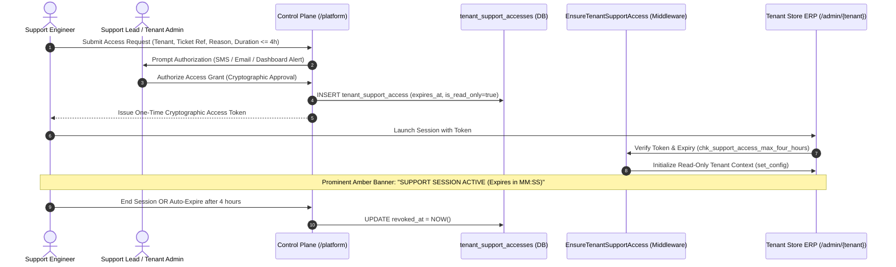

# KC ERP Control Plane: Security & Governance Architecture

**Document Reference:** `docs/platform-control-plane/CONTROL_PLANE_SECURITY_ARCHITECTURE.md`  
**Application Target:** KC ERP Control Plane (`/platform`)  
**Environment:** Proxmox CT 104 (`dev.kcerp.com`)  
**Design Authority:** Senior Security & Compliance Architecture Team  
**Scope Boundary:** Read-Only Security Architecture & Protocol Specification (Zero code mutations, Zero schema alterations)

---

## 1. Executive Summary & Zero-Trust Governance

The **KC ERP Control Plane** governs mission-critical enterprise retail infrastructure across hundreds of retail chains, handling sensitive financial ledgers, customer personal data, and national statutory tax records (NBR Mushak 6.3/6.8).

A security breach in the Control Plane could compromise all tenant environments simultaneously. Therefore, the Control Plane is designed under a **Zero-Trust Multi-Tenant Architecture**:
1. **Absolute Context Separation:** Control Plane authentication guards and user credentials never provide default access to tenant ERP databases.
2. **Segregation of Duties (Platform RBAC):** Fine-grained operator roles enforce strict separation between infrastructure operations, commercial billing, customer support, and compliance auditing.
3. **Mandatory Two-Factor Authentication (2FA):** Every platform operator must authenticate with TOTP multi-factor authentication.
4. **Cryptographic Support Impersonation Protocol:** Platform engineers cannot enter a tenant store without a verified customer support ticket, cryptographic authorization, a hard 4-hour time ceiling, and read-only defaults.
5. **Tamper-Evident Platform Auditing:** Every configuration change, tenant lifecycle state mutation, and support session is sealed in a tamper-evident audit log.

---

## 2. Authentication & Guard Isolation

```mermaid
graph LR
    subgraph Browser Sessions
        O["Platform Operator Browser"]
        U["Tenant Store User Browser"]
    end

    subgraph Authentication Guards
        PG["Guard: 'platform'"]
        TG["Guard: 'web'"]
    end

    subgraph Identity Models
        PU["Model: PlatformUser (platform_users table)"]
        TU["Model: User (users table, Tenant Isolated)"]
    end

    subgraph Database Layer
        PS["Shared Schema (plans, tenants, platform_users)"]
        TS["Tenant Tables (sales, stock, gl_accounts - Forced RLS)"]
    end

    O -->|Cookie: kcerp_platform_session| PG
    PG --> PU
    PU -->|app_rw (Global Context)| PS

    U -->|Cookie: kcerp_tenant_session| TG
    TG --> TU
    TU -->|app_rw with app.current_tenant_id| TS
```

### 2.1 Guard & Session Mechanics
- **Control Plane Guard:** `platform`  
  - Provider: `platform_users` (Eloquent model: `App\Models\PlatformUser`).  
  - Cookie Name: `kcerp_platform_session`.  
  - Session Lifetime: 15 minutes idle timeout (stricter than tenant user session lifetime of 120 minutes).
- **Tenant ERP Guard:** `web`  
  - Provider: `users` (Eloquent model: `App\Models\User`).  
  - Cookie Name: `kcerp_tenant_session`.
- **Cross-Guard Firewall:**  
  A valid `platform` session cookie is strictly rejected by the tenant ERP middleware (`app/Http/Middleware/EnsureTenantContext.php`), and a `web` session cookie is rejected by `PlatformPanelProvider.php`. There is zero session bleeding.

---

## 3. Platform Role-Based Access Control (RBAC)

The current binary implementation (`isSuperAdmin()` vs non-super-admin) will be replaced with a **6-Tier Granular RBAC Matrix**:

### 3.1 Operator Roles Defined
1. `super_admin`: Full administrative power across platform settings, operator creation, role assignments, and emergency break-glass overrides.
2. `platform_admin`: Infrastructure operations, release management, backup configuration, and tenant lifecycle approvals.
3. `billing_admin`: Commercial management, subscription plans, pricing, SaaS invoice generation, payment reconciliation, and dunning.
4. `support_lead`: Support ticket assignment, customer escalation, and authorization of tenant support access requests.
5. `support_engineer`: Frontline tier-1/tier-2 customer troubleshooting, view-only telemetry, and requesting tenant support access.
6. `auditor_ro`: Read-only compliance auditor with access to platform audit logs, security telemetry, and invariant health reports.

### 3.2 Granular Permissions Matrix

| Platform Resource / Action | super_admin | platform_admin | billing_admin | support_lead | support_engineer | auditor_ro |
| :--- | :---: | :---: | :---: | :---: | :---: | :---: |
| **Manage Platform Operators** | **CRUD** | Denied | Denied | Denied | Denied | Denied |
| **Manage Global Platform Settings** | **CRUD** | Read-Only | Denied | Denied | Denied | Read-Only |
| **Provision New Tenant** | **Execute** | **Execute** | Denied | Denied | Denied | Denied |
| **Suspend / Reinstate Tenant** | **Execute** | **Execute** | Denied | Approval Req | Denied | Read-Only |
| **Manage Subscription Plans** | **CRUD** | **CRUD** | **CRUD** | Read-Only | Denied | Read-Only |
| **Manage Tenant Subscriptions** | **CRUD** | **CRUD** | **CRUD** | Read-Only | Denied | Read-Only |
| **Generate Platform Invoices** | **CRUD** | Read-Only | **CRUD** | Denied | Denied | Read-Only |
| **Record Subscription Payments** | **CRUD** | Read-Only | **CRUD** | Denied | Denied | Read-Only |
| **Trigger Invariant Watchdog** | **Execute** | **Execute** | Denied | **Execute** | Denied | Read-Only |
| **View Database & RLS Telemetry** | Full | Full | Denied | Read-Only | Read-Only | Full |
| **Request Support Impersonation** | **Execute** | **Execute** | Denied | **Execute** | **Execute** | Denied |
| **Authorize Support Impersonation**| **Approve** | **Approve** | Denied | **Approve** | Denied | Denied |
| **Revoke Support Impersonation** | **Instant** | **Instant** | Denied | **Instant** | Denied | Denied |
| **View Platform Audit Logs** | Full | Full | Read-Only | Read-Only | Denied | Full |

---

## 4. Two-Factor Authentication (2FA) & Session Hardening

### 4.1 Mandatory 2FA Enforcement
- **Algorithm:** Time-Based One-Time Password (TOTP) conforming to RFC 6238 (compatible with Google Authenticator, Authy, 1Password).
- **Enforcement Policy:**  
  All `PlatformUser` accounts are **mandated** to configure 2FA upon first login. Any operator attempting to navigate `/platform` without an active `two_factor_confirmed_at` timestamp is redirected to `/platform/profile/two-factor`.
- **Emergency Recovery Codes:**  
  Eight single-use 16-character alphanumeric recovery codes generated upon setup, hashed with bcrypt in `platform_users.two_factor_recovery_codes`.

### 4.2 Brute-Force & Credential Protection
- **Rate Limiting:** Maximum 5 failed login attempts per IP / email combination per minute. Exceeding triggers a 15-minute account lock.
- **Password Hygiene:** Minimum 12 characters, requiring uppercase, lowercase, numbers, and special symbols. Checked against HaveIBeenPwned API during creation/reset.
- **Re-Authentication for Sensitive Actions:**  
  Operators must re-enter their password and 2FA token before:
  - Suspending or offboarding an active retail tenant.
  - Modifying financial subscription plans or pricing.
  - Requesting break-glass support impersonation.

---

## 5. Support Impersonation Protocol (Tenant Access Governance)

Under data protection laws and retail enterprise contracts, platform operators **must not possess permanent or unrestricted access** to a tenant store's operational database.

The database table `tenant_support_accesses` (`database/migrations/2026_11_01_000008_create_tenant_support_accesses_table.php`) was committed specifically to govern this workflow.



### 5.1 Protocol Rules & Restrictions
1. **Ticket Reference Required:** Every support access grant must link to a valid, open customer support ticket reference (`ticket_reference`).
2. **Dual-Authorization:**  
   - Standard Access: Authorized by the **Tenant's Store Admin** from their `/admin/settings` panel.
   - Emergency Break-Glass: Authorized by a **Platform Super Admin** with recorded emergency justification.
3. **Hard 4-Hour Database Ceiling:**  
   Enforced at the PostgreSQL database level via constraint:
   ```sql
   ALTER TABLE tenant_support_accesses
   ADD CONSTRAINT chk_support_access_max_four_hours
   CHECK (expires_at <= granted_at + INTERVAL '4 hours');
   ```
   No application bug or operator override can extend an access session beyond 4 hours.
4. **Read-Only Default (`is_read_only = true`):**  
   Support sessions operate in **Read-Only Mode** by default. Any `POST`, `PUT`, `PATCH`, or `DELETE` HTTP request from a support session is blocked by middleware unless `is_read_only = false` was explicitly requested and granted with executive authorization.
5. **Session Banner & Revocation:**  
   While a support session is active, an inescapable high-contrast amber banner is displayed across the top of the viewport showing:  
   `SUPPORT OPERATOR ACTIVE: {Operator Name} (Ticket: {Ref}) • Time Remaining: {MM:SS} • [REVOKE NOW]`.  
   The tenant admin can click `[REVOKE NOW]` at any time to instantly terminate the session.

---

## 6. Platform Audit Logging Specification

While tenant financial transactions are audited in `audit_logs`, the Control Plane requires its own dedicated audit ledger: `platform_audit_logs`.

### 6.1 Proposed Database Schema (`platform_audit_logs`)
- `id` (UUID, Primary Key)
- `platform_user_id` (UUID, foreign key to `platform_users.id`)
- `action` (string: `tenant.created`, `tenant.suspended`, `plan.updated`, `support_access.granted`, etc.)
- `target_type` (string: `Tenant`, `Plan`, `TenantSubscription`, `PlatformUser`)
- `target_id` (string / UUID)
- `client_ip` (string: IPv4/IPv6)
- `user_agent` (string)
- `old_values` (jsonb, nullable)
- `new_values` (jsonb, nullable)
- `reason` (text, nullable - mandatory for suspensions)
- `payload_hash` (string: SHA-256 HMAC of old/new values)
- `created_at` (timestamp with timezone)

### 6.2 Immutability Guarantees
- The `platform_audit_logs` table has PostgreSQL rules prohibiting `UPDATE` and `DELETE` operations.
- Application code accesses this table strictly via `app_rw`, but no model exposes mutator methods. Records are append-only.

---

## 7. Compliance & Regulatory Alignment

1. **Bangladesh Data Sovereignty:**  
   All tenant database records are stored in PostgreSQL instances deployed within the designated data residency region (`dhaka-1` / local sovereign cloud), respecting local financial privacy regulations.
2. **NBR VAT Audit Requirements:**  
   Platform operators cannot alter, backdate, or suppress tenant Mushak 6.3 VAT tax invoices. Any attempt to access tenant tax tables during a support session is flagged and logged.
3. **Principle of Least Privilege (PoLP):**  
   Platform operators only receive permissions essential to their job function, preventing accidental or malicious data modification.
