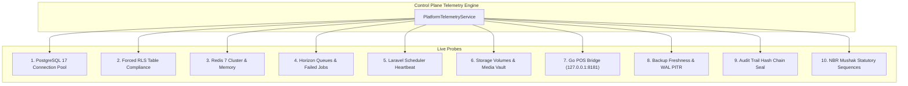

# KC ERP Control Plane: System & Infrastructure Monitoring Specification

**Document Reference:** `docs/platform-control-plane/CONTROL_PLANE_SYSTEM_MONITORING_SPEC.md`  
**Application Target:** KC ERP Control Plane Telemetry Engine (`/platform/health`, `/platform/database-rls`)  
**Environment:** Proxmox CT 104 (`dev.kcerp.com`)  
**Design Authority:** Senior SRE & Database Architecture Team  
**Scope Boundary:** Read-Only Specification (Zero code mutations, Zero schema alterations)

---

## 1. Executive Summary & Telemetry Principles

The current `PlatformSystemHealthWidget` displays static HTML cards with hardcoded statements ("PostgreSQL 17 DB: 68/68 tables forced RLS", "Redis 7 Cluster active", "Go POS Bridge 127.0.0.1:8181 active"). This static presentation provides **false confidence**—if a database pool exhausts, an RLS policy drops, or the Go hardware bridge crashes, the dashboard continues displaying green checkmarks.

This specification establishes an active, multi-point **System & Infrastructure Monitoring Engine**. Every indicator on the Control Plane dashboard must execute a **live probe** and return:
1. `last_checked_at`: ISO-8601 timestamp of actual probe execution.
2. `status`: Strict health enum (`HEALTHY`, `DEGRADED`, `CRITICAL`).
3. `latency_ms`: Round-trip execution time in milliseconds.
4. `evidence`: Concrete diagnostic proof (e.g. table count, active connection count, queue depth).
5. `failure_details`: Human-readable error description and remediation guide if degraded.

---

## 2. Infrastructure Health Indicator Matrix



---

## 3. Detailed Probe Specifications

### Probe 1: PostgreSQL 17 Database Health & Pool Saturation
- **Target:** Primary PostgreSQL 17.4 instance.
- **Probe Logic:**
  Executes a ping query and inspects server connection statistics from `pg_stat_activity`:
  ```sql
  SELECT 
      count(*) AS total_connections,
      count(*) FILTER (WHERE state = 'active') AS active_connections,
      count(*) FILTER (WHERE state = 'idle') AS idle_connections,
      current_setting('max_connections')::int AS max_connections
  FROM pg_stat_activity;
  ```
- **Evidence Output:**  
  `"Active: 12/100 connections (12% saturation) • Query latency: 1.8ms"`
- **Health Thresholds:**
  - `HEALTHY`: Latency $< 20\text{ms}$ and Active Connections $< 70\%$ of max.
  - `DEGRADED`: Latency $20\text{ms} - 100\text{ms}$ or Connections $70\% - 85\%$.
  - `CRITICAL`: Latency $> 100\text{ms}$ or Connections $> 85\%$, or connection error.

---

### Probe 2: Forced Row Level Security (RLS) Compliance
- **Target:** PostgreSQL 17 system catalog (`pg_tables`, `pg_class`, `pg_policy`).
- **Probe Logic:**
  Queries every table containing a `tenant_id` column to verify that:
  1. `c.relrowsecurity = true` (RLS enabled).
  2. `c.relforcerowsecurity = true` (RLS forced even for table owners).
  3. Fail-closed policy exists for `app_rw`.
  ```sql
  SELECT 
      t.tablename,
      c.relrowsecurity AS rls_enabled,
      c.relforcerowsecurity AS rls_forced,
      COUNT(p.polname) AS policy_count
  FROM pg_tables t
  JOIN pg_class c ON c.relname = t.tablename
  JOIN pg_namespace n ON n.oid = c.relnamespace AND n.nspname = t.schemaname
  LEFT JOIN pg_policy p ON p.polrelid = c.oid
  WHERE t.schemaname = 'public'
    AND EXISTS (
        SELECT 1 FROM information_schema.columns col 
        WHERE col.table_schema = 'public' 
          AND col.table_name = t.tablename 
          AND col.column_name = 'tenant_id'
    )
  GROUP BY t.tablename, c.relrowsecurity, c.relforcerowsecurity;
  ```
- **Evidence Output:**  
  `"74/74 tenant tables verified • 100% Forced RLS • Fail-closed policies active"`
- **Health Thresholds:**
  - `HEALTHY`: Exactly 100% of tenant tables have `rls_enabled = true` and `rls_forced = true`.
  - `CRITICAL`: Any tenant table has `rls_forced = false` or missing policy.  
    *Immediate Alert: "CRITICAL DATA LEAKAGE RISK: Table {tablename} is not enforcing RLS!"*

---

### Probe 3: Redis 7 Cluster & Memory Utilization
- **Target:** Redis 7 server (`REDIS_HOST:REDIS_PORT`).
- **Probe Logic:**
  Executes `Redis::ping()` and queries `Redis::info()` for memory statistics:
  ```php
  $info = Redis::info('memory');
  $usedMemoryMb = round($info['used_memory'] / 1024 / 1024, 2);
  $peakMemoryMb = round($info['used_memory_peak'] / 1024 / 1024, 2);
  ```
- **Evidence Output:**  
  `"PONG received (0.6ms) • Memory: 42.5 MB / 512 MB peak • Eviction: volatile-lru"`
- **Health Thresholds:**
  - `HEALTHY`: Latency $< 5\text{ms}$ and Used Memory $< 75\%$ of max.
  - `DEGRADED`: Memory $75\% - 90\%$.
  - `CRITICAL`: Redis unresponsive or Memory $> 90\%$.

---

### Probe 4: Laravel Horizon & Queue Processing Latency
- **Target:** Redis queue backlogs (`default`, `audit`, `sync`, `notifications`) and `failed_jobs` table.
- **Probe Logic:**
  ```php
  $pendingJobs = Queue::size('default') + Queue::size('audit') + Queue::size('sync');
  $failedJobsCount = DB::table('failed_jobs')->count();
  $latestFailedJob = DB::table('failed_jobs')->latest('failed_at')->first();
  ```
- **Evidence Output:**  
  `"Queues: 0 pending • Horizon active (4 workers) • Failed Jobs: 0"`
- **Health Thresholds:**
  - `HEALTHY`: $\text{Failed Jobs} = 0$ and $\text{Pending Jobs} < 50$.
  - `DEGRADED`: $\text{Failed Jobs} \in [1, 5]$ or $\text{Pending Jobs} \in [50, 200]$.
  - `CRITICAL`: $\text{Failed Jobs} > 5$ or workers inactive for $> 5\text{ minutes}$.

---

### Probe 5: Task Scheduler Heartbeat
- **Target:** Laravel Artisan Scheduler (`schedule:run`).
- **Probe Logic:**
  A scheduled job writes a heartbeat timestamp to Redis key `platform:scheduler:heartbeat` every minute:
  ```php
  $lastHeartbeat = Cache::get('platform:scheduler:heartbeat');
  $delaySeconds = $lastHeartbeat ? now()->diffInSeconds(Carbon::parse($lastHeartbeat)) : 9999;
  ```
- **Evidence Output:**  
  `"Last heartbeat: 24s ago (Cron active)"`
- **Health Thresholds:**
  - `HEALTHY`: Delay $< 120\text{s}$.
  - `DEGRADED`: Delay $120\text{s} - 300\text{s}$.
  - `CRITICAL`: Delay $> 300\text{s}$ (Cron has stopped running).

---

### Probe 6: Storage Volumes & Media Vault
- **Target:** Local and remote filesystem disks (`local`, `public`, `backups`, `s3`).
- **Probe Logic:**
  Writes, reads, and deletes a temporary probe file:
  ```php
  $probeFile = 'health/probe_' . uniqid() . '.tmp';
  $disk = Storage::disk('local');
  $written = $disk->put($probeFile, 'KC_ERP_PROBE');
  $read = $disk->get($probeFile) === 'KC_ERP_PROBE';
  $disk->delete($probeFile);
  ```
- **Evidence Output:**  
  `"Disk read/write verified (2.1ms) • Free Space: 142.8 GB available (68% free)"`
- **Health Thresholds:**
  - `HEALTHY`: Read/Write successful and Free Space $> 20\%$.
  - `DEGRADED`: Free Space $10\% - 20\%$.
  - `CRITICAL`: Disk write failure or Free Space $< 10\%$.

---

### Probe 7: Go POS Bridge Agent Connectivity
- **Target:** Local Go hardware communication daemon (`127.0.0.1:8181/health`).
- **Probe Logic:**
  Sends an HTTP GET request with a strict 1-second timeout:
  ```php
  $response = Http::timeout(1)->get('http://127.0.0.1:8181/health');
  $data = $response->json();
  ```
- **Evidence Output:**  
  `"Go Bridge v1.2.0 online • Port 8181 responsive (4.2ms) • ESC/POS USB printer ready"`
- **Health Thresholds:**
  - `HEALTHY`: HTTP 200 returned within 1000ms.
  - `DEGRADED`: Latency $> 500\text{ms}$ or hardware ports unattached.
  - `CRITICAL`: Connection refused (Go process crashed or unstarted).

---

### Probe 8: Database Backup Freshness & Point-In-Time Recovery (PITR)
- **Target:** Backup artifact directory and PostgreSQL WAL archiver.
- **Probe Logic:**
  Checks the timestamp of the latest physical database dump and checks `pg_stat_archiver`:
  ```sql
  SELECT 
      archived_count,
      last_archived_wal,
      last_archived_time,
      failed_count,
      last_failed_time
  FROM pg_stat_archiver;
  ```
- **Evidence Output:**  
  `"Snapshot: 2.5h ago (pgBackRest) • WAL archive: 48s ago • Failed WAL: 0"`
- **Health Thresholds:**
  - `HEALTHY`: Daily dump age $< 24\text{h}$ and WAL delay $< 10\text{ mins}$.
  - `DEGRADED`: Daily dump age $24\text{h} - 48\text{h}$ or WAL delay $10\text{m} - 30\text{m}$.
  - `CRITICAL`: Daily dump age $> 48\text{h}$ or WAL archival failing.

---

### Probe 9: Audit Trail Cryptographic Hash Chain Seal
- **Target:** `audit_logs` table.
- **Probe Logic:**
  Verifies the cryptographic link between `prev_hash`, `payload_hash`, and `current_hash` on the most recent 100 audit entries:
  $$\text{current\_hash} = \text{HMAC-SHA256}(\text{prev\_hash} \parallel \text{payload\_hash}, \text{secret})$$
- **Evidence Output:**  
  `"Last 100 entries verified • Zero hash breaks • Chain head at position #14,209"`
- **Health Thresholds:**
  - `HEALTHY`: All checked hashes match exactly.
  - `CRITICAL`: Hash mismatch detected!  
    *Immediate Alert: "TAMPER ALERT: Audit trail broke at position #X. Immediate forensic review required!"*

---

### Probe 10: NBR Mushak Statutory Sequences & Tax Vault
- **Target:** `number_series` and `sales_invoices` (Mushak 6.3) / `credit_notes` (Mushak 6.7/6.8).
- **Probe Logic:**
  Verifies that statutory Mushak invoice number series have no gaps, no duplicate serials, and immutable triggers are active:
  ```sql
  SELECT count(*) FROM (
      SELECT tenant_id, mushak_number, count(*) 
      FROM sales_invoices 
      WHERE mushak_number IS NOT NULL 
      GROUP BY tenant_id, mushak_number 
      HAVING count(*) > 1
  ) dups;
  ```
- **Evidence Output:**  
  `"Zero duplicate Mushak serials • Number series sequences monotonic • Strict VAT lock active"`
- **Health Thresholds:**
  - `HEALTHY`: Duplicates $= 0$ and triggers verified.
  - `CRITICAL`: Any duplicate Mushak number detected across any tenant.

---

## 4. Telemetry DTO & Data Architecture

To ensure high performance and clean decoupled architecture, all probes implement a common interface:

```php
namespace App\Modules\Platform\Contracts;

interface SystemProbeInterface
{
    public function getKey(): string;
    public function getName(): string;
    public function execute(): ProbeResultDto;
}
```

### ProbeResult DTO Structure
```php
readonly class ProbeResultDto
{
    public function __construct(
        public string $key,
        public string $name,
        public string $status, // HEALTHY | DEGRADED | CRITICAL
        public float $latencyMs,
        public string $evidence,
        public ?string $failureDetails = null,
        public ?string $remediationGuide = null,
        public Carbon $checkedAt = new Carbon(),
    ) {}
}
```

---

## 5. Automated Alerting & Escalation Webhooks

When any probe evaluates to `DEGRADED` or `CRITICAL`, the `PlatformTelemetryService` triggers automated notification dispatches:

1. **Slack / Discord NOC Webhook:**  
   Payload containing probe name, status badge, latency, evidence, and direct link to `/platform/health`.
2. **SMS Escalation (Twilio / Local BD SMS Gateway):**  
   Dispatched to on-call Platform Super Admin if PostgreSQL pool exhausts or Forced RLS coverage drops below 100%.
3. **Control Plane Toast Notification:**  
   Broadcast via Filament Livewire database notifications to all logged-in platform operators.
