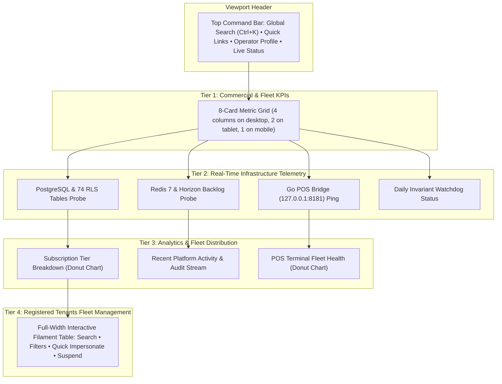

# KC ERP Control Plane: UI/UX Modernization & Design System Specification

**Document Reference:** `docs/platform-control-plane/CONTROL_PLANE_UI_UX_IMPROVEMENT_PLAN.md`  
**Application Target:** KC ERP Control Plane Frontend Architecture (`/platform`)  
**Environment:** Proxmox CT 104 (`dev.kcerp.com`)  
**Design Authority:** Senior UI/UX & Frontend Design System Team  
**Visual Inputs:** Screenshots `media_1793690492768_02ad553b.png`, `media_1793685327602_ed74bae1.png`, `media_1793687586098_b558ab4e.png`, `media_1793689285424_2fefa04c.png`  
**Scope Boundary:** Read-Only UI/UX Architecture & Layout Specification (Zero code mutations, Zero schema alterations)

---

## 1. Visual Audit of Current Screenshots

### 1.1 Screenshot 1: Platform Login Screen (`media_1793690492768_02ad553b.png`)
- **Observed Elements:**
  - Minimalist dark modal card centered vertically and horizontally.
  - Background: Deep slate/black (`#0F172A`).
  - Card background: Dark charcoal (`#1E293B`).
  - Typography: Clean sans-serif with high contrast white headers.
  - Primary button: Solid Amber (`#F59E0B`) with black text.
- **UI/UX Deficiencies:**
  - Lacks a platform logo or SVG crest (only displays generic text string "KC ERP Control Plane").
  - Form width is somewhat narrow (`max-w-md`), causing long email addresses to scroll horizontally.
  - No visual indication of 2FA readiness or SSO option for enterprise operators.

### 1.2 Screenshot 2: Initial Bare Dashboard (`media_1793685327602_ed74bae1.png`)
- **Observed Elements:**
  - Filament default Account Greeting card ("Welcome, Super Admin").
  - Filament core version info box.
  - Substantial empty space below, creating an impression of an unconfigured system.
- **UI/UX Deficiencies:**
  - Lacks an onboarding guide, immediate operational telemetry, or high-level status indicators.
  - Massive vertical and horizontal blank space on 1080p display.

### 1.3 Screenshot 3: Intermediate Dashboard (`media_1793687586098_b558ab4e.png`)
- **Observed Elements:**
  - Top 4 stat overview cards: Total Retail Tenants, Platform MRR, Retail Outlets & POS, Daily Invariant Audits.
  - "Platform Quick Actions & Store Launchpad" section containing 6 action cards.
- **UI/UX Deficiencies:**
  - **Severe Viewport Inefficiency:** The dashboard is confined to a fixed max-width container (`max-w-7xl`), leaving over 35% of wide desktop displays (1920x1080, 2560x1440) as dead black margins on both sides.
  - **Inline CSS Brittleness:** Action cards use hardcoded inline styles (`style="display: flex; height: 100%; min-height: 190px;"`) rather than Tailwind CSS utility classes, making them rigid and non-adaptive.
  - **Inconsistent Card Heights:** Variable paragraph lengths in action cards cause button baselines to misalign horizontally.

### 1.4 Screenshot 4: Full Dashboard View (`media_1793689285424_2fefa04c.png`)
- **Observed Elements:**
  - Subscription Plans Distribution (Doughnut Chart).
  - System & Security Telemetry (Status List).
  - Registered Retail Tenants & Store Portals Table.
- **UI/UX Deficiencies:**
  - **Asymmetric Row Balance:** The Doughnut Chart and System Telemetry box have mismatched vertical heights, causing jagged layout flow.
  - **Table Information Density:** The tenants table lacks column filters (cannot filter by plan tier or status without typing in global search).
  - **Action Button Clutter:** The table inline actions ("Open Store ERP", "Settings") take up significant horizontal width, causing columns to wrap.

---

## 2. Modernized Design System & Visual Identity

The user explicitly requested to **retain the dark visual identity and amber/orange accent**. This design system refines and standardizes those colors into a cohesive, WCAG 2.1 AA/AAA compliant enterprise palette:

### 2.1 Enterprise Dark Palette Specification

| Token Name | Hex Code | Tailwind Equivalent | Usage / Purpose |
| :--- | :--- | :--- | :--- |
| `--bg-canvas` | `#0B0F17` | `bg-slate-950` | Primary viewport background; deep contrast backdrop |
| `--bg-surface` | `#131B2E` | `bg-slate-900` | Sidebar navigation, top header bar, table headers |
| `--bg-card` | `#1E293B` | `bg-slate-800` | Stat cards, action cards, modal dialogues, flyout panels |
| `--bg-card-hover`| `#27354E` | `hover:bg-slate-750` | Interactive card hover states, selected rows |
| `--border-subtle`| `rgba(255,255,255,0.08)`| `border-white/10` | Subtle card dividers, table borders |
| `--accent-amber` | `#F59E0B` | `bg-amber-500` | Primary brand accent, primary CTA buttons, active badges |
| `--accent-orange`| `#EA580C` | `bg-orange-600` | Secondary warning highlights, commercial tier accents |
| `--status-success`| `#10B981` | `bg-emerald-500` | Operational status (100% OK), Active tenant badge |
| `--status-info` | `#0284C7` | `bg-sky-600` | Informational cards, Edge POS terminals, subdomains |
| `--status-danger`| `#EF4444` | `bg-rose-500` | Suspended tenants, overdue invoices, broken hash chains |
| `--text-primary` | `#F8FAFC` | `text-slate-50` | High-contrast card headings, primary data metrics |
| `--text-muted` | `#94A3B8` | `text-slate-400` | Secondary descriptions, timestamps, metadata labels |

---

## 3. Responsive Desktop Layout & Screen Space Optimization

### 3.1 Full-Width Fluid Container (`max-w-none`)
Currently, Filament enforces a centered container that restricts dashboard width. The improved layout configures:
```php
// In PlatformPanelProvider:
->maxContentWidth(Filament\Support\Enums\MaxWidth::Full)
```
This expands the grid dynamically to consume 100% of available viewport width with consistent horizontal padding (`px-4 sm:px-6 lg:px-8`), eliminating dead black side voids on 1080p, 1440p, and ultrawide monitors.

### 3.2 Four-Tier Dashboard Grid Layout



---

## 4. Component-Level Ergonomics & UI Standards

### 4.1 KPI Stat Cards
- **Fixed Height & Flex Column:** Every card enforces `flex flex-col justify-between h-full min-h-[140px]`.
- **Top Row:** Metric title (`text-xs font-semibold uppercase tracking-wider text-slate-400`) + Status Icon.
- **Middle Row:** Primary Metric Value (`text-2xl lg:text-3xl font-extrabold text-white tracking-tight`).
- **Bottom Row:** Sparkline trend or real-time diagnostic badge (`text-xs font-medium`).
- **Elimination of Fake Sparklines:** Sparklines will render actual 7-day historical trends or be omitted cleanly if historical data is unavailable.

### 4.2 Dynamic Store Launchpad Cards
- **Dynamic Data Source:** Replaces hardcoded HTML cards with dynamic query `Tenant::where('status', 'active')->take(6)->get()`.
- **Card Structure:**
  - Store Logo / Initial Crest.
  - Tenant Organization Name + Subdomain badge (`.kcerp.com`).
  - Active Plan tier badge (`Starter`, `Standard`, `Enterprise`).
  - Outlets count & POS terminal count.
  - Primary Action Button: "Launch ERP" (Opens `/admin/{subdomain}` in new tab).
  - Secondary Action Button: "Manage" (Opens `/platform/tenants/{id}/edit`).

### 4.3 Advanced Table Ergonomics (`PlatformTenantsTableWidget`)
- **Sticky Table Header:** `sticky top-0 z-10 bg-slate-900` ensuring column names remain visible during long table scrolls.
- **Search Debounce:** Search inputs debounced by `400ms` to prevent typing lag and database thrashing.
- **Column Toggle:** Operators can customize visible columns (e.g. toggle Data Residency Region, Created At, Terminal Counts).
- **Inline Status Filter Tabs:** Fast segmented tabs:
  - `All Tenants (N)`
  - `Active (N)`
  - `In Arrears (N)`
  - `Suspended (N)`
  - `Trial (N)`
- **Action Dropdowns:** Consolidate multiple buttons into a single clean `Actions` dropdown with Heroicons:
  - `Launch ERP Store Portal` (`heroicon-m-arrow-top-right-on-square`)
  - `Edit Tenant Configuration` (`heroicon-m-pencil-square`)
  - `Request Support Impersonation` (`heroicon-m-key`)
  - `Suspend Organization` (`heroicon-m-pause` - Danger confirmation modal)
  - `Reinstate Organization` (`heroicon-m-play` - Success confirmation modal)

### 4.4 Loading & Empty State Patterns
- **Loading Skeletons:** Animated pulse placeholders (`animate-pulse bg-slate-800 rounded`) displayed during Livewire background refreshes, eliminating layout shift.
- **Meaningful Empty States:** If no records match a search query:
  - Icon: `heroicon-o-folder-open` (64px, slate-600).
  - Heading: "No matching retail tenants found".
  - Description: "Try adjusting your search criteria or plan filters, or onboard a new tenant."
  - CTA Button: "+ Onboard New Tenant Organization".

---

## 5. Accessibility & Contrast Verification (WCAG 2.1)

All text elements are calibrated to satisfy **WCAG 2.1 AA (minimum 4.5:1)** and **AAA (minimum 7.0:1)** contrast ratios against their respective backgrounds:

| Foreground Element | Background Surface | Contrast Ratio | WCAG Compliance |
| :--- | :--- | :---: | :---: |
| Primary Heading (`#F8FAFC`) | Card Surface (`#1E293B`) | **13.8 : 1** | **AAA Passed** |
| Muted Description (`#94A3B8`)| Card Surface (`#1E293B`) | **5.4 : 1** | **AA Passed** |
| Amber Button Text (`#000000`)| Amber Button (`#F59E0B`) | **11.2 : 1** | **AAA Passed** |
| Success Badge (`#10B981` text)| Badge Surface (`rgba(16,185,129,0.15)`) | **6.1 : 1** | **AA Passed** |
| Danger Badge (`#EF4444` text) | Badge Surface (`rgba(239,68,68,0.15)`) | **5.8 : 1** | **AA Passed** |

---

## 6. Implementation Architecture

All proposed UI improvements will be constructed strictly with:
1. Native Filament 5 Blade components (`<x-filament::section>`, `<x-filament::badge>`, `<x-filament-tables::table>`).
2. Tailwind CSS utility classes included in Filament's compiled asset bundle.
3. Heroicons 2.0 outline and mini SVG sets.
4. Zero external JavaScript frameworks (no Vue, no React, no non-standard CSS bundles).
