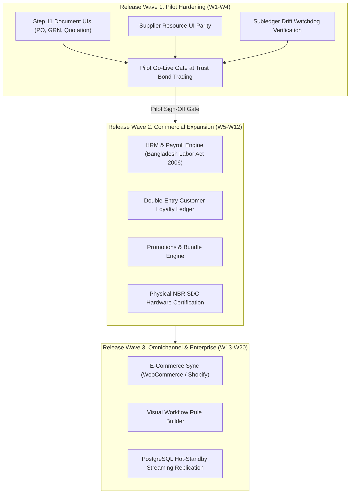

# Unified ERP v2.0: Implementation Roadmap & Release Plan
**KC Retail ERP | Phased Engineering Backlog & Deployment Milestones**  
**Controlling Work Order:** `docs/master-work-order/KC_Retail_ERP_Unified_v2.0_Specification_Work_Order.md`  
**Repository Baseline:** Branch `step-13a-watchdog-audit` (Commit: `17d0264`)  
**Auditor & Planning Lead:** Principal Software Architect & ERP Solution Lead  
**Publication Date:** November 2026  
**Document Authority:** Authoritative Implementation Roadmap (v2.0)  

---

## 1. Executive Roadmap Summary & Release Strategy

KC Retail ERP Unified v2.0 follows a rigorous, dependency-driven release strategy designed to guarantee core retail business correctness, financial consistency, and regulatory compliance before introducing advanced operational extensions.

The roadmap organizes engineering deliverables into three sequential release waves:
1. **Wave 1 — Core Retail Pilot Hardening (Weeks 1–4):** Complete remaining procurement document UIs, execute pilot go-live gate at Trust Bond Trading, and establish live operational stability.
2. **Wave 2 — Commercial Expansion & Compliance (Weeks 5–12):** Deliver Bangladesh Labor Act compliant HRM/Payroll, Customer Loyalty points ledger, and physical SDC lab testing.
3. **Wave 3 — Omnichannel & Enterprise Scale (Weeks 13–20):** Deliver bi-directional E-Commerce sync (Shopify/WooCommerce), visual workflow builder, and multi-node database high availability.



---

## 2. Release Wave 1: Core Retail Pilot Hardening (Weeks 1–4)

### 2.1 Objectives & Scope
The sole focus of Wave 1 is achieving rock-solid production stability for the retail pilot at Trust Bond Trading. All foundational P0 features are already verified in code; Wave 1 closes the remaining UI gaps on procurement documents.

### 2.2 Prioritized Engineering Backlog
```
+---------------------------------------------------------------------------------------------------------------+
|                                      WAVE 1 ENGINEERING BACKLOG (PILOT CORE)                                  |
+--------------------------+----------+--------+------------------------------------+---------------------------+
| Task / Feature ID        | Priority | Effort | Deliverable Artifacts              | Dependencies              |
+--------------------------+----------+--------+------------------------------------+---------------------------+
| TASK-W1-01: PO UI        | P1       | M      | PurchaseOrderResource.php          | PurchaseOrder model       |
|                          |          |        | Form, Table, Approval Action       | (Already verified in code)|
| TASK-W1-02: GRN UI       | P1       | M      | GoodsReceiptResource.php           | GoodsReceipt model,       |
|                          |          |        | 3-Way Match Validation Widget      | PurchaseOrder linkage     |
| TASK-W1-03: Quotation UI | P1       | S      | QuotationResource.php              | Quotation model           |
|                          |          |        | Multi-vendor comparison view       |                           |
| TASK-W1-04: Supplier UI  | P1       | S      | SupplierResource.php               | Supplier model & ledger   |
|                          |          |        | BIN/TIN validation, Payment terms  |                           |
| TASK-W1-05: Watchdog Run | P0       | S      | Pilot daily watchdog check report  | Horizon cron schedule     |
|                          |          |        | Zero balance sheet drift verify    |                           |
| TASK-W1-06: Pilot Drill  | P0       | M      | Complete Cashier's Day Browser Run | POS PWA + Go Bridge       |
|                          |          |        | Shift open -> sales -> Z-report    |                           |
+--------------------------+----------+--------+------------------------------------+---------------------------+
```

### 2.3 Wave 1 Test & Review Gates
* **Code Formatting & Analysis:** Pint clean, Larastan Level 8 (0 errors).
* **Database Suite:** All 403 existing database tests pass on PostgreSQL 17 as `app_rw`.
* **Subledger Reconciliation:** Watchdog confirms `drift = 0.00 BDT` between General Ledger and Subledgers for 7 consecutive days.

---

## 3. Release Wave 2: Commercial Expansion (Weeks 5–12)

### 3.1 Objectives & Scope
Expands platform utility to human resources, customer retention, and advanced retail promotions, following successful pilot validation.

### 3.2 Prioritized Engineering Backlog
```
+---------------------------------------------------------------------------------------------------------------+
|                                      WAVE 2 ENGINEERING BACKLOG (EXPANSION)                                   |
+--------------------------+----------+--------+------------------------------------+---------------------------+
| Task / Feature ID        | Priority | Effort | Deliverable Artifacts              | Dependencies              |
+--------------------------+----------+--------+------------------------------------+---------------------------+
| TASK-W2-01: HRM Master   | P2       | M      | Employee profiles, salary grades,  | Core Tenancy,             |
|                          |          |        | Department/Designation hierarchies | Location Scopes           |
| TASK-W2-02: Payroll Calc | P2       | L      | PayrollService.php, Tax slabs,     | General Ledger contract,  |
|                          |          |        | Festival bonus, PF deduction       | JournalPostingService     |
| TASK-W2-03: Loyalty Core | P2       | M      | LoyaltyLedgerService.php,          | CustomerLedger,           |
|                          |          |        | Double-entry point accrual/redeem  | POS Payment Service       |
| TASK-W2-04: Promotions   | P2       | M      | PromotionRuleEngine.php,           | Catalog,                  |
|                          |          |        | BOGO, tiered cart discount rules   | POS pricing engine        |
| TASK-W2-05: SDC Lab Test | P1       | L      | Physical SDC serial testing,       | Go Hardware Bridge,       |
|                          |          |        | NBR accredited lab certification   | Bangladesh NBR Lab Access |
+--------------------------+----------+--------+------------------------------------+---------------------------+
```

### 3.3 Wave 2 Test & Review Gates
* **Payroll Accuracy:** Automated unit tests verifying exact income tax deduction against current National Budget progressive tax slabs.
* **Loyalty Balance:** Mathematical proof that customer loyalty points balance equals total accrued minus redeemed minus expired.

---

## 4. Release Wave 3: Omnichannel & Enterprise Scale (Weeks 13–20)

### 4.1 Objectives & Scope
Enables omnichannel retail integration and hardens infrastructure for high-throughput enterprise conglomerates.

### 4.2 Prioritized Engineering Backlog
```
+---------------------------------------------------------------------------------------------------------------+
|                                      WAVE 3 ENGINEERING BACKLOG (ENTERPRISE)                                  |
+--------------------------+----------+--------+------------------------------------+---------------------------+
| Task / Feature ID        | Priority | Effort | Deliverable Artifacts              | Dependencies              |
+--------------------------+----------+--------+------------------------------------+---------------------------+
| TASK-W3-01: E-Com Ingest | P3       | L      | WooCommerce & Shopify webhooks,    | Inventory valuation,      |
|                          |          |        | Real-time inventory reservation    | Sales order pipeline      |
| TASK-W3-02: Visual WF    | P3       | M      | Drag-and-drop workflow builder     | WorkflowApprovalService   |
|                          |          |        | in Filament admin panel            |                           |
| TASK-W3-03: High Avail   | P2       | L      | PostgreSQL active-passive          | Infrastructure team,      |
|                          |          |        | streaming replication on Proxmox   | Offsite storage node      |
| TASK-W3-04: Load Testing | P2       | M      | k6 automated benchmark suite       | Isolated staging cluster  |
|                          |          |        | Proving 10,000 req/sec throughput  |                           |
+--------------------------+----------+--------+------------------------------------+---------------------------+
```

---

## 5. Specialist Dependencies & Resource Matrix

Successful delivery across waves requires coordinated cross-functional disciplines:

1. **ERP Financial Architect:** Oversees double-entry posting rules, subledger reconciliation, and GL integrity (Waves 1, 2).
2. **Bangladesh Tax Specialist (NBR Consultant):** Validates Mushak sub-forms, SDC hardware lab testing, and tax audit compliance (Waves 1, 2).
3. **Embedded Systems Engineer (Go Specialist):** Maintains Go hardware bridge, ESC/POS drivers, and serial scale protocols (Waves 1, 2).
4. **DevOps & Infrastructure Architect:** Manages Proxmox container isolation, ZFS snapshots, PostgreSQL streaming replication, and Horizon queue tuning (Waves 1, 3).
5. **Frontend / PWA Engineer:** Leads Alpine.js / Dexie.js offline POS UX and barcode scanner latency optimizations (Waves 1, 2).

---

## 6. Pilot & Production Go-Live Gates

Transition from pre-production to live commercial operations mandates strict sign-off across four irreversible gates:

```
+---------------------------------------------------------------------------------------------------------------+
|                                       COMMERCIAL GO-LIVE SIGN-OFF GATES                                       |
+--------------------------+----------------------------------------------------+-------------------------------+
| Gate Name                | Verification Criteria                              | Mandatory Sign-Off Role       |
+--------------------------+----------------------------------------------------+-------------------------------+
| Gate 1: Security & RLS   | php artisan db:check-rls clean; 0 cross-tenant leaks| Chief Information Security    |
|                          | in automated isolation test suite.                 | Officer (CISO)                |
| Gate 2: Financial Audit  | 7 consecutive days of zero GL-to-Subledger drift;  | Chief Accountant / Lead       |
|                          | all journal reversal and audit triggers active.    | Financial Architect           |
| Gate 3: Cashier Offline  | Full cashier shift simulated with network severed; | Retail Operations Director    |
|                          | 100% receipt print, scale reading, and sync verify.|                               |
| Gate 4: NBR Statutory    | Bilingual Mushak 6.3, 6.6, 6.8, and 9.1 return     | Head of Tax & Statutory       |
|                          | generation verified against NBR sample vouchers.   | Compliance                    |
+--------------------------+----------------------------------------------------+-------------------------------+
```

---

## 7. Explicit Exclusions per Release Wave

To maintain focus and avoid delivery slippage, the following domains are explicitly excluded from each wave:
* **Excluded from Wave 1:** HRM, Payroll, Loyalty points, E-Commerce sync, Physical SDC laboratory certification.
* **Excluded from Wave 2:** Direct E-Commerce order ingestion, drag-and-drop visual workflow builders, multi-region database clustering.
* **Excluded from Wave 3:** Custom in-house e-commerce storefront development (ERP provides API contracts only).
