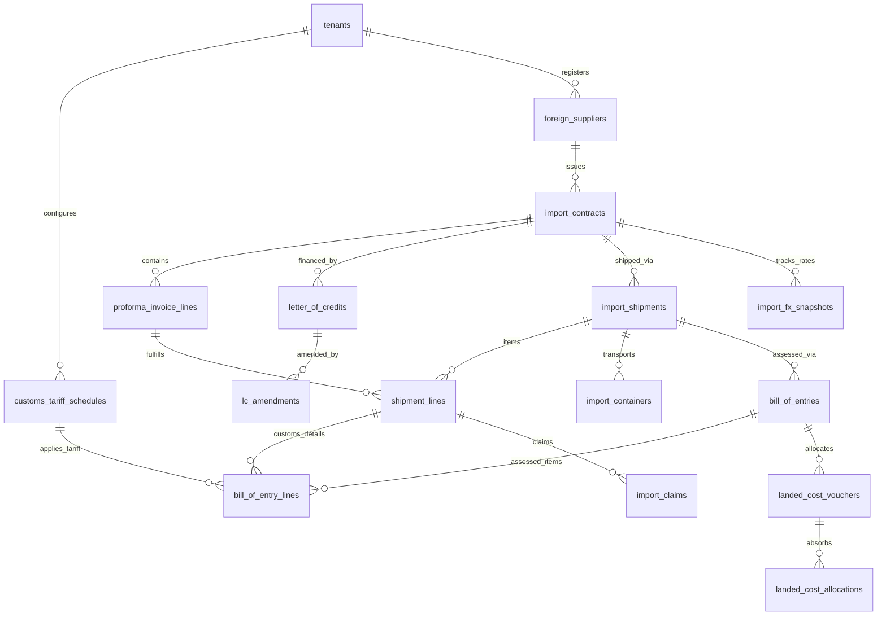

# Unified ERP v2.0.3: Import Management Relational Database Architecture Refinement
**KC Retail ERP | Relational DDL Design, Composite Integrity & Statutory Foreign Trade Schema**  
**Controlling Work Order:** `docs/master-work-order/KC_Retail_ERP_Unified_v2.0_Specification_Work_Order.md`  
**Database Engine:** PostgreSQL 17.4 on x86_64-pc-linux-gnu  
**Repository Baseline:** Branch `step-13a-watchdog-audit` | Commit: `17d0264`  
**Target Release:** Release Wave 2 (Import Subsystem Implementation)  
**Lead DBA & Database Architect:** Principal Database Architect & Systems Auditor  
**Publication Date:** November 2026  
**Document Revision:** v2.0.3 (Authoritative DDL & Schema Specification)  

---

## 1. Executive Summary & Schema Principles

This document provides the production-grade PostgreSQL 17 relational database architecture for the **Import & International Trade Management Module (`MOD-IMP-INT`)**. 

It refines the preliminary specification by eliminating hardcoded tax assumptions and implementing enterprise relational integrity:
1. **Dynamic, Overlap-Free Tariffs:** Uses PostgreSQL `btree_gist` temporal exclusion constraints to prevent overlapping validity dates for the same 8-digit HS Code within a tenant.
2. **Fail-Closed Multi-Tenancy:** 100% of tables enforce `FORCE ROW LEVEL SECURITY`, tenant-composite primary keys, and composite foreign keys `(tenant_id, ...)`.
3. **Company-Level Relational Consistency:** All financial contracts, shipments, and banking records enforce `(tenant_id, company_id, ...)` composite keys to prevent cross-company document mixing.
4. **Hierarchical Line-Level Tracking:** Granular line-item mapping from Proforma Invoices (PI) through Partial Shipments, Containers, Bills of Entry (B/E), and Landed Cost Allocations.
5. **Audited Assessment Overrides & Claims:** Dual-control approval foreign keys for customs assessment overrides and shortage/damage insurance claims.

---

## 2. Complete Entity-Relationship Model



---

## 3. Production PostgreSQL 17 DDL Specification

```sql
-- Extension required for btree_gist temporal exclusion constraints
CREATE EXTENSION IF NOT EXISTS btree_gist;

-- ============================================================================
-- 1. DYNAMIC & VERSIONED CUSTOMS TARIFF SCHEDULES
-- ============================================================================
CREATE TABLE customs_tariff_schedules (
    id UUID PRIMARY KEY,
    tenant_id UUID NOT NULL,
    hs_code VARCHAR(16) NOT NULL,
    description VARCHAR(255) NOT NULL,
    valid_range DATERANGE NOT NULL,
    cd_rate NUMERIC(6, 4) NOT NULL,
    rd_rate NUMERIC(6, 4) NOT NULL,
    sd_rate NUMERIC(6, 4) NOT NULL,
    vat_rate NUMERIC(6, 4) NOT NULL,
    ait_rate NUMERIC(6, 4) NOT NULL,
    at_rate NUMERIC(6, 4) NOT NULL,
    sro_reference VARCHAR(128),
    created_at TIMESTAMPTZ NOT NULL,
    updated_at TIMESTAMPTZ NOT NULL,
    
    CONSTRAINT uq_tariff_tenant_id UNIQUE (tenant_id, id),
    CONSTRAINT fk_tariff_tenant FOREIGN KEY (tenant_id) REFERENCES tenants(id) ON DELETE RESTRICT,
    -- Prevent overlapping validity dates for the exact same HS Code within a tenant
    CONSTRAINT ex_tariff_no_overlap EXCLUDE USING gist (
        tenant_id WITH =,
        hs_code WITH =,
        valid_range WITH &&
    )
);

-- ============================================================================
-- 2. IMPORT CONTRACTS & PROFORMA INVOICES (PI)
-- ============================================================================
CREATE TABLE import_contracts (
    id UUID PRIMARY KEY,
    tenant_id UUID NOT NULL,
    company_id UUID NOT NULL,
    supplier_id UUID NOT NULL,
    contract_number VARCHAR(64) NOT NULL,
    pi_number VARCHAR(64) NOT NULL,
    pi_date DATE NOT NULL,
    incoterm VARCHAR(16) NOT NULL, -- FOB, CFR, CIF, EXW
    currency VARCHAR(3) NOT NULL,  -- USD, RMB, EUR
    total_foreign_amount NUMERIC(18, 4) NOT NULL,
    payment_terms VARCHAR(64) NOT NULL,
    status VARCHAR(32) NOT NULL DEFAULT 'draft',
    created_at TIMESTAMPTZ NOT NULL,
    updated_at TIMESTAMPTZ NOT NULL,

    CONSTRAINT uq_import_contracts_tenant_id UNIQUE (tenant_id, id),
    CONSTRAINT uq_import_contracts_company UNIQUE (tenant_id, company_id, id),
    CONSTRAINT fk_import_contracts_tenant FOREIGN KEY (tenant_id) REFERENCES tenants(id) ON DELETE RESTRICT,
    CONSTRAINT fk_import_contracts_company FOREIGN KEY (tenant_id, company_id) REFERENCES companies(tenant_id, id) ON DELETE RESTRICT,
    CONSTRAINT fk_import_contracts_supplier FOREIGN KEY (tenant_id, supplier_id) REFERENCES suppliers(tenant_id, id) ON DELETE RESTRICT
);

CREATE TABLE proforma_invoice_lines (
    id UUID PRIMARY KEY,
    tenant_id UUID NOT NULL,
    contract_id UUID NOT NULL,
    product_id UUID NOT NULL,
    hs_code VARCHAR(16) NOT NULL,
    quantity NUMERIC(14, 4) NOT NULL,
    unit_price_foreign NUMERIC(18, 4) NOT NULL,
    line_total_foreign NUMERIC(18, 4) NOT NULL,
    cbm_volume NUMERIC(10, 4) NOT NULL,
    gross_weight_kg NUMERIC(10, 4) NOT NULL,
    created_at TIMESTAMPTZ NOT NULL,
    updated_at TIMESTAMPTZ NOT NULL,

    CONSTRAINT uq_pi_lines_tenant_id UNIQUE (tenant_id, id),
    CONSTRAINT fk_pi_lines_contract FOREIGN KEY (tenant_id, contract_id) REFERENCES import_contracts(tenant_id, id) ON DELETE CASCADE,
    CONSTRAINT fk_pi_lines_product FOREIGN KEY (tenant_id, product_id) REFERENCES products(tenant_id, id) ON DELETE RESTRICT
);

-- ============================================================================
-- 3. COMMERCIAL BANKING: LETTERS OF CREDIT (LC) & AMENDMENTS
-- ============================================================================
CREATE TABLE letter_of_credits (
    id UUID PRIMARY KEY,
    tenant_id UUID NOT NULL,
    company_id UUID NOT NULL,
    contract_id UUID NOT NULL,
    lc_number VARCHAR(64) NOT NULL,
    issuing_bank VARCHAR(128) NOT NULL,
    branch_name VARCHAR(128) NOT NULL,
    lc_currency VARCHAR(3) NOT NULL,
    lc_value NUMERIC(18, 4) NOT NULL,
    margin_percentage NUMERIC(6, 4) NOT NULL,
    margin_amount_bdt NUMERIC(18, 4) NOT NULL,
    issue_date DATE NOT NULL,
    expiry_date DATE NOT NULL,
    latest_shipment_date DATE NOT NULL,
    lc_type VARCHAR(32) NOT NULL, -- Sight, Usance, Irrevocable
    status VARCHAR(32) NOT NULL DEFAULT 'applied',
    created_at TIMESTAMPTZ NOT NULL,
    updated_at TIMESTAMPTZ NOT NULL,

    CONSTRAINT uq_lc_tenant_id UNIQUE (tenant_id, id),
    CONSTRAINT uq_lc_company UNIQUE (tenant_id, company_id, id),
    CONSTRAINT fk_lc_contract FOREIGN KEY (tenant_id, company_id, contract_id) REFERENCES import_contracts(tenant_id, company_id, id) ON DELETE RESTRICT
);

CREATE TABLE lc_amendments (
    id UUID PRIMARY KEY,
    tenant_id UUID NOT NULL,
    lc_id UUID NOT NULL,
    amendment_number INT NOT NULL,
    amendment_date DATE NOT NULL,
    amendment_type VARCHAR(64) NOT NULL, -- Value, Validity, Quantity, Port
    revised_lc_value NUMERIC(18, 4),
    revised_expiry_date DATE,
    bank_commission_bdt NUMERIC(18, 4) NOT NULL DEFAULT 0.0000,
    swift_charge_bdt NUMERIC(18, 4) NOT NULL DEFAULT 0.0000,
    approval_reference VARCHAR(64),
    created_at TIMESTAMPTZ NOT NULL,
    updated_at TIMESTAMPTZ NOT NULL,

    CONSTRAINT uq_lc_amendments_tenant_id UNIQUE (tenant_id, id),
    CONSTRAINT fk_lc_amendments_lc FOREIGN KEY (tenant_id, lc_id) REFERENCES letter_of_credits(tenant_id, id) ON DELETE RESTRICT,
    CONSTRAINT uq_lc_amendment_seq UNIQUE (tenant_id, lc_id, amendment_number)
);

-- ============================================================================
-- 4. PARTIAL SHIPMENTS, CONTAINERS & EXPENSES
-- ============================================================================
CREATE TABLE import_shipments (
    id UUID PRIMARY KEY,
    tenant_id UUID NOT NULL,
    company_id UUID NOT NULL,
    contract_id UUID NOT NULL,
    shipment_number VARCHAR(64) NOT NULL,
    bill_of_lading_number VARCHAR(64) NOT NULL,
    bl_date DATE NOT NULL,
    vessel_name VARCHAR(128) NOT NULL,
    voyage_number VARCHAR(64),
    port_of_loading VARCHAR(64) NOT NULL,
    port_of_discharge VARCHAR(64) NOT NULL,
    eta_date DATE,
    status VARCHAR(32) NOT NULL DEFAULT 'in_transit',
    created_at TIMESTAMPTZ NOT NULL,
    updated_at TIMESTAMPTZ NOT NULL,

    CONSTRAINT uq_import_shipments_tenant_id UNIQUE (tenant_id, id),
    CONSTRAINT uq_import_shipments_company UNIQUE (tenant_id, company_id, id),
    CONSTRAINT fk_import_shipments_contract FOREIGN KEY (tenant_id, company_id, contract_id) REFERENCES import_contracts(tenant_id, company_id, id) ON DELETE RESTRICT
);

CREATE TABLE shipment_lines (
    id UUID PRIMARY KEY,
    tenant_id UUID NOT NULL,
    shipment_id UUID NOT NULL,
    pi_line_id UUID NOT NULL,
    product_id UUID NOT NULL,
    shipped_quantity NUMERIC(14, 4) NOT NULL,
    fob_amount_foreign NUMERIC(18, 4) NOT NULL,
    created_at TIMESTAMPTZ NOT NULL,
    updated_at TIMESTAMPTZ NOT NULL,

    CONSTRAINT uq_shipment_lines_tenant_id UNIQUE (tenant_id, id),
    CONSTRAINT fk_shipment_lines_shipment FOREIGN KEY (tenant_id, shipment_id) REFERENCES import_shipments(tenant_id, id) ON DELETE CASCADE,
    CONSTRAINT fk_shipment_lines_pi_line FOREIGN KEY (tenant_id, pi_line_id) REFERENCES proforma_invoice_lines(tenant_id, id) ON DELETE RESTRICT,
    CONSTRAINT fk_shipment_lines_product FOREIGN KEY (tenant_id, product_id) REFERENCES products(tenant_id, id) ON DELETE RESTRICT
);

CREATE TABLE import_containers (
    id UUID PRIMARY KEY,
    tenant_id UUID NOT NULL,
    shipment_id UUID NOT NULL,
    container_number VARCHAR(32) NOT NULL,
    container_type VARCHAR(16) NOT NULL, -- 20FT, 40FT, 40HQ
    seal_number VARCHAR(32) NOT NULL,
    total_cbm NUMERIC(10, 4) NOT NULL,
    total_weight_kg NUMERIC(10, 4) NOT NULL,
    demurrage_free_days INT NOT NULL DEFAULT 14,
    gate_out_date DATE,
    created_at TIMESTAMPTZ NOT NULL,
    updated_at TIMESTAMPTZ NOT NULL,

    CONSTRAINT uq_containers_tenant_id UNIQUE (tenant_id, id),
    CONSTRAINT fk_containers_shipment FOREIGN KEY (tenant_id, shipment_id) REFERENCES import_shipments(tenant_id, id) ON DELETE CASCADE,
    CONSTRAINT uq_container_per_shipment UNIQUE (tenant_id, shipment_id, container_number)
);

-- ============================================================================
-- 5. BILL OF ENTRY & AUDITED CUSTOMS ASSESSMENTS
-- ============================================================================
CREATE TABLE bill_of_entries (
    id UUID PRIMARY KEY,
    tenant_id UUID NOT NULL,
    company_id UUID NOT NULL,
    shipment_id UUID NOT NULL,
    be_number VARCHAR(64) NOT NULL,
    be_date DATE NOT NULL,
    customs_house VARCHAR(64) NOT NULL,
    customs_exchange_rate NUMERIC(12, 6) NOT NULL,
    assessable_value_bdt NUMERIC(18, 4) NOT NULL,
    total_customs_duty NUMERIC(18, 4) NOT NULL,
    total_regulatory_duty NUMERIC(18, 4) NOT NULL,
    total_supplementary_duty NUMERIC(18, 4) NOT NULL,
    total_import_vat NUMERIC(18, 4) NOT NULL,
    total_advance_income_tax NUMERIC(18, 4) NOT NULL,
    total_advance_tax NUMERIC(18, 4) NOT NULL,
    is_overridden BOOLEAN NOT NULL DEFAULT FALSE,
    override_reason TEXT,
    override_approved_by UUID,
    out_of_charge_date DATE,
    created_at TIMESTAMPTZ NOT NULL,
    updated_at TIMESTAMPTZ NOT NULL,

    CONSTRAINT uq_be_tenant_id UNIQUE (tenant_id, id),
    CONSTRAINT uq_be_company UNIQUE (tenant_id, company_id, id),
    CONSTRAINT fk_be_shipment FOREIGN KEY (tenant_id, company_id, shipment_id) REFERENCES import_shipments(tenant_id, company_id, id) ON DELETE RESTRICT,
    CONSTRAINT fk_be_override_user FOREIGN KEY (override_approved_by) REFERENCES users(id) ON DELETE RESTRICT
);

CREATE TABLE bill_of_entry_lines (
    id UUID PRIMARY KEY,
    tenant_id UUID NOT NULL,
    be_id UUID NOT NULL,
    shipment_line_id UUID NOT NULL,
    tariff_schedule_id UUID NOT NULL,
    assessable_value_bdt NUMERIC(18, 4) NOT NULL,
    cd_amount NUMERIC(18, 4) NOT NULL,
    rd_amount NUMERIC(18, 4) NOT NULL,
    sd_amount NUMERIC(18, 4) NOT NULL,
    vat_amount NUMERIC(18, 4) NOT NULL,
    ait_amount NUMERIC(18, 4) NOT NULL,
    at_amount NUMERIC(18, 4) NOT NULL,
    created_at TIMESTAMPTZ NOT NULL,
    updated_at TIMESTAMPTZ NOT NULL,

    CONSTRAINT uq_be_lines_tenant_id UNIQUE (tenant_id, id),
    CONSTRAINT fk_be_lines_be FOREIGN KEY (tenant_id, be_id) REFERENCES bill_of_entries(tenant_id, id) ON DELETE CASCADE,
    CONSTRAINT fk_be_lines_shipment_line FOREIGN KEY (tenant_id, shipment_line_id) REFERENCES shipment_lines(tenant_id, id) ON DELETE RESTRICT,
    CONSTRAINT fk_be_lines_tariff FOREIGN KEY (tenant_id, tariff_schedule_id) REFERENCES customs_tariff_schedules(tenant_id, id) ON DELETE RESTRICT
);

-- ============================================================================
-- 6. MULTI-STAGE FX SNAPSHOTS & SHORTAGE/DAMAGE CLAIMS
-- ============================================================================
CREATE TABLE import_fx_snapshots (
    id UUID PRIMARY KEY,
    tenant_id UUID NOT NULL,
    contract_id UUID NOT NULL,
    milestone VARCHAR(32) NOT NULL, -- PI_Booking, LC_Opening, BE_Filing, Bank_Settlement
    foreign_currency VARCHAR(3) NOT NULL,
    exchange_rate NUMERIC(12, 6) NOT NULL,
    rate_source VARCHAR(64) NOT NULL,
    captured_at TIMESTAMPTZ NOT NULL,
    created_at TIMESTAMPTZ NOT NULL,

    CONSTRAINT uq_fx_snapshots_tenant_id UNIQUE (tenant_id, id),
    CONSTRAINT fk_fx_snapshots_contract FOREIGN KEY (tenant_id, contract_id) REFERENCES import_contracts(tenant_id, id) ON DELETE CASCADE
);

CREATE TABLE import_claims (
    id UUID PRIMARY KEY,
    tenant_id UUID NOT NULL,
    company_id UUID NOT NULL,
    shipment_id UUID NOT NULL,
    claim_number VARCHAR(64) NOT NULL,
    claim_type VARCHAR(32) NOT NULL, -- Shortage, Transit_Damage, Water_Damage
    claim_amount_bdt NUMERIC(18, 4) NOT NULL,
    survey_agency VARCHAR(128) NOT NULL,
    survey_date DATE NOT NULL,
    status VARCHAR(32) NOT NULL DEFAULT 'filed', -- filed, accepted, rejected, settled
    created_at TIMESTAMPTZ NOT NULL,
    updated_at TIMESTAMPTZ NOT NULL,

    CONSTRAINT uq_claims_tenant_id UNIQUE (tenant_id, id),
    CONSTRAINT uq_claims_company UNIQUE (tenant_id, company_id, id),
    CONSTRAINT fk_claims_shipment FOREIGN KEY (tenant_id, company_id, shipment_id) REFERENCES import_shipments(tenant_id, company_id, id) ON DELETE RESTRICT
);
```

**Authoritative Status:** **IMPORT DATABASE ARCHITECTURE REFINED (v2.0.3)**
