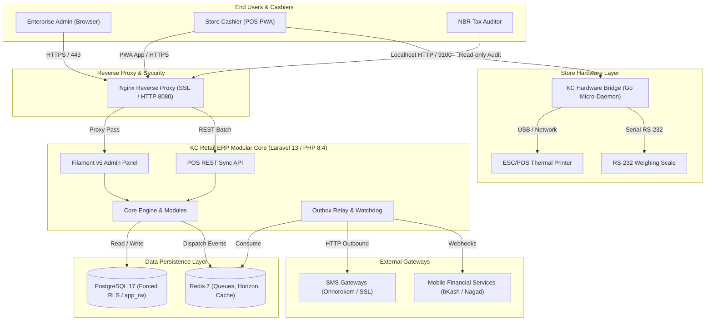
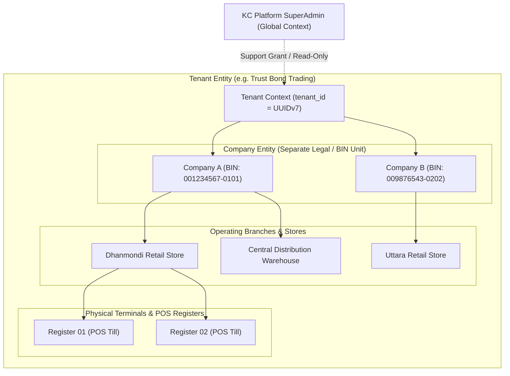
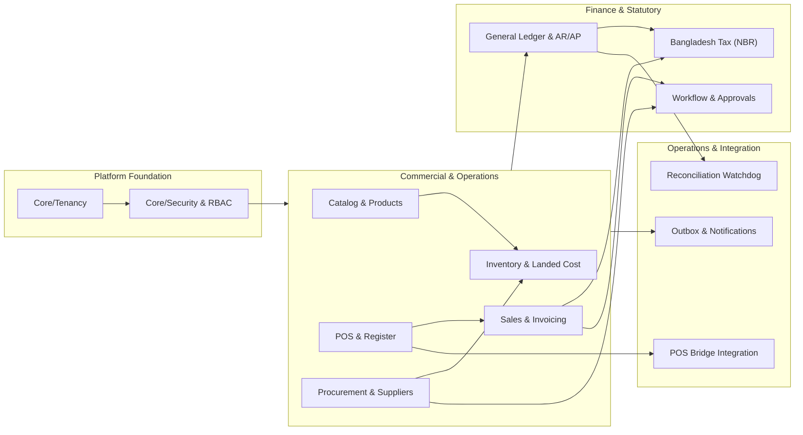
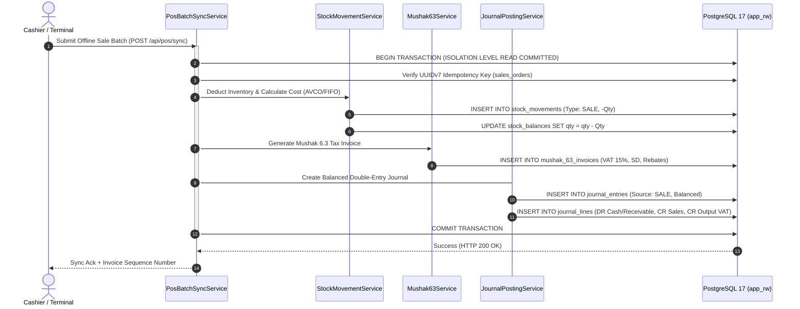
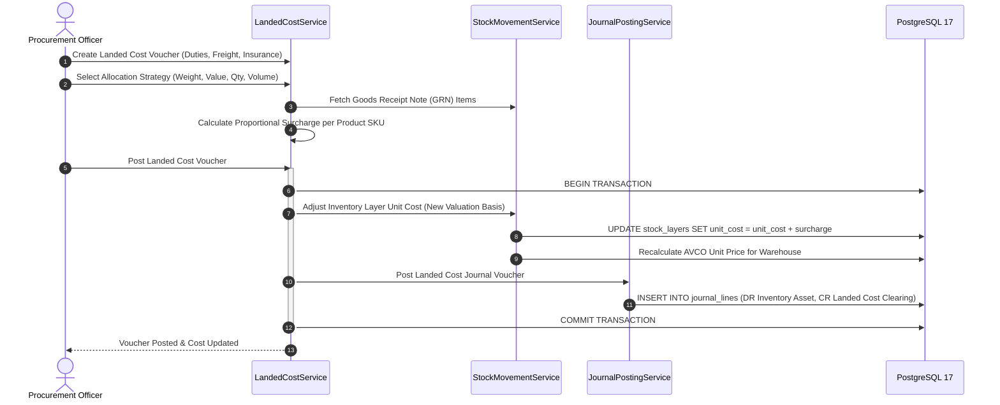
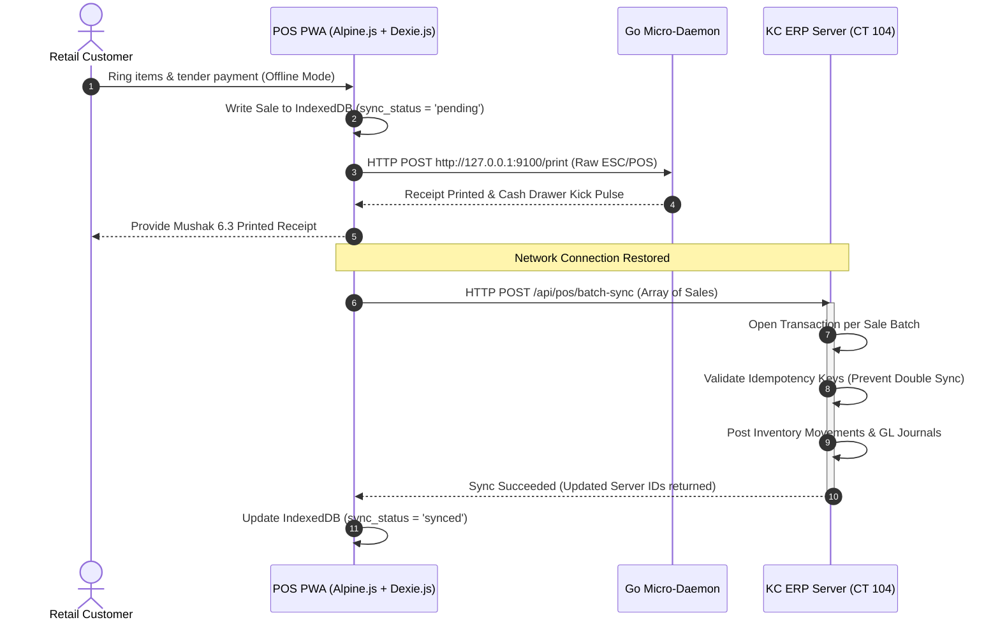
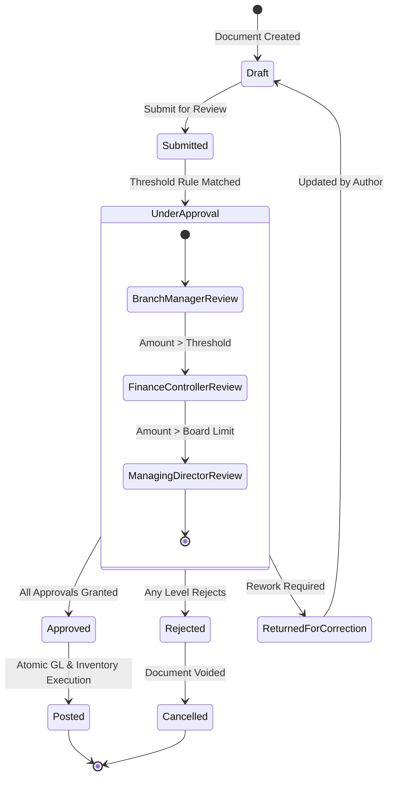
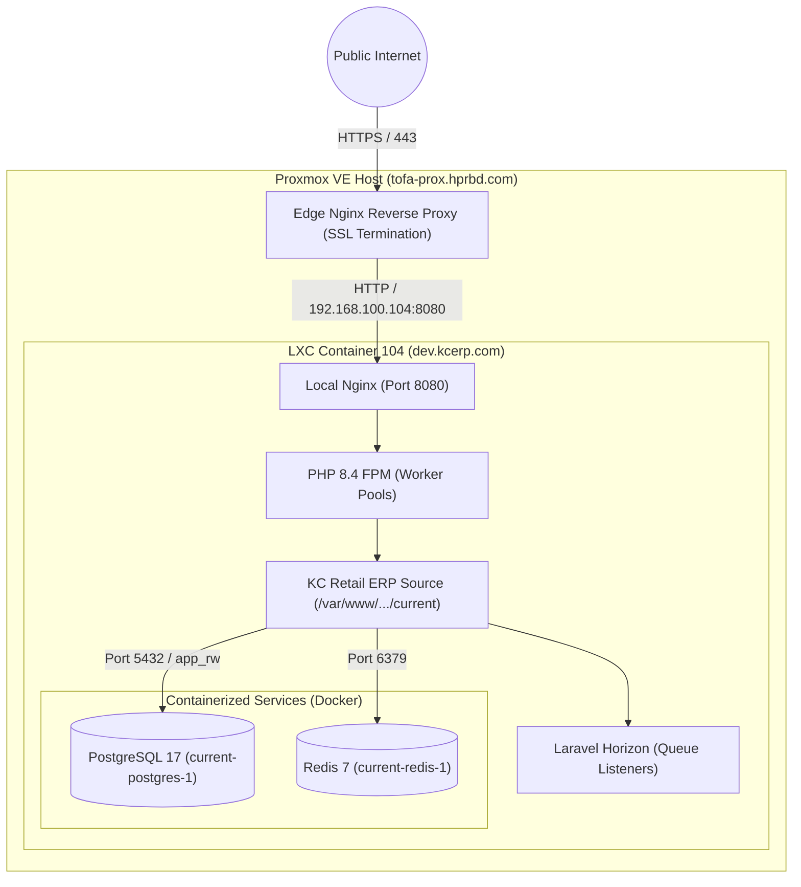
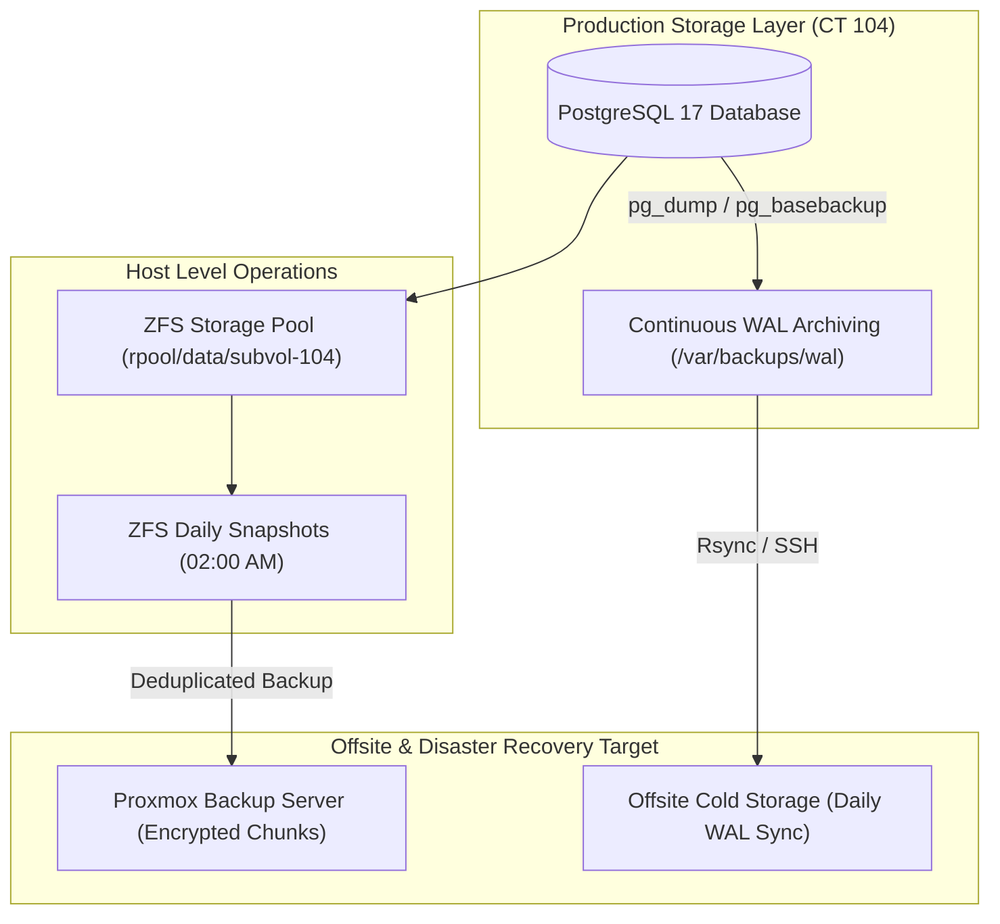

# Unified ERP v2.0: Master Architecture Specification
**KC Retail ERP | Production Architecture & System Design**  
**Controlling Work Order:** `docs/master-work-order/KC_Retail_ERP_Unified_v2.0_Specification_Work_Order.md`  
**Repository Baseline:** Branch `step-13a-watchdog-audit` (Commit: `17d0264`)  
**Auditor & Lead Architect:** Principal Software Architect & ERP Solution Lead  
**Publication Date:** November 2026  
**Document Authority:** Authoritative System Specification (v2.0)  

---

## 1. Executive Summary & Product Vision

### 1.1 Executive Summary
KC Retail ERP Unified v2.0 is an enterprise-grade, multi-tenant retail management platform and General Ledger designed specifically for distributed multi-branch retail enterprises operating in Bangladesh. The architecture enforces strict cryptographic and transactional integrity: **fail-closed PostgreSQL Row-Level Security (RLS)** guarantees tenant data isolation, **synchronous double-entry bookkeeping** eliminates financial drifts between business operations and the General Ledger, **real-time AVCO/FIFO inventory costing** prevents valuation distortions, and an **offline-first Progressive Web App (PWA) POS** coupled with a local **Go hardware bridge** guarantees cashier resilience during broadband disruptions. Statutory compliance with Bangladesh National Board of Revenue (NBR) VAT Act 2012 is natively embedded across all commercial cycles (Mushak 6.3, 6.6, 6.8, and 9.1).

### 1.2 Target Customers & Operating Environment
* **Primary Segment:** High-throughput multi-outlet supermarket chains, departmental stores, retail fashion outlets, and wholesale-to-retail distributors.
* **Operating Topologies:** Multi-company conglomerates managing discrete VAT Registration Numbers (BINs), central distribution warehouses, and geographically dispersed retail branches.
* **Network Realities:** Designed for erratic broadband infrastructure in Bangladesh; cashier registers continue billing offline and sync automatically upon reconnection via isolated transactional savepoints.

### 1.3 Scope Boundaries & Exclusions
* **In Scope (Unified Core v2.0):** Multi-Tenancy (Forced RLS), RBAC & Location Scoping, Product & Multi-Barcode Catalog, AVCO/FIFO Inventory, Offline POS PWA, Go Hardware Bridge, Landed Cost Import Accounting, Double-Entry General Ledger, AR/AP Subledgers, NBR Mushak Compliance, Transactional Outbox Event Bus, and Autonomous Reconciliation Watchdog.
* **Exclusions (Phase 2 Roadmap Slated):** Human Resource Management & Payroll (HRM), Bi-directional E-Commerce Inventory Sync (WooCommerce/Shopify), Customer Loyalty Point Ledgers, and Physical NBR SDC Hardware Certification. These domains are architecturally mapped and scheduled for Release Wave 2/3 so that core retail pilot go-live remains unblocked.

---

## 2. Architecture Principles & Design Tenets

1. **Modular Monolith over Distributed Microservices:** Core domains (`Core`, `Accounting`, `Inventory`, `Sales`, `Procurement`, `Tax`, `Pos`, `Workflow`) reside in a single deployable unit under strict contract-based boundaries (`app/Modules/{Name}/Contracts`). Microservices are rejected to prevent distributed transaction failures, network latency, and operational sprawl.
2. **Database-Level Fail-Closed Multi-Tenancy:** Isolation is enforced at the database layer via PostgreSQL Row-Level Security (`app_rw` connection). No tenant query can leak data across tenant boundaries, even in the event of an application-layer bug or raw SQL query.
3. **Strict Financial Immutability:** Posted journals, issued or cancelled sales invoices, and confirmed stock movements are physically immutable. Database triggers reject `UPDATE` and `DELETE` operations. Corrections must occur via reversal journals, credit notes, or adjustment vouchers.
4. **Single-Transaction GL Posting:** Every commercial document (sale, purchase receipt, landed cost allocation, inventory write-off) generates its corresponding balanced General Ledger journal within the *exact same database transaction*. Asynchronous or queued GL posting is strictly forbidden.
5. **Exact Numeric Arithmetic:** Floating-point numbers are prohibited in financial code. All monetary values and quantities use arbitrary-precision arithmetic (`brick/math` and PostgreSQL `numeric(15, 2)` / `numeric(15, 4)` columns).

---

## 3. Technology Baseline & Environment Evidence

All framework and package versions are verified directly against committed lockfiles in the repository:

* **Backend Framework:** Laravel `v13.39.0` running on PHP `8.4.27`.
* **Administrative UI:** Filament `v5.11.0` built on Livewire `v4.4.8`.
* **Database Engine:** PostgreSQL `17.4` (Forced RLS enabled on all 68 tenant tables).
* **Caching & Queue Driver:** Redis `7.2` managed via Laravel Horizon.
* **POS Client Engine:** Alpine.js `^3.17.5` and Dexie.js `^4.4.7` (IndexedDB PWA) styled with Tailwind CSS `^4.0.0`.
* **Hardware Bridge Micro-Daemon:** Go `1.22` (Standalone local HTTP daemon for ESC/POS printing and RS-232 serial scales).
* **Code Quality & Testing:** Pest `v4.7.8`, Larastan `v3.13.2` (PHPStan Level 8 clean), Pint formatter.

---

## 4. System Context & Architecture Diagrams

### 4.1 System Context Diagram
The diagram below illustrates the external actors, edge proxy, runtime components, and external gateways of KC Retail ERP v2.0:



### 4.2 Multi-Tenant & Location Hierarchy
The structural tenancy and operational hierarchy enforce company consistency and branch scoping:



---

## 5. Domain Boundaries & Modular Architecture

The monolithic codebase is partitioned into decoupled domain modules located under `app/Modules/`. Communication across domain boundaries is restricted strictly to contract interfaces under `app/Modules/{Name}/Contracts`:



---

## 6. End-to-End Business Workflows

### 6.1 Core Transaction & Accounting Flow
Every posted sales invoice atomically updates customer subledgers, inventory layers, tax registers, and the General Ledger:



### 6.2 Import to Landed Cost & Valuation Flow
Imported goods absorb customs tariffs, freight, and port clearance expenses into their final landed inventory cost:



### 6.3 Offline POS Synchronization Flow
POS registers operate autonomously during internet outages and reconcile reliably via transactional batching:



### 6.4 Approval Workflow State Machine
High-value purchase orders, customer credit limit overrides, and physical inventory write-offs follow strict multi-step governance:



---

## 7. Data Architecture & Integrity Standards

### 7.1 Multi-Tenant Data Isolation (PostgreSQL Forced RLS)
Every tenant table is defined via `TenantMigration::createTenantTable()` with the following mandatory schema constraints:
* Primary Column: `id UUID NOT NULL` (UUIDv7 for natural time-series clustering).
* Tenant Column: `tenant_id UUID NOT NULL REFERENCES tenants(id) ON DELETE RESTRICT`.
* Primary / Unique Index: `PRIMARY KEY (tenant_id, id)` or `UNIQUE (tenant_id, id)`.
* Foreign Keys: All foreign keys between tenant tables must include `tenant_id` (composite FKs).
* RLS Policies: `FORCE ROW LEVEL SECURITY` enabled. Policy:
  ```sql
  CREATE POLICY tenant_isolation_policy ON {table}
      AS RESTRICTIVE
      USING (tenant_id = NULLIF(current_setting('app.current_tenant_id', true), '')::uuid)
      WITH CHECK (tenant_id = NULLIF(current_setting('app.current_tenant_id', true), '')::uuid);
  ```

### 7.2 Financial & Inventory Immutability
To comply with standard auditing rules and NBR VAT guidelines, the database enforces physical immutability:
* **Trigger Enforcement:** The trigger function `prevent_financial_mutation()` is attached to `journal_entries`, `journal_lines`, `mushak_63_invoices`, and `stock_movements`.
* **Disallowed Operations:** Any `UPDATE` or `DELETE` statement issued against confirmed records is blocked with a PostgreSQL exception: `ERROR: [SEC-IMMUTABLE] Posted financial and stock records cannot be updated or deleted.`
* **Reversal Pattern:** Adjustments must be performed by posting an opposite-signed offsetting document.

---

## 8. Deployment Topology & Disaster Recovery

### 8.1 Deployment Topology
The current deployment runs in an isolated Proxmox LXC container (CT 104) behind an external reverse proxy:



### 8.2 Backup & Disaster Recovery Architecture



---

## 9. Non-Functional Requirements & Performance Standards

* **Tenant Isolation:** Zero data leakage across tenant boundaries under all query vectors, verified by automated security suites.
* **POS Offline Availability:** 100% cashier checkout functionality maintained indefinitely during complete network isolation.
* **Accounting Consistency:** Maximum allowable balance sheet drift between General Ledger control accounts and Subledger registers: `0.00 BDT`.
* **API Idempotency:** All mutating POS batch endpoints mandate UUIDv7 client-generated request tokens to prevent double-charging on network retries.
* **Target Throughput:** Sub-100ms response time on POS sync transactions; sub-200ms response time on Filament list views under 100,000 active SKU records per tenant.

---

## 10. Open Decisions & Architecture Governance

1. **Procurement Document UI Alignment:** Assign highest priority in Sprint 1 to creating Filament Resources for `PurchaseOrder`, `GoodsReceipt`, and `Quotation` to bring them into full parity with `SalesInvoice`.
2. **Phase 2 Expansion Boundary:** Quarantine HRM, E-Commerce, and Loyalty into modular packages under `app/Modules/` so they remain isolated and do not delay the Phase 1 retail pilot.
3. **Database High Availability:** Prepare a formal decision record (`ADR-019`) for moving PostgreSQL out of the shared container into an active-passive streaming replication pair prior to commercial multi-tenant onboarding.
