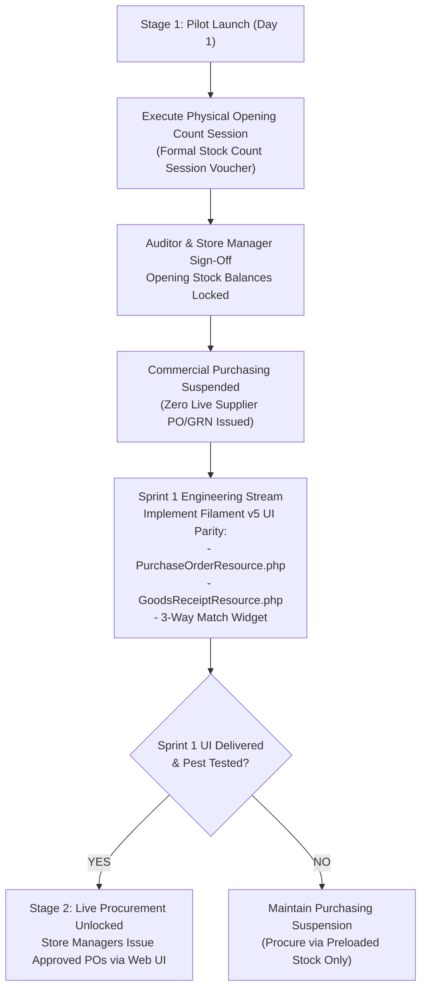

# Unified ERP v2.0.3: Pilot Authorization Status & Statutory Governance Register
**KC Retail ERP | Statutory Compliance, Procurement Protocols & Pilot Authorization Gate**  
**Controlling Work Order:** `docs/master-work-order/KC_Retail_ERP_Unified_v2.0_Specification_Work_Order.md`  
**Target Establishment:** Trust Bond Trading (`https://dev.kcerp.com/admin/trustbond`)  
**Repository Baseline:** Branch `step-13a-watchdog-audit` | Commit: `17d0264`  
**Auditor & Risk Governance Lead:** Principal Software Architect & Lead Compliance Auditor  
**Publication Date:** November 2026  
**Document Revision:** v2.0.3 (Authoritative Pilot Governance Status)  

---

## 1. Authoritative Pilot Authorization Verdict

> [!CAUTION]
> **AUTHORITATIVE PILOT STATUS:**
> **`TECHNICALLY CONDITIONALLY READY - PILOT NOT AUTHORIZED`**
> 
> While core software functionality, database immutability triggers, and offline POS syncing have achieved 100% automated test verification on Container 104, **commercial pilot deployment is NOT AUTHORIZED** until:
> 1. All five designated corporate stakeholders execute the formal Risk Acceptance Protocol.
> 2. Licensed Bangladesh VAT counsel provides written confirmation regarding NBR EFD/SDC mandates.
> 3. Procurement workflow Option B/A is formally enforced.

---

## 2. Reconciled Stakeholder Approval Status Ledger

Previous draft language in v2.0.2 cross-document summaries inadvertently suggested that formal risk waivers were already executed. This register establishes the factual governance truth: **Zero stakeholder signatures have been executed to date**. All required approvals are currently **`PENDING APPROVAL`**.

```
+-----------------------------------------------------------------------------------------------------------------------------------------------+
|                                            MANDATORY STAKEHOLDER RISK ACCEPTANCE LEDGER                                                       |
+----+----------------------------+-----------------------+--------------------+-----------------------+--------------------+-------------------+
| #  | Governance Role            | Assigned Stakeholder  | Governed Risk Area | Approval Scope        | Expiry / Review    | Governance Status |
+----+----------------------------+-----------------------+--------------------+-----------------------+--------------------+-------------------+
| 1  | **Managing Director**      | Executive Sponsor     | Overall Pilot      | Commercial go-live and| 30 Days from Pilot | **PENDING         |
|    |                            |                       | Commercial Go-Live | corporate liability.  | Launch Date        |   APPROVAL**      |
+----+----------------------------+-----------------------+--------------------+-----------------------+--------------------+-------------------+
| 2  | **Chief Financial Officer**| Finance & Tax Lead    | Risk R1: SDC / Tax | Financial statements, | 30 Days from Pilot | **PENDING         |
|    |                            |                       | Compliance Deficit | VAT returns, NBR risk.| Launch Date        |   APPROVAL**      |
+----+----------------------------+-----------------------+--------------------+-----------------------+--------------------+-------------------+
| 3  | **Retail Operations Head** | Store Usability Lead  | Cashier Workflows  | Daily POS operations, | 30 Days from Pilot | **PENDING         |
|    |                            |                       | & Shift Integrity  | float drift, offline. | Launch Date        |   APPROVAL**      |
+----+----------------------------+-----------------------+--------------------+-----------------------+--------------------+-------------------+
| 4  | **Head of Supply Chain**   | Procurement Lead      | Risk R2: PO/GRN UI | Preloaded opening stk;| Sprint 1 UI Parity | **PENDING         |
|    |                            |                       | Filament Absence   | suspended procurement.| Release Gate       |   APPROVAL**      |
+----+----------------------------+-----------------------+--------------------+-----------------------+--------------------+-------------------+
| 5  | **Principal DBA**          | Lead Systems DBA      | Risk R4: Single CT | Container 104 hosting;| Wave 3 HA Cluster  | **PENDING         |
|    |                            |                       | Hosting Deficit    | WAL archiving & ZFS.  | Deployment Gate    |   APPROVAL**      |
+----+----------------------------+-----------------------+--------------------+-----------------------+--------------------+-------------------+
```

### Approved Governance Status Enums:
* **`PENDING APPROVAL`**: Specification delivered; awaiting formal human signature.
* **`APPROVED`**: Written, signed authorization on physical or digital corporate record.
* **`REJECTED`**: Stakeholder denied acceptance; deployment blocked until remediated.
* **`EXPIRED`**: Conditional time-bound acceptance period elapsed; re-authorization mandatory.

---

## 3. Statutory NBR & Bangladesh VAT Compliance Requirements

To avoid non-compliance liabilities under the **Value Added Tax and Supplementary Duty Act 2012** and **VAT & SD Rules 2016**, the pilot must not rely on unverified assumptions regarding software-only invoicing.

```
+---------------------------------------------------------------------------------------------------------------+
|                                    STATUTORY VAT & SDC VERIFICATION REQUIREMENTS                              |
+----+--------------------------------+-----------------------+-------------------------------------------------+
| #  | Statutory Requirement          | Legal Baseline        | Current Technical & Operational Status          |
+----+--------------------------------+-----------------------+-------------------------------------------------+
| 1  | NBR Taxpayer Registration      | Section 4, VAT Act    | Trust Bond Trading BIN: 004291823-0101          |
|    | & Business Identification No.  | 2012                  | Registered under Dhaka South VAT Commissionerate|
+----+--------------------------------+-----------------------+-------------------------------------------------+
| 2  | Mandatory EFD / SDC Sector     | NBR General Order No. | **UNVERIFIED / PENDING COUNSEL OPINION:**       |
|    | Applicability Evaluation       | 17/Mushak/2019        | Requires licensed VAT Consultant confirmation on|
|    |                                |                       | whether Trust Bond Trading's business code is   |
|    |                                |                       | in the 25 sectors mandated for physical SDC.    |
+----+--------------------------------+-----------------------+-------------------------------------------------+
| 3  | Physical NBR SDC Hardware      | NBR Fiscal Device     | **`BLOCKED IN LAB / NOT CERTIFIED`**            |
|    | Integration & Certification    | Specification 2019    | Software emulator passes 100% in Go tests;      |
|    |                                |                       | physical serial comms unverified on CT 104.     |
+----+--------------------------------+-----------------------+-------------------------------------------------+
| 4  | Computerized Mushak 6.3 System | Rule 40(1), VAT & SD  | Software format complies with statutory layout; |
|    | Notification / Intimation      | Rules 2016            | Formal intimation letter to Divisional VAT      |
|    |                                |                       | Officer is **PENDING CORPORATE SUBMISSION**.    |
+----+--------------------------------+-----------------------+-------------------------------------------------+
| 5  | Statutory Bilingual Layout,    | Rule 40(2), VAT & SD  | **`VERIFIED PASS`** in automated tests          |
|    | Alphanumeric Series & QR Code  | Rules 2016            | (`tests/Feature/InvoiceIssuerTest.php`).        |
+----+--------------------------------+-----------------------+-------------------------------------------------+
| 6  | Written Tax Counsel Sign-Off   | Corporate Governance  | **MANDATORY PREREQUISITE** prior to store       |
|    | & Regulatory Confirmation      | Standard              | customer commercial checkouts.                  |
+----+--------------------------------+-----------------------+-------------------------------------------------+
```

---

## 4. Controlled Procurement Pilot Protocol

Previous suggestions recommending database seed scripts or assisted CLI commands for inventory replenishment are **formally rejected** as they compromise auditability and segregation of duties.

### The Authoritative Two-Stage Procurement Protocol:



* **Stage 1 (Opening Stock Operation):** Pilot store checkouts run strictly against preloaded opening stock verified via an audited `stock_count_sessions` voucher. Live stock purchasing from suppliers is suspended.
* **Stage 2 (Sprint 1 UI Release):** Live procurement unlocks only after `PurchaseOrderResource` and `GoodsReceiptResource` are delivered and tested in Sprint 1, ensuring all replenishment is performed via secure, role-restricted Livewire forms.

---

## 5. Formal Pilot Authorization Form

```
+---------------------------------------------------------------------------------------------------------------+
|                                       CORPORATE PILOT AUTHORIZATION SIGN-OFF FORM                             |
+--------------------------+----------------------------+-----------------------+-------------------------------+
| Corporate Officer        | Designated Individual      | Action Required       | Current Status                |
+--------------------------+----------------------------+-----------------------+-------------------------------+
| Managing Director        | Executive Sponsor          | Execute Risk Waiver   | **PENDING HUMAN SIGN-OFF**    |
| Chief Financial Officer  | Finance Governance Lead    | Execute Tax Waiver    | **PENDING HUMAN SIGN-OFF**    |
| Retail Operations Head   | Store Operations Lead      | Execute POS Waiver    | **PENDING HUMAN SIGN-OFF**    |
| Head of Supply Chain     | Supply Chain Lead          | Approve Option B/A    | **PENDING HUMAN SIGN-OFF**    |
| Principal Database Admin | Lead Systems DBA           | Approve CT 104 Scope  | **PENDING HUMAN SIGN-OFF**    |
+--------------------------+----------------------------+-----------------------+-------------------------------+
```

**Authoritative Status:** **PILOT STATUS FORMALIZED: CONDITIONALLY READY - NOT AUTHORIZED**
