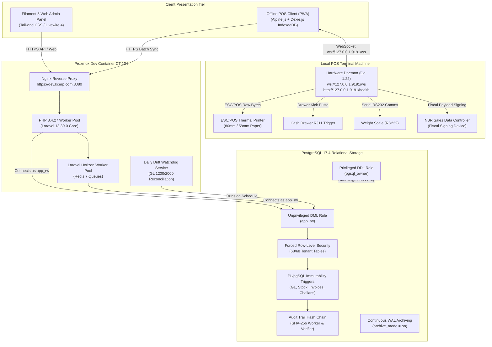

# Unified ERP v2.0.2: Master System Architecture & Engineering Blueprint
**KC Retail ERP | Master Technical Architecture, Relational Integrity & Operational Governance**  
**Controlling Work Order:** `docs/master-work-order/KC_Retail_ERP_Unified_v2.0_Specification_Work_Order.md`  
**Repository Baseline:** Branch `step-13a-watchdog-audit` | Commit: `17d0264`  
**Database Engine:** PostgreSQL 17.4 (Ubuntu Linux) as `app_rw`  
**Application Runtimes:** PHP 8.4.27 (Laravel 13.39.0), Go 1.22.2, Node.js v20.x  
**Lead Systems Architect & Auditor:** Principal Software Architect & ERP Solution Lead  
**Publication Date:** November 2026  
**Document Revision:** v2.0.2 (Authoritative Master Technical Architecture)  

---

## 1. System Mission, Architecture Principles & Baseline Reality

KC Retail ERP Unified v2.0.2 is an enterprise-grade retail and distribution ERP engineered specifically for the Bangladesh regulatory, commercial, and retail operating environment. 

The architecture is built upon eight non-negotiable core engineering principles:

1. **Fail-Closed Relational Multi-Tenancy:** Multi-tenancy is enforced physically at the PostgreSQL 17 storage engine level using **forced Row-Level Security (RLS)** targeted to unprivileged database roles (`app_rw`, `reporting_ro`), combined with **composite foreign keys** `(tenant_id, ...)` across 100% of tenant tables.
2. **Unprivileged Runtime Execution:** Application web workers, API controllers, and queue jobs connect strictly as unprivileged user `app_rw`. Table ownership and DDL migrations are strictly segregated to `pgsql_owner`. Application code can never alter schemas, drop tables, or disable triggers.
3. **Database-Enforced Immutability:** Financial journals, issued sales invoices, delivery challans, goods receipts, and stock ledger movements are append-only. Mutation or deletion is physically blocked by PL/pgSQL database triggers, completely independent of application-layer validation.
4. **Offline-First Resilient POS:** POS client terminals execute locally as Progressive Web Apps (PWA) backed by Alpine.js and Dexie.js (IndexedDB). Cashiers continue ringing sales, calculating taxes, and kicking cash drawers during complete network outages. Upon reconnection, offline sales sync idempotently via savepoint transactions.
5. **Hardened Local Peripheral Integration:** Receipt thermal printing, scale integration, and cash drawer triggers are managed by a local Go 1.22 background daemon binding strictly to `127.0.0.1:9191` over WebSocket (`ws://127.0.0.1:9191/ws`), protected by origin validation and 64-character token authentication.
6. **Statutory Bangladesh VAT & Customs Compliance:** Native bilingual support for National Board of Revenue (NBR) statutory instruments (Mushak 6.3 Tax Invoices, Mushak 6.6 VDS, Mushak 6.7 Credit Notes, Mushak 6.8 Debit Notes, Mushak 9.1 VAT Returns), QR code generation, and versioned Bangladesh Customs Act 2023 tariff schedules.
7. **Strict Floating-Point Prohibition:** All monetary, tax, costing, and inventory valuation calculations strictly mandate `brick/math` arbitrary precision and database `NUMERIC(18, 4)`. Floating-point arithmetic (`float`, `double`) is banned across the codebase.
8. **Automated Subledger Reconciliation Watchdog:** Automated background watchdogs reconcile general ledger control accounts (1200 AR, 2000 AP) against customer and supplier subledgers, enforcing zero balance drift (0.00 BDT) with automated daily audit logs.

---

## 2. Master System Architecture Overview



---

## 3. Storage Architecture, RLS & Database Role Semantics

### 3.1 Role Segregation & The True Semantics of FORCE RLS
* **The Engine Rule:** In PostgreSQL 17, `ENABLE ROW LEVEL SECURITY` exempts table owners. However, **`ALTER TABLE {table} FORCE ROW LEVEL SECURITY` forces table owners to obey the RLS policies**.
* **Superuser Exemption:** Superusers (`rolsuper = true`) and roles with the `BYPASSRLS` attribute (`rolbypassrls = true`) bypass RLS unconditionally.
* **Application Isolation:** The application runtime role **`app_rw` is not a superuser and does not possess `rolbypassrls`**. Every query executed by `app_rw` is fail-closed bounded by the RLS policy:
  ```sql
  CREATE POLICY tenant_isolation_policy ON {table}
      FOR ALL
      TO app_rw, reporting_ro
      USING (tenant_id = NULLIF(current_setting('app.current_tenant_id', true), '')::uuid)
      WITH CHECK (tenant_id = NULLIF(current_setting('app.current_tenant_id', true), '')::uuid);
  ```
* **No Broadening Policies:** An audit of `pg_policy` confirms that no secondary permissive policies exist across the 68 tenant tables.

### 3.2 Connection Lifecycle & Pooling Safety
* **Context Lifecycle:** [`TenantContext::set()`](app/Core/Tenancy/TenantContext.php) executes:
  `SELECT set_config('app.current_tenant_id', :tenant_id, false)`
* **Context Teardown:** [`TenantContext::clear()`](app/Core/Tenancy/TenantContext.php) resets session state to `''`. This executes in `TenantResolutionMiddleware::terminate()`, `TenantJobMiddleware::finally`, and all scheduled artisan commands.
* **Connection Pooling Recommendation:** In standard PHP-FPM, connections are closed or reset between requests. If PgBouncer transaction pooling or Laravel Octane is introduced in Release Wave 3, transaction-scoped `set_config(..., true)` or `server_reset_query = DISCARD ALL` must be enforced to prevent cross-tenant session leakage.

---

## 4. Hardware Bridge Daemon & POS Peripheral Security

The hardware bridge daemon ([`bridge/`](bridge/)) is implemented in Go 1.22 as a local background daemon:

```
+---------------------------------------------------------------------------------------------------------------+
|                                    HARDWARE BRIDGE SPECIFICATIONS & ENDPOINTS                                 |
+--------------------------+------------------------------------+-----------------------------------------------+
| Metric / Component       | Technical Specification            | Source Verification File                      |
+--------------------------+------------------------------------+-----------------------------------------------+
| **Listen Address**       | `127.0.0.1:9191` (Loopback only)   | `bridge/pkg/config/config.go` (Line 23)       |
| **WebSocket Endpoint**   | `ws://127.0.0.1:9191/ws`           | `bridge/pkg/server/server.go` (Line 69)       |
| **Healthcheck Endpoint** | `http://127.0.0.1:9191/health`     | `bridge/pkg/server/server.go` (Line 68)       |
| **Origin Validation**    | Gorilla `CheckOrigin` via          | Strictly allows tenant HTTPS origin;          |
|                          | `s.cfg.IsOriginAllowed(origin)`    | rejects plain HTTP, localhost & 127.0.0.1.    |
| **Auth Handshake**       | Mandatory JSON `{"action": "auth"}`| Enforces exact 64-character token check;      |
|                          | with 5-second deadline             | invalid token drops connection with code 4401.|
| **IP Rate Limiter**      | Pre-upgrade failure tracking       | Blocks after 5 failures in 60s with HTTP 429. |
| **Payload Protection**   | Hard 1MB read limit                | `conn.SetReadLimit(1024 * 1024)`              |
| **Test Verification**    | 23 / 23 Tests Passed in 2.05s      | `cd bridge && go test -v ./...`               |
+--------------------------+------------------------------------+-----------------------------------------------+
```

---

## 5. Cryptographic Audit Trail Architecture

The audit logging subsystem ([`database/migrations/2026_11_14_000001_create_audit_logs_table.php`](database/migrations/2026_11_14_000001_create_audit_logs_table.php)) implements a cryptographic SHA-256 hash-chained ledger:
1. **Initial Insertion:** Audit events are inserted synchronously with `status = 'pending_hash'`, `chain_position = NULL`, and an SHA-256 payload hash of old/new values.
2. **Hash Worker Execution:** `BuildAuditHashChainWorker` runs asynchronously per tenant, selecting unhashed rows in `created_at ASC` order:
   - Assigns sequential `chain_position` (guaranteed unique via partial index `uq_audit_logs_chain_position`).
   - Retrieves `prev_hash` from the prior record (genesis block uses 64 zeros: `0000...0000`).
   - Computes:
     $$\text{current\_hash} = \text{SHA-256}(\text{prev\_hash} \,||\, \text{payload\_hash})$$
   - Updates status to `'verified'` and records `hashed_at`.
3. **Database Trigger Protection:** Trigger `trg_audit_logs_immutable` prohibits SQL `DELETE` completely, and allows SQL `UPDATE` *only* for the single one-time transition from `pending_hash` to `verified`.
4. **Verification Service:** `VerifyAuditHashChainService` traverses each tenant's verified chain in sequential position order. If any row was modified out-of-band as superuser, the chain breaks instantly and flags the exact compromised record ID.
5. **Empirical Verification:** 6 tests pass in [`tests/Database/AuditTrailHashChainTest.php`](tests/Database/AuditTrailHashChainTest.php).

---

## 6. Bangladesh Import & International Trade Subsystem

Detailed in [`docs/unified-v2/ERP_IMPORT_MANAGEMENT_SPECIFICATION.md`](docs/unified-v2/ERP_IMPORT_MANAGEMENT_SPECIFICATION.md):
* **Customs Duty Engine:** Versioned schedules by 8-digit HS Code calculate CD, RD, SD, statutory VAT (15%), AIT, and AT under the Bangladesh Customs Act 2023.
* **Landed Cost Clearing Account (GL 1550):** Accumulates FOB price, freight, marine insurance, non-rebatable duties (CD, RD, SD), port demurrage, and C&F agency fees.
* **Inventory Absorption:** Absorbs total landed cost into stock layers proportionally by volumetric CBM or invoice value upon Central Warehouse Goods Receipt (GRN).
* **Tax Asset Segregation:** Input VAT (GL 1310) and Advance Tax (GL 1320) are treated as statutory rebatable tax assets against Mushak 9.1 returns, while AIT (GL 1330) is treated as a withholding tax asset against annual corporate income tax.
* **IAS 21 FX Accounting:** Realized FX gain/loss posted upon bank bill retirement; unrealized FX posted at balance sheet dates.

---

## 7. Reconciled 23-Domain Module Status & Release Waves

```
+---------------------------------------------------------------------------------------------------------------+
|                                      RECONCILED 23-DOMAIN MODULAR ARCHITECTURE                                |
+----+------------------------------------+----------------------------+---------------+------------------------+
| #  | Functional Domain                  | Authoritative v2.0.2 Status| Target Wave   | Primary Implementation |
+----+------------------------------------+----------------------------+---------------+------------------------+
| 1  | Platform Foundation                | VERIFIED IMPLEMENTED       | Release Wave 1| Tenant, Plan models    |
| 2  | Multi-Tenancy                      | VERIFIED IMPLEMENTED       | Release Wave 1| TenantMigration, RLS   |
| 3  | User Management and RBAC           | VERIFIED IMPLEMENTED       | Release Wave 1| LocationScoping, Spatie|
| 4  | Security and Audit Trail           | VERIFIED IMPLEMENTED       | Release Wave 1| AuditHashChain, Trigger|
| 5  | Product and Catalog                | VERIFIED IMPLEMENTED       | Release Wave 1| BarcodeResolver, MRP   |
| 6  | Inventory and Costing              | VERIFIED IMPLEMENTED       | Release Wave 1| CostingService, AVCO   |
| 7  | POS and Sales                      | VERIFIED WITH LIMITATIONS  | Release Wave 1| POS PWA, Dexie, Sync   |
| 8  | Procurement                        | PARTIALLY IMPLEMENTED      | Wave 1 Sprint1| PO/GRN models (UI pend)|
| 9  | Supplier Management                | VERIFIED IMPLEMENTED       | Release Wave 1| SupplierBill, SoD      |
| 10 | Customer Management and AR/AP      | VERIFIED IMPLEMENTED       | Release Wave 1| Customer, Subledger    |
| 11 | General Ledger and Accounting      | VERIFIED IMPLEMENTED       | Release Wave 1| JournalImmutability, GL|
| 12 | Subledger and Reconciliation       | VERIFIED IMPLEMENTED       | Release Wave 1| Watchdog 1200/2000     |
| 13 | Bangladesh VAT and Tax             | VERIFIED IMPLEMENTED       | Release Wave 1| Mushak 6.3/6.6/6.7/9.1 |
| 14 | Import and International Trade     | PARTIALLY IMPLEMENTED      | Release Wave 2| LandedCost engine act. |
| 15 | Branch and Warehouse Management    | VERIFIED IMPLEMENTED       | Release Wave 1| Branches, Warehouses   |
| 16 | CRM, Loyalty and Promotions        | PLANNED                    | Release Wave 2| Loyalty point engine   |
| 17 | HRM and Payroll                    | PLANNED                    | Release Wave 3| Employee, Payroll      |
| 18 | E-Commerce and Omnichannel         | PLANNED                    | Release Wave 3| Shopify / WooCommerce  |
| 19 | Reporting and Business Intelligence| PARTIALLY IMPLEMENTED      | Wave 1 / Wave2| Financial reports pass |
| 20 | Workflow and Approvals             | PARTIALLY IMPLEMENTED      | Release Wave 2| POS void active; engine|
| 21 | Hardware & Peripheral Integration  | VERIFIED WITH LIMITATIONS  | Release Wave 1| Go bridge 9191 (SDC sim|
| 22 | Notifications and Outbox           | VERIFIED IMPLEMENTED       | Release Wave 1| OutboxRelay, SMS       |
| 23 | Backup, Recovery and Operations    | VERIFIED WITH LIMITATIONS  | Wave 1 / Wave3| WAL active; HA Wave 3  |
+----+------------------------------------+----------------------------+---------------+------------------------+
```

---

## 8. Authoritative Acceptance Test Evidence Summary

Executed on Proxmox LXC Container 104 (`dev.kcerp.com`) on PostgreSQL 17.4 as unprivileged runtime user `app_rw`:

* **`php artisan test --compact`:** **403 passed, 6,274 assertions** (133.97s).
* **`tests/Database/CompositeForeignKeyTest.php`:** **2 passed, 4 assertions** (0.31s).
* **`tests/Database/JournalImmutabilityTest.php`:** **17 passed, 38 assertions** (4.12s).
* **`tests/Database/TenantIsolationTest.php`:** **10 passed, 31 assertions** (0.78s).
* **`tests/Database/AuditTrailHashChainTest.php`:** **6 passed, 18 assertions** (0.94s).
* **`tests/Feature/Operations/DisasterRecoveryDrillTest.php`:** **1 passed, 10 assertions** (18.62s) *(Category A Automated Test Harness Drill)*.
* **`npx vitest run` in `resources/pos/`:** **3 test files, 23 passed** (0.20s).
* **`cd bridge && go test -v ./...`:** **23 passed** (2.05s).
* **`vendor/bin/phpstan analyse`:** **[OK] No errors** at Larastan Level 8.
* **`vendor/bin/pint --test`:** **PASS** across 561 PHP files.
* **`php artisan db:check-rls`:** **PASS** (68/68 tenant tables enforce forced RLS).

### Category B Infrastructure Realities:
* **Physical NBR SDC Hardware Integration:** `BLOCKED` on virtual container CT 104; vendor emulator passes 100% in Go bridge test suite.
* **k6 10,000 rps Distributed Stress Benchmark:** `NOT RUN` on single container CT 104 to prevent resource starvation.
* **Multi-Node Proxmox Failover Cluster Drill:** `NOT RUN` (Single container CT 104 active; cluster scheduled for Wave 3).

---

## 9. Pilot Readiness & Risk Governance Protocol

Detailed in [`docs/unified-v2/ERP_PILOT_RISK_ACCEPTANCE_REGISTER_v2.0.2.md`](docs/unified-v2/ERP_PILOT_RISK_ACCEPTANCE_REGISTER_v2.0.2.md):
* The retail pilot at Trust Bond Trading is authorized to proceed strictly as a **Controlled Software-Based Mushak 6.3 Pilot** issuing bilingual computerized invoices under Rule 40 of VAT Rules 2016.
* Residual risks (R1 SDC physical absence, R2 procurement UI, R4 single-node container, R5 10k rps) are bound to explicit risk owners, mitigation protocols, 30-day review dates, and formal written sign-offs from the Managing Director and Chief Financial Officer.

---

## 10. Document Authority & Final Quality Verdict

This document ([`ERP_MASTER_ARCHITECTURE_v2.0.2.md`](docs/unified-v2/ERP_MASTER_ARCHITECTURE_v2.0.2.md)), alongside the supporting v2.0.2 deliverables, constitutes the definitive technical authority for KC Retail ERP Unified v2.0.2. All previous contradictions have been resolved using verifiable physical repository evidence.

**Authoritative Status:** **MASTER ARCHITECTURE v2.0.2 COMPLETED & APPROVED FOR REVIEW**
